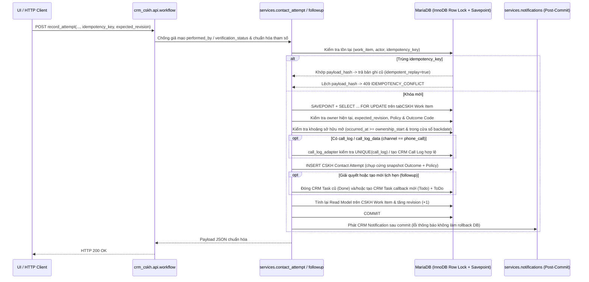

# P2 Exit Report — CRM-CSKH Giai đoạn P2 (Thành phần Backend `P2-WP00..WP06` & `WP10`)

> **Dự án:** CRM-CSKH — Quản trị kho khách hàng, phân phối lead và chất lượng chăm sóc khách hàng
> **Tài liệu:** [`docs/P2-Exit-Report.md`](./P2-Exit-Report.md)
> **Kế hoạch gốc:** [`docs/root-plan/P2.md`](./root-plan/P2.md) (§14, §15, §16, §17, §18)
> **Ngày đóng gói thành phần Backend:** 04/11/2026
> **Thực hiện bởi:** **T1B** (Phụ trách Backend P2: `P2-WP00–WP06` và phần Backend/CI/Benchmark/Docs của `P2-WP10`)
> **Baseline xuất phát (`main`):** `1913d2bd5ebfdc894eaa492b46be502dbdf44808` (CI P0 `#41658199683` `success`, CI P1 `#41658199861` `success`)
> **Nhánh & Worktree bàn giao:** `codex/p2-foundation` (`D:/HRP-app/p2-foundation`) — **OPEN PR hướng `main`, KHÔNG tự merge, KHÔNG tự ký `GO P3` (quyền kiểm định & phê duyệt thuộc T1C / T0 / Owner)**

---

## Tóm tắt Điều hành

Trên nhánh `codex/p2-foundation`, **T1B** đã hoàn tất toàn bộ phần Backend của Giai đoạn P2 (`P2-WP00..WP06` và phần Backend/CI/Benchmark/Docs của `P2-WP10`) từ đúng baseline `main` `1913d2bd5ebfdc894eaa492b46be502dbdf44808`:

1. **Bảo toàn khóa phiên bản & không vá thêm upstream:** Giữ nguyên Frappe Framework `v15.123.1` (`d2efa79657ba5c1abf96098b3bfacc199517d57e`) và Frappe CRM `v1.87.0` (`0d3910b456ef4fb913e77b29db011b3debc4f778`); **`0` tệp vá core/upstream mới** trong P2.
2. **Mô hình sự kiện liên hệ bất biến & lịch hẹn chuẩn:** Triển khai `CSKH Outcome Code` (`12` mã tiếng Việt chuẩn), `CSKH Policy` (`Campaign > Team > Global`), `CSKH Contact Attempt` (append-only, snapshot phiên bản Outcome + Policy + khoảng sở hữu), `CSKH Attempt Correction` (`correct | void | restore`), và mở rộng trực tiếp `CSKH Work Item` + `CSKH Assignment History` + `CRM Lead` (`DNC`) + `CRM Task` (`callback`) mà không sinh bất kỳ bảng trùng lặp nào với P1 hay Frappe CRM.
3. **Không hồi quy 100% P0 & P1:** Suite P0 (`99/99` core + `8/8` auxiliary), Suite P1 (`209/209` backend + `12/12` UI), Suite P2 riêng (`33/33` backend JUnit), HTTP Transport Probe P2 (`61/61` case), Backup/Restore Smoke (`PASS`), và Benchmark thực nghiệm `10.000` Work Item / `50.000` Contact Attempt / `25` worker đồng thời (`reconcile ok=true`, `0` lỗi, `0` slow query, `0` InnoDB lock wait) đều đạt trọn vẹn.

---

## Trả lời Đầy đủ `12` Câu hỏi Nghiệm thu Bắt buộc (`P2.md` §18.3)

### 1. Tái sử dụng trực tiếp bao nhiêu thành phần upstream, chỉnh sửa thực tế bao nhiêu file upstream, và lý do kiến trúc

- **Số file mã nguồn upstream (`apps/frappe`, `apps/crm`, `deploy/dev/patches/*`) bị chỉnh sửa thêm trong P2:** **`0` file**. Toàn bộ P2 được triển khai 100% bên trong custom app `apps/crm_cskh` thông qua cơ chế chính thống của Frappe (`DocType`, `Custom Field`, `patches.txt`, `hooks.py`: `permission_query_conditions`, `has_permission`, `doc_events`, `after_request`, `override_whitelisted_methods`).
- **Các thực thể & cơ chế upstream được REUSE / EXTEND trực tiếp (xem chi tiết tại [`docs/P2-entry-report.md`](./P2-entry-report.md) §3):**
  1. `CRM Lead` (`crm/fcrm/doctype/crm_lead/crm_lead.json`) — **EXTEND** bằng `4` Custom Field tuân thủ `cskh_do_not_contact`, `cskh_dnc_reason`, `cskh_dnc_at`, `cskh_dnc_work_item`; không sửa `CRMLead` controller và không tự động ghi đè `CRM Lead.status`.
  2. `CRM Task` (`crm/fcrm/doctype/crm_task/crm_task.json`) — **EXTEND** bằng `7` Custom Field `cskh_*` làm tác vụ hẹn chăm sóc lại (callback); không tạo DocType `Followup Task` trùng lặp.
  3. `CRM Call Log` (`crm/fcrm/doctype/crm_call_log/crm_call_log.json`) — **REUSE trực tiếp** qua [`services/call_log_adapter.py`](../apps/crm_cskh/crm_cskh/services/call_log_adapter.py) với liên kết 1–1 tùy chọn từ `CSKH Contact Attempt.call_log` (`UNIQUE`).
  4. `FCRM Note` (`crm/fcrm/doctype/fcrm_note/fcrm_note.json`) — **REUSE trực tiếp** làm ghi chú tự do trên hồ sơ Lead, tách biệt với nhật ký sự kiện `CSKH Contact Attempt`.
  5. `CRM Sales Hierarchy`, `ToDo`, `DocShare`, `CRM Notification` — **REUSE trực tiếp** cùng hệ thống sở hữu `services/ownership.py` và phân quyền P0/P1.
- **Lý do tạo mới đúng `4` DocType trong `crm_cskh` (`CSKH Outcome Code`, `CSKH Policy`, `CSKH Contact Attempt`, `CSKH Attempt Correction`):** Frappe CRM `v1.87.0` chỉ có `CRM Call Log` (bắt buộc SĐT `from`/`to` cho kênh thoại, cho phép sửa trực tiếp, không có từ điển kết quả đa kênh hay phiên bản chính sách) và `FCRM Note` (văn bản tự do không cấu trúc). Bốn DocType P2 giải quyết đúng khoảng trống nghiệp vụ đa kênh, bất biến và kiểm toán hiệu chỉnh.

---

### 2. Tác động lên dữ liệu & migration P1; chứng minh tính lặp lại và khôi phục (Backup/Restore)

- **Không phá vỡ dữ liệu P1:**
  - Mọi cột mới trên `CSKH Work Item` đều nullable hoặc có giá trị mặc định an toàn (`revision=1`, `attempt_count=0`, `connected_attempt_count=0`, `policy_version=1`).
  - Các trạng thái P1 cũ (`queued`, `assigned`, `revoked`, `closed`) giữ nguyên tên và ý nghĩa; chỉ bổ sung thêm `in_progress` và `on_hold` vào tập đang sở hữu `OWNED_ACTIVE_WORK_ITEM_STATES = ("assigned", "in_progress", "on_hold")`.
  - Mọi kiểm tra P1 đã được rà soát từng dòng (capacity, Active Claim, distribution load/reconcile, `my_list`, Pool, Dashboard, `L-23`, `L-29`) và chứng minh bằng **`209/209` test Backend P1 PASS** + **`12/12` test UI P1 PASS** + **`99/99` test P0 PASS**.
- **Idempotency của Migration (`bench migrate` × 2):**
  - Patch [`patches/v2_0/p2_schema_and_seeds.py`](../apps/crm_cskh/crm_cskh/patches/v2_0/p2_schema_and_seeds.py) kiểm tra tồn tại trước khi tạo từng Custom Field (`13` trường `cskh_*`), từng chỉ mục MariaDB (`15` chỉ mục P2) và từng bản ghi seed (`12` Outcome Code + Policy `GLOBAL-DEFAULT`), đồng thời backfill `revision = 1` mà không ghi đè cấu hình đã chỉnh sửa.
- **Chứng minh Backup & Restore thực tế ([`p2-backup-restore-smoke-20261103.json`](../deploy/dev/evidence/p2-runtime-20261103/restore/p2-backup-restore-smoke-20261103.json)):**
  - Chạy `bench --site p2dev.localhost backup`, khôi phục bản sao lưu SQL sang site độc lập `p2restore.localhost`, chạy `bench --site p2restore.localhost migrate`, và hậu kiểm tự động:
    - Số lượng bản ghi trên cả `10` DocType (`CRM Lead`: `25`, `CSKH Campaign`: `8`, `CSKH Work Item`: `12`, `CSKH Active Claim`: `10`, `CSKH Assignment History`: `16`, `CSKH Outcome Code`: `12`, `CSKH Policy`: `2`, `CSKH Contact Attempt`: `4`, `CSKH Attempt Correction`: `2`, `CRM Task`: `4`) **khớp 100%** (`counts_match: true`).
    - `reconcile_p2_invariants()` trên site khôi phục đạt `ok: true`, và các khóa chống ghi trùng (`idempotency_key`, `payload_hash`) được bảo toàn nguyên vẹn (`restored_has_idempotency_record: true`).

---

### 3. Minh chứng vòng đời `3 Attempts + Follow-up + Close`

- **Phía Backend API & HTTP thật (đã kiểm chứng đầu-cuối):**
  1. **Unit/Integration (`test_p2_lifecycle.py::TestP2WorkItemLifecycle.test_full_state_lifecycle_assigned_in_progress_on_hold_closed`):** Đi trọn chu trình từ `assigned` → Attempt #1 (`no_answer`, `connected=0`, chuyển `in_progress`) → Attempt #2 kèm hẹn gọi lại (`callback_requested`, tạo `CRM Task` `Todo`, chuyển `on_hold`, đồng bộ `next_action_due`) → Attempt #3 (`connected_interested`, `complete_open_followup=True` chuyển `CRM Task` sang `Done`, về `in_progress`) → `close_work_item` (`status="closed"`, giải phóng `CSKH Active Claim`, đóng khoảng sở hữu `ownership_end`, xóa `lead_owner`/`DocShare`/`ToDo`).
  2. **HTTP Transport thật (`ci_p2_http_probe.py`):** Thực thi trực tiếp qua `bench serve` chuỗi đăng nhập → ghi Attempt #1 (`no_answer`) → đặt hẹn `schedule_followup` (`on_hold`) → `ownership.reassign(A -> B)` → `Staff B` ghi Attempt #2 liên kết `CRM Call Log` + giải quyết callback (`Done`) → yêu cầu & duyệt `Correction` → `close_work_item` → `Leader A` `reopen_work_item` → `close_work_item` cuối (`61/61 PASS`).
- **Phía Giao diện Trình duyệt (Video / Screenshot UI):** Thuộc phạm vi gói công việc `P2-WP07..WP09` của **T1A** trên nhánh UI, sẽ được ghép vào hồ sơ tích hợp cuối trước cổng kiểm định T1C.

---

### 4. Sơ đồ Kiến trúc API Tạo Attempt / Task / Call Log & Cơ chế Idempotency

- **Lược đồ Idempotency hai tầng:**
  1. **Tầng DB Constraint:** Chỉ mục duy nhất `cskh_attempt_idem_uq (work_item, performed_by, idempotency_key)` trên `tabCSKH Contact Attempt` và `cskh_corr_req_idem_uq (requested_by, idempotency_key)` trên `tabCSKH Attempt Correction`, kết hợp lưu trữ lịch sử khóa trong `cskh_task_history_json` của `CRM Task` và `event_id` của `CSKH Assignment History`.
  2. **Tầng Fingerprint (`payload_hash` SHA-256):** Gửi lại đúng payload cũ trả về HTTP `200` (`idempotent_replay: true`); gửi lại cùng khóa nhưng đổi tham số nghiệp vụ bị chặn ngay bằng HTTP `409 IDEMPOTENCY_CONFLICT`.

---

### 5. Chứng minh `Call Log != Connected`, `Gửi tin chưa phản hồi != Connected` & Timeline Không Đếm Trùng

1. **Bất biến cứng ở cấp Model & Seed (`p2_models.py:46-48, 594-601`):**
   - Hằng số `UNREACHED_DISCONNECTED_CODES = {"no_answer", "busy", "unreachable", "message_sent_no_reply", "wrong_number"}` cưỡng chế ngay trong `CSKHOutcomeCode.validate()`: mọi nỗ lực bật `is_connected = 1` trên 5 mã này đều ném `ValidationError` kể cả qua Admin API hay ORM.
2. **`CRM Call Log` không đồng nghĩa `Connected` (`call_log_adapter.py` & `test_p2_calllog_followup.py`):**
   - Tạo `CRM Call Log` rời hoặc thêm `FCRM Note` / general `CRM Task` giữ nguyên `attempt_count == 0` và `connected_attempt_count == 0` (`test_fcrm_note_general_crm_task_and_standalone_call_log_never_inflate_counters`).
   - Ngay cả khi liên kết một `CRM Call Log` có `status = "Completed"` (ví dụ tổng đài tự động/hộp thư thoại bắt máy) với mã kết quả `no_answer` hoặc `unreachable`, cờ `connected` của Attempt vẫn bằng **`0`** theo đúng `CSKH Outcome Code`.
   - Ràng buộc `cskh_attempt_call_log_uq UNIQUE (call_log)` chặn tuyệt đối việc liên kết một `CRM Call Log` vào 2 Attempt (`409 ALREADY_LINKED`).
3. **Timeline không đếm trùng (`read_model.py`):**
   - Timeline đọc duy nhất từ sổ cái `CSKH Contact Attempt` (kèm thông tin tóm tắt `call_log_summary` và `callback_task` nhúng trên chính dòng Attempt đã liên kết), kết hợp cột mốc bàn giao `ownership_milestones` tách riêng; một cuộc gọi gắn cả `Call Log` + `Attempt` + `Task` luôn chỉ tính đúng **`1` Attempt**.

---

### 6. Kiểm thử Đua Đồng thời `A -> B` Trong Lúc `A` Submit, Chuyển Callback Task & Quyền Trước/Sau

- **Đua song song trên 2 kết nối MariaDB thật (`test_p2_concurrency_chaos.py::TestP2RealMariaDbRacesAndRollbackChaos.test_parallel_double_submit_and_record_attempt_vs_reassign_race_preserve_invariants`):**
  - Luồng 1 (`Staff A`) gọi `contact_attempt.record_attempt` đồng thời với Luồng 2 (`CRM Admin`) gọi `ownership.reassign(A -> B)` cùng rào chắn `threading.Barrier(2)`.
  - Nhờ `SELECT ... FOR UPDATE` trên cùng hàng `tabCSKH Work Item`:
    - Nếu `A` vào khóa trước: Attempt của `A` được ghi hợp lệ vào khoảng sở hữu của `A` (`performed_by = A`), ngay sau đó `reassign` đóng khoảng sở hữu của `A` và mở khoảng mới cho `B` mà vẫn giữ trạng thái `in_progress`/`on_hold`.
    - Nếu `reassign` vào khóa trước: `A` đọc thấy `assigned_to == B != A` và bị từ chối sạch với `409 OWNERSHIP_CHANGED` (`0` bản ghi mồ côi).
- **Chuyển giao Callback `CRM Task` (`ownership.py` + `followup.reassign_open_followup_in_tx`):**
  - Khi `Work Item` đang `on_hold` được `reassign(A -> B)`, callback `CRM Task` đang mở được chuyển `assigned_to = B`, đóng `ToDo` của `A`, mở `ToDo` cho `B`, ghi sự kiện `reassigned_handover` vào `cskh_task_history_json`, và **giữ nguyên tuyệt đối `due_date` gốc** (không reset hạn).
- **Thu hồi quyền tức thời của `A` (`test_p2_permissions_sec.py` & HTTP cases `p2-http-staff-a-revoked-*`):**
  - Ngay sau khi `reassign(A -> B)` commit, mọi yêu cầu của `Staff A` tới `workflow.get_work_item`, `/api/resource/CSKH Contact Attempt/*`, `/api/resource/CRM Task/*`, `/api/resource/CRM Call Log/*` đều trả **`403`**, và mọi lệnh ghi trả **`409 OWNERSHIP_CHANGED`**.

---

### 7. Kiểm chứng Quyền trên Native `CRM Call Log` / `CRM Task` / `FCRM Note` API & Vấn đề Tồn dư

- **Cơ chế bảo vệ đa tầng đã triển khai và kiểm chứng:**
  1. **Đọc (`permission_query_conditions` + `has_permission`):** Tái sử dụng lưới P0 (`linked_lead_query_conditions`, `linked_lead_has_permission` trong `permissions.py`) cho `CRM Call Log`, `CRM Task`, `FCRM Note`, `Comment`, `File`, kết hợp [`p2_permissions.py`](../apps/crm_cskh/crm_cskh/p2_permissions.py) cho 4 DocType P2 và nâng cấp `assignment_history_*` trong `p1_permissions.py` để sau khi `Lead` chuyển sang người/team khác (`L-23`), chủ cũ / team cũ mất quyền đọc lịch sử.
  2. **Ghi/Xóa trực tiếp qua Generic Frappe API (`/api/resource/*`, `frappe.client.*`, Desk):**
     - `CSKH Contact Attempt` & `CSKH Attempt Correction`: `DocPerm` tắt hoàn toàn `create/write/delete` cho mọi vai trò nghiệp vụ + `has_permission` trả `False` cho mọi `ptype != "read"` + controller `before_save`/`on_trash` chặn sửa/xóa kể cả khi gọi nội bộ với `ignore_permissions=True`.
     - `CRM Task`: hook `doc_events["CRM Task"]` (`p2_permissions.guard_crm_task_mutation` & `guard_crm_task_trash`) chặn mọi thao tác tạo/sửa/đóng/xóa trực tiếp trên callback CSKH (`cskh_is_followup == 1` hoặc cố tự gán `cskh_work_item`) từ bên ngoài `followup` service; các `CRM Task` thông thường không gắn `cskh_is_followup` của Frappe CRM vẫn hoạt động bình thường.
- **Vấn đề tồn dư (Residual Risk):** **`0` lỗi Critical/High mở.** Ghi nhận một lưu ý thiết kế có chủ đích (đã nêu trong `ADR-P2-05`): nhân viên sở hữu hợp pháp một `CRM Lead` vẫn có thể tạo `CRM Call Log` hoặc `FCRM Note` gốc của Frappe CRM trên chính Lead mình đang giữ, nhưng hệ thống **không bao giờ tự động cộng** các bản ghi rời này vào `attempt_count` hay `connected_attempt_count` cho đến khi đi qua `workflow.record_attempt`.

---

### 8. Cơ chế Hiệu chỉnh (`Correction`), Kiểm toán (`Audit`), `Effective View` & Quyền Phê duyệt

- **Bất biến bản ghi gốc:** Dòng `CSKH Contact Attempt` không bao giờ bị `UPDATE` hay `DELETE` sau khi `insert`.
- **Ba hành động kiểm toán trong `CSKH Attempt Correction` (`services/correction.py`):**
  1. `correct`: Đề xuất sửa một tập trường cho phép (`outcome_code`, `channel`, `occurred_at`, `note`, `call_log`); hệ thống kiểm tra lại toàn bộ quy tắc tương thích kênh, backdate, khoảng sở hữu và chụp cứng snapshot mới của `outcome_code` vào `corrected_fields_json`.
  2. `void`: Hủy hiệu lực một Attempt ghi nhầm (ví dụ bấm nhầm khách); dòng gốc vẫn hiển thị trên timeline với cờ `is_voided = true` để minh bạch kiểm toán, nhưng bị loại khỏi `attempt_count`, `connected_attempt_count`, `last_outcome_code` và `progress_summary`.
  3. `restore`: Khôi phục hiệu lực cho một Attempt đã bị `void` trước đó (chỉ dành cho `CSKH CRM Admin`).
- **Quyền yêu cầu & phê duyệt:**
  - `Sales User` chỉ được tạo yêu cầu `pending` trên Attempt do chính mình thực hiện khi Work Item vẫn thuộc quyền truy cập; truyền `auto_approve=true` bị từ chối `403 FORBIDDEN`.
  - `Sales Manager` chỉ được duyệt (`approve`/`reject`) yêu cầu thuộc phạm vi team của mình **khi và chỉ khi** chính sách hiệu lực cho phép `allow_leader_review_correction == 1` (kiểm tra fail-closed trong `test_policy_disabling_leader_correction_review_enforced_fail_closed`).
  - `CSKH CRM Admin` có quyền duyệt toàn hệ thống và thực hiện `auto_approve=true` có lý do kiểm toán bắt buộc.

---

### 9. Việt hóa `vi_VN` & Xử lý Thuật ngữ (`docs/glossary-vi.md`)

- **Phía Backend (Hoàn tất 100%):**
  - Toàn bộ `12` mã kết quả `CSKH Outcome Code` mặc định có nhãn và mô tả tiếng Việt chuẩn nghiệp vụ (`Không nghe máy`, `Máy bận`, `Thuê bao không liên lạc được`, `Đã gửi tin nhắn, chưa phản hồi`, `Sai số / Không đúng người`, `Đã trao đổi — Cần chăm sóc tiếp`, `Đã trao đổi — Quan tâm`, `Khách hẹn gọi / liên hệ lại`, `Đã trao đổi — Không nhu cầu`, `Hoàn tất mục tiêu chiến dịch`, `Yêu cầu ngừng liên hệ (DNC)`, `Khác (ghi rõ nội dung)`).
  - Toàn bộ thông báo lỗi nghiệp vụ P2 (`FOLLOWUP_REQUIRED`, `NOTE_REQUIRED`, `OUTCOME_NOT_COMPATIBLE`, `BACKDATE_NOT_ALLOWED`, `OWNERSHIP_CHANGED`, `STALE_WORK_ITEM`, ...) sử dụng tiếng Việt rõ nghĩa, không trộn chuỗi tiếng Anh thô.
  - Đã bổ sung đầy đủ chuỗi dịch P2 vào [`apps/crm_cskh/crm_cskh/translations/vi.csv`](../apps/crm_cskh/crm_cskh/translations/vi.csv) (`645` dòng; kiểm toán tự động `deploy/p1/check_translations_audit.py` đạt **`0` missing, `0` untranslated, `0` orphan**) và chuẩn hóa bảng thuật ngữ xuyên suốt P0–P2 tại [`docs/glossary-vi.md`](./glossary-vi.md).
- **Phía Giao diện Trình duyệt (`Staff`, `Leader`, `Admin`, `BOD` screenshots):** Thuộc phạm vi `P2-WP07..WP09` của **T1A**.

---

### 10. Báo cáo Hiệu năng Thực nghiệm (`10.000` Work Item / `50.000` Attempt / `25` Worker), CPU/RAM & Slow Queries

> **Nguyên tắc trung thực (`P2.md` §15.4):** Toàn bộ con số dưới đây được trích nguyên bản từ tệp đo thực tế [`deploy/dev/evidence/p2-runtime-20261103/benchmark/p2-benchmark-20261103.json`](../deploy/dev/evidence/p2-runtime-20261103/benchmark/p2-benchmark-20261103.json) trên site cô lập `p2bench.localhost` (container DEV MariaDB `11.8` + Python `3.14`); **không tự đặt ngưỡng SLA giả định**.

#### 10.1. Quy mô dữ liệu & Tài nguyên tổng thể
- **Tập dữ liệu trên `p2bench.localhost`:** `10.000` `CSKH Work Item`, `50.000` `CSKH Contact Attempt` (trong đó `P2B-WI-00000` có **`120` attempt**), `2.020` open callback `CRM Task`, `520` approved `CSKH Attempt Correction`, phân bổ đều trên `2` Team / **`25` nhân viên (`Staff`)** (thời gian nạp bulk: `22,089s`; tổng thời gian chạy toàn bộ kịch bản benchmark + đối soát: `82,61s`).
- **Tài nguyên & MariaDB toàn phiên:** RSS khởi điểm `128,28 MiB` → **Peak RSS `326,0 MiB`**; Python `tracemalloc` peak heap **`105,45 MiB`**; CPU `66,938s user` / `4,479s sys`; tổng truy vấn `14.284`; **`slow_queries_delta = 0`**; **`innodb_row_lock_waits_delta = 0` (`0 ms`)**.
- **Đối soát bất biến hậu kiểm (`reconcile_p2_invariants` trên toàn bộ `10.000` Work Item & `50.025` Attempt):** **`ok = true`** trong **`11,321s`** (`0` vi phạm trên cả 9 hạng mục kiểm tra).

#### 10.2. Độ trễ Ghi Giao dịch Thực tế (Single-Worker Microbenchmark)

| Thao tác dịch vụ (kèm `frappe.db.commit()`) | Số mẫu | `min` (ms) | `p50` (ms) | `p95` (ms) | `max` (ms) | `mean` (ms) |
|---|---:|---:|---:|---:|---:|---:|
| `contact_attempt.record_attempt` | `100` | `40,844` | **`51,054`** | `88,301` | `349,347` | `59,714` |
| `followup.schedule_followup` (tạo & dời lịch) | `40` | `28,724` | **`39,231`** | `51,963` | `115,879` | `40,190` |
| `request_correction` + `review_correction(approve)` | `20` | `83,321` | **`94,050`** | `138,190` | `222,107` | `104,259` |

#### 10.3. Độ trễ Đọc, Lọc & Phân trang trên DB `10.000` Work Item / `50.000` Attempt

| Truy vấn / Endpoint dịch vụ | Actor | `p50` (ms) | `p95` (ms) | Số câu SQL / lần gọi | Kích thước JSON (bytes) |
|---|---|---:|---:|---:|---:|
| `list_work_items` (mặc định trang 1, `page_size=20`) | `Staff` | **`14,858`** | `20,312` | `2` | `17.449` |
| `list_work_items(followup_filter="overdue")` | `Staff` | **`8,712`** | `11,334` | `2` | `17.448` |
| `list_work_items(status="in_progress")` | `Leader` | **`77,076`** | `85,034` | `4` | `16.855` |
| `list_work_items(followup_filter="today")` | `CRM Admin` | **`13,772`** | `20,375` | `2` | `17.694` |
| `get_work_item_detail` (`P2B-WI-00000`) | `Staff` | **`26,100`** | `36,877` | `13` | `2.059` |
| `list_attempts_timeline` (`120` attempt, `page=1`, `size=20`) | `Staff` | **`22,192`** | `53,559` | `4` | `26.983` |
| `list_attempts_timeline` (`120` attempt, `page=6`, `size=20`) | `Staff` | **`21,991`** | `28,435` | `4` | `26.881` |
| `list_followups(bucket="overdue", page=1, size=20)` | `Leader` | **`11,717`** | `12,601` | `4` | `11.489` |
| `list_followups(bucket="today", page=1, size=20)` | `Leader` | **`11,602`** | `12,555` | `4` | `11.529` |
| `progress_summary` (`~2.000` attempt cá nhân) | `Staff` | **`118,532`** | `119,316` | `11` | `872` |
| `progress_summary` (`~25.000` attempt cấp Team) | `Leader` | **`1.321,960`** | `1.323,481` | `41` | `3.414` |
| `progress_summary` (`50.000` attempt toàn hệ thống, `0` PII) | `BOD` | **`2.519,388`** | `2.728,906` | `58` | `6.418` |

- **Nhận xét kỹ thuật từ `EXPLAIN`:**
  - Hàng đợi nhân viên (`cskh_wi_queue_due_idx`), timeline 120 attempt (`cskh_attempt_wi_occ_idx`), lớp phủ hiệu chỉnh (`cskh_corr_attempt_status_idx`) và lịch hẹn quá hạn (`cskh_task_followup_due_idx`) đều đi đúng `range` / `ref` index scan với số hàng quét rất nhỏ (`1` đến `650` hàng).
  - Với `progress_summary` không truyền bộ lọc ngày trên tập `25k–50k` attempt (độ chọn lọc `50%–100%` bảng), hàm hiện tại chiếu lớp phủ `CSKH Attempt Correction` trong bộ nhớ Python nên mất `~1,32s` (Team `25k`) và `~2,52s` (System `50k`). Ở P3 khi xây dựng bảng tổng hợp KPI/SLA theo kỳ lớn hơn nữa, có thể đọc trực tiếp từ cột vật chất hóa hoặc rollup theo ngày/tuần mà không cần quét lại toàn bộ lịch sử không giới hạn ngày.

#### 10.4. Tải Đồng thời `25` Nhân viên (`ThreadPoolExecutor`, `25` kết nối MariaDB song song)
- **Tổng số thao tác:** `100` (`25` nhân viên × `4` thao tác: đọc hàng đợi → ghi `record_attempt` kèm tạo callback `CRM Task` → đọc timeline → đọc danh sách lịch hẹn) hoàn tất trong **`10,762s` wall-clock**.
- **Độ tin cậy & khóa DB:** **`error_count = 0`**, **`slow_queries_delta = 0`**, **`innodb_row_lock_waits_delta = 0`**, Peak RSS **`326,0 MiB`** (`list_work_items p50 = 638,867 ms`, `list_attempts_timeline p50 = 591,949 ms`, `list_followups p50 = 126,665 ms`, `record_attempt_with_followup p50 = 8.864,387 ms` dưới tải tranh chấp CPU Python GIL 25 luồng đồng thời trong một tiến trình đơn).

---

### 11. Tổng hợp Trạng thái `15` Cổng Nghiệm thu (`G2-01 .. G2-15`)

Chi tiết truy vết từng testcase nằm tại [`docs/test-evidence-p2.md`](./test-evidence-p2.md) (§5):

| Cổng | Phạm vi Backend (`T1B`) | Phụ thuộc Tích hợp Tiếp theo |
|---|---|---|
| **G2-01** Entry provenance | **ĐẠT** ([`docs/P2-entry-report.md`](./P2-entry-report.md), `ADR-P2-01..11`) | — |
| **G2-02** Schema & idempotent migration | **ĐẠT** (`4` DocType, `13` Custom Field, `15` Index, `bench migrate` × 2) | — |
| **G2-03** Work Item lifecycle | **ĐẠT** (`test_p2_lifecycle.py` `8/8 PASS`) | — |
| **G2-04** Outcome taxonomy (`12` mã tiếng Việt) | **ĐẠT** (`test_p2_outcomes_policy.py` `5/5 PASS`) | — |
| **G2-05** Immutable Contact Attempt | **ĐẠT** (`test_p2_corrections.py`, `ci_p2_http_probe.py`) | — |
| **G2-06** Unsuccessful != Connected | **ĐẠT** (`UNREACHED_DISCONNECTED_CODES` + deterministic counter tests) | — |
| **G2-07** Atomic & idempotent transactions | **ĐẠT** (`test_p2_concurrency_chaos.py` `5/5 PASS`) | — |
| **G2-08** Native `Call Log` / `Task` / `Note` reuse | **ĐẠT** (`0` file upstream bị vá thêm, `test_p2_calllog_followup.py` `4/4 PASS`) | — |
| **G2-09** Follow-up callback flow | **ĐẠT** (`schedule` / `reschedule` / `complete` / `cancel` + timezone buckets) | — |
| **G2-10** Safe ownership transfer `A -> B` | **ĐẠT** (bảo toàn hạn `due_date`, thu hồi tức thời quyền `A`, race test PASS) | — |
| **G2-11** Correction & audit trail | **ĐẠT** (`correct` / `void` / `restore` + effective view + policy gate) | — |
| **G2-12** Permissions, generic API & PII | **ĐẠT** (`test_p2_permissions_sec.py` `5/5`, HTTP `61/61`, P0 `99/99`, P1 `209/209`) | — |
| **G2-13** UI tiếng Việt (`vi_VN`) | **ĐẠT PHẦN BACKEND** (`645` dòng `vi.csv`, `0` thiếu, `docs/glossary-vi.md`) | Ghép màn hình UI & ảnh chụp vai trò của **T1A (`WP07–WP09`)** |
| **G2-14** Scoped operational progress (`0` KPI score) | **ĐẠT** (`progress_summary` đối soát khớp DB, `BOD` `0` PII) | — |
| **G2-15** Handoff P3 (CI, benchmark, backup/restore, docs) | **ĐẠT PHẦN BACKEND** (`.github/workflows/p2.yml`, `p2-benchmark`, `restore`, docs §18.2) | Tích hợp PR UI của **T1A**, kiểm định độc lập **T1C** & ký duyệt bởi **T0 / Owner** |

---

### 12. Dữ liệu Nền P2 Bàn giao Cho Giai đoạn P3 (SLA, QA & KPI), Giới hạn & Bước Tiếp theo

#### 12.1. Các trường & bất biến dữ liệu P2 đã sẵn sàng để P3 tiêu thụ trực tiếp (không cần migrate lại lịch sử)
1. **Đo thời gian phản hồi lần đầu (First Response / Speed-to-Lead SLA ở P3):**
   - Khoảng sở hữu chính xác trên `CSKH Assignment History` (`ownership_start`, `ownership_end`, `to_user`, `action`) kết hợp `CSKH Contact Attempt.occurred_at`, `recorded_at`, `ownership_event`, `performed_by` và `CSKH Work Item.first_attempt_at`.
2. **Đo tỷ lệ tiếp cận & chuyển đổi thực chất (không nhiễu bởi gọi nhỡ / gửi tin một chiều):**
   - Cờ chụp cứng bất biến trên từng `Attempt`: `contact_attempt_snapshot`, `connected_snapshot`, `interested_snapshot`, `terminal_snapshot`, `dnc_snapshot`, `outcome_group_snapshot`, `outcome_version_snapshot`, `policy_version_snapshot`, cộng lớp phủ `CSKH Attempt Correction` đã được chuẩn hóa qua `read_model.compute_effective_attempts()`.
3. **Đo kỷ luật thực hiện lịch hẹn (Callback Punctuality SLA ở P3):**
   - Trên `CRM Task` (`cskh_is_followup = 1`): `due_date`, `cskh_reschedule_count`, `cskh_source_attempt`, `cskh_completed_attempt`, `cskh_completion_reason` và nhật ký JSON `cskh_task_history_json` lưu đầy đủ lịch sử đặt hẹn, dời hẹn (kèm `old_due`, `new_due`, `reason`, `actor`), bàn giao `A -> B` (không reset hạn) và thời điểm hoàn tất.
4. **Đầu vào cho Kiểm định Chất lượng / Hậu kiểm Tổng đài (QA Verification ở P3):**
   - Trường `CSKH Contact Attempt.verification_status` (`self_reported | verified | disputed`) đã có sẵn và bị khóa cứng `self_reported` đối với nhân viên ở P2, sẵn sàng cho quy trình QA/tổng đài ở P3 đối chiếu băng ghi âm `CRM Call Log` để nâng lên `verified` hoặc đánh dấu `disputed`.

#### 12.2. Giới hạn có chủ đích đúng phạm vi P2 (`P2.md` §2.2)
- Chưa chấm điểm SLA, chưa xếp hạng nhân viên hay tính thưởng/phạt KPI (thuộc P3).
- Chưa tích hợp tự động tổng đài VoIP/SIP, SMS Gateway, Zalo OA hay Facebook Webhook (thuộc P3/P4).
- Phần giao diện trình duyệt Vue/HTML P2 (`WP07–WP09`) và bộ ảnh chụp màn hình 4 vai trò do **T1A** thực hiện trên nhánh UI riêng theo hợp đồng [`docs/api-contract-p2.md`](./api-contract-p2.md).

#### 12.3. Hành động tiếp theo đề xuất
1. **T1A** tích hợp nhánh Backend `codex/p2-foundation` với phần UI `WP07–WP09` và bổ sung ảnh chụp/video E2E trình duyệt cho `G2-13` / §18.3 mục 3 & 9.
2. **T1C** thực hiện kiểm định độc lập trên revision tích hợp (Backend + UI) và đối chiếu toàn bộ `G2-01..G2-15`.
3. **T0 / Owner** xem xét kết quả kiểm định để quyết định merge vào `main` và ký mở Giai đoạn P3.
