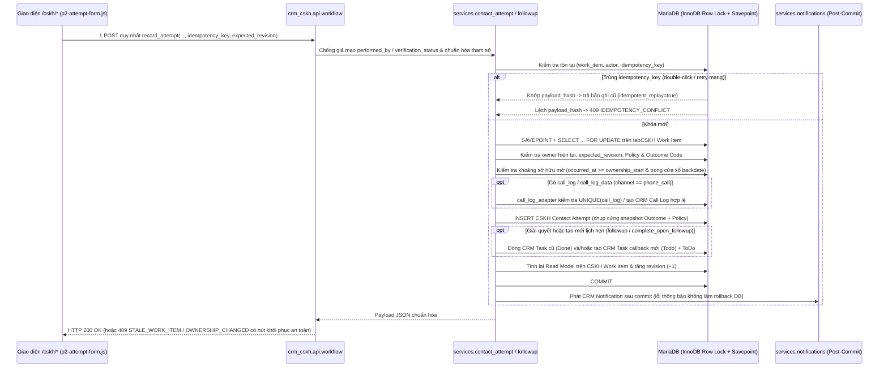

# P2 Exit Report — CRM-CSKH Giai đoạn P2 (Hồ sơ Tích hợp Backend `WP00–WP06` + Giao diện `WP07–WP09` + Kiểm chứng `WP10` & Đóng gói `WP11`)

> **Dự án:** CRM-CSKH — Quản trị kho khách hàng, phân phối lead và chất lượng chăm sóc khách hàng
> **Tài liệu:** [`docs/P2-Exit-Report.md`](./P2-Exit-Report.md)
> **Kế hoạch gốc:** [`docs/root-plan/P2.md`](./root-plan/P2.md) (§14, §15, §16, §17, §18) & ADR giao diện [`docs/architecture/adr-ui-001.md`](./architecture/adr-ui-001.md), [`docs/architecture/adr-p1-06-ui-integration.md`](./architecture/adr-p1-06-ui-integration.md)
> **Ngày đóng gói hồ sơ tích hợp (Đợt khắc phục Round 2):** 04/11/2026
> **Thực hiện bởi:**
> - **T1B (AI Coding — Backend):** `P2-WP00..WP06`, phần Backend/CI/Benchmark/Restore của `P2-WP10` (`6ef2e2e2` → `580a45f0`) & bản sửa khắc phục Backend Round 2 cho `F-P2-01/02/04/05/06` + `OBS-P2-01` (commit `16e69438a30deaa8de723594e3beaea92e91fecd`, `apps/` tree `3c3a8a6e8c29cfca49e8628ba104bec1dd2aec99`, nhánh `codex/p2-foundation` / PR #6)
> - **T1A (AI Coding — UI, i18n, Browser E2E & WP11):** `P2-WP07..WP09`, bản sửa khắc phục UI Round 2 cho `F-P2-04A`, `F-P2-05`, `F-P2-01`, E2E HTTP/Chromium thực tế & đóng gói tích hợp `P2-WP11` (Source & E2E code commit `0f3c7311c75aa3c49c3953a9b8cd64e45809d008`, `apps/` tree `f3b6db3ff80b3371ea5b991d7e5aaa408533007b`, nhánh `codex/p2-ui`, worktree `D:/HRP-app/p2-ui`, PR #7)
> **Baseline xuất phát (`main`):** `1913d2bd5ebfdc894eaa492b46be502dbdf44808` (CI P0 `#41658199683` `success`, CI P1 `#41658199861` `success`)
> **Phán quyết T1C hiện hành (bảo toàn nguyên trạng đến khi T1C kiểm định lại):** **`9/15 PASS` / `6/15 FAIL` — `GO P3 = NO-GO`** *(theo [`deploy/dev/evidence/p2-t1c/t1c-p2-verification-report.md`](../deploy/dev/evidence/p2-t1c/t1c-p2-verification-report.md) trên `26b0237` / `ffe74df`; `F-P2-03` = `CLOSED`, `5` finding `F-P2-01`, `F-P2-02`, `F-P2-04`, `F-P2-05`, `F-P2-06` đã được khắc phục kỹ thuật trên `0f3c731` và đang chờ **T1C** tái kiểm delta; chưa merge vào `main`, chưa ký `GO P3`)*

---

## Phán quyết Kiểm định Độc lập của T1C, Phê duyệt Cổng P2 → P3 & Truy vết SHA

| Hạng mục quản trị | Tài liệu / Đầu mối liên kết thực tế trong repo | Trạng thái hiện tại |
|---|---|---|
| **Bộ hồ sơ kiểm định độc lập của T1C (Round 1 — giữ nguyên từng byte)** | [`deploy/dev/evidence/p2-t1c/t1c-p2-verification-report.md`](../deploy/dev/evidence/p2-t1c/t1c-p2-verification-report.md), [`deploy/dev/evidence/p2-t1c/security-matrix-p2.md`](../deploy/dev/evidence/p2-t1c/security-matrix-p2.md), [`deploy/dev/evidence/p2-t1c/test-evidence-p2.md`](../deploy/dev/evidence/p2-t1c/test-evidence-p2.md), [`manifest.json`](../deploy/dev/evidence/p2-t1c/manifest.json), [`SHA256SUMS.txt`](../deploy/dev/evidence/p2-t1c/SHA256SUMS.txt) *(kèm [`t1c-p2-entry-baseline-1913d2b.json`](../deploy/dev/evidence/p2-t1c/artifacts/t1c-p2-entry-baseline-1913d2b.json), [`t1c-p2-runtime-26b0237.json`](../deploy/dev/evidence/p2-t1c/artifacts/t1c-p2-runtime-26b0237.json), [`t1c-p2-ffe74df-audit.json`](../deploy/dev/evidence/p2-t1c/artifacts/t1c-p2-ffe74df-audit.json))* | Phán quyết đã ký của **T1C** trên `26b0237` / `ffe74df`: **`9 PASS` (`G2-01, G2-02, G2-05..G2-11`) / `6 FAIL` (`G2-03, G2-04, G2-12..G2-15`)**, `F-P2-03` = `CLOSED`, `F-P2-01/02/04/05/06` đang `OPEN` chờ **T1C** tái kiểm delta trên SHA tích hợp Round 2 — *T1A/T1B tuyệt đối không sửa hồ sơ T1C và không tự tuyên bố đóng finding từ CI xanh* |
| **Truy vết bảo mật & bằng chứng kỹ thuật Round 2 (`T1B + T1A`)** | [`docs/security-matrix-p2.md`](./security-matrix-p2.md), [`docs/test-evidence-p2.md`](./test-evidence-p2.md), [`deploy/p2/evidence/http-e2e-report.json`](../deploy/p2/evidence/http-e2e-report.json), [`deploy/p2/evidence/browser-manifest.json`](../deploy/p2/evidence/browser-manifest.json) | Đã chạy mới trực tiếp trên Source SHA sạch `0f3c7311c75aa3c49c3953a9b8cd64e45809d008` (`apps` tree `f3b6db3ff80b3371ea5b991d7e5aaa408533007b`): `6/6` cụm HTTP E2E `PASS` + `22/22` kịch bản & ảnh chụp Chromium `B2E-01..B2E-22` `PASS` (`0` SĐT thô, `0` secret) |
| **Quyết định chuyển pha (`GO P3` / `NO-GO P3`)** | Thẩm quyền phê duyệt của **T0 / Owner** trên cơ sở verdict tái kiểm độc lập của **T1C** | **HIỆN HÀNH: `NO-GO` (CHỜ T1C TÁI KIỂM DELTA & CHƯA KÝ `GO P3`)** |

### Bảng Truy vết Revision Thực tế (`Source SHA`, `Packaging SHA`, `App Tree SHA` & `CI Synthetic Merge SHA`)

| Mốc revision | Commit SHA / Tree SHA thực tế | Nội dung & ý nghĩa kiểm chứng |
|---|---|---|
| **Baseline `main` nghiệm thu P0/P1** | `1913d2bd5ebfdc894eaa492b46be502dbdf44808` | Điểm xuất phát của `codex/p2-foundation` và `codex/p2-ui`; Entry Gate `G2-01` đã được T1C xác minh độc lập (`PASS`). |
| **Backend P2 Round 1 (`T1B`, PR #6)** | `6ef2e2e21c9e8265efe43fd5413074b70849a674` → `580a45f0d823267f6845fec083d56ead00d29681` (`apps` tree: `21f2fc434a031d50256d5302a0c8247c12a788b8`) | Schema, state machine, Outcome/Policy, Contact Attempt, Correction, permissions, benchmark `10k/50k`, backup/restore & cổng `p2-http-completeness-gate.json` (`61/61` HTTP assertions). |
| **Tích hợp P2 Round 1 — Baseline tích hợp lần này (`PR #7`)** | `d3da46b16a6d800d5d8cf866fc06415f9f02253f` → `26b02379adbc8a50a2bee6eb3bd91ec5d5b6b6ce` → `ffe74df22b85c1d5ecda9dc2f1bdc3015b5bae10` (`apps` tree: `4a395ae619f95a1feb0fbf9ec189063af2938f76`; CI merge `faa6dfb33e4972a9aa5488858cfd0a46e0e45b04`) | Mốc T1C đã kiểm định toàn trình (`9 PASS / 6 FAIL`, đóng `F-P2-03` trên `ffe74df`, mở `F-P2-01, F-P2-02, F-P2-04, F-P2-05, F-P2-06`). |
| **Backend P2 Round 2 Remediation (`T1B`, PR #6)** | `49b25bb6313b2b29323aa2d1c13d24e55e563a8b` → `d1cd196316e4daf4699214118fff8d187ccd570e` → **`16e69438a30deaa8de723594e3beaea92e91fecd`** (`apps` tree: `3c3a8a6e8c29cfca49e8628ba104bec1dd2aec99`) | Khắc phục phần Backend của `F-P2-01`, `F-P2-02`, `F-P2-04A/04B`, `F-P2-05`, `F-P2-06` + `OBS-P2-01`, bổ sung `test_p2_t1c_regressions.py` (`5/5`) và mở rộng `ci_p2_http_probe.py` lên `81/81` assertions (CI PR #6: P0 `#41779348055`, P1 `#41779348111`, P2 `#41779347989` đều `success`). |
| **Code Tích hợp & E2E Round 2 (`T1A + T1B` — `<SOURCE_CODE_SHA>`)** | **`0f3c7311c75aa3c49c3953a9b8cd64e45809d008`** (`HEAD^1 = ffe74df2`, `HEAD^2 = 16e69438`; `apps` tree: **`f3b6db3ff80b3371ea5b991d7e5aaa408533007b`**) | Hợp nhất trực tiếp commit `16e69438` của T1B với bản sửa UI `F-P2-04A`/`F-P2-05`/`F-P2-01`, bộ hồ sơ T1C Round 1 nguyên vẹn (`deploy/dev/evidence/p2-t1c/*`), `375/375` JUnit `PASS`, chạy trực tiếp `verify_p2_http_e2e.py` (`6/6 PASS`) & `verify_p2_browser_e2e.mjs` (`22/22 PASS`, ảnh `01..22`). |
| **Packaging tích hợp cuối trên PR #7 (`<PACKAGING_SHA>`) & `CI Merge SHA`** | Commit `HEAD` của nhánh `codex/p2-ui` ngay trên `0f3c7311c75aa3c49c3953a9b8cd64e45809d008` (`HEAD:apps == f3b6db3ff80b3371ea5b991d7e5aaa408533007b`); GitHub Actions `pull_request` chạy trên `refs/pull/7/merge` (`workflow-metadata.json -> commit_sha`) | Chỉ đóng gói evidence E2E vừa đo trên `0f3c731` (`deploy/p2/evidence/*`) và đồng bộ `docs/{P2-Exit-Report.md,test-evidence-p2.md,security-matrix-p2.md}` (`0` byte thay đổi trong `apps/`); SHA đầy đủ của commit đóng gói cuối và `CI Merge SHA` thực tế được ghi trực tiếp trên mô tả PR #7 & biên bản bàn giao. |

---

## Bảng Ánh xạ Khắc phục Kỹ thuật Round 2 (`F-P2-01`, `F-P2-02`, `F-P2-04`, `F-P2-05`, `F-P2-06`)

> **Lưu ý quản trị:** Bảng dưới đây trình bày ánh xạ thay đổi kỹ thuật và bằng chứng tự đo của `T1B + T1A` trên `0f3c7311c75aa3c49c3953a9b8cd64e45809d008` để phục vụ kiểm định delta của **T1C**. Trạng thái chính thức của cả 5 finding được giữ nguyên là **`Chờ T1C tái kiểm`** (không tự đóng từ kết quả CI/E2E nội bộ).

| Finding (T1C Round 1) | Thay đổi Backend (`T1B` — `16e69438`) | Thay đổi Giao diện & Adapter (`T1A` — `0f3c731`) | Bằng chứng Kiểm thử (JUnit, CI HTTP `81/81`, Live HTTP E2E & Browser E2E) | Trạng thái kiểm định |
|---|---|---|---|---|
| **`F-P2-01`** (`HIGH` — `G2-12`, `G2-13`, `G2-15`): Rò PII/lý do `permlevel=1` sang `BOD` trên 5 mặt phẳng qua `CSKH Assignment History.reason` & lộ `[H:<16hex>]` trên UI | Tách `reason` trung tính (`permlevel=0`), `private_reason` (`permlevel=1`), `payload_hash` (`permlevel=1, hidden=1`) trên `CSKH Assignment History`; không chép `note` tự do vào `reason` khi auto-close DNC; migration `migrate_p2_assignment_history_privacy()` làm sạch dòng cũ & tách `[H:<16hex>]` bảo toàn idempotency; `p1_permissions.py`, `guarded_crm.py`, `guarded_reporting.py`, `api/ownership.py` chặn `BOD` đọc/filter/search/sort/group `private_reason` & `payload_hash` trên cả 5 mặt phẳng. | `public/cskh/work-item.js` (`formatMilestoneReason`) hiển thị nhãn tiếng Việt sạch từ payload server, không lộ `[H:<16hex>]` và **không dùng thao tác ẩn DOM** để thay cho backend bảo vệ dữ liệu `BOD`. | `test_p2_t1c_regressions.py::test_f_p2_01_*`, `test_ui_p2_pages_and_context.py::test_remediation_ui_*`, CI HTTP `p2-http-f01-*`, Live HTTP `P2-E2E-05`, Browser **`B2E-22`** ([`22-leader-a-closed-reopened-milestones-clean.png`](../deploy/p2/evidence/screenshots/22-leader-a-closed-reopened-milestones-clean.png)). | *Đã sửa trên `0f3c731` — Chờ T1C tái kiểm* |
| **`F-P2-02`** (`MEDIUM` — `G2-03`, `G2-15`): `api/run_history.py` lọc cứng `status = 'assigned'`, làm rơi số lượng phân bổ của `Sales Manager` khi sang `in_progress`/`on_hold` | `api/run_history.py` bảo toàn số lượng phân bổ lịch sử theo đợt chạy (`allocation_semantics = "historical_run_allocation"` từ lịch sử cấp phát đợt chạy, không rơi qua `in_progress`, `on_hold`, `closed`, `reassign`, `revoke`), đồng thời trả thêm `active_owned` / `active_owned_total` theo `OWNED_ACTIVE_WORK_ITEM_STATES` và giữ nguyên phạm vi đội `L-24`. | Tương thích trực tiếp với hợp đồng `run_history.runs` hiện hữu. | `test_p2_t1c_regressions.py::test_f_p2_02_*`, CI HTTP `p2-http-f02-*`, Live HTTP `P2-E2E-05`. | *Đã sửa trên `0f3c731` — Chờ T1C tái kiểm* |
| **`F-P2-04A` & `F-P2-04B`** (`MEDIUM` — `G2-03`, `G2-13`, `G2-15`): `/cskh/my-customers` lọc care-state trên 20 dòng trang hiện tại; `list_work_items(status="closed", assignee=...)` trả `0` dòng | `services/read_model.py::list_work_items` & `api/workflow.py` lọc `care_state` ở tầng SQL **trước** `COUNT(*)` và `LIMIT/OFFSET` (`unattempted`/`not_contacted` [chỉ `assigned`/`in_progress` có `attempt_count=0` & không DNC], `attempted`, `attempted_not_connected`, `connected`, `on_hold`, `followup_due`, `followup_overdue`, `closed`, `do_not_contact`); bổ sung `CSKH Work Item.owner_at_close` (backfill qua migration) để lọc `status="closed"` theo `assignee` khớp `coalesce(nullif(owner_at_close, ''), closed_by)`. | Bỏ hoàn toàn lọc client-side `matchesClientCareFilter`/`filteredCount` trong `public/cskh/my-customers.js`; truyền `care_state` + `status` qua `public/cskh/p2-api.js`; `pager.setTotal(serverTotal)` lấy đúng `total` từ server; đổi chip/tìm kiếm/chiến dịch tự reset về trang `1`; bổ sung bộ lọc trạng thái (gồm `Hoàn tất` / `closed`) + phân trang độc lập cho bảng phạm vi quản lý `#mine-scope-card`. | `test_p2_t1c_regressions.py::test_f_p2_04_*`, Node `test_p2_ui_timezone_and_contracts.mjs`, CI HTTP `p2-http-f04-*`, Live HTTP `P2-E2E-05`, Browser **`B2E-18`**, **`B2E-19`**, **`B2E-20`** ([`18-staff-a-multipage-page2.png`](../deploy/p2/evidence/screenshots/18-staff-a-multipage-page2.png), [`19-staff-a-connected-filter-finds-page2.png`](../deploy/p2/evidence/screenshots/19-staff-a-connected-filter-finds-page2.png), [`20-staff-a-closed-completed-filter.png`](../deploy/p2/evidence/screenshots/20-staff-a-closed-completed-filter.png)). | *Đã sửa trên `0f3c731` — Chờ T1C tái kiểm* |
| **`F-P2-05`** (`MEDIUM` — `G2-14`, `G2-15`): `progress_summary` làm rơi phát sinh trong ngày `date_to="YYYY-MM-DD"`, thiếu bộ đếm distinct Work Item đã/chưa thử/đã kết nối & gắn sai nhãn `dnc_leads` | `services/read_model.py::progress_summary` chuẩn hóa `date_to` dạng ngày sang khoảng nửa mở `[start_of_day, start_of_next_day)` (`end_bound_mode = "exclusive"`) theo múi giờ site/user (`Asia/Ho_Chi_Minh`), chặn ngày sai/đảo ngược (`400 INVALID_REQUEST`), và bổ sung `cohort_work_items`, `attempted_work_items`, `unattempted_work_items`, `connected_work_items`, `dnc_leads`, `dnc_work_items` đối soát khớp SQL. | `www/cskh/progress.html` & `public/cskh/progress.js` hiển thị tách biệt hàng `#prog-wi-coverage-metrics` (`Công việc chưa thử liên hệ`, `Công việc đã thử liên hệ`, `Công việc đã thử, chưa kết nối`, `Công việc đã kết nối`), khối `Lần liên hệ hiệu lực`, và thẻ riêng `#prog-dnc-card` mang nhãn **`Số khách hàng ngừng liên hệ (DNC)`** (đơn vị khách hàng `CRM Lead`, không ghi là Work Item), kèm huy hiệu múi giờ `#prog-tz-badge` & nạp danh sách chiến dịch cá nhân cho `Sales User`. | `test_p2_t1c_regressions.py::test_f_p2_05_*`, Node `test_p2_ui_timezone_and_contracts.mjs`, CI HTTP `p2-http-f05-*`, Live HTTP `P2-E2E-05`, Browser **`B2E-12`**, **`B2E-21`** ([`12-bod-progress-all-zero-pii.png`](../deploy/p2/evidence/screenshots/12-bod-progress-all-zero-pii.png), [`21-staff-a-progress-sameday-cross-tz.png`](../deploy/p2/evidence/screenshots/21-staff-a-progress-sameday-cross-tz.png)). | *Đã sửa trên `0f3c731` — Chờ T1C tái kiểm* |
| **`F-P2-06`** (`HIGH` — `G2-04`, `G2-12`, `G2-15`): `Sales User`/`Sales Manager` sửa trực tiếp `CRM Lead.cskh_do_not_contact` qua REST PUT vượt mặt quy trình P2 và `override_dnc` của Admin | Đặt `read_only=1` cho 4 trường `cskh_do_not_contact` / `cskh_dnc_*` trên `CRM Lead`; gắn `doc_events["CRM Lead"]["validate"]` (`validate_cskh_lead_dnc_fields`) + `auth_hooks` (`enforce_lead_dnc_request_guard`) trả `403 FORBIDDEN` với mọi ghi trực tiếp qua REST v1/v2, `frappe.client.*`, Desk `savedocs` hay ORM ngoài service được phép; ghi `Comment` kiểm toán khi Admin gỡ/đặt DNC (`reopen_work_item(override_dnc=True)` / `settings.set_lead_dnc`). | Không mở bất kỳ biểu mẫu sửa trực tiếp cờ DNC nào cho Staff/Leader ngoài luồng `record_attempt(outcome_code="do_not_contact")`. | `test_p2_t1c_regressions.py::test_f_p2_06_*`, CI HTTP `p2-http-f06-*`, Live HTTP `P2-E2E-05`. | *Đã sửa trên `0f3c731` — Chờ T1C tái kiểm* |

*(Ghi chú bổ sung: tại commit `16e69438`, T1B đồng thời bọc `_run_with_tx_retry` cho `assign`/`reassign`/`revoke` trong `api/ownership.py` theo khuyến nghị không chặn `OBS-P2-01` của T1C).*

---

## Tóm tắt Điều hành & Phạm vi Tích hợp Thực tế (`16e69438` → `0f3c731`)

Trên nhánh tích hợp `codex/p2-ui` (hợp nhất có kiểm soát Backend `16e69438a30deaa8de723594e3beaea92e91fecd` của **T1B** với Giao diện/Việt hóa/E2E `0f3c7311c75aa3c49c3953a9b8cd64e45809d008` của **T1A**), phạm vi khác biệt trong `apps/` giữa nhánh Backend và nhánh tích hợp được xác định minh bạch như sau:
- **Các module backend giữ nguyên `0` dòng diff so với `16e69438`:** toàn bộ `permissions.py`, `p1_permissions.py`, `p2_permissions.py`, `p1_models.py`, `p2_models.py`, `services/*`, `crm_cskh/doctype/**`, `fixtures/custom_field.json`, `patches/**`, `tests/test_p2_*.py` và mọi endpoint trong `api/` ngoại trừ `api/ownership_ui.py`.
- **Ngoại lệ có chủ đích trong tầng API & hook (`diff 16e69438..0f3c731`):**
  1. [`apps/crm_cskh/crm_cskh/api/ownership_ui.py`](../apps/crm_cskh/crm_cskh/api/ownership_ui.py) (`+21 / -24` dòng):
     - **Mở rộng tập trạng thái đang sở hữu (`active states`):** đổi điều kiện SQL từ `status = 'assigned'` sang `status in ('assigned', 'in_progress', 'on_hold')` trong cả truy vấn đếm tải `_campaign_ineligible_users` lẫn danh sách `assigned_list` (trả thêm `status` và `work_item_status`), giúp khách đang chăm sóc/hẹn lại không biến mất khỏi màn quản trị sở hữu và được tính đúng vào tải chiến dịch.
     - **Sửa điều kiện nhận khách theo phiên bản rule mới nhất của từng user (`rule eligibility` / `O-02`):** trong `_campaign_ineligible_users(campaign_name, allowed_nodes)`, thay cách lọc `max_version` toàn chiến dịch bằng gom nhóm `by_user` và tính `latest_version` riêng trên tập rule của từng `user`, rồi kiểm tra `enabled`, `weight > 0`, `team in allowed_nodes` và `capacity_limit` trên `enabled_latest` — được chứng minh bằng test `TestUiP2PagesAndContext.test_o02_ownership_ui_assignees_respects_per_user_latest_rule_version` tại [`test_ui_p2_pages_and_context.py`](../apps/crm_cskh/crm_cskh/tests/test_ui_p2_pages_and_context.py).
     - **Các helper thực tế đang dùng trong `ownership_ui.py`:** `assigned_list` dùng `reporting._scope(actor)` và `reporting._scope_users(scope)` (kèm `parse_pagination`, `parse_optional_str` từ `api._ui_params`); phần kiểm tra vai trò và lọc `assignees(campaign)` dùng các hàm nội bộ ngay trong module (`_roles`, `_is_system`, `_require_read`, `_can_mutate`, `_require_admin`, `_campaign_team_scope`, `_campaign_ineligible_users`), **chưa** gộp sang helper tập trung của `services/eligibility.py` hay `services/ownership.py`.
  2. [`apps/crm_cskh/crm_cskh/hooks.py`](../apps/crm_cskh/crm_cskh/hooks.py) (`+4 / -1` dòng) & [`crm_form_script.json`](../apps/crm_cskh/crm_cskh/fixtures/crm_form_script.json): chỉ bổ sung tên `"CSKH - Open Lead CSKH Workspace"` vào bộ lọc fixture `CRM Form Script`.

Các kết quả kỹ thuật cốt lõi đã hoàn tất từ tầng dữ liệu đến trải nghiệm trình duyệt tiếng Việt:

1. **Bảo toàn khóa phiên bản & chiến lược giao diện cùng Frappe site `/cskh/*`:** Giữ nguyên Frappe Framework `v15.123.1` (`d2efa79657ba5c1abf96098b3bfacc199517d57e`) và Frappe CRM `v1.87.0` (`0d3910b456ef4fb913e77b29db011b3debc4f778`); **`0` tệp vá core/upstream mới** trong P2, không dựng SPA tách rời và không sửa `Activities.vue` của upstream. Kết nối từ trang chi tiết `CRM Lead` sang hồ sơ CSKH dùng điểm mở rộng chuẩn `CRM Form Script` (`"CSKH - Open Lead CSKH Workspace"` → `/cskh/work-item?lead=<lead_id>`).
2. **Mô hình sự kiện liên hệ bất biến, trung thực & giao diện thao tác nguyên tử:**
   - **Backend (`WP00–WP06` + Round 2 fixes):** `CSKH Outcome Code` (`12` mã tiếng Việt chuẩn), `CSKH Policy` (`Campaign > Team > Global`), `CSKH Contact Attempt` (append-only, snapshot phiên bản Outcome + Policy + khoảng sở hữu), `CSKH Attempt Correction` (`correct | void | restore`), mở rộng trực tiếp `CSKH Work Item` (kèm `owner_at_close`) + `CSKH Assignment History` (tách `reason` trung tính / `private_reason` `permlevel=1` / `payload_hash` `permlevel=1, hidden=1`) + `CRM Lead` (`DNC` khóa `read_only=1` & `validate` guard) + `CRM Task` (`callback`).
   - **Giao diện `/cskh/*` (`WP07–WP09` + Round 2 fixes):** Nâng cấp `/cskh/my-customers` (lọc `care_state` và `status` hoàn toàn ở phía server với `total` thực từ DB cho cả nhiều trang + bảng phạm vi quản lý hỗ trợ lọc `Hoàn tất` theo nhân viên; form ghi kết quả nhanh gọi **đúng `1` POST orchestration** `workflow.record_attempt`), `/cskh/work-item` (dòng thời gian hợp nhất phân biệt rõ `Attempt` / `CRM Call Log` / `CRM Task` / `FCRM Note`, hiển thị `Nhân viên tự báo cáo`, không lộ `[H:<16hex>]`, không có nút sửa/xóa trực tiếp Attempt, xử lý rõ `409 STALE_WORK_ITEM` & `OWNERSHIP_CHANGED`), `/cskh/callbacks` (lịch hẹn theo biên múi giờ `23:59`/`00:00` site/user), `/cskh/progress` (hiển thị tách biệt số `Work Item` đã thử / chưa thử / đã thử chưa kết nối / đã kết nối, số `Lần liên hệ hiệu lực`, và `Số khách hàng ngừng liên hệ (DNC)`, đúng biên ngày `date_from == date_to` kể cả khi trình duyệt khác múi giờ site, `BOD` `0` PII), và `/cskh/settings` (cấu hình Outcome Code & Policy theo `capabilities` từ server).
3. **Kiểm chứng thực nghiệm đa tầng & bảo toàn 100% P0/P1:**
   - **`375/375` Frappe JUnit test method trên `24` module** (`P2 Backend` `38/38` trên `8` module gồm `test_p2_t1c_regressions` `5/5`, `P2 UI` `9/9`, `P1 Backend` `209/209`, `P1 UI` `12/12`, `P0 Core+Aux` `107/107`; *số liệu lịch sử Round 1 trên `ffe74df` là `369/369` gồm `33/33` P2 Backend + `8/8` P2 UI*), `72/72` AST guard P0, `6/6` Vite bootstrap test, Node timezone/contract unit suite (`PASS`), và `9/9` kiểm chứng âm cổng đo HTTP [`test_ci_p2_http_probe.py`](../deploy/dev/seed/test_ci_p2_http_probe.py).
   - **CI HTTP Transport Probe (`ci_p2_http_probe.py` trên `16e69438` / `0f3c731`):** **`total_records = 81`** (`14` HTTP record đăng nhập/CSRF có `check()` + `67` HTTP record kiểm chứng nghiệp vụ/bảo mật/khắc phục P2; `verification_records = 81`, `setup_observation_records = 0`, `asserted_cases = 81`, `passed_assertions = 81`, `unasserted_cases = 0`, khóa cứng bằng `p2-http-completeness-gate.json`; *các mốc lịch sử: snapshot cục bộ `03/11/2026` có `61`/`60`, Round 1 `ffe74df` có `61`/`61`*).
   - **Live HTTP E2E (`verify_p2_http_e2e.py`) & Real-Chromium Browser E2E (`verify_p2_browser_e2e.mjs`) trên `0f3c7311c75aa3c49c3953a9b8cd64e45809d008` (`apps` tree `f3b6db3ff80b3371ea5b991d7e5aaa408533007b`):** **`6/6` cụm kiểm tra HTTP E2E `PASS`** (gồm `P2-E2E-05-remediation-f-p2-01-02-04-05-06` & `P2-E2E-06-reconcile-p2-invariants ok=true`) và **`22/22` kịch bản & ảnh chụp trình duyệt `B2E-01..B2E-22` `PASS`** (`0` màn trắng, `0` lỗi console/page/asset/500, `0` SĐT thô trên DOM; *lịch sử Round 1 trên `d3da46b` là `5/5` HTTP E2E & `17/17` Browser E2E*).

---

## Trả lời Đầy đủ `12` Câu hỏi Nghiệm thu Bắt buộc (`P2.md` §18.3)

### 1. Tái sử dụng trực tiếp bao nhiêu thành phần upstream, chỉnh sửa thực tế bao nhiêu file upstream, và lý do kiến trúc

- **Số file mã nguồn upstream (`apps/frappe`, `apps/crm`, `deploy/dev/patches/*`) bị chỉnh sửa thêm trong P2 (cả Backend lẫn UI):** **`0` file**. Toàn bộ P2 được triển khai 100% bên trong custom app `apps/crm_cskh` thông qua cơ chế chính thống của Frappe (`DocType`, `Custom Field`, `CRM Form Script` fixture, `www/cskh/*` website routes, `patches.txt`, `hooks.py`).
- **Các thực thể & cơ chế upstream được REUSE / EXTEND trực tiếp (xem chi tiết tại [`docs/P2-entry-report.md`](./P2-entry-report.md) §3):**
  1. `CRM Lead` (`crm/fcrm/doctype/crm_lead/crm_lead.json`) — **EXTEND** bằng `4` Custom Field tuân thủ `cskh_do_not_contact`, `cskh_dnc_reason`, `cskh_dnc_at`, `cskh_dnc_work_item` (`read_only=1` + khóa ghi trực tiếp qua `validate_cskh_lead_dnc_fields` & `enforce_lead_dnc_request_guard`); không sửa `CRMLead` controller và không tự động ghi đè `CRM Lead.status`.
  2. `CRM Task` (`crm/fcrm/doctype/crm_task/crm_task.json`) — **EXTEND** bằng `7` Custom Field `cskh_*` làm tác vụ hẹn chăm sóc lại (callback); không tạo DocType `Followup Task` trùng lặp.
  3. `CRM Call Log` (`crm/fcrm/doctype/crm_call_log/crm_call_log.json`) — **REUSE trực tiếp** qua [`services/call_log_adapter.py`](../apps/crm_cskh/crm_cskh/services/call_log_adapter.py) với liên kết 1–1 tùy chọn từ `CSKH Contact Attempt.call_log` (`UNIQUE`).
  4. `FCRM Note` (`crm/fcrm/doctype/fcrm_note/fcrm_note.json`) — **REUSE trực tiếp** làm ghi chú nội bộ trên hồ sơ Lead, hiển thị tách biệt trên timeline `/cskh/work-item` với nhãn rõ `Ghi chú nội bộ — không tính vào số lần liên hệ`.
  5. `CRM Form Script` (`crm/fcrm/doctype/crm_form_script`) — **REUSE điểm mở rộng UI sạch của Frappe CRM** thông qua fixture [`crm_form_script.json`](../apps/crm_cskh/crm_cskh/fixtures/crm_form_script.json) (`"CSKH - Open Lead CSKH Workspace"`) gắn nút `"Mở hồ sơ CSKH"` trên màn chi tiết `CRM Lead` điều hướng sang `/cskh/work-item?lead=<lead_id>` mà không sửa `Activities.vue` hay `Lead.vue`.
  6. `CRM Sales Hierarchy`, `ToDo`, `DocShare`, `CRM Notification` — **REUSE trực tiếp** cùng hệ thống sở hữu `services/ownership.py` và phân quyền P0/P1.
- **Lý do tạo mới đúng `4` DocType trong `crm_cskh` (`CSKH Outcome Code`, `CSKH Policy`, `CSKH Contact Attempt`, `CSKH Attempt Correction`):** Frappe CRM `v1.87.0` chỉ có `CRM Call Log` (bắt buộc SĐT `from`/`to` cho kênh thoại, cho phép sửa trực tiếp, không có từ điển kết quả đa kênh hay phiên bản chính sách) và `FCRM Note` (văn bản tự do không cấu trúc). Bốn DocType P2 giải quyết đúng khoảng trống nghiệp vụ đa kênh, bất biến và kiểm toán hiệu chỉnh.

---

### 2. Tác động lên dữ liệu & migration P1; chứng minh tính lặp lại và khôi phục (Backup/Restore)

- **Không phá vỡ dữ liệu P1:**
  - Mọi cột mới trên `CSKH Work Item` (gồm `owner_at_close`) và `CSKH Assignment History` (`private_reason`, `payload_hash`) đều nullable hoặc có giá trị mặc định an toàn (`revision=1`, `attempt_count=0`, `connected_attempt_count=0`, `policy_version=1`).
  - Các trạng thái P1 cũ (`queued`, `assigned`, `revoked`, `closed`) giữ nguyên tên và ý nghĩa; chỉ bổ sung thêm `in_progress` và `on_hold` vào tập đang sở hữu `OWNED_ACTIVE_WORK_ITEM_STATES = ("assigned", "in_progress", "on_hold")`.
  - Mọi kiểm tra P1 đã được rà soát từng dòng (capacity, Active Claim, distribution load/reconcile, `run_history` lịch sử phân bổ & đang sở hữu, `my_list`, Pool, Dashboard, `L-23`, `L-29`) và chứng minh bằng **`209/209` test Backend P1 PASS** + **`12/12` test UI P1 PASS** + **`99/99` test P0 PASS** + cập nhật `ownership_ui.py` nhận diện đủ `('assigned', 'in_progress', 'on_hold')` và xét `latest_version` theo từng `user` (`O-02`).
- **Idempotency của Migration (`bench migrate` × 2):**
  - Patch [`patches/v2_0/p2_schema_and_seeds.py`](../apps/crm_cskh/crm_cskh/patches/v2_0/p2_schema_and_seeds.py) kiểm tra tồn tại trước khi tạo từng Custom Field (`13` trường `cskh_*`), từng chỉ mục MariaDB (`16` chỉ mục P2 gồm cả index trên `payload_hash` / `owner_at_close`), từng bản ghi seed (`12` Outcome Code + Policy `GLOBAL-DEFAULT`), đồng thời chạy idempotent bước làm sạch `migrate_p2_assignment_history_privacy()` (tách `[H:<16hex>]` sang `payload_hash`, chuyển lý do nhạy cảm sang `private_reason`, backfill `owner_at_close`); chạy `bench migrate` lặp lại trên `p2dev.localhost`, `p2-ci.localhost` và `p2.localhost` đều trả exit `0`.
- **Chứng minh Backup & Restore thực tế ([`p2-backup-restore-smoke-20261103.json`](../deploy/dev/evidence/p2-runtime-20261103/restore/p2-backup-restore-smoke-20261103.json) & cổng CI `p2-backup-restore-smoke.json`):**
  - Chạy `bench --site p2dev.localhost backup`, khôi phục bản sao lưu SQL sang site độc lập `p2restore.localhost`, chạy `bench --site p2restore.localhost migrate`, và hậu kiểm tự động:
    - Số lượng bản ghi trên cả `10` DocType (`CRM Lead`: `25`, `CSKH Campaign`: `8`, `CSKH Work Item`: `12`, `CSKH Active Claim`: `10`, `CSKH Assignment History`: `16`, `CSKH Outcome Code`: `12`, `CSKH Policy`: `2`, `CSKH Contact Attempt`: `4`, `CSKH Attempt Correction`: `2`, `CRM Task`: `4`) **khớp 100%** (`counts_match: true`).
    - `reconcile_p2_invariants()` trên site khôi phục đạt `ok: true`, và các khóa chống ghi trùng (`idempotency_key`, `payload_hash`) được bảo toàn nguyên vẹn (`restored_has_idempotency_record: true`). Quy trình tương tự được khóa tự động trong `.github/workflows/p2.yml` (`p2-ci.localhost` → `p2-restore.localhost` kèm `--with-files`).

---

### 3. Minh chứng vòng đời `Attempts + Follow-up + Handover + Correction + Close` từ API đến Trình duyệt

- **Phía Backend API & HTTP thật:**
  1. **Unit/Integration (`test_p2_lifecycle.py` & `test_p2_t1c_regressions.py`):** Đi trọn chu trình từ `assigned` → Attempt #1 (`no_answer`, `connected=0`, chuyển `in_progress`) → Attempt #2 kèm hẹn gọi lại (`callback_requested`, tạo `CRM Task` `Todo`, chuyển `on_hold`, đồng bộ `next_action_due`) → Attempt #3 (`connected_interested`, `complete_open_followup=True` chuyển `CRM Task` sang `Done`, về `in_progress`) → `close_work_item` (`status="closed"`, ghi `owner_at_close`, giải phóng `CSKH Active Claim`, đóng khoảng sở hữu `ownership_end`, xóa `lead_owner`/`DocShare`/`ToDo`).
  2. **HTTP Transport & Live E2E (`ci_p2_http_probe.py` trên `16e69438`/`0f3c731`: `81` verification HTTP record / `81` assertion `PASS`, `0` `setup_observation`, `0` `unasserted`, kèm `9/9` kiểm chứng âm [`test_ci_p2_http_probe.py`](../deploy/dev/seed/test_ci_p2_http_probe.py); và [`verify_p2_http_e2e.py`](../deploy/p2/verify_p2_http_e2e.py): `6/6` nhóm kiểm tra lớn `PASS`):** Đi trọn từ P1 CSV upload/preview/confirm → campaign rules → async distribution sang Work Item P2 → lọc server-side nhiều trang & lọc `closed` theo `assignee` → ghi kết quả đa kênh → liên kết `CRM Call Log` → lịch hẹn callback → `reassign(A -> B)` → hiệu chỉnh/void → đóng/mở lại không lộ `[H:<16hex>]` hay `private_reason` sang `BOD` → chặn `Sales User` sửa trực tiếp `cskh_do_not_contact` → tiến độ cùng ngày `date_from == date_to` → đối soát `reconcile_p2_invariants ok=true` ([`http-e2e-report.json`](../deploy/p2/evidence/http-e2e-report.json)). *(Lịch sử: snapshot cục bộ `03/11/2026` lưu tại `deploy/dev/evidence/p2-runtime-20261103/http/p2-http-transport.json` có `61`/`60`; Round 1 `ffe74df` có `61`/`61`).*
- **Phía Giao diện Trình duyệt Chromium Thật ([`verify_p2_browser_e2e.mjs`](../deploy/p2/verify_p2_browser_e2e.mjs) — `22/22 PASS` trên `0f3c731`, manifest tại [`browser-manifest.json`](../deploy/p2/evidence/browser-manifest.json)):**
  - Danh sách nhiều trang (`31` khách active), phân trang server-side tìm thấy khách `connected` chỉ nằm ở trang 2, lọc `Hoàn tất` (`closed`) theo nhân viên & ghi kết quả nhanh **1 POST duy nhất**: [`01-staff-a-my-customers-upgraded.png`](../deploy/p2/evidence/screenshots/01-staff-a-my-customers-upgraded.png), [`18-staff-a-multipage-page2.png`](../deploy/p2/evidence/screenshots/18-staff-a-multipage-page2.png), [`19-staff-a-connected-filter-finds-page2.png`](../deploy/p2/evidence/screenshots/19-staff-a-connected-filter-finds-page2.png), [`20-staff-a-closed-completed-filter.png`](../deploy/p2/evidence/screenshots/20-staff-a-closed-completed-filter.png), [`02-staff-a-after-quick-record.png`](../deploy/p2/evidence/screenshots/02-staff-a-after-quick-record.png).
  - Hồ sơ CSKH, dòng thời gian hợp nhất không lộ `[H:<16hex>]`, trung thực `Chưa kết nối` & an toàn XSS: [`03-staff-a-work-item-happy.png`](../deploy/p2/evidence/screenshots/03-staff-a-work-item-happy.png), [`04-staff-a-honesty-and-xss-safe.png`](../deploy/p2/evidence/screenshots/04-staff-a-honesty-and-xss-safe.png), [`22-leader-a-closed-reopened-milestones-clean.png`](../deploy/p2/evidence/screenshots/22-leader-a-closed-reopened-milestones-clean.png).
  - Xung đột `409 STALE_WORK_ITEM` & bàn giao `A -> B` (`0` lộ PII khi mở lại URL cũ, `Staff B` hoàn tất lịch hẹn nhận bàn giao): [`05-staff-a-stale-revision-conflict.png`](../deploy/p2/evidence/screenshots/05-staff-a-stale-revision-conflict.png), [`06-staff-a-after-transfer-forbidden-zero-leak.png`](../deploy/p2/evidence/screenshots/06-staff-a-after-transfer-forbidden-zero-leak.png), [`07-staff-b-handover-completed-callback.png`](../deploy/p2/evidence/screenshots/07-staff-b-handover-completed-callback.png).
  - Hiệu chỉnh bất biến (`pending` → `Leader A` duyệt → `Admin` vô hiệu `void`), lịch hẹn biên `23:59`/`00:00` & tiến độ cùng ngày khác múi giờ trình duyệt: [`08-staff-a-correction-pending.png`](../deploy/p2/evidence/screenshots/08-staff-a-correction-pending.png), [`09-leader-a-correction-approved.png`](../deploy/p2/evidence/screenshots/09-leader-a-correction-approved.png), [`10-admin-voided-attempt-excluded.png`](../deploy/p2/evidence/screenshots/10-admin-voided-attempt-excluded.png), [`11-staff-a-callbacks-schedule-boundaries.png`](../deploy/p2/evidence/screenshots/11-staff-a-callbacks-schedule-boundaries.png), [`21-staff-a-progress-sameday-cross-tz.png`](../deploy/p2/evidence/screenshots/21-staff-a-progress-sameday-cross-tz.png).

---

### 4. Sơ đồ Kiến trúc API Tạo Attempt / Task / Call Log & Cơ chế Idempotency

- **Kỷ luật phía UI ([`p2-attempt-form.js`](../apps/crm_cskh/crm_cskh/public/cskh/p2-attempt-form.js)):**
  - Một thao tác lưu luôn gọi **đúng một API orchestration** (`workflow.record_attempt`), tuyệt đối không nối chuỗi nhiều API ghi từ trình duyệt rồi coi là giao dịch (`B2E-02` kiểm chứng bộ đếm request mạng `recordPosts.length === 1`).
  - Khóa `idempotency_key` được giữ cố định trong suốt quá trình gửi/thử lại cùng dữ liệu (chống double-click `B2E-05`), và tự động xoay khóa mới ngay khi người dùng chỉnh sửa bất kỳ trường dữ liệu nào trên biểu mẫu.
- **Lược đồ Idempotency hai tầng phía Server:**
  1. **Tầng DB Constraint:** Chỉ mục duy nhất `cskh_attempt_idem_uq (work_item, performed_by, idempotency_key)` trên `tabCSKH Contact Attempt`, `cskh_corr_req_idem_uq (requested_by, idempotency_key)` trên `tabCSKH Attempt Correction`, và cột `payload_hash` riêng biệt trên `tabCSKH Assignment History` (không nhúng `[H:<16hex>]` vào chuỗi hiển thị).
  2. **Tầng Fingerprint (`payload_hash` SHA-256):** Gửi lại đúng payload cũ trả về HTTP `200` (`idempotent_replay: true`); gửi lại cùng khóa nhưng đổi tham số nghiệp vụ bị chặn ngay bằng HTTP `409 IDEMPOTENCY_CONFLICT`.

---

### 5. Chứng minh `Call Log != Connected`, `Gửi tin chưa phản hồi != Connected` & Timeline Không Đếm Trùng

1. **Bất biến cứng ở cấp Model & Seed (`p2_models.py`):**
   - Hằng số `UNREACHED_DISCONNECTED_CODES = {"no_answer", "busy", "unreachable", "message_sent_no_reply", "wrong_number"}` cưỡng chế ngay trong `CSKHOutcomeCode.validate()`: mọi nỗ lực bật `is_connected = 1` trên 5 mã này đều ném `ValidationError` kể cả qua Admin API hay ORM.
2. **`CRM Call Log`, `CRM Task` & `FCRM Note` không tự biến thành `Connected` (`call_log_adapter.py` & `work-item.js`):**
   - Tạo `CRM Call Log` rời (kể cả `status = "Completed"`), thêm `FCRM Note`, hay hủy `CRM Task` có lý do giữ nguyên `attempt_count == 0` / `connected_attempt_count == 0`.
   - Giao diện `/cskh/work-item` và `/cskh/callbacks` chặn hoàn tất lịch hẹn rỗng: nút `Ghi kết quả & hoàn tất` mở form `record_attempt(complete_open_followup=true)`, còn nhánh hủy bắt buộc nhập lý do kiểm toán và hiển thị rõ thông báo `Đã đóng lịch hẹn theo lý do hủy (không tính là đã kết nối)` cùng huy hiệu cảnh báo trên từng thẻ timeline (`Nhiệm vụ — không tự tính là lần liên hệ hay đã kết nối`, `Chưa gắn lần liên hệ (không tự tính số lần liên hệ)`, `Ghi chú nội bộ — không tính vào số lần liên hệ` — đối chứng trực quan tại [`04-staff-a-honesty-and-xss-safe.png`](../deploy/p2/evidence/screenshots/04-staff-a-honesty-and-xss-safe.png)).
   - Ràng buộc `cskh_attempt_call_log_uq UNIQUE (call_log)` chặn tuyệt đối việc liên kết một `CRM Call Log` vào 2 Attempt (`409 ALREADY_LINKED`).
3. **Timeline hợp nhất không đếm trùng (`read_model.py` + `work-item.js`):**
   - Bộ đếm trên đầu trang đọc duy nhất từ các `CSKH Contact Attempt` hiệu lực (`is_voided == false`), trong khi danh sách dòng thời gian hiển thị phân loại trực quan từng loại bản ghi (`Lần liên hệ CSKH`, `Nhật ký cuộc gọi (CRM)`, `Lịch hẹn / Nhiệm vụ (CRM)`, `Ghi chú nội bộ (CRM)`, `Lịch sử phụ trách`) kèm bộ lọc theo loại mà không bao giờ cộng gộp nhầm sang số lần liên hệ.

---

### 6. Kiểm thử Đua Đồng thời `A -> B` Trong Lúc `A` Submit, Chuyển Callback Task & Quyền Trước/Sau

- **Đua song song trên 2 kết nối MariaDB thật (`test_p2_concurrency_chaos.py` & `api/ownership.py`):**
  - Luồng 1 (`Staff A`) gọi `contact_attempt.record_attempt` đồng thời với Luồng 2 (`CRM Admin`) gọi `ownership.reassign(A -> B)` cùng rào chắn `threading.Barrier(2)`; cả `api/workflow.py` lẫn `api/ownership.py` đều đã bọc `_run_with_tx_retry` xử lý sạch `1020`/`1213`.
  - Nhờ `SELECT ... FOR UPDATE` trên cùng hàng `tabCSKH Work Item`:
    - Nếu `A` vào khóa trước: Attempt của `A` được ghi hợp lệ vào khoảng sở hữu của `A` (`performed_by = A`), ngay sau đó `reassign` đóng khoảng sở hữu của `A` và mở khoảng mới cho `B`.
    - Nếu `reassign` vào khóa trước: `A` đọc thấy `assigned_to == B != A` và bị từ chối sạch với `409 OWNERSHIP_CHANGED` (`0` bản ghi mồ côi).
- **Chuyển giao Callback `CRM Task` & kiểm chứng trình duyệt (`B2E-06`, `B2E-07`):**
  - Khi `Work Item` đang `on_hold` được `reassign(A -> B)`, callback `CRM Task` đang mở được chuyển sang `assigned_to = B`, đóng `ToDo` của `A`, mở `ToDo` cho `B`, ghi sự kiện `reassigned_handover` và **giữ nguyên tuyệt đối `due_date` gốc**.
  - Ngay sau khi chuyển giao, `Staff A` tải lại đúng URL `/cskh/work-item?id=...` đang mở trước đó nhận thông báo `[FORBIDDEN]`, ẩn sạch toàn bộ thẻ khách hàng và timeline (`0` rò rỉ PII — [`06-staff-a-after-transfer-forbidden-zero-leak.png`](../deploy/p2/evidence/screenshots/06-staff-a-after-transfer-forbidden-zero-leak.png)); `Staff B` mở cùng hồ sơ nhìn thấy lịch sử Attempt của `Staff A` kèm hạn callback gốc và hoàn tất thành công dưới tên `Staff B` ([`07-staff-b-handover-completed-callback.png`](../deploy/p2/evidence/screenshots/07-staff-b-handover-completed-callback.png)).

---

### 7. Kiểm chứng Quyền trên Native `CRM Call Log` / `CRM Task` / `FCRM Note` / `CRM Lead` API, Cổng Website `/cskh/*` & Vấn đề Tồn dư

- **Cơ chế bảo vệ đa tầng (Backend + Website Route Gate):**
  1. **Đọc (`permission_query_conditions` + `has_permission` + `guarded_crm.py` + `guarded_reporting.py`):** Tái sử dụng lưới P0 (`linked_lead_query_conditions`, `linked_lead_has_permission` trong `permissions.py` và `crm_cskh.api.guarded_crm.get_activities`) cho `CRM Call Log`, `CRM Task`, `FCRM Note`, `Comment`, `File`, kết hợp [`p2_permissions.py`](../apps/crm_cskh/crm_cskh/p2_permissions.py) cho 4 DocType P2, khóa quyền đọc lịch sử chủ cũ / team cũ sau chuyển giao (`L-23`), và tách `CSKH Assignment History.private_reason` (`permlevel=1`) + `payload_hash` (`permlevel=1, hidden=1`) để chặn hoàn toàn `CSKH BOD Viewer` nhận lý do riêng tư/PII trên cả 5 mặt phẳng (`F-P2-01`).
  2. **Cổng phân quyền cấp trang Website (`/cskh/*` — `cskh_context.py`):** Mọi route mới đều kiểm tra quyền ở phía máy chủ trước khi render HTML: `BOD` bị từ chối HTTP `403` ngay trên các route chứa PII (`/cskh/work-item`, `/cskh/callbacks` — [`14-bod-work-item-403-denied.png`](../deploy/p2/evidence/screenshots/14-bod-work-item-403-denied.png)), `Sales User` bị từ chối HTTP `403` trên `/cskh/settings`; frontend chỉ dùng `capabilities` để ẩn/hiện nút hợp lệ chứ không thay thế kiểm tra quyền backend.
  3. **Ghi/Xóa trực tiếp qua Generic Frappe API (`/api/resource/*`, `/api/v2/*`, `frappe.client.*`, Desk):**
     - `CSKH Contact Attempt` & `CSKH Attempt Correction`: tắt hoàn toàn `create/write/delete` + controller `before_save`/`on_trash` chặn sửa/xóa kể cả khi gọi nội bộ với `ignore_permissions=True`.
     - `CRM Task`: hook `doc_events["CRM Task"]` chặn mọi thao tác tạo/sửa/đóng/xóa trực tiếp trên callback CSKH (`cskh_is_followup == 1`) từ bên ngoài `followup` service.
     - `CRM Lead` (`cskh_do_not_contact` & `cskh_dnc_*`): khóa `read_only=1` + `validate_cskh_lead_dnc_fields` + `enforce_lead_dnc_request_guard` chặn mọi thao tác bật/gỡ DNC trái phép ngoài service CSKH được ủy quyền (`F-P2-06`).
- **Lưu ý thiết kế có chủ đích (`ADR-P2-05` & `OBS-P2-03`):** Nhân viên sở hữu hợp pháp một `CRM Lead` vẫn có thể tạo `CRM Call Log` hoặc `FCRM Note` gốc của Frappe CRM trên chính Lead mình đang giữ, nhưng cả Backend lẫn UI đều gắn nhãn phân biệt rõ và **không bao giờ tự động cộng** các bản ghi rời này vào `attempt_count` hay `connected_attempt_count`; với `File` riêng tư, P2 giữ nguyên ranh giới Frappe v15 của P0 (`OBS-P2-03`).

---

### 8. Cơ chế Hiệu chỉnh (`Correction`), Kiểm toán (`Audit`), `Effective View` & Quyền Phê duyệt

- **Bất biến bản ghi gốc & giao diện không sửa/xóa trực tiếp:** Dòng `CSKH Contact Attempt` không bao giờ bị `UPDATE` hay `DELETE`; trên `/cskh/work-item` hoàn toàn không có nút Sửa/Xóa Attempt mà chỉ có nút `Yêu cầu hiệu chỉnh / vô hiệu` (`B2E-03`).
- **Ba hành động kiểm toán trong `CSKH Attempt Correction` (`services/correction.py`):**
  1. `correct`: Đề xuất sửa một tập trường cho phép (`outcome_code`, `channel`, `occurred_at`, `note`, `call_log`); sau khi duyệt, UI hiển thị đồng thời giá trị hiệu lực mới và hộp `Bản ghi gốc` để đối chiếu minh bạch ([`09-leader-a-correction-approved.png`](../deploy/p2/evidence/screenshots/09-leader-a-correction-approved.png)).
  2. `void`: Hủy hiệu lực một Attempt ghi nhầm; dòng gốc vẫn nằm trên timeline với huy hiệu `Đã vô hiệu — không tính vào bộ đếm` nhưng bị loại khỏi `attempt_count`, `connected_attempt_count`, `last_outcome_code` và `progress_summary` ([`10-admin-voided-attempt-excluded.png`](../deploy/p2/evidence/screenshots/10-admin-voided-attempt-excluded.png)).
  3. `restore`: Khôi phục hiệu lực cho một Attempt đã bị `void` trước đó (chỉ dành cho `CSKH CRM Admin`).
- **Quyền yêu cầu & phê duyệt:** `Sales User` chỉ tạo yêu cầu `pending`; `Sales Manager` duyệt trong phạm vi team khi chính sách bật `allow_leader_review_correction == 1`; `CSKH CRM Admin` có quyền duyệt toàn hệ thống.

---

### 9. Việt hóa `vi_VN`, Xử lý Biên Múi giờ `23:59`/`00:00` & Bảng Thuật ngữ (`docs/glossary-vi.md`)

- **Từ điển dịch & kiểm toán tự động (`0` lỗi):**
  - Hợp nhất toàn bộ chuỗi Backend (`T1B`) và chuỗi Giao diện P1/P2 (`T1A` trong `p1_strings.py` + `p2_strings.py`) vào [`apps/crm_cskh/crm_cskh/translations/vi.csv`](../apps/crm_cskh/crm_cskh/translations/vi.csv) (**`912` dòng**) và chuẩn hóa bảng thuật ngữ xuyên suốt P0–P2 tại [`docs/glossary-vi.md`](./glossary-vi.md).
  - Kiểm toán tự động `python deploy/p1/check_translations_audit.py` đạt: `used strings: 446`, `declared strings: 696`, `vi.csv rows: 912`, **`missing declaration: 0`**, **`missing translation: 0`**, **`untranslated (EN): 0`**, **`orphan declaration: 0`**.
  - Kiểm chứng trình duyệt trên cả `5` nhân vật thuộc `4` nhóm vai trò (`Staff A`, `Staff B`, `Leader A`, `BOD`, `CRM Admin` — `B2E-01..B2E-22`): toàn bộ tiêu đề, điều hướng, cột bảng, chip lọc server-side, nhãn độ bao phủ `Work Item` vs `Số khách hàng ngừng liên hệ (DNC)`, trạng thái lịch hẹn, lịch sử phụ trách sạch (không có `[H:<16hex>]`), hộp thoại hiệu chỉnh, empty state và toast đều hiển thị tiếng Việt tự nhiên, `html[lang="vi"]` đạt `90/90` kiểm tra HTTP route.
- **Biên ngày giờ `23:59:59` / `00:00:00` & lọc cùng ngày theo đúng múi giờ Site/User (không lệ thuộc giờ máy tính):**
  - Tầng JS dùng chung [`cskh.js`](../apps/crm_cskh/crm_cskh/public/cskh/cskh.js) đọc `cskhBoot.userTimezone || cskhBoot.siteTimezone || 'Asia/Ho_Chi_Minh'` từ server context và định dạng/phân loại qua `Intl.DateTimeFormat(..., { timeZone })`; phía server `progress_summary` chuẩn hóa `date_from`/`date_to` theo khoảng nửa mở `[start_of_day, start_of_next_day)` trên cùng múi giờ site/user.
  - Đã kiểm chứng bằng cả Node unit suite ([`test_p2_ui_timezone_and_contracts.mjs`](../deploy/p2/test_p2_ui_timezone_and_contracts.mjs)) lẫn Chromium thật (`B2E-11` & `B2E-21`): phân loại lịch hẹn và lọc tiến độ cùng ngày (`date_from == date_to`) bao trọn biên `23:59:50` hôm nay và loại trừ đúng biên `00:00:05` ngày kế tiếp ngay cả khi trình duyệt chạy ở múi giờ `America/Los_Angeles` (`UTC-8`).

---

### 10. Báo cáo Hiệu năng Thực nghiệm (`10.000` Work Item / `50.000` Attempt / `25` Worker), CPU/RAM & Slow Queries

> **Nguyên tắc trung thực (`P2.md` §15.4 & `OBS-P2-02`):** Toàn bộ con số dưới đây được trích nguyên bản từ tệp đo thực tế [`deploy/dev/evidence/p2-runtime-20261103/benchmark/p2-benchmark-20261103.json`](../deploy/dev/evidence/p2-runtime-20261103/benchmark/p2-benchmark-20261103.json) (được commit tại `23a782bd58edaaef3e406fbc2b7e40622fb98d58`, SHA-256 `81c8b2afd4bc2d4279e0d0351099509f795d6cf4b7f2942261f7a84f219ae383`) do **T1B** thực hiện trên site cô lập `p2bench.localhost` (container DEV MariaDB `11.8` + Python `3.14`); **không tự đặt ngưỡng SLA giả định**. Lưu ý rõ giới hạn phép đo: kịch bản gọi trực tiếp hàm Python service trong tiến trình `bench execute` + `ThreadPoolExecutor(25)` (không đi qua live HTTP/WSGI).

#### 10.1. Quy mô dữ liệu & Tài nguyên tổng thể
- **Tập dữ liệu trên `p2bench.localhost`:** `10.000` `CSKH Work Item`, `50.000` `CSKH Contact Attempt` (trong đó `P2B-WI-00000` có **`120` attempt**), `2.020` open callback `CRM Task`, `520` approved `CSKH Attempt Correction`, phân bổ đều trên `2` Team / **`25` nhân viên (`Staff`)** (thời gian nạp bulk: `22,089s`; tổng thời gian chạy toàn bộ kịch bản benchmark + đối soát: `82,61s`).
- **Tài nguyên & MariaDB toàn phiên:** RSS khởi điểm `128,28 MiB` → **Peak RSS `326,0 MiB`**; Python `tracemalloc` peak heap **`105,45 MiB`**; CPU `66,938s user` / `4,479s sys`; tổng truy vấn `14.284`; **`slow_queries_delta = 0`**; **`innodb_row_lock_waits_delta = 0` (`0 ms`)**.
- **Đối soát bất biến hậu kiểm (`reconcile_p2_invariants` trên toàn bộ `10.000` Work Item & `50.025` Attempt):** **`ok = true`** trong **`11,321s`** (`0` vi phạm trên cả 9 hạng mục kiểm tra).

#### 10.2. Độ trễ Ghi Giao dịch Thực tế (Single-Worker Microbenchmark)

| Thao tác dịch vụ (kèm `frappe.db.commit()`) | Số mẫu | `min` (ms) | `p50` (ms) | `p95` (ms) | `max` (ms) | `mean` (ms) |
|---|---:|---:|---:|---:|---:|---:|
| `contact_attempt.record_attempt` | `100` | `40,844` | **`51,054`** | `88,301` | `349,347` | `59,714` |
| `followup.schedule_followup` (tạo & dời lịch) | `40` | `28,724` | **`39,231`** | `51,963` | `115,879` | `40,190` |
| `request_correction` + `review_correction(approve)` | `20` | `83,321` | **`94,050`** | `138,190` | `222,107` | `104,259` |

#### 10.3. Độ trễ Đọc, Lọc & Phân trang trên DB `10.000` Work Item / `50.000` Attempt

| Truy vấn / Endpoint dịch vụ | Actor | `p50` (ms) | `p95` (ms) | Số câu SQL / lần gọi | Kích thước JSON (bytes) |
|---|---|---:|---:|---:|---:|
| `list_work_items` (mặc định trang 1, `page_size=20`) | `Staff` | **`14,858`** | `20,312` | `2` | `17.449` |
| `list_work_items(followup_filter="overdue")` | `Staff` | **`8,712`** | `11,334` | `2` | `17.448` |
| `list_work_items(status="in_progress")` | `Leader` | **`77,076`** | `85,034` | `4` | `16.855` |
| `list_work_items(followup_filter="today")` | `CRM Admin` | **`13,772`** | `20,375` | `2` | `17.694` |
| `get_work_item_detail` (`P2B-WI-00000`) | `Staff` | **`26,100`** | `36,877` | `13` | `2.059` |
| `list_attempts_timeline` (`120` attempt, `page=1`, `size=20`) | `Staff` | **`22,192`** | `53,559` | `4` | `26.983` |
| `list_attempts_timeline` (`120` attempt, `page=6`, `size=20`) | `Staff` | **`21,991`** | `28,435` | `4` | `26.881` |
| `list_followups(bucket="overdue", page=1, size=20)` | `Leader` | **`11,717`** | `12,601` | `4` | `11.489` |
| `list_followups(bucket="today", page=1, size=20)` | `Leader` | **`11,602`** | `12,555` | `4` | `11.529` |
| `progress_summary` (`~2.000` attempt cá nhân) | `Staff` | **`118,532`** | `119,316` | `11` | `872` |
| `progress_summary` (`~25.000` attempt cấp Team) | `Leader` | **`1.321,960`** | `1.323,481` | `41` | `3.414` |
| `progress_summary` (`50.000` attempt toàn hệ thống, `0` PII) | `BOD` | **`2.519,388`** | `2.728,906` | `58` | `6.418` |

- **Nhận xét kỹ thuật từ `EXPLAIN` & `OBS-P2-02`:**
  - Hàng đợi nhân viên (`cskh_wi_queue_due_idx`), timeline 120 attempt (`cskh_attempt_wi_occ_idx`), lớp phủ hiệu chỉnh (`cskh_corr_attempt_status_idx`) và lịch hẹn quá hạn (`cskh_task_followup_due_idx`) đều đi đúng `range` / `ref` index scan với số hàng quét nhỏ (`1` đến `650` hàng).
  - Với `progress_summary` toàn kỳ không lọc ngày trên tập `25k–50k` attempt, truy vấn `attempt_summary_by_campaign_occurred` quét bảng (`type = "ALL"`, `48.650` dòng) và chiếu lớp phủ `CSKH Attempt Correction` trong bộ nhớ Python nên mất `~1,32s` (Team `25k`) và `~2,52s` (System `50k`). Ở P3 khi xây dựng bảng tổng hợp KPI/SLA quy mô lớn, sẽ dùng chỉ mục/bảng rollup theo kỳ.

#### 10.4. Tải Đồng thời `25` Nhân viên (`ThreadPoolExecutor(25)`, `25` kết nối MariaDB song song) & Giới hạn Phép đo
- **Tổng số thao tác:** `100` (`25` nhân viên × `4` thao tác: đọc hàng đợi → ghi `record_attempt` kèm tạo callback `CRM Task` → đọc timeline → đọc danh sách lịch hẹn) hoàn tất trong **`10,762s` wall-clock**.
- **Độ tin cậy & khóa DB:** **`error_count = 0`**, **`slow_queries_delta = 0`**, **`innodb_row_lock_waits_delta = 0`**, Peak RSS **`326,0 MiB`**.
- **Giới hạn phép đo thực nghiệm:** Tệp `p2-benchmark-20261103.json` (commit gốc `23a782bd58edaaef3e406fbc2b7e40622fb98d58`, chưa nhúng trường `commit_sha` nội tại) đo trực tiếp các hàm Python service trong 1 tiến trình `bench execute` với `ThreadPoolExecutor(25)` (chịu tranh chấp GIL Python ở luồng ghi đồng thời và chưa đi qua lớp HTTP/WSGI/reverse proxy TLS).

---

### 11. Tổng hợp Hồ sơ Kỹ thuật `15` Cổng Nghiệm thu (`G2-01 .. G2-15` — Đánh số chuẩn `P2.md` §17)

> **Nguyên tắc bảo toàn phán quyết độc lập:** Cột `Phán quyết T1C hiện hành` giữ nguyên chính xác verdict đã ký của **T1C** trên `26b0237` / `ffe74df` tại [`t1c-p2-verification-report.md`](../deploy/dev/evidence/p2-t1c/t1c-p2-verification-report.md) (**`9 PASS / 6 FAIL`**). Cột `Hồ sơ kỹ thuật Round 2 (T1B + T1A)` ghi nhận các bản sửa và bằng chứng tự đo trên `0f3c7311c75aa3c49c3953a9b8cd64e45809d008` đang bàn giao để **T1C** tái kiểm delta.

| Cổng (`P2.md` §17) | Hồ sơ kỹ thuật tích hợp Round 2 (`T1B` `16e69438` + `T1A` `0f3c731`) | Phán quyết `T1C` hiện hành (`ffe74df`) |
|---|---|---|
| **G2-01 — Entry provenance** | Đã đo & lưu trữ ([`docs/P2-entry-report.md`](./P2-entry-report.md), `ADR-P2-01..11`, baseline `1913d2b`) | **`PASS`** |
| **G2-02 — Schema/migration** | `4` DocType, `13` Custom Field, `16` Index MariaDB, migration privacy `F-P2-01` & `owner_at_close` `F-P2-04B` idempotent (`bench migrate` × 2 exit `0`) | **`PASS`** |
| **G2-03 — Lifecycle** | Đã tích hợp sửa `F-P2-02` (`run_history.py` bảo toàn phân bổ lịch sử + `active_owned`) & `F-P2-04B` (`owner_at_close` cho `list_work_items(status="closed", assignee=...)`), chứng minh qua `test_p2_t1c_regressions.py`, CI HTTP `81/81`, `P2-E2E-05`, `B2E-20` | **`FAIL`** *(trên `ffe74df` do `F-P2-02`, `F-P2-04B` — chờ T1C kiểm lại)* |
| **G2-04 — Outcome taxonomy** | `12` mã kết quả tiếng Việt + đã tích hợp sửa `F-P2-06` (`read_only=1` + `validate_cskh_lead_dnc_fields` + `enforce_lead_dnc_request_guard` chặn sửa trực tiếp `CRM Lead.cskh_do_not_contact`), chứng minh qua `test_p2_t1c_regressions.py`, CI HTTP `81/81`, `P2-E2E-05` | **`FAIL`** *(trên `ffe74df` do `F-P2-06` — chờ T1C kiểm lại)* |
| **G2-05 — Contact Attempt** | Sự kiện bất biến (append-only), chặn giả mạo `performed_by`/`verification_status`, kiểm tra khoảng sở hữu & backdate (`test_p2_corrections.py`, `B2E-03`) | **`PASS`** |
| **G2-06 — Unsuccessful ≠ Connected** | `UNREACHED_DISCONNECTED_CODES`, gửi tin chưa phản hồi & hủy callback không bao giờ tăng `connected` (`B2E-02`, `B2E-04`) | **`PASS`** |
| **G2-07 — Atomic & idempotent** | `1` POST orchestration duy nhất (`B2E-02`), chống double-submit & `409 STALE_WORK_ITEM` (`B2E-05`), retry MariaDB `1020`/`1213` trên cả `workflow.py` & `ownership.py` | **`PASS`** |
| **G2-08 — Native reuse** | Reuse trực tiếp `CRM Call Log`, `CRM Task`, `FCRM Note` + `CRM Form Script` (`0` file upstream bị sửa, `B2E-04`, `B2E-17`) | **`PASS`** |
| **G2-09 — Follow-up flow** | Tối đa `01` open callback `CRM Task`/WI, phân loại biên `23:59`/`00:00` đúng múi giờ site/user (`test_p2_ui_timezone_and_contracts.mjs`, `B2E-07`, `B2E-11`) | **`PASS`** |
| **G2-10 — Transfer safety** | `reassign(A -> B)` giữ hạn `due_date`, thu hồi tức thời quyền `A`, mở lại URL cũ `0` lộ PII (`B2E-06`, `B2E-07`) | **`PASS`** |
| **G2-11 — Correction/audit** | `0` nút sửa/xóa thẳng `Attempt`; hiệu chỉnh `correct` / `void` / `restore` lưu vết bản gốc + hiệu lực (`B2E-08..10`) | **`PASS`** |
| **G2-12 — Permissions & PII** | Đã tích hợp sửa `F-P2-01` (tách `private_reason` `permlevel=1` & `payload_hash` ẩn, chặn `BOD` trên cả 5 mặt phẳng, không dùng ẩn DOM thay backend) và `F-P2-06` (khóa ghi trực tiếp `CRM Lead.cskh_do_not_contact`); CI HTTP `81/81` `PASS`, P0 `107/107`, P1 `221/221` | **`FAIL`** *(trên `ffe74df` do `F-P2-01`, `F-P2-06` — chờ T1C kiểm lại)* |
| **G2-13 — UI tiếng Việt** | `vi.csv` `912` dòng (`0` lỗi) + đã tích hợp sửa `F-P2-04A` (lọc server-side & phân trang nhiều trang trên `/cskh/my-customers`, tìm thấy mục `connected` ở trang 2, lọc `Hoàn tất`) & `F-P2-01` (timeline không còn `[H:<16hex>]`), ảnh chụp `B2E-01..B2E-22` | **`FAIL`** *(trên `ffe74df` do `F-P2-04A`, `F-P2-01` — chờ T1C kiểm lại)* |
| **G2-14 — Progress basic** | Đã tích hợp sửa `F-P2-05`: `date_to` nửa mở bao trọn phát sinh cùng ngày theo `Asia/Ho_Chi_Minh`, hiển thị riêng `Work Item` đã thử / chưa thử / đã kết nối & nhãn `Số khách hàng ngừng liên hệ (DNC)`, kiểm chứng khác múi giờ trình duyệt (`B2E-12`, `B2E-21`) | **`FAIL`** *(trên `ffe74df` do `F-P2-05` — chờ T1C kiểm lại)* |
| **G2-15 — Handoff P3** | CI `.github/workflows/p2.yml` (`38` P2 backend + `9` P2 UI + `81/81` HTTP assertions + `p2-backup-restore-smoke.json`), Live HTTP E2E `6/6` & Browser E2E `22/22` trên `0f3c731`, giữ nguyên bộ hồ sơ T1C Round 1 | **`FAIL`** *(trên `ffe74df` do 5 finding mở — chờ T1C kiểm lại & T0/Owner ký)* |

---

### 12. Dữ liệu Nền P2 Bàn giao Cho Giai đoạn P3 (SLA, QA & KPI), Giới hạn & Bước Tiếp theo

#### 12.1. Các trường & bất biến dữ liệu P2 đã sẵn sàng để P3 tiêu thụ trực tiếp (không cần migrate lại lịch sử)
1. **Đo thời gian phản hồi lần đầu (First Response / Speed-to-Lead SLA ở P3):**
   - Khoảng sở hữu chính xác trên `CSKH Assignment History` (`ownership_start`, `ownership_end`, `to_user`, `action`, `payload_hash` tách biệt) kết hợp `CSKH Contact Attempt.occurred_at`, `recorded_at`, `ownership_event`, `performed_by`, `CSKH Work Item.first_attempt_at` và `owner_at_close`.
2. **Đo tỷ lệ tiếp cận & chuyển đổi thực chất (không nhiễu bởi gọi nhỡ / gửi tin một chiều):**
   - Cờ chụp cứng bất biến trên từng `Attempt`: `contact_attempt_snapshot`, `connected_snapshot`, `interested_snapshot`, `terminal_snapshot`, `dnc_snapshot`, `outcome_group_snapshot`, `outcome_version_snapshot`, `policy_version_snapshot`, cộng lớp phủ `CSKH Attempt Correction` đã được chuẩn hóa qua `read_model.compute_effective_attempts()`.
3. **Đo kỷ luật thực hiện lịch hẹn (Callback Punctuality SLA ở P3):**
   - Trên `CRM Task` (`cskh_is_followup = 1`): `due_date`, `cskh_reschedule_count`, `cskh_source_attempt`, `cskh_completed_attempt`, `cskh_completion_reason` và nhật ký JSON `cskh_task_history_json` lưu đầy đủ lịch sử đặt hẹn, dời hẹn (kèm `old_due`, `new_due`, `reason`, `actor`), bàn giao `A -> B` (không reset hạn) và thời điểm hoàn tất.
4. **Đầu vào cho Kiểm định Chất lượng / Hậu kiểm Tổng đài (QA Verification ở P3):**
   - Trường `CSKH Contact Attempt.verification_status` (`self_reported | verified | disputed`) đã có sẵn và bị khóa cứng `self_reported` đối với nhân viên ở P2 (hiển thị nhãn `Nhân viên tự báo cáo` trên UI), sẵn sàng cho quy trình QA/tổng đài ở P3 đối chiếu băng ghi âm `CRM Call Log` để nâng lên `verified` hoặc đánh dấu `disputed`.

#### 12.2. Giới hạn có chủ đích đúng phạm vi P2 (`P2.md` §2.2) & các mục theo dõi không chặn từ P1
- Chưa chấm điểm SLA, chưa xếp hạng nhân viên hay tính thưởng/phạt KPI (thuộc P3).
- Chưa tích hợp tự động tổng đài VoIP/SIP, SMS Gateway, Zalo OA hay Facebook Webhook (thuộc P3/P4).
- Về 2 mục không chặn sau nghiệm thu P1:
  - **`O-02` (UI — `ownership_ui.py`):** Đã xử lý lỗi lệch điều kiện nhận khách đa version tại [`ownership_ui.py`](../apps/crm_cskh/crm_cskh/api/ownership_ui.py) (`_campaign_ineligible_users` gom nhóm `by_user` để lấy `latest_version` riêng của từng nhân sự thay vì `max_version` toàn chiến dịch, đồng thời tính tải theo tập trạng thái P2 `('assigned', 'in_progress', 'on_hold')` cho cả `_campaign_ineligible_users` và `assigned_list`), được kiểm chứng bởi `TestUiP2PagesAndContext.test_o02_ownership_ui_assignees_respects_per_user_latest_rule_version` trong [`test_ui_p2_pages_and_context.py`](../apps/crm_cskh/crm_cskh/tests/test_ui_p2_pages_and_context.py). Ghi chú chính xác theo mã nguồn: `assigned_list` gọi `reporting._scope` & `reporting._scope_users`, còn kiểm tra vai trò và lọc rule/team/capacity của `assignees` vẫn dùng các hàm nội bộ trong `ownership_ui.py` (`_roles`, `_is_system`, `_require_read`, `_can_mutate`, `_require_admin`, `_campaign_team_scope`, `_campaign_ineligible_users`), chưa gộp sang helper tập trung của `services/eligibility.py`.
  - **`O-01` (Backend import chunking — mục tối ưu không chặn của P1):** Giữ nguyên trong backlog kỹ thuật không chặn theo đúng phạm vi không sửa logic P1 ngoài phần tương thích trạng thái P2.

#### 12.3. Hướng dẫn tái lập độc lập cho T1C & Hành động tiếp theo
1. **T1C** tái kiểm delta cho `F-P2-01`, `F-P2-02`, `F-P2-04`, `F-P2-05`, `F-P2-06` trên SHA tích hợp cuối của nhánh `codex/p2-ui` (PR #7, kèm kiểm toán bộ artifact CI `P0/P1/P2` mới) và ký cập nhật verdict độc lập trong bộ hồ sơ [`deploy/dev/evidence/p2-t1c/`](../deploy/dev/evidence/p2-t1c/).
2. **T0 / Owner** xem xét verdict tái kiểm của **T1C** để quyết định merge vào `main` và ký mở Giai đoạn P3.
