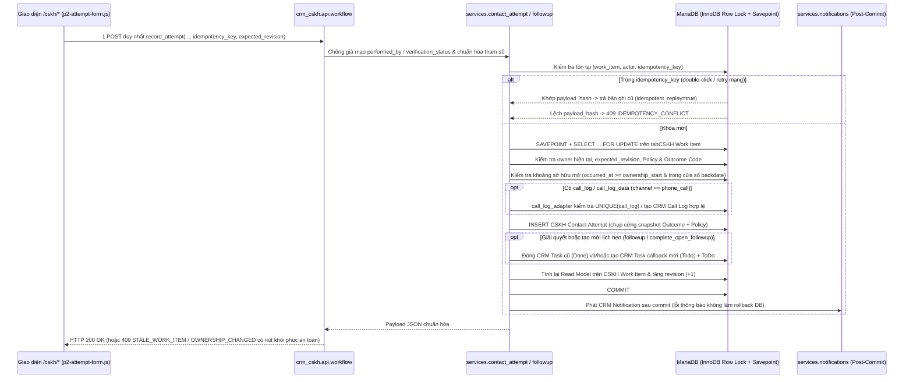

# P2 Exit Report — CRM-CSKH Giai đoạn P2 (Hồ sơ Tích hợp Backend `WP00–WP06` + Giao diện `WP07–WP09` + Kiểm chứng `WP10` & Đóng gói `WP11`)

> **Dự án:** CRM-CSKH — Quản trị kho khách hàng, phân phối lead và chất lượng chăm sóc khách hàng
> **Tài liệu:** [`docs/P2-Exit-Report.md`](./P2-Exit-Report.md)
> **Kế hoạch gốc:** [`docs/root-plan/P2.md`](./root-plan/P2.md) (§14, §15, §16, §17, §18) & ADR giao diện [`docs/architecture/ui-strategy-p1.md`](./architecture/ui-strategy-p1.md)
> **Ngày đóng gói hồ sơ tích hợp:** 04/11/2026
> **Thực hiện bởi:**
> - **T1B (AI Coding — Backend):** `P2-WP00..WP06` & phần Backend/CI/Benchmark/Restore của `P2-WP10` (commit `6ef2e2e21c9e8265efe43fd5413074b70849a674`, nhánh `codex/p2-foundation`)
> - **T1A (AI Coding — UI, i18n, Browser E2E & WP11):** `P2-WP07..WP09`, E2E HTTP/Chromium thực tế & đóng gói tích hợp `P2-WP11` (code commit `d3da46b16a6d800d5d8cf866fc06415f9f02253f`, nhánh `codex/p2-ui`, worktree `D:/HRP-app/p2-ui`)
> **Baseline xuất phát (`main`):** `1913d2bd5ebfdc894eaa492b46be502dbdf44808` (CI P0 `#41658199683` `success`, CI P1 `#41658199861` `success`)
> **Trạng thái cổng nghiệm thu:** **ĐÃ BÀN GIAO HỒ SƠ KỸ THUẬT CHO T1C — CHƯA MERGE VÀO `main`, CHƯA KÝ `GO P3`**

---

## Phán quyết Kiểm định Độc lập của T1C & Phê duyệt Cổng P2 → P3

| Hạng mục quản trị | Tài liệu / Đầu mối liên kết | Trạng thái hiện tại |
|---|---|---|
| **Báo cáo kiểm định độc lập của T1C** | `docs/audits/P2-T1C-Verification-Report.md` *(sẽ do **T1C** xuất bản và ký độc lập sau khi kiểm định nhánh tích hợp)* | **CHỜ T1C KIỂM ĐỊNH ĐỘC LẬP (`PENDING`)** — *T1A/T1B không tự điền `PASS` thay cho T1C* |
| **Truy vết bằng chứng kỹ thuật chi tiết (`T1B + T1A`)** | [`docs/test-evidence-p2.md`](./test-evidence-p2.md), [`deploy/p2/evidence/http-e2e-report.json`](../deploy/p2/evidence/http-e2e-report.json), [`deploy/p2/evidence/browser-manifest.json`](../deploy/p2/evidence/browser-manifest.json) | Đã đo và lưu đầy đủ trên commit mã `d3da46b16a6d800d5d8cf866fc06415f9f02253f` (`0` SĐT thô, `0` secret) |
| **Quyết định chuyển pha (`GO P3` / `NO-GO P3`)** | Thẩm quyền phê duyệt của **T0 / Owner** trên cơ sở báo cáo độc lập của **T1C** | **CHƯA KÝ `GO P3`** |

---

## Tóm tắt Điều hành

Trên nhánh tích hợp `codex/p2-ui` (hợp nhất có kiểm soát commit Backend `6ef2e2e21c9e8265efe43fd5413074b70849a674` của **T1B** với các màn hình UI/Việt hóa/E2E `d3da46b16a6d800d5d8cf866fc06415f9f02253f` của **T1A**, **`0` dòng thay đổi lên bất kỳ module phân quyền hay dịch vụ backend nào của T1B**), hệ thống CRM-CSKH Giai đoạn P2 đã hoàn tất đồng bộ từ tầng dữ liệu đến trải nghiệm trình duyệt tiếng Việt:

1. **Bảo toàn khóa phiên bản & chiến lược giao diện cùng Frappe site `/cskh/*`:** Giữ nguyên Frappe Framework `v15.123.1` (`d2efa79657ba5c1abf96098b3bfacc199517d57e`) và Frappe CRM `v1.87.0` (`0d3910b456ef4fb913e77b29db011b3debc4f778`); **`0` tệp vá core/upstream mới** trong P2, không dựng SPA tách rời và không sửa `Activities.vue` của upstream. Kết nối từ trang chi tiết `CRM Lead` sang hồ sơ CSKH dùng điểm mở rộng chuẩn `CRM Form Script` (`"CSKH - Open Lead CSKH Workspace"` → `/cskh/work-item?lead=<lead_id>`).
2. **Mô hình sự kiện liên hệ bất biến, trung thực & giao diện thao tác nguyên tử:**
   - **Backend (`WP00–WP06`):** `CSKH Outcome Code` (`12` mã tiếng Việt chuẩn), `CSKH Policy` (`Campaign > Team > Global`), `CSKH Contact Attempt` (append-only, snapshot phiên bản Outcome + Policy + khoảng sở hữu), `CSKH Attempt Correction` (`correct | void | restore`), mở rộng trực tiếp `CSKH Work Item` + `CSKH Assignment History` + `CRM Lead` (`DNC`) + `CRM Task` (`callback`).
   - **Giao diện `/cskh/*` (`WP07–WP09`):** Nâng cấp `/cskh/my-customers` (cột trạng thái CSKH, lần liên hệ gần nhất, kết quả, số lần liên hệ, lịch hẹn tiếp theo; bộ lọc chưa liên hệ/đã thử/chưa kết nối/đã kết nối/đến hạn/quá hạn/hoàn tất/DNC + form ghi kết quả nhanh gọi **đúng `1` POST orchestration** `workflow.record_attempt`), xây dựng mới `/cskh/work-item` (hồ sơ CSKH, dòng thời gian hợp nhất phân biệt rõ `Attempt` / `CRM Call Log` / `CRM Task` / `FCRM Note`, hiển thị `Nhân viên tự báo cáo`, lịch sử hiệu chỉnh/vô hiệu, không có nút sửa/xóa trực tiếp Attempt, xử lý rõ xung đột `409 STALE_WORK_ITEM` & `OWNERSHIP_CHANGED`), `/cskh/callbacks` (lịch hẹn theo biên múi giờ `23:59`/`00:00` site/user), `/cskh/progress` (bộ đếm vận hành đúng scope, biểu ngữ không chấm điểm chất lượng/SLA, `BOD` `0` PII), và `/cskh/settings` (cấu hình Outcome Code & Policy theo `capabilities` từ server).
3. **Kiểm chứng thực nghiệm đa tầng & bảo toàn 100% P0/P1 (đóng thêm `O-02`):**
   - `369/369` Frappe JUnit test method trên 23 module (`P2 Backend` `33/33`, `P2 UI` `8/8`, `P1 Backend` `209/209`, `P1 UI` `12/12`, `P0 Core+Aux` `107/107`), `72/72` AST guard P0, `6/6` Vite bootstrap test, Node timezone/contract unit suite (`PASS`).
   - HTTP Transport Probe (`61/61 PASS`), Live HTTP E2E tích hợp (`5/5` cụm lớn PASS + `reconcile_p2_invariants ok=true`), và Real-Chromium Browser E2E (`17/17` kịch bản & ảnh chụp `B2E-01..B2E-17` PASS, `0` màn trắng, `0` lỗi console/page/asset/500, `0` SĐT thô trên DOM).
   - Backup/Restore Smoke (`PASS`) và Benchmark thực nghiệm `10.000` Work Item / `50.000` Contact Attempt / `25` worker đồng thời (`reconcile ok=true`, `0` lỗi, `0` slow query, `0` InnoDB lock wait).
   - Đồng thời đóng gọn mục tồn đọng không chặn sau P1 `O-02` trong [`ownership_ui.py`](../apps/crm_cskh/crm_cskh/api/ownership_ui.py) (chuyển sang dùng helper quyền tập trung từ `reporting`), có test hồi quy trong `test_ui_p2_pages_and_context.py`.

---

## Trả lời Đầy đủ `12` Câu hỏi Nghiệm thu Bắt buộc (`P2.md` §18.3)

### 1. Tái sử dụng trực tiếp bao nhiêu thành phần upstream, chỉnh sửa thực tế bao nhiêu file upstream, và lý do kiến trúc

- **Số file mã nguồn upstream (`apps/frappe`, `apps/crm`, `deploy/dev/patches/*`) bị chỉnh sửa thêm trong P2 (cả Backend lẫn UI):** **`0` file**. Toàn bộ P2 được triển khai 100% bên trong custom app `apps/crm_cskh` thông qua cơ chế chính thống của Frappe (`DocType`, `Custom Field`, `CRM Form Script` fixture, `www/cskh/*` website routes, `patches.txt`, `hooks.py`).
- **Các thực thể & cơ chế upstream được REUSE / EXTEND trực tiếp (xem chi tiết tại [`docs/P2-entry-report.md`](./P2-entry-report.md) §3):**
  1. `CRM Lead` (`crm/fcrm/doctype/crm_lead/crm_lead.json`) — **EXTEND** bằng `4` Custom Field tuân thủ `cskh_do_not_contact`, `cskh_dnc_reason`, `cskh_dnc_at`, `cskh_dnc_work_item`; không sửa `CRMLead` controller và không tự động ghi đè `CRM Lead.status`.
  2. `CRM Task` (`crm/fcrm/doctype/crm_task/crm_task.json`) — **EXTEND** bằng `7` Custom Field `cskh_*` làm tác vụ hẹn chăm sóc lại (callback); không tạo DocType `Followup Task` trùng lặp.
  3. `CRM Call Log` (`crm/fcrm/doctype/crm_call_log/crm_call_log.json`) — **REUSE trực tiếp** qua [`services/call_log_adapter.py`](../apps/crm_cskh/crm_cskh/services/call_log_adapter.py) với liên kết 1–1 tùy chọn từ `CSKH Contact Attempt.call_log` (`UNIQUE`).
  4. `FCRM Note` (`crm/fcrm/doctype/fcrm_note/fcrm_note.json`) — **REUSE trực tiếp** làm ghi chú nội bộ trên hồ sơ Lead, hiển thị tách biệt trên timeline `/cskh/work-item` với nhãn rõ `Ghi chú nội bộ — không tính vào số lần liên hệ`.
  5. `CRM Form Script` (`crm/fcrm/doctype/crm_form_script`) — **REUSE điểm mở rộng UI sạch của Frappe CRM** thông qua fixture [`crm_form_script.json`](../apps/crm_cskh/crm_cskh/fixtures/crm_form_script.json) (`"CSKH - Open Lead CSKH Workspace"`) gắn nút `"Mở hồ sơ CSKH"` trên màn chi tiết `CRM Lead` điều hướng sang `/cskh/work-item?lead=<lead_id>` mà không sửa `Activities.vue` hay `Lead.vue`.
  6. `CRM Sales Hierarchy`, `ToDo`, `DocShare`, `CRM Notification` — **REUSE trực tiếp** cùng hệ thống sở hữu `services/ownership.py` và phân quyền P0/P1.
- **Lý do tạo mới đúng `4` DocType trong `crm_cskh` (`CSKH Outcome Code`, `CSKH Policy`, `CSKH Contact Attempt`, `CSKH Attempt Correction`):** Frappe CRM `v1.87.0` chỉ có `CRM Call Log` (bắt buộc SĐT `from`/`to` cho kênh thoại, cho phép sửa trực tiếp, không có từ điển kết quả đa kênh hay phiên bản chính sách) và `FCRM Note` (văn bản tự do không cấu trúc). Bốn DocType P2 giải quyết đúng khoảng trống nghiệp vụ đa kênh, bất biến và kiểm toán hiệu chỉnh.

---

### 2. Tác động lên dữ liệu & migration P1; chứng minh tính lặp lại và khôi phục (Backup/Restore)

- **Không phá vỡ dữ liệu P1:**
  - Mọi cột mới trên `CSKH Work Item` đều nullable hoặc có giá trị mặc định an toàn (`revision=1`, `attempt_count=0`, `connected_attempt_count=0`, `policy_version=1`).
  - Các trạng thái P1 cũ (`queued`, `assigned`, `revoked`, `closed`) giữ nguyên tên và ý nghĩa; chỉ bổ sung thêm `in_progress` và `on_hold` vào tập đang sở hữu `OWNED_ACTIVE_WORK_ITEM_STATES = ("assigned", "in_progress", "on_hold")`.
  - Mọi kiểm tra P1 đã được rà soát từng dòng (capacity, Active Claim, distribution load/reconcile, `my_list`, Pool, Dashboard, `L-23`, `L-29`) và chứng minh bằng **`209/209` test Backend P1 PASS** + **`12/12` test UI P1 PASS** + **`99/99` test P0 PASS** + đóng thêm `O-02` trong `ownership_ui.py`.
- **Idempotency của Migration (`bench migrate` × 2):**
  - Patch [`patches/v2_0/p2_schema_and_seeds.py`](../apps/crm_cskh/crm_cskh/patches/v2_0/p2_schema_and_seeds.py) kiểm tra tồn tại trước khi tạo từng Custom Field (`13` trường `cskh_*`), từng chỉ mục MariaDB (`15` chỉ mục P2) và từng bản ghi seed (`12` Outcome Code + Policy `GLOBAL-DEFAULT`), kết hợp đồng bộ fixture `CRM Form Script` không trùng lặp; chạy `bench migrate` lặp lại trên cả `p2dev.localhost`, `p2-reg.localhost` và `p2.localhost` đều trả exit `0`.
- **Chứng minh Backup & Restore thực tế ([`p2-backup-restore-smoke-20261103.json`](../deploy/dev/evidence/p2-runtime-20261103/restore/p2-backup-restore-smoke-20261103.json)):**
  - Chạy `bench --site p2dev.localhost backup`, khôi phục bản sao lưu SQL sang site độc lập `p2restore.localhost`, chạy `bench --site p2restore.localhost migrate`, và hậu kiểm tự động:
    - Số lượng bản ghi trên cả `10` DocType (`CRM Lead`: `25`, `CSKH Campaign`: `8`, `CSKH Work Item`: `12`, `CSKH Active Claim`: `10`, `CSKH Assignment History`: `16`, `CSKH Outcome Code`: `12`, `CSKH Policy`: `2`, `CSKH Contact Attempt`: `4`, `CSKH Attempt Correction`: `2`, `CRM Task`: `4`) **khớp 100%** (`counts_match: true`).
    - `reconcile_p2_invariants()` trên site khôi phục đạt `ok: true`, và các khóa chống ghi trùng (`idempotency_key`, `payload_hash`) được bảo toàn nguyên vẹn (`restored_has_idempotency_record: true`).

---

### 3. Minh chứng vòng đời `Attempts + Follow-up + Handover + Correction + Close` từ API đến Trình duyệt

- **Phía Backend API & HTTP thật:**
  1. **Unit/Integration (`test_p2_lifecycle.py::TestP2WorkItemLifecycle.test_full_state_lifecycle_assigned_in_progress_on_hold_closed`):** Đi trọn chu trình từ `assigned` → Attempt #1 (`no_answer`, `connected=0`, chuyển `in_progress`) → Attempt #2 kèm hẹn gọi lại (`callback_requested`, tạo `CRM Task` `Todo`, chuyển `on_hold`, đồng bộ `next_action_due`) → Attempt #3 (`connected_interested`, `complete_open_followup=True` chuyển `CRM Task` sang `Done`, về `in_progress`) → `close_work_item` (`status="closed"`, giải phóng `CSKH Active Claim`, đóng khoảng sở hữu `ownership_end`, xóa `lead_owner`/`DocShare`/`ToDo`).
  2. **HTTP Transport & Live E2E (`ci_p2_http_probe.py` `61/61 PASS` & [`verify_p2_http_e2e.py`](../deploy/p2/verify_p2_http_e2e.py) `5/5 PASS`):** Đi trọn từ P1 CSV upload/preview/confirm → campaign rules → async distribution sang Work Item P2 → ghi kết quả đa kênh → liên kết `CRM Call Log` → lịch hẹn callback → `reassign(A -> B)` → hiệu chỉnh/void → đóng & mở lại có lý do → đối soát `reconcile_p2_invariants ok=true` ([`http-e2e-report.json`](../deploy/p2/evidence/http-e2e-report.json)).
- **Phía Giao diện Trình duyệt Chromium Thật ([`verify_p2_browser_e2e.mjs`](../deploy/p2/verify_p2_browser_e2e.mjs) — `17/17 PASS`, manifest tại [`browser-manifest.json`](../deploy/p2/evidence/browser-manifest.json)):**
  - Danh sách khách được giao nâng cấp & ghi kết quả nhanh **1 POST duy nhất**: [`01-staff-a-my-customers-upgraded.png`](../deploy/p2/evidence/screenshots/01-staff-a-my-customers-upgraded.png), [`02-staff-a-after-quick-record.png`](../deploy/p2/evidence/screenshots/02-staff-a-after-quick-record.png).
  - Hồ sơ CSKH, dòng thời gian hợp nhất, trung thực `Chưa kết nối` & an toàn XSS: [`03-staff-a-work-item-happy.png`](../deploy/p2/evidence/screenshots/03-staff-a-work-item-happy.png), [`04-staff-a-honesty-and-xss-safe.png`](../deploy/p2/evidence/screenshots/04-staff-a-honesty-and-xss-safe.png).
  - Xung đột `409 STALE_WORK_ITEM` & bàn giao `A -> B` (`0` lộ PII khi mở lại URL cũ, `Staff B` hoàn tất lịch hẹn nhận bàn giao): [`05-staff-a-stale-revision-conflict.png`](../deploy/p2/evidence/screenshots/05-staff-a-stale-revision-conflict.png), [`06-staff-a-after-transfer-forbidden-zero-leak.png`](../deploy/p2/evidence/screenshots/06-staff-a-after-transfer-forbidden-zero-leak.png), [`07-staff-b-handover-completed-callback.png`](../deploy/p2/evidence/screenshots/07-staff-b-handover-completed-callback.png).
  - Hiệu chỉnh bất biến (`pending` → `Leader A` duyệt → `Admin` vô hiệu `void`) & lịch hẹn biên `23:59`/`00:00`: [`08-staff-a-correction-pending.png`](../deploy/p2/evidence/screenshots/08-staff-a-correction-pending.png), [`09-leader-a-correction-approved.png`](../deploy/p2/evidence/screenshots/09-leader-a-correction-approved.png), [`10-admin-voided-attempt-excluded.png`](../deploy/p2/evidence/screenshots/10-admin-voided-attempt-excluded.png), [`11-staff-a-callbacks-schedule-boundaries.png`](../deploy/p2/evidence/screenshots/11-staff-a-callbacks-schedule-boundaries.png).

---

### 4. Sơ đồ Kiến trúc API Tạo Attempt / Task / Call Log & Cơ chế Idempotency

- **Kỷ luật phía UI ([`p2-attempt-form.js`](../apps/crm_cskh/crm_cskh/public/cskh/p2-attempt-form.js)):**
  - Một thao tác lưu luôn gọi **đúng một API orchestration** (`workflow.record_attempt`), tuyệt đối không nối chuỗi nhiều API ghi từ trình duyệt rồi coi là giao dịch (`B2E-02` kiểm chứng bộ đếm request mạng `recordPosts.length === 1`).
  - Khóa `idempotency_key` được giữ cố định trong suốt quá trình gửi/thử lại cùng dữ liệu (chống double-click `B2E-05`), và tự động xoay khóa mới ngay khi người dùng chỉnh sửa bất kỳ trường dữ liệu nào trên biểu mẫu.
- **Lược đồ Idempotency hai tầng phía Server:**
  1. **Tầng DB Constraint:** Chỉ mục duy nhất `cskh_attempt_idem_uq (work_item, performed_by, idempotency_key)` trên `tabCSKH Contact Attempt` và `cskh_corr_req_idem_uq (requested_by, idempotency_key)` trên `tabCSKH Attempt Correction`.
  2. **Tầng Fingerprint (`payload_hash` SHA-256):** Gửi lại đúng payload cũ trả về HTTP `200` (`idempotent_replay: true`); gửi lại cùng khóa nhưng đổi tham số nghiệp vụ bị chặn ngay bằng HTTP `409 IDEMPOTENCY_CONFLICT`.

---

### 5. Chứng minh `Call Log != Connected`, `Gửi tin chưa phản hồi != Connected` & Timeline Không Đếm Trùng

1. **Bất biến cứng ở cấp Model & Seed (`p2_models.py`):**
   - Hằng số `UNREACHED_DISCONNECTED_CODES = {"no_answer", "busy", "unreachable", "message_sent_no_reply", "wrong_number"}` cưỡng chế ngay trong `CSKHOutcomeCode.validate()`: mọi nỗ lực bật `is_connected = 1` trên 5 mã này đều ném `ValidationError` kể cả qua Admin API hay ORM.
2. **`CRM Call Log`, `CRM Task` & `FCRM Note` không tự biến thành `Connected` (`call_log_adapter.py` & `work-item.js`):**
   - Tạo `CRM Call Log` rời (kể cả `status = "Completed"`), thêm `FCRM Note`, hay hủy `CRM Task` có lý do giữ nguyên `attempt_count == 0` / `connected_attempt_count == 0`.
   - Giao diện `/cskh/work-item` và `/cskh/callbacks` chặn hoàn tất lịch hẹn rỗng: nút `Ghi kết quả & hoàn tất` mở form `record_attempt(complete_open_followup=true)`, còn nhánh hủy bắt buộc nhập lý do kiểm toán và hiển thị rõ thông báo `Đã đóng lịch hẹn theo lý do hủy (không tính là đã kết nối)` cùng huy hiệu cảnh báo trên từng thẻ timeline (`Nhiệm vụ — không tự tính là lần liên hệ hay đã kết nối`, `Chưa gắn lần liên hệ (không tự tính số lần liên hệ)`, `Ghi chú nội bộ — không tính vào số lần liên hệ` — đối chứng trực quan tại [`04-staff-a-honesty-and-xss-safe.png`](../deploy/p2/evidence/screenshots/04-staff-a-honesty-and-xss-safe.png)).
   - Ràng buộc `cskh_attempt_call_log_uq UNIQUE (call_log)` chặn tuyệt đối việc liên kết một `CRM Call Log` vào 2 Attempt (`409 ALREADY_LINKED`).
3. **Timeline hợp nhất không đếm trùng (`read_model.py` + `work-item.js`):**
   - Bộ đếm trên đầu trang đọc duy nhất từ các `CSKH Contact Attempt` hiệu lực (`is_voided == false`), trong khi danh sách dòng thời gian hiển thị phân loại trực quan từng loại bản ghi (`Lần liên hệ CSKH`, `Nhật ký cuộc gọi (CRM)`, `Lịch hẹn / Nhiệm vụ (CRM)`, `Ghi chú nội bộ (CRM)`, `Lịch sử phụ trách`) kèm bộ lọc theo loại mà không bao giờ cộng gộp nhầm sang số lần liên hệ.

---

### 6. Kiểm thử Đua Đồng thời `A -> B` Trong Lúc `A` Submit, Chuyển Callback Task & Quyền Trước/Sau

- **Đua song song trên 2 kết nối MariaDB thật (`test_p2_concurrency_chaos.py::TestP2RealMariaDbRacesAndRollbackChaos.test_parallel_double_submit_and_record_attempt_vs_reassign_race_preserve_invariants`):**
  - Luồng 1 (`Staff A`) gọi `contact_attempt.record_attempt` đồng thời với Luồng 2 (`CRM Admin`) gọi `ownership.reassign(A -> B)` cùng rào chắn `threading.Barrier(2)`.
  - Nhờ `SELECT ... FOR UPDATE` trên cùng hàng `tabCSKH Work Item`:
    - Nếu `A` vào khóa trước: Attempt của `A` được ghi hợp lệ vào khoảng sở hữu của `A` (`performed_by = A`), ngay sau đó `reassign` đóng khoảng sở hữu của `A` và mở khoảng mới cho `B`.
    - Nếu `reassign` vào khóa trước: `A` đọc thấy `assigned_to == B != A` và bị từ chối sạch với `409 OWNERSHIP_CHANGED` (`0` bản ghi mồ côi).
- **Chuyển giao Callback `CRM Task` & kiểm chứng trình duyệt (`B2E-06`, `B2E-07`):**
  - Khi `Work Item` đang `on_hold` được `reassign(A -> B)`, callback `CRM Task` đang mở được chuyển sang `assigned_to = B`, đóng `ToDo` của `A`, mở `ToDo` cho `B`, ghi sự kiện `reassigned_handover` và **giữ nguyên tuyệt đối `due_date` gốc**.
  - Ngay sau khi chuyển giao, `Staff A` tải lại đúng URL `/cskh/work-item?id=...` đang mở trước đó nhận thông báo `[FORBIDDEN]`, ẩn sạch toàn bộ thẻ khách hàng và timeline (`0` rò rỉ PII — [`06-staff-a-after-transfer-forbidden-zero-leak.png`](../deploy/p2/evidence/screenshots/06-staff-a-after-transfer-forbidden-zero-leak.png)); `Staff B` mở cùng hồ sơ nhìn thấy lịch sử Attempt của `Staff A` kèm hạn callback gốc và hoàn tất thành công dưới tên `Staff B` ([`07-staff-b-handover-completed-callback.png`](../deploy/p2/evidence/screenshots/07-staff-b-handover-completed-callback.png)).

---

### 7. Kiểm chứng Quyền trên Native `CRM Call Log` / `CRM Task` / `FCRM Note` API, Cổng Website `/cskh/*` & Vấn đề Tồn dư

- **Cơ chế bảo vệ đa tầng (Backend + Website Route Gate):**
  1. **Đọc (`permission_query_conditions` + `has_permission` + `guarded_crm.py`):** Tái sử dụng lưới P0 (`linked_lead_query_conditions`, `linked_lead_has_permission` trong `permissions.py` và `crm_cskh.api.guarded_crm.get_activities`) cho `CRM Call Log`, `CRM Task`, `FCRM Note`, `Comment`, `File`, kết hợp [`p2_permissions.py`](../apps/crm_cskh/crm_cskh/p2_permissions.py) cho 4 DocType P2 và nâng cấp `assignment_history_*` trong `p1_permissions.py` để sau khi `Lead` chuyển sang người/team khác (`L-23`), chủ cũ / team cũ mất quyền đọc lịch sử.
  2. **Cổng phân quyền cấp trang Website (`/cskh/*` — `page_context.py`):** Mọi route mới đều kiểm tra quyền ở phía máy chủ trước khi render HTML: `BOD` bị từ chối HTTP `403` ngay trên các route chứa PII (`/cskh/work-item`, `/cskh/callbacks` — [`14-bod-work-item-403-denied.png`](../deploy/p2/evidence/screenshots/14-bod-work-item-403-denied.png)), `Sales User` bị từ chối HTTP `403` trên `/cskh/settings`; frontend chỉ dùng `capabilities` để ẩn/hiện nút hợp lệ chứ không thay thế kiểm tra quyền backend.
  3. **Ghi/Xóa trực tiếp qua Generic Frappe API (`/api/resource/*`, `frappe.client.*`, Desk):**
     - `CSKH Contact Attempt` & `CSKH Attempt Correction`: tắt hoàn toàn `create/write/delete` + controller `before_save`/`on_trash` chặn sửa/xóa kể cả khi gọi nội bộ với `ignore_permissions=True`.
     - `CRM Task`: hook `doc_events["CRM Task"]` chặn mọi thao tác tạo/sửa/đóng/xóa trực tiếp trên callback CSKH (`cskh_is_followup == 1`) từ bên ngoài `followup` service.
- **Vấn đề tồn dư (Residual Risk):** **`0` lỗi Critical/High mở.** Ghi nhận một lưu ý thiết kế có chủ đích (`ADR-P2-05`): nhân viên sở hữu hợp pháp một `CRM Lead` vẫn có thể tạo `CRM Call Log` hoặc `FCRM Note` gốc của Frappe CRM trên chính Lead mình đang giữ, nhưng cả Backend lẫn UI đều gắn nhãn phân biệt rõ và **không bao giờ tự động cộng** các bản ghi rời này vào `attempt_count` hay `connected_attempt_count`.

---

### 8. Cơ chế Hiệu chỉnh (`Correction`), Kiểm toán (`Audit`), `Effective View` & Quyền Phê duyệt

- **Bất biến bản ghi gốc & giao diện không sửa/xóa trực tiếp:** Dòng `CSKH Contact Attempt` không bao giờ bị `UPDATE` hay `DELETE`; trên `/cskh/work-item` hoàn toàn không có nút Sửa/Xóa Attempt mà chỉ có nút `Yêu cầu hiệu chỉnh / vô hiệu` (`B2E-03`).
- **Ba hành động kiểm toán trong `CSKH Attempt Correction` (`services/correction.py`):**
  1. `correct`: Đề xuất sửa một tập trường cho phép (`outcome_code`, `channel`, `occurred_at`, `note`, `call_log`); sau khi duyệt, UI hiển thị đồng thời giá trị hiệu lực mới và hộp `Bản ghi gốc` để đối chiếu minh bạch ([`09-leader-a-correction-approved.png`](../deploy/p2/evidence/screenshots/09-leader-a-correction-approved.png)).
  2. `void`: Hủy hiệu lực một Attempt ghi nhầm; dòng gốc vẫn nằm trên timeline với huy hiệu `Đã vô hiệu — không tính vào bộ đếm` nhưng bị loại khỏi `attempt_count`, `connected_attempt_count`, `last_outcome_code` và `progress_summary` ([`10-admin-voided-attempt-excluded.png`](../deploy/p2/evidence/screenshots/10-admin-voided-attempt-excluded.png)).
  3. `restore`: Khôi phục hiệu lực cho một Attempt đã bị `void` trước đó (chỉ dành cho `CSKH CRM Admin`).
- **Quyền yêu cầu & phê duyệt:** `Sales User` chỉ tạo yêu cầu `pending`; `Sales Manager` duyệt trong phạm vi team khi chính sách bật `allow_leader_review_correction == 1`; `CSKH CRM Admin` có quyền duyệt toàn hệ thống.

---

### 9. Việt hóa `vi_VN`, Xử lý Biên Múi giờ `23:59`/`00:00` & Bảng Thuật ngữ (`docs/glossary-vi.md`)

- **Từ điển dịch & kiểm toán tự động (`0` lỗi):**
  - Hợp nhất toàn bộ chuỗi Backend (`T1B`) và chuỗi Giao diện P1/P2 (`T1A` trong `p1_strings.py` + `p2_strings.py`) vào [`apps/crm_cskh/crm_cskh/translations/vi.csv`](../apps/crm_cskh/crm_cskh/translations/vi.csv) (**`907` dòng**) và chuẩn hóa bảng thuật ngữ xuyên suốt P0–P2 tại [`docs/glossary-vi.md`](./glossary-vi.md).
  - Kiểm toán tự động `python deploy/p1/check_translations_audit.py` đạt: `used strings: 438`, `declared strings: 691`, `vi.csv rows: 907`, **`missing declaration: 0`**, **`missing translation: 0`**, **`untranslated (EN): 0`**, **`orphan declaration: 0`**.
  - Kiểm chứng trình duyệt trên cả `5` nhân vật thuộc `4` nhóm vai trò (`Staff A`, `Staff B`, `Leader A`, `BOD`, `CRM Admin` — `B2E-01..B2E-17`): toàn bộ tiêu đề, điều hướng, cột bảng, chip lọc, nhãn kết quả/kênh, trạng thái lịch hẹn, biểu ngữ cảnh báo, hộp thoại hiệu chỉnh, empty state và toast đều hiển thị tiếng Việt tự nhiên, `html[lang="vi"]` đạt `90/90` kiểm tra HTTP route.
- **Biên ngày giờ `23:59:59` / `00:00:00` theo đúng múi giờ Site/User (không lệ thuộc giờ máy tính):**
  - Tầng JS dùng chung [`cskh.js`](../apps/crm_cskh/crm_cskh/public/cskh/cskh.js) đọc `cskhBoot.userTimezone || cskhBoot.siteTimezone || 'Asia/Ho_Chi_Minh'` từ server context và định dạng/phân loại qua `Intl.DateTimeFormat(..., { timeZone })`.
  - Đã kiểm chứng bằng cả Node unit suite ([`test_p2_ui_timezone_and_contracts.mjs`](../deploy/p2/test_p2_ui_timezone_and_contracts.mjs)) lẫn Chromium thật (`B2E-11`): cùng tập dữ liệu hạn `23:59:59` hôm nay và `00:00:00` ngày mai giữ nguyên phân loại `Đến hạn hôm nay` vs `Sắp đến hạn` ngay cả khi trình duyệt người dùng chạy ở múi giờ hệ điều hành `America/Los_Angeles` (`UTC-8`), và tự động chuyển đổi hiển thị sang `+09:00` khi cấu hình `User.time_zone = "Asia/Tokyo"`.

---

### 10. Báo cáo Hiệu năng Thực nghiệm (`10.000` Work Item / `50.000` Attempt / `25` Worker), CPU/RAM & Slow Queries

> **Nguyên tắc trung thực (`P2.md` §15.4):** Toàn bộ con số dưới đây được trích nguyên bản từ tệp đo thực tế [`deploy/dev/evidence/p2-runtime-20261103/benchmark/p2-benchmark-20261103.json`](../deploy/dev/evidence/p2-runtime-20261103/benchmark/p2-benchmark-20261103.json) do **T1B** thực hiện trên site cô lập `p2bench.localhost` (container DEV MariaDB `11.8` + Python `3.14`); **không tự đặt ngưỡng SLA giả định**.

#### 10.1. Quy mô dữ liệu & Tài nguyên tổng thể
- **Tập dữ liệu trên `p2bench.localhost`:** `10.000` `CSKH Work Item`, `50.000` `CSKH Contact Attempt` (trong đó `P2B-WI-00000` có **`120` attempt**), `2.020` open callback `CRM Task`, `520` approved `CSKH Attempt Correction`, phân bổ đều trên `2` Team / **`25` nhân viên (`Staff`)** (thời gian nạp bulk: `22,089s`; tổng thời gian chạy toàn bộ kịch bản benchmark + đối soát: `82,61s`).
- **Tài nguyên & MariaDB toàn phiên:** RSS khởi điểm `128,28 MiB` → **Peak RSS `326,0 MiB`**; Python `tracemalloc` peak heap **`105,45 MiB`**; CPU `66,938s user` / `4,479s sys`; tổng truy vấn `14.284`; **`slow_queries_delta = 0`**; **`innodb_row_lock_waits_delta = 0` (`0 ms`)**.
- **Đối soát bất biến hậu kiểm (`reconcile_p2_invariants` trên toàn bộ `10.000` Work Item & `50.025` Attempt):** **`ok = true`** trong **`11,321s`** (`0` vi phạm trên cả 9 hạng mục kiểm tra).

#### 10.2. Độ trễ Ghi Giao dịch Thực tế (Single-Worker Microbenchmark)

| Thao tác dịch vụ (kèm `frappe.db.commit()`) | Số mẫu | `min` (ms) | `p50` (ms) | `p95` (ms) | `max` (ms) | `mean` (ms) |
|---|---:|---:|---:|---:|---:|---:|
| `contact_attempt.record_attempt` | `100` | `40,844` | **`51,054`** | `88,301` | `349,347` | `59,714` |
| `followup.schedule_followup` (tạo & dời lịch) | `40` | `28,724` | **`39,231`** | `51,963` | `115,879` | `40,190` |
| `request_correction` + `review_correction(approve)` | `20` | `83,321` | **`94,050`** | `138,190` | `222,107` | `104,259` |

#### 10.3. Độ trễ Đọc, Lọc & Phân trang trên DB `10.000` Work Item / `50.000` Attempt

| Truy vấn / Endpoint dịch vụ | Actor | `p50` (ms) | `p95` (ms) | Số câu SQL / lần gọi | Kích thước JSON (bytes) |
|---|---|---:|---:|---:|---:|
| `list_work_items` (mặc định trang 1, `page_size=20`) | `Staff` | **`14,858`** | `20,312` | `2` | `17.449` |
| `list_work_items(followup_filter="overdue")` | `Staff` | **`8,712`** | `11,334` | `2` | `17.448` |
| `list_work_items(status="in_progress")` | `Leader` | **`77,076`** | `85,034` | `4` | `16.855` |
| `list_work_items(followup_filter="today")` | `CRM Admin` | **`13,772`** | `20,375` | `2` | `17.694` |
| `get_work_item_detail` (`P2B-WI-00000`) | `Staff` | **`26,100`** | `36,877` | `13` | `2.059` |
| `list_attempts_timeline` (`120` attempt, `page=1`, `size=20`) | `Staff` | **`22,192`** | `53,559` | `4` | `26.983` |
| `list_attempts_timeline` (`120` attempt, `page=6`, `size=20`) | `Staff` | **`21,991`** | `28,435` | `4` | `26.881` |
| `list_followups(bucket="overdue", page=1, size=20)` | `Leader` | **`11,717`** | `12,601` | `4` | `11.489` |
| `list_followups(bucket="today", page=1, size=20)` | `Leader` | **`11,602`** | `12,555` | `4` | `11.529` |
| `progress_summary` (`~2.000` attempt cá nhân) | `Staff` | **`118,532`** | `119,316` | `11` | `872` |
| `progress_summary` (`~25.000` attempt cấp Team) | `Leader` | **`1.321,960`** | `1.323,481` | `41` | `3.414` |
| `progress_summary` (`50.000` attempt toàn hệ thống, `0` PII) | `BOD` | **`2.519,388`** | `2.728,906` | `58` | `6.418` |

- **Nhận xét kỹ thuật từ `EXPLAIN`:**
  - Hàng đợi nhân viên (`cskh_wi_queue_due_idx`), timeline 120 attempt (`cskh_attempt_wi_occ_idx`), lớp phủ hiệu chỉnh (`cskh_corr_attempt_status_idx`) và lịch hẹn quá hạn (`cskh_task_followup_due_idx`) đều đi đúng `range` / `ref` index scan với số hàng quét rất nhỏ (`1` đến `650` hàng).
  - Với `progress_summary` không truyền bộ lọc ngày trên tập `25k–50k` attempt, hàm hiện tại chiếu lớp phủ `CSKH Attempt Correction` trong bộ nhớ Python nên mất `~1,32s` (Team `25k`) và `~2,52s` (System `50k`). Ở P3 khi xây dựng bảng tổng hợp KPI/SLA theo kỳ lớn hơn nữa, có thể đọc trực tiếp từ cột vật chất hóa hoặc rollup theo ngày/tuần.

#### 10.4. Tải Đồng thời `25` Nhân viên (`ThreadPoolExecutor`, `25` kết nối MariaDB song song)
- **Tổng số thao tác:** `100` (`25` nhân viên × `4` thao tác: đọc hàng đợi → ghi `record_attempt` kèm tạo callback `CRM Task` → đọc timeline → đọc danh sách lịch hẹn) hoàn tất trong **`10,762s` wall-clock**.
- **Độ tin cậy & khóa DB:** **`error_count = 0`**, **`slow_queries_delta = 0`**, **`innodb_row_lock_waits_delta = 0`**, Peak RSS **`326,0 MiB`**.

---

### 11. Tổng hợp Hồ sơ Kỹ thuật `15` Cổng Nghiệm thu (`G2-01 .. G2-15`)

> **Nguyên tắc phân quyền kiểm định:** Cột `Hồ sơ kỹ thuật (T1B + T1A)` ghi nhận các bằng chứng tự đo đã hoàn thành trên mã nguồn `d3da46b16a6d800d5d8cf866fc06415f9f02253f`. Cột `Phán quyết T1C` để trống có chủ đích cho **T1C** điền độc lập (xem truy vết đầy đủ tại [`docs/test-evidence-p2.md`](./test-evidence-p2.md) §6).

| Cổng | Hồ sơ kỹ thuật tích hợp (`T1B` + `T1A`) | Phán quyết độc lập `T1C` |
|---|---|---|
| **G2-01** Entry provenance | Đã đo & lưu trữ ([`docs/P2-entry-report.md`](./P2-entry-report.md), `ADR-P2-01..11`, baseline `1913d2b`) | *Chờ T1C kiểm định* |
| **G2-02** Schema & idempotent migration | Đã đo & lưu trữ (`4` DocType, `13` Custom Field, `15` Index, fixture `CRM Form Script`, `bench migrate` × 2) | *Chờ T1C kiểm định* |
| **G2-03** Work Item lifecycle | Đã đo & lưu trữ (`test_p2_lifecycle.py` `8/8`, `B2E-01..03`, `B2E-07`) | *Chờ T1C kiểm định* |
| **G2-04** Outcome taxonomy (`12` mã tiếng Việt) | Đã đo & lưu trữ (`test_p2_outcomes_policy.py` `5/5`, `B2E-02`, `B2E-16`) | *Chờ T1C kiểm định* |
| **G2-05** Immutable Contact Attempt | Đã đo & lưu trữ (`test_p2_corrections.py`, `ci_p2_http_probe.py`, `B2E-03`, `B2E-08..10`) | *Chờ T1C kiểm định* |
| **G2-06** Unsuccessful != Connected | Đã đo & lưu trữ (`UNREACHED_DISCONNECTED_CODES`, `B2E-02`, `B2E-04`) | *Chờ T1C kiểm định* |
| **G2-07** Atomic & idempotent transactions | Đã đo & lưu trữ (`test_p2_concurrency_chaos.py` `5/5`, `1` POST/save ở `B2E-02`, khôi phục `409 STALE_WORK_ITEM` ở `B2E-05`) | *Chờ T1C kiểm định* |
| **G2-08** Native `Call Log` / `Task` / `Note` reuse | Đã đo & lưu trữ (`0` file upstream bị sửa, `test_p2_calllog_followup.py` `4/4`, `B2E-04`, `B2E-17`) | *Chờ T1C kiểm định* |
| **G2-09** Follow-up callback flow | Đã đo & lưu trữ (`test_p2_calllog_followup.py`, `test_p2_ui_timezone_and_contracts.mjs`, `B2E-07`, `B2E-11`) | *Chờ T1C kiểm định* |
| **G2-10** Safe ownership transfer `A -> B` | Đã đo & lưu trữ (giữ hạn `due_date`, thu hồi quyền `A`, `0` lộ PII khi mở lại URL cũ `B2E-06`, `B2E-07`) | *Chờ T1C kiểm định* |
| **G2-11** Correction & audit trail | Đã đo & lưu trữ (`0` nút sửa/xóa thẳng, `correct` / `void` / `restore` ở `B2E-08..10`) | *Chờ T1C kiểm định* |
| **G2-12** Permissions, generic API & PII | Đã đo & lưu trữ (`test_p2_permissions_sec.py` `5/5`, `test_ui_p2_pages_and_context.py` `8/8`, HTTP `61/61`, P0 `99/99`, P1 `209/209` + `12/12`, đóng `O-02`, `B2E-06`, `B2E-14`) | *Chờ T1C kiểm định* |
| **G2-13** UI tiếng Việt (`vi_VN`) | Đã đo & lưu trữ (`vi.csv` `907` dòng `0` lỗi, `docs/glossary-vi.md`, `17/17` ảnh chụp vai trò `B2E-01..17`) | *Chờ T1C kiểm định* |
| **G2-14** Scoped operational progress (`0` KPI score) | Đã đo & lưu trữ (`progress_summary` đối soát khớp DB, `BOD` `0` PII `B2E-12`, `Leader A` đúng scope `B2E-13`) | *Chờ T1C kiểm định* |
| **G2-15** Handoff P3 (CI, benchmark, backup/restore, docs) | Đã đóng gói đầy đủ (`.github/workflows/p2.yml` tích hợp Backend + UI, `p2-benchmark`, `restore`, `http-e2e-report.json`, `browser-manifest.json`, docs §18.2) | *Chờ T1C kiểm định & T0/Owner phê duyệt* |

---

### 12. Dữ liệu Nền P2 Bàn giao Cho Giai đoạn P3 (SLA, QA & KPI), Giới hạn & Bước Tiếp theo

#### 12.1. Các trường & bất biến dữ liệu P2 đã sẵn sàng để P3 tiêu thụ trực tiếp (không cần migrate lại lịch sử)
1. **Đo thời gian phản hồi lần đầu (First Response / Speed-to-Lead SLA ở P3):**
   - Khoảng sở hữu chính xác trên `CSKH Assignment History` (`ownership_start`, `ownership_end`, `to_user`, `action`) kết hợp `CSKH Contact Attempt.occurred_at`, `recorded_at`, `ownership_event`, `performed_by` và `CSKH Work Item.first_attempt_at`.
2. **Đo tỷ lệ tiếp cận & chuyển đổi thực chất (không nhiễu bởi gọi nhỡ / gửi tin một chiều):**
   - Cờ chụp cứng bất biến trên từng `Attempt`: `contact_attempt_snapshot`, `connected_snapshot`, `interested_snapshot`, `terminal_snapshot`, `dnc_snapshot`, `outcome_group_snapshot`, `outcome_version_snapshot`, `policy_version_snapshot`, cộng lớp phủ `CSKH Attempt Correction` đã được chuẩn hóa qua `read_model.compute_effective_attempts()`.
3. **Đo kỷ luật thực hiện lịch hẹn (Callback Punctuality SLA ở P3):**
   - Trên `CRM Task` (`cskh_is_followup = 1`): `due_date`, `cskh_reschedule_count`, `cskh_source_attempt`, `cskh_completed_attempt`, `cskh_completion_reason` và nhật ký JSON `cskh_task_history_json` lưu đầy đủ lịch sử đặt hẹn, dời hẹn (kèm `old_due`, `new_due`, `reason`, `actor`), bàn giao `A -> B` (không reset hạn) và thời điểm hoàn tất.
4. **Đầu vào cho Kiểm định Chất lượng / Hậu kiểm Tổng đài (QA Verification ở P3):**
   - Trường `CSKH Contact Attempt.verification_status` (`self_reported | verified | disputed`) đã có sẵn và bị khóa cứng `self_reported` đối với nhân viên ở P2 (hiển thị nhãn `Nhân viên tự báo cáo` trên UI), sẵn sàng cho quy trình QA/tổng đài ở P3 đối chiếu băng ghi âm `CRM Call Log` để nâng lên `verified` hoặc đánh dấu `disputed`.

#### 12.2. Giới hạn có chủ đích đúng phạm vi P2 (`P2.md` §2.2) & các mục theo dõi không chặn từ P1
- Chưa chấm điểm SLA, chưa xếp hạng nhân viên hay tính thưởng/phạt KPI (thuộc P3).
- Chưa tích hợp tự động tổng đài VoIP/SIP, SMS Gateway, Zalo OA hay Facebook Webhook (thuộc P3/P4).
- Về 2 mục không chặn sau nghiệm thu P1:
  - **`O-02` (UI):** Đã đóng gọn trong P2 tại [`ownership_ui.py`](../apps/crm_cskh/crm_cskh/api/ownership_ui.py) (loại bỏ hàm kiểm tra quyền nội bộ trùng lặp, gọi trực tiếp `is_admin_actor` / `is_leader_actor` / `get_leader_team_names` từ `reporting`).
  - **`O-01` (Backend import chunking — mục tối ưu không chặn của P1):** Giữ nguyên trong backlog kỹ thuật không chặn theo đúng phạm vi không sửa logic P1 ngoài phần tương thích trạng thái P2.

#### 12.3. Hướng dẫn tái lập độc lập cho T1C & Hành động tiếp theo
1. **T1C** kiểm định độc lập trên nhánh `codex/p2-ui` (hoặc qua CI tự động `.github/workflows/p0.yml`, `p1.yml`, `p2.yml` và chạy lại `deploy/p2/verify_p2_http_e2e.py` + `deploy/p2/verify_p2_browser_e2e.mjs` trên stack cô lập `deploy/p2/docker-compose.yml`), xuất bản báo cáo độc lập và điền phán quyết `G2-01..G2-15`.
2. **T0 / Owner** xem xét báo cáo kiểm định độc lập của **T1C** để quyết định merge vào `main` và ký mở Giai đoạn P3.
