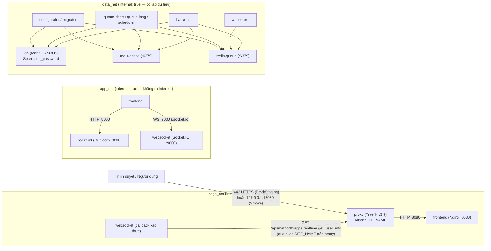

# P4-ADR-01 & P4-ADR-04: Kiến trúc Docker Compose, Tái sử dụng `frappe_docker@v4.0.1` và Cô lập Môi trường

- **Mã quyết định:** `P4-ADR-01` (Topology dịch vụ, TLS ingress & mạng nội bộ) & `P4-ADR-04` (Biên cô lập Staging / Production / Smoke & SPOF)
- **Ngày lập:** 2026-11-05
- **Baseline ứng dụng:** `main` tại `92e14af3532876ad5bc2468bf0e502474cc95a53`
- **Hồ sơ đầu vào đối chiếu:** `P4-00` dự thảo tại `be33e6c931337c42b94184b2fe292e094bd51c97` (`docs/p4/entry-audit.md`, `docs/p4/infra-inventory.md`)
- **Upstream `frappe_docker` đã ghim (`L-04`):** `v4.0.1` (`2b26e9ab8d751e5ea33bb7b930aea3550bb81ded`)
- **Trạng thái phê duyệt:** `PENDING T0`

---

## 1. Bối cảnh

Theo `docs/root-plan/P4.md` (§§1–5, §18) và hồ sơ kiểm kê `P4-00` (`be33e6c`):

1. Các tệp Compose hiện có trong kho (`deploy/dev/docker-compose.yml`, `deploy/p2/docker-compose.yml`, `deploy/p3/docker-compose.yml`) đều dùng image phát triển `frappe/bench:v5.31.0`, chạy `bench start` một container gom chung tiến trình, bind-mount mã nguồn trực tiếp từ máy trạm và dùng mật khẩu mẫu cố định phục vụ kiểm thử nội bộ. Các tệp này **không được dùng cho Staging hoặc Production**.
2. `docs/architecture/version-lock.md` (`L-04`) đã khóa nguồn tham chiếu triển khai tại `frappe/frappe_docker@v4.0.1` (`2b26e9ab8d751e5ea33bb7b930aea3550bb81ded`).
3. `P4-01` yêu cầu tái sử dụng tối đa Compose và overrides chuẩn của `frappe_docker` tại đúng revision đã ghim, đồng thời khắc phục các khoảng trống vận hành thực tế:
   - Nhận image ứng dụng tùy biến do `T1B` bàn giao **bắt buộc theo `@sha256:<64-hex>` digest**, không dùng tag trôi nổi (`:latest`, `:main`).
   - Cô lập tuyệt đối network, named volume, Frappe site và secrets giữa các môi trường (`Owner DEV`, `Isolated Smoke`, `Staging`, `Production`).
   - Chỉ mở duy nhất cổng ingress cần thiết trên `proxy`; tuyệt đối không mở `3306` (MariaDB), `6379` (Redis), `8000` (Gunicorn), `9000` (Socket.IO) hay `8080` (Nginx nội bộ) ra máy chủ.
   - Kiểm soát chặt thời điểm chạy `bench migrate` (tắt tự động migrate khi khởi động container thường trực).

---

## 2. Các Phương án Đã So sánh & Đánh đổi

| Phương án | Mô tả | Ưu điểm | Nhược điểm / Rủi ro | Kết luận |
| :--- | :--- | :--- | :--- | :--- |
| **A. Viết mới hoàn toàn một tệp `docker-compose.yml` riêng** | Tự định nghĩa lại toàn bộ 11–12 service mà không dùng tệp gốc của `frappe_docker`. | Ngắn gọn trong một tệp đơn. | Dễ lệch chuẩn entrypoint/volume/env của `frappe_docker`; tốn công đối chiếu thủ công mỗi lần nâng cấp `frappe_docker` hoặc Frappe `v15.x`. | **Loại bỏ** |
| **B. Dùng nguyên bản `frappe_docker` không kèm override dự án** | Chỉ ghép `compose.yaml` + `overrides/compose.{mariadb,mariadb-secrets,redis,https,migrator}.yaml`. | Không phát sinh tệp override riêng. | (1) `compose.yaml` gốc ép cú pháp `${CUSTOM_IMAGE}:${CUSTOM_TAG}` nên không khóa cứng `@sha256` digest độc lập; (2) toàn bộ service nằm chung mạng `default`; (3) `compose.migrator.yaml` tự chạy `bench --site all migrate` mỗi lần `up`; (4) `FRAPPE_SITE_NAME_HEADER=$$host` không khóa cứng site đích; (5) thiếu healthcheck cho `backend`, `frontend`, `websocket`, `queue-*`, `scheduler`, `redis-*`. | **Loại bỏ** |
| **C. Giữ nguyên bản byte-for-byte upstream `frappe_docker@v4.0.1` + xếp chồng lớp override mỏng của dự án** | Lưu trữ nguyên bản các tệp gốc tại `deploy/compose/upstream/frappe_docker/` (kèm kiểm chứng SHA-1/SHA-256 trong `UPSTREAM-PROVENANCE.json`) và xếp chồng `compose.cskh-common.yaml` + `compose.cskh-tls.yaml` (hoặc `compose.cskh-isolated-smoke.yaml`). | Bảo toàn 100% hành vi chuẩn của `frappe_docker@v4.0.1`; dễ kiểm toán diff khi nâng cấp upstream; khóa chặt digest, mạng 3 lớp, secrets, cổng ingress, healthcheck và cơ chế migrate có kiểm soát. | Lệnh `docker compose` truyền danh sách `-f` dài hơn (được chuẩn hóa qua script và tài liệu vận hành). | **Lựa chọn áp dụng** |

---

## 3. Chi tiết Tái sử dụng Service từ `frappe_docker@v4.0.1`

Danh sách kết xuất từ `docker compose ... config --services` gồm **11 service mặc định** và **1 service `migrator` thuộc profile `migrate`** (tổng cộng 12 định nghĩa service, giữ nguyên tên chuẩn của `frappe_docker`):

| STT | Service | Nguồn định nghĩa gốc (`2b26e9ab8d`) | Vai trò trong kiến trúc P4 | Mạng Docker gắn kết | Cổng host công khai | Điều chỉnh tại lớp Override dự án |
| :---: | :--- | :--- | :--- | :--- | :--- | :--- |
| 1 | `configurator` | `compose.yaml` + `compose.mariadb.yaml` + `compose.redis.yaml` | One-shot khởi tạo `sites/apps.txt` (theo thứ tự phụ thuộc `frappe` → `crm` → `crm_cskh`) và `sites/common_site_config.json` (`db_host`, `db_port`, `redis_cache`, `redis_queue`, `redis_socketio`, `socketio_port`, `chromium_path`), sau đó thoát `0`. | `data_net` (`internal: true`) | Không (`0`) | Ghim `APP_IMAGE@sha256`, gắn volume `sites` + `logs`, ghi đè `command` đọc `/home/frappe/frappe-bench/apps-order.txt` thay cho `ls -1 apps`, chờ `db`, `redis-cache`, `redis-queue` đạt `service_healthy` trước khi ghi cấu hình. |
| 2 | `backend` | `compose.yaml` | Gunicorn WSGI chạy Frappe + `crm` + `crm_cskh` ở cổng nội bộ `8000/tcp`. | `app_net`, `data_net` (đều `internal: true`) | Không (`0`) | Ghim `APP_IMAGE@sha256`, gắn volume `sites` + `logs`, giới hạn CPU/RAM, bổ sung healthcheck `GET /api/method/ping` với `Host: ${SITE_NAME}`. |
| 3 | `frontend` | `compose.yaml` | Nginx phục vụ static/assets, `/private/files/*` (`X-Accel-Redirect`) và reverse-proxy về `backend:8000` + `websocket:9000` ở cổng nội bộ `8080/tcp`. | `edge_net`, `app_net` | Không (`0`) | Gắn volume `sites` + `logs`, khóa cứng `FRAPPE_SITE_NAME_HEADER=${SITE_NAME}`, tin cậy `X-Forwarded-For` từ `edge_net` (`UPSTREAM_REAL_IP_RECURSIVE=off`), giới hạn `CLIENT_MAX_BODY_SIZE=25m`, bổ sung healthcheck `/api/method/ping`. |
| 4 | `websocket` | `compose.yaml` | Node.js Socket.IO (`apps/frappe/socketio.js`) phục vụ realtime ở cổng nội bộ `9000/tcp`. | `edge_net`, `app_net`, `data_net` | Không (`0`) | Gắn volume `sites` + `logs`, bổ sung healthcheck kết nối TCP nội bộ `127.0.0.1:9000`; gắn `edge_net` để gọi xác thực phiên về alias `${SITE_NAME}` trên `proxy` mà không đi vòng ra Internet (xem Mục 5.2). |
| 5 | `queue-short` | `compose.yaml` | RQ worker xử lý hàng đợi `short,default`. | `data_net` (`internal: true`) | Không (`0`) | Ghim `APP_IMAGE@sha256`, gắn volume `sites` + `logs`, giới hạn CPU/RAM, healthcheck kiểm tiến trình `bench` (`PID 1`) + kết nối `redis-queue:6379`. |
| 6 | `queue-long` | `compose.yaml` | RQ worker xử lý hàng đợi `long,default,short` (export P3, recompute KPI, tác vụ nặng). | `data_net` (`internal: true`) | Không (`0`) | Ghim `APP_IMAGE@sha256`, gắn volume `sites` + `logs`, cấp trần RAM cao hơn (`2g` Prod), healthcheck tiến trình + `redis-queue:6379`. |
| 7 | `scheduler` | `compose.yaml` | Tiến trình `bench schedule` kích hoạt cron/scheduled jobs định kỳ (SLA, snapshot KPI). | `data_net` (`internal: true`) | Không (`0`) | Ghim `APP_IMAGE@sha256`, gắn volume `sites` + `logs`, giữ đúng 1 replica duy nhất để tránh nhân đôi lịch chạy, healthcheck tiến trình + `redis-queue:6379`. |
| 8 | `db` | `compose.mariadb.yaml` + `compose.mariadb-secrets.yaml` | Cơ sở dữ liệu MariaDB `11.8` (`utf8mb4_unicode_ci`) lưu trữ tại volume `db-data`. | `data_net` (`internal: true`) | Không (`0`) | Ghim `MARIADB_IMAGE@sha256`, giữ nguyên healthcheck `healthcheck.sh --connect --innodb_initialized`, chỉ nhận mật khẩu `root` qua Docker secret `/run/secrets/db_password`. |
| 9 | `redis-cache` | `compose.redis.yaml` | Redis `8.6-alpine` lưu cache/session tạm thời trong RAM. | `data_net` (`internal: true`) | Không (`0`) | Ghim `REDIS_IMAGE@sha256`, tắt RDB/AOF (`--save "" --appendonly no`), áp trần `--maxmemory` + `allkeys-lru`, bổ sung healthcheck `redis-cli ping`. |
| 10 | `redis-queue` | `compose.redis.yaml` | Redis `8.6-alpine` lưu hàng đợi RQ và pub/sub Socket.IO tại volume bền vững `redis-queue-data`. | `data_net` (`internal: true`) | Không (`0`) | Ghim `REDIS_IMAGE@sha256`, bật `--appendonly yes` + `--maxmemory-policy noeviction` để tránh rơi job nền khi đầy bộ nhớ, bổ sung healthcheck `redis-cli ping`. |
| 11 | `proxy` | `compose.https.yaml` (Prod/Staging) hoặc `compose.proxy.yaml` (Isolated Smoke) | Traefik `v3.7` làm điểm vào ingress duy nhất, chấm dứt TLS / chuyển hướng HTTP→HTTPS và định tuyến vào `frontend:8080`. | `edge_net` (kèm alias `${SITE_NAME}`) | **Duy nhất `proxy`** mở cổng ingress (`80/443` hoặc `127.0.0.1:18080`) | Ghim `PROXY_IMAGE@sha256`, khóa `--providers.docker.network=${COMPOSE_PROJECT_NAME}_edge_net`, xóa `userns_mode: host`, bật `traefik healthcheck --ping`, ràng buộc IP/port theo môi trường. |
| 12 | `migrator` *(profile `migrate`)* | `compose.migrator.yaml` | One-shot chạy `bench --site "$SITE_NAME" migrate` trong cửa sổ bảo trì/triển khai. | `data_net` (`internal: true`) | Không (`0`) | Đưa vào `profiles: ["migrate"]`, gắn volume `sites` + `logs`, đặt mặc định `MIGRATE_SITES=false`, kiểm chứng `sites/apps.txt` đúng thứ tự `frappe` → `crm` → `crm_cskh` (dừng `exit 1` trước `bench migrate` nếu sai) và chỉ migrate đúng `${SITE_NAME}`. |

---

## 4. Ma trận Override Upstream `frappe_docker@v4.0.1` & Lý do Chọn / Loại

### 4.1. Các Override Upstream Được Tái sử dụng Nguyên bản

1. `overrides/compose.mariadb.yaml` — Cung cấp cấu hình chuẩn MariaDB `utf8mb4` / `utf8mb4_unicode_ci` cho tiếng Việt và truyền `DB_HOST=db`, `DB_PORT=3306` vào `configurator`.
2. `overrides/compose.mariadb-secrets.yaml` — Dùng `!reset null` xóa bỏ `MYSQL_ROOT_PASSWORD` dạng biến môi trường rõ và chuyển sang đọc `/run/secrets/db_password`.
3. `overrides/compose.redis.yaml` — Tách biệt `redis-cache` và `redis-queue` (kèm volume `redis-queue-data`).
4. `overrides/compose.https.yaml` — Cung cấp bộ nhãn định tuyến TLS và ACME HTTP-01 trên Traefik cho Staging/Production (được siết thêm bởi `compose.cskh-tls.yaml`).
5. `overrides/compose.proxy.yaml` — Cung cấp mô hình `proxy` → `frontend` không TLS làm nền cho môi trường kiểm thử cô lập `isolated-smoke` (được siết thêm bởi `compose.cskh-isolated-smoke.yaml`).
6. `overrides/compose.migrator.yaml` — Cung cấp khung tiến trình `migrator` chuẩn (được đặt sau cổng kiểm soát profile `migrate` bởi `compose.cskh-common.yaml`).
7. `overrides/compose.noproxy.yaml` — Chỉ lưu kèm trong `upstream/frappe_docker/overrides/` để bảo toàn đối chiếu provenance upstream; **không nạp vào bất kỳ môi trường nào** vì file này mở trực tiếp cổng `frontend` mà không qua lớp `proxy`.

### 4.2. Các Override Upstream Chủ đích Không Sử dụng

| Tệp trong `frappe_docker@v4.0.1` | Lý do loại bỏ trong `P4-01` |
| :--- | :--- |
| `overrides/compose.backup-cron.yaml` | Dùng image trôi nổi `mcuadros/ofelia:latest`, gắn trực tiếp `/var/run/docker.sock` dài hạn và chỉ tạo bản sao lưu nội bộ trên cùng volume mà không mã hóa hay đẩy ra kho offsite ngoài VPS (trái mục tiêu `P4-02`). |
| `overrides/compose.bind-mount-*.yaml` | Bind-mount mã nguồn/cấu hình từ máy chủ đè lên nội dung trong container, phá vỡ tính bất biến của image đã kiểm thử theo digest. |
| `overrides/compose.traefik.yaml`, `compose.traefik-ssl.yaml` | Mở cổng quản trị Traefik `:8080` và cấu hình cho mô hình multi-project toàn cục thay vì đóng gói cô lập theo từng môi trường. |
| `overrides/compose.mariadb-shared.yaml`, `compose.multi-bench*.yaml` | Dùng chung cơ sở dữ liệu hoặc trộn nhiều bench trên cùng hạ tầng, vi phạm yêu cầu tách bạch dữ liệu giữa các môi trường. |
| `overrides/compose.postgres.yaml` | `CRM-CSKH` khóa cứng trên hệ quản trị MariaDB theo `version-lock.md`. |
| `overrides/compose.nginxproxy*.yaml` | Dành cho `nginx-proxy` thế hệ cũ, không khớp Traefik `v3.7` của `compose.https.yaml`. |
| `pwd.yml`, `devcontainer-example/*` | Cấu hình demo/dev chứa mật khẩu mặc định `admin`/`123`, mở cổng rộng. |

### 4.3. Ba Override Bổ sung của Dự án & Lý do Kỹ thuật

1. [`compose.cskh-common.yaml`](../../deploy/compose/overrides/compose.cskh-common.yaml):
   - **Ghim digest `@sha256` bắt buộc:** Thay thế biểu thức `${CUSTOM_IMAGE}:${CUSTOM_TAG}` của upstream bằng `${APP_IMAGE:?...}` trên toàn bộ 8 service ứng dụng, đồng thời bắt buộc `MARIADB_IMAGE` và `REDIS_IMAGE` chứa `@sha256:<64-hex>`.
   - **Phân vùng mạng 3 lớp:** Xóa mạng `default` và phân bổ từng service vào `edge_net`, `app_net` (`internal: true`) và `data_net` (`internal: true`).
   - **Cô lập tài nguyên & triệt tiêu anonymous volume (`F-P4-03`):** Tiền tố hóa toàn bộ tên project, mạng, volume và secret bằng `${COMPOSE_PROJECT_NAME}`, đồng thời gắn named volume `${COMPOSE_PROJECT_NAME}_logs:/home/frappe/frappe-bench/logs` (cùng `${COMPOSE_PROJECT_NAME}_sites:/home/frappe/frappe-bench/sites`) trên toàn bộ 8 service ứng dụng để triệt tiêu rò rỉ anonymous volume từ `VOLUME ["/home/frappe/frappe-bench/logs"]` khi chạy one-shot hoặc `--force-recreate`.
   - **Khóa site đích:** Cố định `FRAPPE_SITE_NAME_HEADER=${SITE_NAME}` trên `frontend` để loại bỏ nguy cơ giả mạo `Host` header hoặc lộ dữ liệu chéo site.
   - **Khóa thứ tự nạp ứng dụng & kiểm soát schema migration (`F-P4-01`):** Ghi đè `configurator.command` đọc `/home/frappe/frappe-bench/apps-order.txt` đã đóng sẵn trong image để ghi `sites/apps.txt` đúng thứ tự `frappe` → `crm` → `crm_cskh` (thay cho `ls -1 apps` theo bảng chữ cái của upstream) đồng thời giữ nguyên cấu hình DB, Redis, Socket.IO và Chromium; gắn `profiles: ["migrate"]` + `MIGRATE_SITES=${MIGRATE_SITES:-false}` cho `migrator` và buộc `migrator` dừng (`exit 1`) trước `bench --site "$$SITE_NAME" migrate` nếu thứ tự `sites/apps.txt` sai lệch.
   - **Hardening vận hành:** Bật `security_opt: ["no-new-privileges:true"]`, xoay vòng log `json-file`, giới hạn `mem_limit`/`cpus`, cấu hình `TZ=Asia/Ho_Chi_Minh`, tách chính sách bộ nhớ `redis-cache` (`allkeys-lru`, không ghi đĩa) và `redis-queue` (`appendonly yes`, `noeviction`), và bổ sung healthcheck cho toàn bộ 10 service chạy thường trực.
2. [`compose.cskh-tls.yaml`](../../deploy/compose/overrides/compose.cskh-tls.yaml):
   - Dành cho **Production** và **Staging**: ghim `PROXY_IMAGE` (`traefik:v3.7@sha256:...`), buộc Traefik định tuyến vào `frontend` qua `${COMPOSE_PROJECT_NAME}_edge_net`, chỉ xuất bản cổng `${INGRESS_BIND_IP}:${HTTP_PUBLISH_PORT}:80` và `${INGRESS_BIND_IP}:${HTTPS_PUBLISH_PORT}:443`, bật `traefik healthcheck --ping` và đặt tên riêng cho volume chứng chỉ `${COMPOSE_PROJECT_NAME}_cert_data`.
3. [`compose.cskh-isolated-smoke.yaml`](../../deploy/compose/overrides/compose.cskh-isolated-smoke.yaml):
   - Dành cho **Isolated Smoke (`P4-01 §4`)**: giữ nguyên kiến trúc 11 service đi qua `proxy` → `frontend` → `backend`/`websocket`, nhưng chỉ bind cổng loopback `127.0.0.1:${HTTP_PUBLISH_PORT:-18080}:80`, thay `HostRegexp` mở rộng bằng `SITES_RULE` tường minh và gỡ `userns_mode: host` của upstream `compose.proxy.yaml` để chạy tương thích trên mọi Docker Engine chuẩn mà không đòi hỏi DNS công cộng hay ACME.

### 4.4. Hợp đồng Biến Nhận Image Phối hợp với `T1B` (`APP_IMAGE`, `PULL_POLICY`, `ERPNEXT_VERSION`)

Để khớp nối trực tiếp giữa bản dựng image của `T1B` (`deploy/images/release-lock.json`, `deploy/images/build-image.sh`) và lớp triển khai Compose của `T1A` mà không chấp nhận tag trôi nổi:

| Biến môi trường | Vai trò trong `compose.cskh-common.yaml` | Quy ước trên Staging & Production | Quy ước trên Isolated Smoke cục bộ (`P4-01 §4`) |
| :--- | :--- | :--- | :--- |
| **`APP_IMAGE`** | Biến duy nhất cấp image cho cả 8 service ứng dụng (`configurator`, `migrator`, `backend`, `frontend`, `websocket`, `queue-short`, `queue-long`, `scheduler`); thay thế hoàn toàn cặp `${CUSTOM_IMAGE}:${CUSTOM_TAG}` của `compose.yaml` gốc. | Bắt buộc định dạng digest từ registry: `<registry>/<namespace>/crm-cskh@sha256:<64-hex>` (kiểm chứng tự động bởi `REMOTE_DIGEST_RE`). | Chấp nhận `<repo>@sha256:<64-hex>` **hoặc** mã định danh image cục bộ bất biến `sha256:<64-hex>` từ trường `APP_IMAGE_for_local_isolated_smoke` của `T1B` khi chưa có registry ngoài; vẫn bác bỏ mọi tag trôi nổi (`:latest`, `:0.0.1-92e14af`). |
| **`PULL_POLICY`** | Truyền vào thuộc tính `pull_policy` của cả 8 service ứng dụng. | `always` (luôn đối chiếu digest từ registry khi triển khai). | `missing` khi dùng `<repo>@sha256:<64-hex>`, hoặc tự động chuyển sang `never` trong `run_isolated_smoke.py` khi nhận `sha256:<64-hex>` trực tiếp trên Docker daemon máy trạm. |
| **`ERPNEXT_VERSION`** | Biến phụ trợ thỏa mãn biểu thức nội suy mặc định của `upstream/frappe_docker/compose.yaml` trước khi bị `compose.cskh-common.yaml` ghi đè bằng `APP_IMAGE`. | `unused-overridden-by-app-image` | `unused-overridden-by-app-image` |

---

## 5. Thiết kế Mạng 3 Lớp, Định tuyến Socket.IO & Cô lập Môi trường

### 5.1. Sơ đồ Phân vùng Mạng Nội bộ

### 5.2. Lý do Kỹ thuật của Định tuyến Xác thực Socket.IO (`frappe@v15.123.1`)

Trong mã nguồn Frappe `v15.123.1` (`realtime/middlewares/authenticate.js` và `realtime/utils.js`), mỗi khi trình duyệt mở kết nối Socket.IO tới `/socket.io`, tiến trình `websocket` đối chiếu header `Origin` với site đích rồi tự phát một HTTP/HTTPS request từ bên trong container `websocket` tới `Origin + "/api/method/frappe.realtime.get_user_info"` kèm cookie `sid` để xác thực người dùng:

- `frontend` (`nginx-template.conf` của `frappe_docker@v4.0.1`) chuyển tiếp `Origin: $proxy_x_forwarded_proto://${FRAPPE_SITE_NAME_HEADER}` sang `websocket`.
- Nhờ khai báo network alias `${SITE_NAME}` trên `proxy` tại `edge_net` và cho `websocket` tham gia `edge_net`, lời gọi xác thực của `websocket` đi thẳng nội bộ tới `proxy` (`:80` ở Isolated Smoke hoặc `:443` ở Staging/Production) mà **không bị chặn bởi mạng `internal: true` và không phải đi vòng qua NAT công cộng (hairpin NAT)**.
- Đồng thời, vì `frontend` tham gia cả `edge_net` và `app_net`, cấu hình `traefik.docker.network=${COMPOSE_PROJECT_NAME}_edge_net` buộc `proxy` luôn chọn địa chỉ IP `edge_net` của `frontend`, loại trừ hoàn toàn lỗi `502/504 Gateway Timeout` do chọn nhầm IP `app_net`.

### 5.3. Ma trận Cô lập Giữa Các Môi trường & Cảnh báo SPOF (`P4.md §3.3`)

| Thuộc tính cô lập | Owner DEV (`deploy/dev`, `deploy/p3`) | Isolated Smoke (`P4-01 §4`) | Staging | Production |
| :--- | :--- | :--- | :--- | :--- |
| ** Trạng thái can thiệp** | **Giữ nguyên 100%, không chạm** | Môi trường kiểm thử tạm thời, dữ liệu giả | Môi trường tiền triển khai, dữ liệu giả/ẩn danh | Môi trường vận hành thật |
| **`COMPOSE_PROJECT_NAME`** | `crm-cskh-dev` / `crm-cskh-p3-ui` | `crm-cskh-p4-smoke` | `crm-cskh-staging` | `crm-cskh-prod` |
| **`SITE_NAME`** | `dev.localhost` / `p3ui.localhost` | `p4-smoke.localhost` | `staging-crm.<domain>` *(chờ DNS)* | `crm.<domain>` *(chờ DNS)* |
| **Networks** | Mạng riêng từng stack DEV | `crm-cskh-p4-smoke_{edge,app,data}_net` | `crm-cskh-staging_{edge,app,data}_net` | `crm-cskh-prod_{edge,app,data}_net` |
| **Named Volumes** | Volume riêng từng stack DEV | `crm-cskh-p4-smoke-<run_id>_{sites,logs,db_data,redis_queue_data}` | `crm-cskh-staging_{sites,logs,db_data,redis_queue_data,cert_data}` | `crm-cskh-prod_{sites,logs,db_data,redis_queue_data,cert_data}` |
| **Docker Secret (`db`)** | Không dùng (chỉ phục vụ DEV) | File tạm thời sinh ngẫu nhiên ngoài Git | `/etc/crm-cskh/secrets/staging/db_root_password.txt` | `/etc/crm-cskh/secrets/prod/db_root_password.txt` |
| **`encryption_key` (`site_config.json`)** | Chỉ dùng nội bộ DEV | Sinh tự động riêng cho site smoke, hủy sau test | Khóa riêng của Staging, lưu ký độc lập | **Khóa riêng của Production**, sao lưu offsite bắt buộc |
| **Cổng Host xuất bản** | `127.0.0.1:8000` / `:8320` | `127.0.0.1:18080->80/tcp` | Mặc định `127.0.0.1:8080->80`, `127.0.0.1:8443->443` (chỉ mở qua VPN/allowlist) | `0.0.0.0:80->80/tcp`, `0.0.0.0:443->443/tcp` |

> [!WARNING]
> **Công bố giới hạn Single-VPS & SPOF (`P4.md §3.3`):**
> - Cấu hình tách `COMPOSE_PROJECT_NAME`, network, volume, site, secret và áp trần `mem_limit`/`cpus` đảm bảo cô lập mức container và ngăn Staging chiếm hết bộ nhớ của Production nếu tạm thời đặt chung máy chủ.
> - Tuy nhiên, nếu đặt cả Staging và Production trên **cùng một VPS vật lý**, hai môi trường vẫn chia sẻ chung kernel Linux, ổ đĩa vật lý, băng thông mạng và hạn mức IOPS (**Single Point of Failure — SPOF**). Khuyến nghị ưu tiên tách VPS riêng cho Staging; nếu tạm đặt chung VPS ở giai đoạn đầu, bắt buộc giữ trần `mem_limit`/`cpus` của Staging trong `staging.env.example` và không chạy tải hiệu năng nặng trên cùng máy chủ với Production.

---

## 6. Tác động Nâng cấp Upstream & Phương án Hoàn tác (Reversal Plan)

- **Tác động khi nâng cấp `frappe_docker`:** Vì toàn bộ tệp trong `deploy/compose/upstream/frappe_docker/` được giữ nguyên bản byte-for-byte và khóa mã băm trong `UPSTREAM-PROVENANCE.json`, khi nâng cấp lên bản vá mới của `frappe_docker`, kỹ sư chỉ cần cập nhật thư mục `upstream/frappe_docker/`, cập nhật `UPSTREAM-PROVENANCE.json`, và chạy `python deploy/compose/scripts/validate_compose_config.py` để kiểm tra tương thích merge trước khi chạy smoke.
- **Phương án hoàn tác (`Reversal Plan`):**
  1. Ở mức cấu hình kho mã: hoàn tác commit trên nhánh `codex/p4-01-compose` hoàn toàn không ảnh hưởng bất kỳ tệp ứng dụng `apps/*` hay stack `deploy/dev`, `deploy/p2`, `deploy/p3` nào.
  2. Ở mức vận hành môi trường: ghim lại digest `APP_IMAGE@sha256:<previous_verified_digest>` trong tệp `.env` ngoài Git của môi trường đích và chạy `docker compose ... up -d` (xem quy trình rollback đầy đủ ở `P4-03`).
