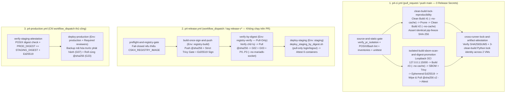

# `P4-ADR-03`: Kiến trúc CI Cô lập PR, Khóa Phụ thuộc Python Bắc cầu, Gate Bảo mật Strict & Quảng bá Cùng Một Image Digest

- **Mã quyết định:** `P4-ADR-03`
- **Trạng thái:** Đề xuất chốt trong PR `P4-02` (`T1B`)
- **Ngày lập:** `2026-11-06`
- **Liên kết chuẩn:** [`docs/root-plan/P4.md`](../root-plan/P4.md) (§4, §18.1, §21, cổng `G02`, `G04`, `G05`, `G23`), [`docs/p4/P4-ADR-01-compose-and-isolation.md`](./P4-ADR-01-compose-and-isolation.md), [`docs/p4/P4-ADR-02-custom-image-and-lock.md`](./P4-ADR-02-custom-image-and-lock.md), [`docs/p4/p4-02-pipeline-input-contract.md`](./p4-02-pipeline-input-contract.md), [`docs/p4/p4-02-cve-exception-requests.md`](./p4-02-cve-exception-requests.md)

---

## 1. Bối cảnh & Bài toán

Sau khi `P4-00` (`be33e6c`) và `P4-01` (`492423c` — ghép custom image `7569e9b` của `T1B` và bộ Compose `12a44c9` của `T1A`) chốt công thức đóng gói đa tầng cùng hợp đồng `APP_IMAGE=<repo>@sha256:<64-hex>`, gói `P4-02` giải quyết đồng thời 5 bài toán kỹ thuật:

1. **Cách ly tuyệt đối luồng kiểm tra PR:** Mọi PR chạy trên runner cô lập với `permissions: contents: read`, **0 secret phát hành**, **0 quyền ghi registry ngoài** và **0 khóa SSH Staging/Production**.
2. **Tất định hóa phụ thuộc Python bắc cầu (`REL-03`):** Ngăn hiện tượng trôi phiên bản gói phụ thuộc bắc cầu của PyPI giữa các thời điểm build bằng tệp khóa constraints kiểm SHA-256 cho cả `pip` lẫn `uv` (`PIP_CONSTRAINT`, `UV_CONSTRAINT`, `UV_BUILD_CONSTRAINT`, `--no-build-isolation`), chứng minh qua các lần build sạch `--no-cache` độc lập.
3. **Thực thi bất biến `Build-Once, Promote-By-Digest` với bộ kiểm POSIX (`REL-02` / `REL-04`):** Xác thực URI `@sha256:<64-hex>` bằng chuẩn POSIX ERE tương thích mọi shell `/bin/sh`, hỗ trợ đăng nhập `pull-only` cho mọi registry riêng tư qua môi trường cô lập `registry-verify` và máy chủ đích.
4. **Cổng bảo mật nghiêm ngặt & ký số Ed25519 (`REL-01`):** Quét Trivy `vuln,secret` không bỏ qua tệp, khóa đối sánh byte-for-byte mẫu JWT doctest duy nhất của `PyJWT METADATA`, vá trực tiếp các gói tương thích trong image, trình duyệt riêng từng ngoại lệ `CRITICAL` còn bị khóa bởi upstream và bắt buộc `gate_mode='strict'` trước khi ký `release-manifest.json` phạm vi `production_candidate`.
5. **Tách bạch bằng chứng OCI Registry loopback với hạ tầng từ xa đang `BLOCKED` (`BLK-INFRA-01..03`):** Chứng minh thực nghiệm toàn bộ chuỗi trên `127.0.0.1:15000` nhưng giữ cổng phát hành từ xa ở trạng thái `fail-closed` minh bạch cho tới khi được cấp phát Registry và VPS.

---

## 2. Quyết định Kiến trúc

### 2.1. Tách 3 Workflow & 4 GitHub Environments Theo Đặc quyền Tối thiểu

- **Bốn GitHub Environments tách biệt quyền hạn:**
  1. `registry-build`: chỉ giữ `REGISTRY_PUSH_USERNAME`, `REGISTRY_PUSH_TOKEN` và `RELEASE_SIGNING_PRIVATE_KEY`.
  2. `registry-verify`: chỉ giữ `REGISTRY_PULL_USERNAME` và `REGISTRY_PULL_TOKEN` (`pull-only`) phục vụ runner kiểm thử sạch cache trên mọi registry riêng (GHCR, Harbor, ECR, GitLab Registry, registry nội bộ).
  3. `staging`: chỉ giữ SSH Staging + tùy chọn tài khoản đọc `pull-only` (tự động `docker logout` ngay sau `docker pull`).
  4. `production`: yêu cầu `Required reviewers`, giữ SSH Production + lệnh backup trước phát hành + tùy chọn tài khoản đọc `pull-only`.

### 2.2. Khóa Phụ thuộc Python Bắc cầu & Đồng bộ Verify Harness (`REL-03` / `REL-04`)

- Hai tệp khóa [`system-python-constraints.txt`](../../deploy/images/resources/system-python-constraints.txt) (`19` gói) và [`python-constraints.txt`](../../deploy/images/resources/python-constraints.txt) (`154` gói) được ghim SHA-256 trong [`release-lock.json`](../../deploy/images/release-lock.json) và áp đặt xuyên suốt `pip3 install`, `bench init`, `bench get-app` và `./env/bin/pip install --no-build-isolation`.
- [`compose.verify.yaml`](../../deploy/images/compose.verify.yaml) sao chép `/home/frappe/frappe-bench/apps-order.txt` (`frappe -> crm -> crm_cskh`) vào `sites/apps.txt` (khớp tuyệt đối [`compose.cskh-common.yaml`](../../deploy/compose/overrides/compose.cskh-common.yaml)), và bước khởi tạo site kiểm thử P0–P3 trong `p4-release.yml` truyền `--no-mariadb-socket` đồng bộ với kết nối MariaDB qua TCP.

### 2.3. Cổng Bảo mật Strict, Bản vá Tương thích & Ký số Ed25519 (`REL-01`)

- Các lỗ hổng `CRITICAL` có bản vá tương thích (`uv 0.13.7`, `form-data 4.0.5`) và các công cụ chỉ dùng lúc build (`esbuild`, `loader-utils`, `shell-quote`) được xử lý ngay trong `Containerfile`.
- [`evaluate_security_scan.py`](../../deploy/release/evaluate_security_scan.py) kiểm tra trực tiếp nội dung `pyjwt-2.13.0.dist-info/METADATA` trích từ image `@sha256`: chỉ chấp nhận duy nhất mẫu JWT doctest đã xác minh tại dòng `76` (`SHA-256: bf145d93...`); bất kỳ JWT nào khác trong cùng tệp đều làm cổng bảo mật `FAIL`.
- [`release_manifest.py`](../../deploy/release/release_manifest.py) từ chối sinh `release-manifest.json` phạm vi `production_candidate` nếu báo cáo quét bảo mật không đạt `status == "PASS"` dưới `gate_mode == "strict"`.
