# `P4-ADR-03`: Kiến trúc CI Cô lập PR, Ký số Manifest Ed25519 và Quảng bá Cùng Một Image Digest (`Build-Once, Promote-By-Digest`)

- **Mã quyết định:** `P4-ADR-03`
- **Trạng thái:** Đề xuất chốt trong PR `P4-02` (`T1B`)
- **Ngày lập:** `2026-11-06`
- **Liên kết chuẩn:** [`docs/root-plan/P4.md`](../root-plan/P4.md) (§4, §18.1, §21, cổng `G02`, `G04`, `G05`, `G23`), [`docs/p4/P4-ADR-01-compose-and-isolation.md`](./P4-ADR-01-compose-and-isolation.md), [`docs/p4/P4-ADR-02-custom-image-and-lock.md`](./P4-ADR-02-custom-image-and-lock.md), [`docs/p4/p4-02-pipeline-input-contract.md`](./p4-02-pipeline-input-contract.md)

---

## 1. Bối cảnh & Bài toán

Sau khi `P4-00` (`be33e6c`) và `P4-01` (`492423c` — ghép custom image `7569e9b` của `T1B` và bộ Compose `12a44c9` của `T1A`) khóa hoàn chỉnh công thức đóng gói đa tầng cùng hợp đồng `APP_IMAGE=<repo>@sha256:<64-hex>`, gói `P4-02` phải giải quyết đồng thời 4 bài toán kỹ thuật:

1. **Cách ly tuyệt đối luồng kiểm tra PR:** Mọi PR (kể cả nhánh thử nghiệm chưa review) phải được kiểm tra đầy đủ (lint, khóa nguồn, build thử image, SBOM, quét lỗ hổng/secret, kiểm site sạch `G02` và smoke Compose 10-service) trên runner cô lập mà **không được tiếp cận bất kỳ secret phát hành, token ghi registry hay khóa SSH Staging/Production nào**.
2. **Thực thi bất biến `Build-Once, Promote-By-Digest`:** Một commit ứng viên phát hành chỉ được build thành container image đúng **một lần duy nhất**; mọi bước kiểm định (`G02`/`G04`), Staging (`G05`) và Production (`G23`) phải kéo **cùng một `@sha256:<64-hex>`** từ OCI Registry, cấm tuyệt đối `docker build` lại trên máy chủ đích.
3. **Chứng thực chuỗi cung ứng phần mềm:** Mỗi bản phát hành phải đi kèm SBOM chuẩn máy đọc (CycloneDX 1.5 + SPDX 2.3), báo cáo quét lỗ hổng & secret (Trivy) và tệp `release-manifest.json` có chữ ký mật mã học để chống sửa đổi hoặc tráo digest giữa các môi trường.
4. **Chứng minh cơ chế quảng bá digest ngay trong CI khi Registry thương mại/nội bộ còn `BLOCKED` (`BLK-INFRA-03`):** Hệ thống cần chứng minh toàn bộ chuỗi `build-once -> push OCI v2 -> xóa cache cục bộ -> pull @sha256 -> verify clean site -> pull @sha256 -> Staging-topology smoke` hoạt động thực tế trên runner cô lập, đồng thời giữ cổng phát hành từ xa ở trạng thái `fail-closed` minh bạch cho tới khi `T0`/Owner cấp phát Registry và VPS Staging.

---

## 2. Quyết định Kiến trúc

### 2.1. Tách 3 Workflow Độc lập Theo Mức Đặc quyền (`Least-Privilege Workflow Split`)

```mermaid
flowchart TB
    subgraph PR["1. p4-ci.yml (pull_request / push main — 0 Release Secrets)"]
        S1["source-and-static-gate\nverify_pr_isolation + ruff + inventories + unittest"]
        S2["isolated-build-sbom-scan-and-digest-promotion\nLoopback OCI 127.0.0.1:15000 -> Build-Once -> SBOM/Trivy\n-> Ephemeral Ed25519 -> Wipe & Pull @sha256 x2 -> Attest"]
        S1 --> S2
    end

    subgraph REL["2. p4-release.yml (workflow_dispatch / tag release-v* — Không chạy trên PR)"]
        R0["preflight-and-registry-gate\nFail-closed nếu thiếu CSKH_REGISTRY_IMAGE"]
        R1["build-once-sign-and-push\nEnv: registry-build (chỉ quyền push Registry + ký Ed25519)"]
        R2["verify-by-digest (Runner mới sạch cache)\nVerify chữ ký -> Pull @sha256 -> G02 + G03 + P0..P3 suites"]
        R3["deploy-staging\nEnv: staging -> deploy_staging_by_digest.sh -> Attest 6 containers"]
        R0 --> R1 --> R2 --> R3
    end

    subgraph PROD["3. p4-production.yml (Chỉ workflow_dispatch thủ công)"]
        P1["verify-staging-attestation\nĐối chiếu PROD_DIGEST == STAGING_DIGEST + chữ ký Ed25519"]
        P2["deploy-production\nEnv: production (Required reviewers)\nBackup mã hóa trước phát hành (G07) + Roll cùng @sha256 (G23)"]
        P1 --> P2
    end
```

1. **[`.github/workflows/p4-ci.yml`](../../.github/workflows/p4-ci.yml):**
   - Kích hoạt trên `pull_request` (`main`, `codex/p4-*`), `push` (`main`) và `workflow_dispatch`.
   - Cố định `permissions: contents: read` ở cấp cao nhất; **không** dùng `pull_request_target`; **không** khai báo bất kỳ `environment:` nào; **không** đọc `secrets.*`.
   - Mọi external GitHub Action trong họ `p4-*.yml` bắt buộc ghim cứng bằng commit SHA 40 ký tự (`actions/checkout@11bd7190...`, `actions/upload-artifact@ea165f8d...`, `actions/download-artifact@d3f86a10...`), và các container công cụ phụ trợ (`registry:2.8.3`, `aquasec/trivy:0.58.2`) ghim cứng bằng `@sha256:<64-hex>`.
   - Được kiểm toán tự động ngay bước đầu tiên bởi [`verify_pr_isolation.py`](../../deploy/release/verify_pr_isolation.py).

2. **[`.github/workflows/p4-release.yml`](../../.github/workflows/p4-release.yml):**
   - Chỉ kích hoạt qua `workflow_dispatch` hoặc tag `release-v*` — **không bao giờ chạy trên PR**.
   - Phân tách đặc quyền qua các GitHub Environments riêng biệt:
     - `registry-build`: chỉ giữ token đẩy image (`REGISTRY_PUSH_TOKEN`) và khóa ký manifest (`RELEASE_SIGNING_PRIVATE_KEY`), hoàn toàn **không có** khóa SSH vào Staging hay Production.
     - Job `verify-by-digest`: chạy trên máy ảo `ubuntu-24.04` mới hoàn toàn (không có image vừa build trong cache cục bộ), chỉ có quyền đọc (`packages: read`), xác minh chữ ký Ed25519 trước khi `docker pull <repo>@sha256:<64-hex>` và chạy trọn bộ `verify_clean_site.py` (`G02`), `run_isolated_smoke.py` (`G03`) cùng các suite hồi quy P0–P3 (`G04`) trực tiếp bên trong image vừa kéo về.
     - `staging`: chỉ giữ thông tin kết nối máy chủ Staging và gọi [`deploy_staging_by_digest.sh`](../../deploy/release/deploy_staging_by_digest.sh).

3. **[`.github/workflows/p4-production.yml`](../../.github/workflows/p4-production.yml):**
   - Chỉ kích hoạt thủ công (`workflow_dispatch`), kiểm tra chéo `staging-digest-attestation.json` đảm bảo `PROD_TARGET_DIGEST == STAGING_VERIFIED_DIGEST` trước khi xin phê duyệt con người trên GitHub Environment `production` (`Required reviewers`), chụp backup mã hóa trước giờ phát hành (`G07`) và cuộn đúng digest đó lên Production (`G23`).

### 2.2. Ký số `release-manifest.json` Bằng Ed25519 & Khóa Phạm vi (`environment_scope`)

- [`release_manifest.py`](../../deploy/release/release_manifest.py) sinh `release-manifest.json` tuân thủ đầy đủ lược đồ `P4.md §4.1`, đồng thời tự động trích xuất:
  - `migration_revision` từ dòng cuối hiệu lực của [`apps/crm_cskh/crm_cskh/patches.txt`](../../apps/crm_cskh/crm_cskh/patches.txt) (`crm_cskh.patches.v3_0.p3_schema_and_seeds`).
  - `kpi_formula_version` từ hằng số `METRIC_VERSION` trong [`apps/crm_cskh/crm_cskh/services/kpi_calculator.py`](../../apps/crm_cskh/crm_cskh/services/kpi_calculator.py) (`cskh-metrics-v2`).
  - Bộ mã băm SHA-256 của `build-manifest.json`, `image-inspect-summary.json`, `sbom.cyclonedx.json`, `sbom.spdx.json` và `security-scan-summary.json`.
- Chữ ký số sử dụng thuật toán chuẩn **Ed25519** (RFC 8032) trên đúng mảng byte UTF-8 của `release-manifest.json`.
- Trường `environment_scope` phân định cứng hai ngữ cảnh:
  - `ci_ephemeral_rehearsal`: dùng trong `p4-ci.yml` với cặp khóa Ed25519 dùng một lần (xóa ngay khóa riêng sau khi ký) để kiểm chứng trọn vẹn cơ chế ký/xác minh trên PR mà không cần cấp secret thật.
  - `production_candidate`: bắt buộc bởi `deploy_staging_by_digest.sh`, `p4-release.yml` và `p4-production.yml` (`--expected-scope production_candidate`), đảm bảo manifest diễn tập của CI bị từ chối tức khắc nếu ai đó cố nạp vào Staging/Production.

### 2.3. Diễn tập OCI Registry Loopback Cô lập Trong `p4-ci.yml`

Trong khi chờ `BLK-INFRA-03` (cấp phát Container Registry từ xa), Job 2 của `p4-ci.yml` dựng một OCI v2 Registry cục bộ chỉ lắng nghe trên `127.0.0.1:15000` (`registry:2.8.3@sha256:a3d8aaa6...`), thực hiện `build-once` + `docker push`, sau đó **xóa sạch image khỏi Docker daemon cục bộ (`docker rmi -f`) hai lần liên tiếp** trước khi kéo lại hoàn toàn bằng định danh bất biến `127.0.0.1:15000/cskh/crm-cskh@sha256:<64-hex>` vào cả `verify_clean_site.py` lẫn `run_isolated_smoke.py`, và khóa bằng [`verify_digest_promotion.py`](../../deploy/release/verify_digest_promotion.py).

---

## 3. Hệ quả & Ràng buộc Vận hành

- **Ưu điểm:**
  - Không một PR nào có thể đọc hoặc làm lộ secret phát hành, nhưng mọi PR đều được kiểm chứng thật từ bước đóng gói image, sinh SBOM, quét secret/CVE, ký Ed25519 cho tới kéo lại theo `@sha256` trên stack 10 service.
  - Xử lý tương thích đồng thời cả hai cơ chế định danh `Image ID` của Docker Engine hiện đại (`overlay2` classic config SHA-256 và `containerd` image store manifest SHA-256) mà vẫn khóa chặt bằng chứng mật mã `@sha256:<64-hex>`.
  - Không tạo bất kỳ tệp `docs/p4/release-manifest.json` giả mạo nào trong Git khi chưa phát hành thật.
- **Đánh đổi:**
  - Job 2 của `p4-ci.yml` build toàn bộ Frappe + CRM + `crm_cskh` trên runner sạch nên mất khoảng 20–35 phút mỗi lượt chạy; đổi lại phát hiện sớm mọi lỗi lệch lockfile, lỗi biên dịch asset hoặc lỗi khởi tạo site sạch ngay trên PR trước khi merge vào `main`.
