# Hợp đồng Đầu vào cho Pipeline `P4-02`: Build-Once và Quảng bá Cùng Một Image Digest qua Kiểm thử, Staging & Production

- **Mã tài liệu:** `P4-02-INPUT-CONTRACT`
- **Gói bàn giao:** `P4-01` (`T1B`) → đồng bộ thực thi với `P4-02` (CI/CD & Release Pipeline) và kiểm định `T1C` (`G02`, `G04`, `G05`)
- **Baseline ứng dụng:** `main` tại `92e14af3532876ad5bc2468bf0e502474cc95a53`
- **Tài liệu liên kết:**
  - [`docs/p4/P4-ADR-02-custom-image-and-lock.md`](./P4-ADR-02-custom-image-and-lock.md)
  - [`docs/p4/P4-ADR-03-ci-registry-and-promotion.md`](./P4-ADR-03-ci-registry-and-promotion.md)
  - [`docs/p4/p4-02-cve-exception-requests.md`](./p4-02-cve-exception-requests.md)
  - [`deploy/images/release-lock.json`](../../deploy/images/release-lock.json)
  - [`deploy/images/Containerfile`](../../deploy/images/Containerfile)
  - [`deploy/images/build-image.sh`](../../deploy/images/build-image.sh)
  - [`deploy/release/validate_digest_uri.sh`](../../deploy/release/validate_digest_uri.sh)

---

## 1. Bất biến Cốt lõi (`Build-Once, Promote-By-Digest`)

Theo [`docs/root-plan/P4.md`](../root-plan/P4.md) (§4.1–§4.3, cổng `G02`, `G04`, `G05`), pipeline `P4-02` phải tuân thủ tuyệt đối bất biến sau:

```mermaid
flowchart LR
    Commit["Commit đã khóa\n+ release-lock.json\n+ python-constraints.txt"] --> BuildOnce["Job 1: build-once\nbash deploy/images/build-image.sh --no-cache"]
    BuildOnce -->|"Push & kiểm POSIX\nvalidate_digest_uri.sh"| Digest["Artifact bất biến\nAPP_IMAGE=repo@sha256:<64hex>"]
    Digest --> GateCI["Job 2: verify-by-digest (Env: registry-verify)\nverify_clean_site.py + Compose smoke + P0..P3 suites"]
    GateCI -->|"Strict Scan + Ed25519 PASS"| Staging["Job 3: deploy-staging (Env: staging)\ndeploy_staging_by_digest.sh"]
    Staging -->|"Smoke + E2E + Perf PASS\n+ Human Approval"| Prod["Job 4: deploy-production (Env: production)\nBackup pre-release + cùng APP_IMAGE@sha256"]
```

> **Một commit ứng viên phát hành chỉ được biên dịch thành Docker image đúng một lần duy nhất (`build-once`).** Mọi bước phía sau — bao gồm kiểm định site sạch (`G02`), hồi quy bảo mật/nghiệp vụ P0–P3 (`G04`), triển khai Staging (`G05`), diễn tập migration (`G06`) và phát hành Production (`G23`) — bắt buộc kéo **chính xác cùng một định danh bất biến `APP_IMAGE=<registry>/<namespace>/crm-cskh@sha256:<64-hex>`**, tuyệt đối không gọi lại `docker build` ở Staging hay Production.



---

## 2. Giao diện Tệp Đầu vào Chuẩn Hóa Cho Pipeline `P4-02`

Pipeline `P4-02` không hardcode phiên bản Frappe, CRM, Node, Python hay cờ build trong YAML của GitHub Actions; chỉ gọi các điểm vào chuẩn hóa dưới đây:

| Thành phần | Đường dẫn | Vai trò trong Pipeline `P4-02` |
| :--- | :--- | :--- |
| **Khóa nguồn & công cụ máy đọc** | [`deploy/images/release-lock.json`](../../deploy/images/release-lock.json) | Nguồn sự thật duy nhất (`cskh-p4-release-lock-v1`) ghim base image `@sha256`, công cụ build (`uv==0.13.7`), SHA 40 ký tự của `frappe`/`crm`/`frappe_docker`, mã băm `yarn.lock`, mã băm khóa phụ thuộc Python bắc cầu, `apps_tree_sha`, `crm_cskh_tree_sha` và bản vá bảo mật runtime. |
| **Khóa phụ thuộc Python bắc cầu (`REL-03`)** | [`deploy/images/resources/python-constraints.txt`](../../deploy/images/resources/python-constraints.txt) + [`system-python-constraints.txt`](../../deploy/images/resources/system-python-constraints.txt) | Khóa chính xác `154` gói PyPI của bench virtualenv và `19` gói Python hệ thống ở stage `base`; được kiểm SHA-256 trước và trong `Containerfile` qua `PIP_CONSTRAINT`, `UV_CONSTRAINT`, `UV_BUILD_CONSTRAINT` và `--no-build-isolation`. |
| **Công thức đóng gói đa tầng** | [`deploy/images/Containerfile`](../../deploy/images/Containerfile) + [`Containerfile.dockerignore`](../../deploy/images/Containerfile.dockerignore) | Công thức BuildKit 3 tầng (`base -> builder -> backend`), user non-root `frappe` (`1000:0`), biên dịch sẵn Desk + `/crm` Vue SPA + `/cskh/*` tiếng Việt, áp bản vá `uv 0.13.7` / `form-data 4.0.5`, loại bỏ công cụ bundler chỉ dùng lúc build và đóng gói `/home/frappe/frappe-bench/release-metadata/*` + `apps-order.txt`. |
| **Trình biên dịch & xuất khóa** | [`deploy/images/build-image.sh`](../../deploy/images/build-image.sh) | Kiểm tra tính toàn vẹn cây `apps/` và SHA-256 của 2 tệp constraints trước khi build; gọi `docker buildx build`; trích xuất khóa phụ thuộc ra `--out-dir`; đẩy lên registry (khi `REGISTRY_PUSH=true`), kiểm POSIX digest URI và ghi `image-inspect-summary.json`. |
| **Trình kiểm POSIX `@sha256` URI (`REL-02`)** | [`deploy/release/validate_digest_uri.sh`](../../deploy/release/validate_digest_uri.sh) | Trình kiểm `/bin/sh` tương thích POSIX dùng chung cho `build-image.sh`, `deploy_staging_by_digest.sh` và cả 3 workflow `p4-*.yml`; chấp nhận URI hợp lệ chứa `crm-cskh` và từ chối khoảng trắng, xuống dòng, tag trôi hoặc digest sai. |
| **Bộ kiểm định site sạch & HTTP assets (`G02`)** | [`deploy/images/verify_clean_site.py`](../../deploy/images/verify_clean_site.py) + [`compose.verify.yaml`](../../deploy/images/compose.verify.yaml) | Dựng stack cô lập từ `APP_IMAGE` (không mount `/src`), đồng bộ `sites/apps.txt` từ `/home/frappe/frappe-bench/apps-order.txt` (`frappe -> crm -> crm_cskh`), chạy `bench new-site --no-mariadb-socket` + `install-app crm` + `install-app crm_cskh` + `migrate` ×2 và kiểm tra 45/45 assertions. |
| **Bộ Compose triển khai & smoke (`T1A`)** | `deploy/compose/overrides/compose.cskh-*.yaml` + [`run_isolated_smoke.py`](../../deploy/compose/scripts/run_isolated_smoke.py) | Nhận trực tiếp `APP_IMAGE=<registry>/<namespace>/crm-cskh@sha256:<64-hex>` và `PULL_POLICY=always` trên toàn bộ 8 service ứng dụng (`configurator`, `backend`, `frontend`, `websocket`, `queue-short`, `queue-long`, `scheduler`, `migrator`). |

---

## 3. Giao thức Gọi Lệnh & Biến Môi trường Theo Từng Chế độ CI/CD

### 3.1. Chế độ PR Kiểm tra Trước Merge (`pull_request` — 0 Secret Phát hành, Loopback OCI Rehearsal)

Trên PR, workflow [`.github/workflows/p4-ci.yml`](../../.github/workflows/p4-ci.yml) **không cấp quyền ghi registry ngoài** và **không nạp bất kỳ secret nào**, đồng thời chứng minh cả hai bất biến: (a) 2 lần build sạch `--no-cache` sinh cùng mã băm danh mục gói Python (`REL-03`), và (b) quảng bá cùng một `@sha256` qua OCI v2 Registry loopback `127.0.0.1:15000`:

```bash
# 1. Build-once không dùng cache và đẩy vào OCI v2 Registry cục bộ 127.0.0.1:15000 (0 secret ngoài)
LOOPBACK_REPO="127.0.0.1:15000/cskh/crm-cskh"
CI_TAG="ci-${GITHUB_SHA::12}"

LOCAL_IMAGE_REPO="${LOOPBACK_REPO}" \
REGISTRY_PUSH=true \
CSKH_REGISTRY_IMAGE="${LOOPBACK_REPO}" \
bash deploy/images/build-image.sh \
  --no-cache \
  --out-dir "${RUNNER_TEMP}/p4-ci-evidence/build" \
  --tag "${CI_TAG}"

# 2. Đọc digest @sha256 bất biến và kiểm tra bằng bộ kiểm POSIX dùng chung (REL-02)
APP_IMAGE_DIGEST="$(jq -r '.registry_verification.approved_registry_repo_digest' \
  "${RUNNER_TEMP}/p4-ci-evidence/build/image-inspect-summary.json")"
sh deploy/release/validate_digest_uri.sh "${APP_IMAGE_DIGEST}"

# 3. Xóa sạch image khỏi Docker cục bộ rồi kéo lại theo đúng @sha256 cho G02 & G03
docker rmi -f "${LOOPBACK_REPO}:${CI_TAG}" "${APP_IMAGE_DIGEST}" || true
docker pull "${APP_IMAGE_DIGEST}"

python3 deploy/images/verify_clean_site.py \
  --app-image "${APP_IMAGE_DIGEST}" \
  --pull-policy always \
  --port 18780 \
  --out "${RUNNER_TEMP}/p4-ci-evidence/verify/clean-site-verify.json"
```

> **Quy tắc cập nhật `apps/` hoặc khóa phụ thuộc trên PR:** [`build-image.sh`](../../deploy/images/build-image.sh) đối chiếu cứng `git rev-parse HEAD:apps`, `git rev-parse HEAD:apps/crm_cskh` và SHA-256 của 2 tệp `*-python-constraints.txt` với [`deploy/images/release-lock.json`](../../deploy/images/release-lock.json); nếu lệch bất kỳ giá trị nào, bước build lập tức dừng lỗi (`fail-closed`).

### 3.2. Chế độ Phát hành Chuẩn (`workflow_dispatch` / Tag `release-v*` — Build Một Lần & Gate Strict)

Trong [`.github/workflows/p4-release.yml`](../../.github/workflows/p4-release.yml), job `build-once-sign-and-push` chạy trong môi trường bảo vệ `registry-build` (chỉ có quyền đẩy image và ký manifest, không có khóa SSH vào VPS):

```bash
ACTUAL_HEAD_SHA="$(git rev-parse HEAD)"
REL_TAG="0.0.1-${ACTUAL_HEAD_SHA::12}"

LOCAL_IMAGE_REPO="${CSKH_REGISTRY_IMAGE}" \
REGISTRY_PUSH=true \
CSKH_REGISTRY_IMAGE="${CSKH_REGISTRY_IMAGE}" \
bash deploy/images/build-image.sh \
  --no-cache \
  --out-dir "${RUNNER_TEMP}/p4-release-bundle/build" \
  --tag "${REL_TAG}"

APP_IMAGE_DIGEST="$(jq -r '.registry_verification.approved_registry_repo_digest' \
  "${RUNNER_TEMP}/p4-release-bundle/build/image-inspect-summary.json")"

# Kiểm tra định dạng digest tương thích POSIX (không dùng \s trong lớp ký tự ERE)
sh deploy/release/validate_digest_uri.sh "${APP_IMAGE_DIGEST}"

# Cổng bảo mật Release chạy bắt buộc ở chế độ --strict kèm xác thực mẫu PyJWT METADATA
python3 deploy/release/evaluate_security_scan.py \
  --strict \
  --trivy-json "${RUNNER_TEMP}/p4-release-bundle/security/trivy-image.json" \
  --pyjwt-metadata-file "${RUNNER_TEMP}/p4-release-bundle/security/pyjwt-METADATA.txt" \
  --out "${RUNNER_TEMP}/p4-release-bundle/security/security-scan-summary.json"
```

### 3.3. Quảng bá Cùng `APP_IMAGE_DIGEST` Sang `verify-by-digest`, `Staging` và `Production`

Mọi job kế tiếp nhận `${{ needs.build-once-sign-and-push.outputs.app_image_digest }}` làm tham số đầu vào duy nhất cho `APP_IMAGE`:

| Giai đoạn Pipeline (`P4.md §4.3`) | Giá trị `APP_IMAGE` | GitHub Environment & Quyền hạn Tối thiểu | Kiểm chứng Bắt buộc Trước Khi Qua Cửa |
| :--- | :--- | :--- | :--- |
| **`verify-by-digest` (`G02` / `G03` / `G04`)** | `${APP_IMAGE_DIGEST}` | `registry-verify` — chỉ giữ tài khoản đọc `REGISTRY_PULL_USERNAME` + `REGISTRY_PULL_TOKEN` (`read-only`) | Xác minh chữ ký Ed25519 + `SHA256SUMS.txt` trước khi `docker pull` → `verify_clean_site.py` (`45/45`) → `run_isolated_smoke.py` (10-service) → toàn bộ suite P0–P3 với `--no-mariadb-socket` và `sites/apps.txt == apps-order.txt` → `docker logout`. |
| **`deploy-staging` (`G05` / `G06`)** | `${APP_IMAGE_DIGEST}` | `staging` — tài khoản đọc registry (`pull-only`) + kênh SSH Staging riêng | `deploy_staging_by_digest.sh`: kiểm POSIX digest URI → xác minh chữ ký Ed25519 phạm vi `production_candidate` → đăng nhập `pull-only` tạm thời, `docker pull` và `docker logout` ngay → `validate_compose_config.py` → one-shot `migrator` (khi bật) → `docker compose up -d` → đối chiếu `docker inspect` cả 6 container ứng dụng (`zero_digest_drift: true`, `0` bind-mount `/src`). |
| **`deploy-production` (`G23`)** | `${APP_IMAGE_DIGEST}` *(y hệt Staging)* | `production` (`Required reviewers`) — tài khoản đọc registry (`pull-only`) + kênh SSH Prod riêng | Kiểm tra `PROD_TARGET_DIGEST == STAGING_VERIFIED_DIGEST` + chữ ký Ed25519 → chụp backup mã hóa offsite bắt buộc (`G07`) → cuộn đúng `${APP_IMAGE_DIGEST}` bằng `deploy_staging_by_digest.sh`. |

---

## 4. Ánh xạ Sang Lược đồ `release-manifest.json` (`P4.md §4.1`)

[`deploy/release/release_manifest.py`](../../deploy/release/release_manifest.py) tự động kết hợp dữ liệu từ `release-lock.json`, `build-manifest.json`, `image-inspect-summary.json`, SBOM và báo cáo quét bảo mật để sinh `release-manifest.json` (từ chối sinh phạm vi `production_candidate` nếu `security-scan` không ở chế độ `gate_mode == "strict"` hoặc `status != "PASS"`):

| Trường trong `release-manifest.json` (`P4.md §4.1`) | Nguồn trích xuất chuẩn hóa từ mã nguồn & artifact `P4-01` / `P4-02` |
| :--- | :--- |
| `release_id` | Chuỗi định danh phát hành do pipeline cấp, ví dụ `crm-cskh-YYYYMMDD-NNN` |
| `git_sha` | `build-manifest.json` → `.apps.crm_cskh.source_commit_sha` (`GITHUB_SHA` 40 ký tự) |
| `frappe_framework_ref` | `build-manifest.json` → `"\(.apps.frappe.tag)@\(.apps.frappe.commit_sha)"` (`v15.123.1@d2efa79657ba5c1abf96098b3bfacc199517d57e`) |
| `frappe_crm_ref` | `build-manifest.json` → `"\(.apps.crm.tag)@\(.apps.crm.commit_sha)"` (`v1.87.0@0d3910b456ef4fb913e77b29db011b3debc4f778`) |
| `crm_cskh_ref` | `build-manifest.json` → `"\(.apps.crm_cskh.source_commit_sha) (tree:\(.apps.crm_cskh.crm_cskh_tree_sha))"` |
| `image` | `image-inspect-summary.json` → `.registry_verification.approved_registry_repo_digest` (`<registry>/<namespace>/crm-cskh@sha256:<64hex>`) |
| `migration_revision` | Dòng patch hiệu lực cuối cùng trong [`apps/crm_cskh/crm_cskh/patches.txt`](../../apps/crm_cskh/crm_cskh/patches.txt) (trên baseline `92e14af`: `crm_cskh.patches.v3_0.p3_schema_and_seeds`) |
| `kpi_formula_version` | Hằng số `METRIC_VERSION` trong [`apps/crm_cskh/crm_cskh/services/kpi_calculator.py`](../../apps/crm_cskh/crm_cskh/services/kpi_calculator.py) (trên baseline `92e14af`: `cskh-metrics-v2`) |
| `previous_release_id` | Định danh bản phát hành Production liền trước (hoặc `null` ở lần Go-Live đầu tiên) |
| `build_url` | URL lượt chạy CI tạo ra digest (`${GITHUB_SERVER_URL}/${GITHUB_REPOSITORY}/actions/runs/${GITHUB_RUN_ID}`) |
| `test_report_url` | URL artifact kiểm thử/nghiệm thu gắn với cùng digest |
| `approved_by` | Danh sách tài khoản phê duyệt cổng phát hành |

---

## 5. Quy tắc Dừng Khẩn cấp (`Fail-Closed Stop Rules`)

Pipeline `P4-02` hủy ngay lập tức (`exit != 0`) nếu gặp bất kỳ điều kiện nào sau đây:

1. **Lệch cây mã nguồn `apps/` hoặc khóa Python bắc cầu:** `git rev-parse HEAD:apps`, `git rev-parse HEAD:apps/crm_cskh` hoặc SHA-256 của `python-constraints.txt` / `system-python-constraints.txt` không khớp `release-lock.json`; hoặc `pip-freeze.txt` lệch mã băm giữa các lần build sạch.
2. **Lệch mã nguồn hoặc lockfile upstream:** `git rev-parse HEAD` của `apps/frappe` / `apps/crm` hoặc `sha256sum` của 3 tệp `yarn.lock` khác với `release-lock.json`.
3. **Thiếu hoặc sai định dạng POSIX digest URI (`REL-02`):** `approved_registry_repo_digest` hoặc `APP_IMAGE` bị [`validate_digest_uri.sh`](../../deploy/release/validate_digest_uri.sh) từ chối (chứa khoảng trắng/xuống dòng, dùng tag trôi thiếu `@sha256`, hoa/thường sai, digest toàn `0`, `BLOCKED` hoặc không khớp mẫu POSIX ERE `^[^/@[:space:]:]+(:[0-9]+)?(/[^/@[:space:]:]+)+(:[A-Za-z0-9._-]+)?@sha256:[0-9a-f]{64}$`).
4. **Vi phạm cổng bảo mật `strict` (`REL-01`):** Xuất hiện bất kỳ secret nào (kể cả JWT khác nằm chung tệp `pyjwt-2.13.0.dist-info/METADATA`) hoặc bất kỳ lỗ hổng `CRITICAL` nào chưa được vá / chưa có mục ngoại lệ còn hạn do `T0` ký duyệt.
5. **Cổng site sạch `G02` hoặc thứ tự `apps.txt` thất bại:** `verify_clean_site.py` trả về bất kỳ assertion nào `!= PASS`, hoặc `sites/apps.txt` không khớp chính xác `/home/frappe/frappe-bench/apps-order.txt` (`frappe -> crm -> crm_cskh`).
6. **Lệch digest giữa các tầng môi trường (`Drift Violation`):** Digest triển khai trên Staging hoặc Production khác dù chỉ 1 ký tự với `release-manifest.json` đã ký Ed25519.

---

## 6. Các Hạng mục Hạ tầng Ngoài Repo Đang Chờ Cấp phát (`BLOCKED` từ `P4-00`)

Theo [`docs/p4/infra-inventory.md`](./infra-inventory.md), luồng diễn tập OCI Registry loopback trên CI đã chạy trọn chuỗi, nhưng để mở khóa phát hành từ xa (`p4-release.yml` / `p4-production.yml`), Chủ sở hữu dự án / Quản trị hạ tầng cần cấp phát:

1. **Container Registry được phê duyệt (`vars.CSKH_REGISTRY_IMAGE` & `vars.RELEASE_SIGNING_PUBLIC_KEY` — `BLK-INFRA-03`):** Ví dụ `ghcr.io/<org>/crm-cskh` hoặc registry riêng nội bộ.
2. **Tách quyền tài khoản Registry trên 4 GitHub Environments bảo vệ:**
   - `registry-build`: chỉ giữ token ghi `REGISTRY_PUSH_USERNAME` + `REGISTRY_PUSH_TOKEN` và khóa ký `RELEASE_SIGNING_PRIVATE_KEY`.
   - `registry-verify`: chỉ giữ tài khoản đọc `REGISTRY_PULL_USERNAME` + `REGISTRY_PULL_TOKEN` (`pull-only`) để kéo image trên runner kiểm thử sạch cache cho mọi registry riêng tư (không chỉ `ghcr.io`).
   - `staging` (`BLK-INFRA-01`): khóa SSH Staging + tùy chọn `REGISTRY_PULL_USERNAME` / `REGISTRY_PULL_TOKEN` (`pull-only`).
   - `production` (`BLK-INFRA-02`): bắt buộc `Required reviewers`, khóa SSH Production, lệnh backup mã hóa trước phát hành (`PROD_PRE_RELEASE_BACKUP_CMD`) và tài khoản đọc registry (`pull-only`).
