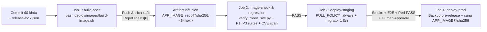

# Hợp đồng Đầu vào cho Pipeline `P4-02`: Build-Once và Quảng bá Cùng Một Image Digest qua Kiểm thử, Staging & Production

- **Mã tài liệu:** `P4-02-INPUT-CONTRACT`
- **Gói bàn giao:** `P4-01` (`T1B`) → đầu vào trực tiếp cho `P4-02` (CI/CD & Release Pipeline) và kiểm định `T1C` (`G02`, `G04`, `G05`)
- **Baseline ứng dụng:** `main` tại `92e14af3532876ad5bc2468bf0e502474cc95a53`
- **Tài liệu liên kết:**
  - [`docs/p4/P4-ADR-02-custom-image-and-lock.md`](./P4-ADR-02-custom-image-and-lock.md)
  - [`deploy/images/release-lock.json`](../../deploy/images/release-lock.json)
  - [`deploy/images/Containerfile`](../../deploy/images/Containerfile)
  - [`deploy/images/build-image.sh`](../../deploy/images/build-image.sh)
  - [`deploy/images/verify_clean_site.py`](../../deploy/images/verify_clean_site.py)

---

## 1. Bất biến Cốt lõi (`Build-Once, Promote-By-Digest`)

Theo [`docs/root-plan/P4.md`](../root-plan/P4.md) (§4.1–§4.3, cổng `G02`, `G04`, `G05`), pipeline `P4-02` phải tuân thủ tuyệt đối bất biến sau:

> **Một commit ứng viên phát hành chỉ được biên dịch thành Docker image đúng một lần duy nhất (`build-once`).** Mọi bước phía sau — bao gồm kiểm định site sạch (`G02`), hồi quy bảo mật/nghiệp vụ P0–P3 (`G04`), triển khai Staging (`G05`), diễn tập migration (`G06`) và phát hành Production (`G23`) — bắt buộc kéo **chính xác cùng một định danh bất biến `APP_IMAGE=<registry>/<namespace>/crm-cskh@sha256:<64-hex>`**, tuyệt đối không gọi lại `docker build` ở Staging hay Production.



---

## 2. Giao diện Tệp Đầu vào Do `P4-01` Bàn giao cho `P4-02`

Pipeline `P4-02` không được hardcode phiên bản Frappe, CRM, Node, Python hay danh sách cờ build trong YAML của GitHub Actions; thay vào đó chỉ gọi các điểm vào chuẩn hóa dưới đây:

| Thành phần `P4-01` | Đường dẫn | Vai trò trong Pipeline `P4-02` |
| :--- | :--- | :--- |
| **Khóa nguồn & công cụ máy đọc** | [`deploy/images/release-lock.json`](../../deploy/images/release-lock.json) | Nguồn sự thật duy nhất (`cskh-p4-release-lock-v1`) ghim base image `@sha256`, công cụ build, SHA 40 ký tự của `frappe`/`crm`/`frappe_docker`, mã băm `yarn.lock`, `apps_tree_sha`, `crm_cskh_tree_sha`, hạ tầng MariaDB/Redis `@sha256` và hợp đồng biến Compose `APP_IMAGE`. |
| **Công thức đóng gói đa tầng** | [`deploy/images/Containerfile`](../../deploy/images/Containerfile) + [`Containerfile.dockerignore`](../../deploy/images/Containerfile.dockerignore) | Công thức BuildKit 3 tầng (`base -> builder -> backend`), user non-root `frappe` (`1000:0`), biên dịch sẵn Desk + `/crm` Vue SPA + `/cskh/*` tiếng Việt và đóng gói `/home/frappe/frappe-bench/release-metadata/*`. |
| **Trình biên dịch & xuất khóa** | [`deploy/images/build-image.sh`](../../deploy/images/build-image.sh) | Kiểm tra tính toàn vẹn cây `apps/` trước khi build; gọi `docker buildx build`; trích xuất toàn bộ khóa phụ thuộc ra `--out-dir`; đẩy lên registry (khi `REGISTRY_PUSH=true`) và ghi `image-inspect-summary.json`. |
| **Bộ kiểm định site sạch & HTTP assets (`G02`)** | [`deploy/images/verify_clean_site.py`](../../deploy/images/verify_clean_site.py) + [`compose.verify.yaml`](../../deploy/images/compose.verify.yaml) | Dựng stack cô lập từ `APP_IMAGE` (không mount `/src`), chạy `bench new-site` + `install-app crm` + `install-app crm_cskh` + `migrate` x2, đối chiếu `list-apps`, upstream SHA, nhãn tiếng Việt, kiểm toán schema DocType và tải thử toàn bộ bundle JS/CSS qua `frontend` (Nginx) → `backend` (Gunicorn). |
| **Bộ Compose triển khai (`T1A` @ `e223555`)** | `deploy/compose/overrides/compose.cskh-*.yaml` + `deploy/compose/scripts/run_isolated_smoke.py` | Nhận trực tiếp `APP_IMAGE=<registry>/<namespace>/crm-cskh@sha256:<64-hex>` (hoặc `sha256:<64-hex>` cục bộ khi smoke cô lập) và `PULL_POLICY=always` trên toàn bộ 8 service ứng dụng (`configurator`, `backend`, `frontend`, `websocket`, `queue-short`, `queue-long`, `scheduler`, `migrator`). |

---

## 3. Giao thức Gọi Lệnh & Biến Môi trường Theo Từng Chế độ CI/CD

### 3.1. Chế độ PR Kiểm tra Trước Merge (`pull_request` — Không Đẩy Registry, Không Cấp Secret)

Trên PR từ nhánh tính năng hoặc fork, workflow **không cấp quyền ghi registry** và **không nạp bất kỳ secret Staging/Production nào**:

```bash
# 1. Build cục bộ trên runner cô lập và xuất hồ sơ khóa
bash deploy/images/build-image.sh \
  --out-dir /tmp/p4-image-evidence \
  --tag "crm-cskh:pr-${GITHUB_SHA::7}"

# 2. Đọc local_image_id bất biến từ kết quả build
APP_IMAGE="$(jq -r '.local_image_id' /tmp/p4-image-evidence/image-inspect-summary.json)"

# 3. Chạy cổng kiểm định site sạch + HTTP frontend assets (G02)
python3 deploy/images/verify_clean_site.py \
  --app-image "${APP_IMAGE}" \
  --pull-policy never \
  --port 18780 \
  --out /tmp/p4-image-evidence/clean-site-verify.json
```

> **Quy tắc cập nhật `apps/` trên PR:** [`build-image.sh`](../../deploy/images/build-image.sh) (dòng 132–143) đối chiếu cứng `git rev-parse HEAD:apps` và `git rev-parse HEAD:apps/crm_cskh` với `apps_tree_sha` / `crm_cskh_tree_sha` trong `deploy/images/release-lock.json`. Nếu một PR có sửa mã nguồn trong `apps/crm_cskh`, tác giả PR bắt buộc cập nhật đồng thời hai mã băm cây này trong `deploy/images/release-lock.json`; nếu quên, bước `build` sẽ tự động dừng lỗi (`fail-closed`).

### 3.2. Chế độ Phát hành Chuẩn (`push` trên `main` / Tag Phát hành — Build Một Lần & Đẩy Registry)

Khi registry được phê duyệt và cấu hình trong `P4-02`:

```bash
# Job `build`: Chỉ có quyền ghi vào Container Registry, KHÔNG có quyền SSH/deploy VPS
REGISTRY_PUSH=true \
CSKH_REGISTRY_IMAGE="${CSKH_REGISTRY_IMAGE}" \
bash deploy/images/build-image.sh \
  --out-dir "${RUNNER_TEMP}/release-evidence" \
  --tag "0.0.1-${GITHUB_SHA::12}"

# Trích xuất định danh digest bất biến do Registry ký nhận
APP_IMAGE_DIGEST="$(jq -r '.registry_verification.approved_registry_repo_digest' \
  "${RUNNER_TEMP}/release-evidence/image-inspect-summary.json")"

# Chốt chặn fail-closed: bắt buộc khớp mẫu @sha256:<64hex>
echo "${APP_IMAGE_DIGEST}" | grep -Eq '^.+@sha256:[0-9a-f]{64}$'
echo "app_image_digest=${APP_IMAGE_DIGEST}" >> "${GITHUB_OUTPUT}"
```

### 3.3. Quảng bá Cùng `APP_IMAGE_DIGEST` Sang `image-check`, `Staging` và `Production`

Mọi job kế tiếp nhận `${{ needs.build.outputs.app_image_digest }}` làm tham số đầu vào duy nhất cho biến `APP_IMAGE`:

| Giai đoạn Pipeline (`P4.md §4.3`) | Giá trị `APP_IMAGE` | `PULL_POLICY` | Quyền hạn Tối thiểu của Job | Kiểm chứng Bắt buộc Trước Khi Qua Cửa |
| :--- | :--- | :---: | :--- | :--- |
| **`image-check` (`G02` / `G04`)** | `${APP_IMAGE_DIGEST}` | `always` | Chỉ `registry:pull` (read-only) | `verify_clean_site.py` PASS (45/45 assertions), `run_isolated_smoke.py` (`T1A`) PASS, quét lỗ hổng CVE (Trivy/Grype) không có Critical chưa được duyệt ngoại lệ. |
| **`test` (`G04` / `G10`–`G16`)** | `${APP_IMAGE_DIGEST}` | `always` | Chỉ `registry:pull` (read-only) | Toàn bộ suite backend/HTTP/UI P1–P3 chạy trên chính image digest vừa build (không bind-mount đè `apps/`). |
| **`deploy-staging` (`G05` / `G06`)** | `${APP_IMAGE_DIGEST}` | `always` | GitHub Environment `staging` (`registry:pull` + kênh deploy Staging riêng) | `validate_compose_env.py` PASS → tạo bản sao pre-migrate → chạy one-shot `migrator` (`--profile migrate`) → `docker compose up -d` → đối chiếu `docker inspect` mọi container chạy đúng `${APP_IMAGE_DIGEST}` → Staging smoke + E2E + perf PASS. |
| **`release-approval`** | `${APP_IMAGE_DIGEST}` | — | Phê duyệt thủ công bắt buộc bởi `Release Approver` (`T0`/Owner) | Xác nhận phân loại migration (Class A/B/C/D), kết quả Staging `G05`/`G06`, trạng thái backup và khung giờ bảo trì. |
| **`deploy-prod` (`G23`)** | `${APP_IMAGE_DIGEST}` *(y hệt Staging)* | `always` | GitHub Environment `production` (`registry:pull` + kênh deploy Prod tách biệt) | Kiểm tra `PROD_TARGET_DIGEST == STAGING_VERIFIED_DIGEST` → chụp backup mã hóa offsite (`G07`) → chạy `migrator` 1 lần → nâng cấp container → post-release smoke & watch window PASS. |

---

## 4. Ánh xạ Sang Lược đồ `docs/p4/release-manifest.json` (`P4.md §4.1`)

Job tổng hợp hồ sơ phát hành của `P4-02` kết hợp dữ liệu từ `deploy/images/release-lock.json`, `build-manifest.json` và `image-inspect-summary.json` để sinh `docs/p4/release-manifest.json` (tuyệt đối không điền sẵn digest giả khi chưa đẩy registry):

| Trường trong `release-manifest.json` (`P4.md §4.1`) | Nguồn trích xuất chuẩn hóa từ artifact `P4-01` / `P4-02` |
| :--- | :--- |
| `release_id` | Chuỗi định danh phát hành do pipeline cấp, ví dụ `crm-cskh-YYYYMMDD-NNN` |
| `git_sha` | `build-manifest.json` → `.apps.crm_cskh.source_commit_sha` (`GITHUB_SHA` 40 ký tự) |
| `frappe_framework_ref` | `build-manifest.json` → `"\(.apps.frappe.tag)@\(.apps.frappe.commit_sha)"` (`v15.123.1@d2efa79657ba5c1abf96098b3bfacc199517d57e`) |
| `frappe_crm_ref` | `build-manifest.json` → `"\(.apps.crm.tag)@\(.apps.crm.commit_sha)"` (`v1.87.0@0d3910b456ef4fb913e77b29db011b3debc4f778`) |
| `crm_cskh_ref` | `build-manifest.json` → `"\(.apps.crm_cskh.source_commit_sha) (tree:\(.apps.crm_cskh.crm_cskh_tree_sha))"` |
| `image` | `image-inspect-summary.json` → `.registry_verification.approved_registry_repo_digest` (`<registry>/<namespace>/crm-cskh@sha256:<64hex>`) |
| `migration_revision` | Mã patch cuối cùng trong `apps/crm_cskh/crm_cskh/patches.txt` tại thời điểm build (trên baseline `92e14af`: `crm_cskh.patches.v0_3.backfill_p3_sla_and_membership`) |
| `kpi_formula_version` | Hằng số phiên bản công thức KPI hiệu lực trong `apps/crm_cskh` (trên baseline `92e14af`: `KPI-P3.v1` / policy `P3-DEV-DEFAULT-V1`) |
| `previous_release_id` | Định danh bản phát hành Production liền trước (hoặc `null` ở lần Go-Live đầu tiên) |
| `build_url` | URL lượt chạy CI tạo ra digest (`${GITHUB_SERVER_URL}/${GITHUB_REPOSITORY}/actions/runs/${GITHUB_RUN_ID}`) |
| `test_report_url` | URL artifact kiểm thử/nghiệm thu gắn với cùng digest |
| `approved_by` | Danh sách tài khoản phê duyệt cổng `release-approval` |

---

## 5. Quy tắc Dừng Khẩn cấp (`Fail-Closed Stop Rules`)

Pipeline `P4-02` phải hủy ngay lập tức (exit `!= 0`) nếu gặp bất kỳ điều kiện nào sau đây:

1. **Lệch cây mã nguồn `apps/`:** `git rev-parse HEAD:apps` hoặc `git rev-parse HEAD:apps/crm_cskh` không khớp `release-lock.json`.
2. **Lệch mã nguồn hoặc lockfile upstream:** `git rev-parse HEAD` của `apps/frappe` / `apps/crm` hoặc `sha256sum` của 3 tệp `yarn.lock` khác với `release-lock.json`.
3. **Thiếu hoặc sai định dạng digest:** `approved_registry_repo_digest` rỗng hoặc không khớp biểu thức chính quy `^.+@sha256:[0-9a-f]{64}$` khi chạy ở nhánh phát hành.
4. **Cổng site sạch `G02` thất bại:** `verify_clean_site.py` trả về bất kỳ assertion nào `!= PASS` (thiếu 1 trong 3 app ở `list-apps`, sai thứ tự `frappe -> crm -> crm_cskh`, thiếu 23 DocType `CRM CSKH`, bật nhầm `developer_mode`, hoặc bất kỳ tài sản tĩnh Desk / `/crm` / `/cskh/*` nào không trả về `HTTP 200`).
5. **Lệch digest giữa các tầng môi trường (`Drift Violation`):** Digest đang yêu cầu triển khai lên Production khác dù chỉ 1 ký tự với digest đã vượt qua cổng nghiệm thu trên Staging (`G05`).

---

## 6. Các Hạng mục Hạ tầng Ngoài Repo Đang Chờ Cấp phát (`BLOCKED` từ `P4-00`)

Theo [`docs/p4/infra-inventory.md`](../p4/infra-inventory.md) (dòng 18–21 tại `be33e6c`), công thức build và bộ kiểm định của `P4-01` đã hoàn chỉnh, nhưng để `P4-02` kích hoạt luồng đẩy registry từ xa và triển khai tự động lên Staging/Production, Chủ sở hữu dự án / Quản trị hạ tầng cần cấp phát các đầu vào sau:

1. **Container Registry được phê duyệt (`CSKH_REGISTRY_IMAGE`):** Ví dụ `ghcr.io/<org>/crm-cskh` hoặc registry nội bộ riêng tư.
2. **Tách quyền tài khoản Registry:**
   - Token `push` (`write:packages` hoặc robot account chỉ ghi) chỉ gắn cho job `build` trên nhánh được bảo vệ.
   - Token `pull` (`read:packages`, chỉ đọc) cấp cho runner kiểm thử, máy chủ Staging và máy chủ Production.
3. **GitHub Environments bảo vệ (`staging` & `production`):** Cấu hình danh sách `Required reviewers` cho môi trường `production`, khóa nhánh triển khai chỉ từ `main`/release tags, và không lộ khóa kết nối VPS cho workflow PR.
