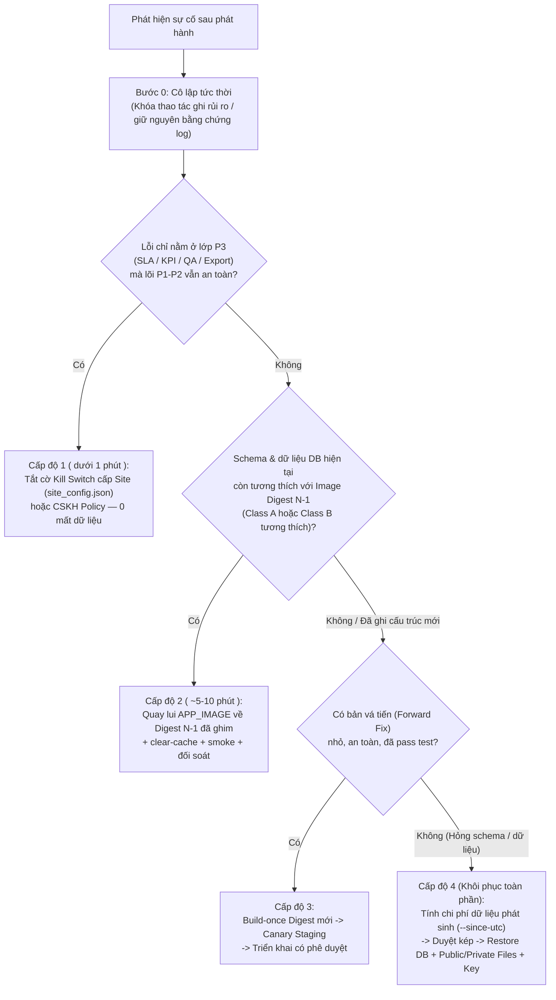

# Sổ Tay Quay Lui & Phục Hồi Sau Sự Cố Có Cây Quyết Định (`P4-10` — Cổng `G09`)

- **Mã tài liệu:** `P4-ROLLBACK-RUNBOOK` (`docs/p4/rollback-runbook.md` — `P4.md §7.6`, `§15`, `§20.2`)
- **Đầu vào khóa cứng:** Bộ Compose `492423c` (`deploy/compose/*`), cơ chế cờ runtime hợp nhất `crm_cskh.services.p3_flags` ([`docs/p3/rollback.md`](../p3/rollback.md)) và công cụ đếm cửa sổ mất dữ liệu [`deploy/ops/check_health_and_invariants.py`](../../deploy/ops/check_health_and_invariants.py) (`--since-utc`)
- **Trạng thái diễn tập trên Staging hiện tại:** **`BLOCKED`** *(Tài liệu và công cụ đã hoàn chỉnh; bước chạy diễn tập thực tế trên Staging HTTPS cho cổng `G09` đang chờ mở khóa `P4-03` [`BLK-INFRA-01..04`] và `P4-05` [`BLK-INFRA-05`])*.

---

## 1. Điều Kiện Kích Hoạt Quay Lui / Cô Lập Sự Cố (`P4.md §15.1`)

Kích hoạt ngay quy trình này khi xuất hiện bất kỳ dấu hiệu nào sau phát hành:

1. **Rò rỉ PII hoặc vượt ranh giới quyền** có thể tái hiện giữa các nhân viên/đội/vai trò (`SEV-1`).
2. **Sai lệch chủ sở hữu (`lead_owner` / `Active Claim`)** hoặc phát sinh nhiều owner active cho cùng một đầu việc (`INV-01 != 0`).
3. **Mất quyền truy cập hợp lệ diện rộng** hoặc nhân viên không thể ghi nhận liên hệ / đặt lịch hẹn.
4. **Sai lệch nghiêm trọng số liệu SLA / KPI / quy gán lịch sử `team-as-of`** sau khi nâng cấp.
5. **`migrator` thất bại**, lỗi hỏng bảng/chỉ mục MariaDB, hoặc không mở được tệp đính kèm `private`.
6. **Tỷ lệ `5xx > 1%`**, `OOMKilled` lặp lại hoặc hàng đợi RQ đình trệ kéo dài vượt ngưỡng chịu đựng vận hành.

---

## 2. Cây Quyết Định 4 Cấp Độ — Tuyệt Đối Không Lùi Mù (`P4.md §15.2`)



---

## 3. Ma Trận Tương Thích Thay Đổi Trước Phát Hành (`Compatibility Matrix`, `P4.md §6.1`)

Trước mỗi đợt phát hành, `Release Owner` bắt buộc điền phân loại của bản `N` so với `N-1`:

| Phân loại | Đặc điểm thay đổi | Cho phép Quay lui Image Cấp độ 2 (`N → N-1`)? | Phương án dự phòng bắt buộc |
| :--- | :--- | :---: | :--- |
| **`Class A` — Chỉ đổi mã / giao diện / dịch thuật** | Không thêm/sửa DocType JSON, không thêm dòng mới trong `patches.txt`. | **CÓ (An toàn trực tiếp)** | Đổi `APP_IMAGE` về digest `N-1` + `clear-cache`. |
| **`Class B` — Bổ sung Schema tương thích xuôi (`Additive`)** | Chỉ thêm cột nullable/có default hoặc thêm index mới; mã `N-1` không bị lỗi khi cột mới tồn tại. | **CÓ (Có kiểm tra trên Staging)** | Kiểm chứng chạy lại image `N-1` trên DB đã migrate `N` ở Staging trước khi mở cổng. |
| **`Class C` — Backfill dữ liệu có Checkpoint** | Chạy patch điền/chuyển đổi dữ liệu lịch sử (ví dụ các patch trong [`patches.txt`](../../apps/crm_cskh/crm_cskh/patches.txt)). | **HẠN CHẾ** *(chỉ khi dữ liệu backfill không phá quy ước đọc của `N-1`)* | Phải có bản chụp `Pre-Release Backup` đã xác thực checksum + kế hoạch `Forward Fix` (Cấp độ 3) hoặc `Restore` (Cấp độ 4). |
| **`Class D` — Phá vỡ tương thích (`Breaking / Destructive`)** | Đổi tên/xóa cột, thay đổi ngữ nghĩa khóa chính hoặc xóa dữ liệu. | **KHÔNG ĐƯỢC PHÉP LÙI IMAGE** | Bắt buộc có ADR `Expand / Contract` tách làm 2 kỳ phát hành hoặc chỉ khôi phục qua Cấp độ 4. |

---

## 4. Chi Tiết Thao Tác Cho Từng Cấp Độ

> Sử dụng biến `ENV_FILE` và `COMPOSE_CMD` chuẩn đã định nghĩa tại [`release-runbook.md`](./release-runbook.md) Mục 1.

### 4.1. Cấp độ 1 — Tắt Nhanh Tính Năng Qua Kill Switch (`< 1 phút`, `0` Downtime, `0` Mất Dữ Liệu)

Áp dụng khi sự cố thuộc báo cáo KPI, job xuất tệp, chấm QA hoặc đồng hồ SLA (cơ chế hợp nhất `crm_cskh.services.p3_flags.resolve_p3_flags()` có hiệu lực tức thời trên cả UI + HTTP API + RQ Worker đang xếp hàng):

```bash
# Tắt toàn bộ cụm tính năng P3 (hoặc thay bằng khóa con: cskh_p3_reporting_enabled / cskh_p3_export_enabled / cskh_p3_sla_enabled / cskh_qa_enabled):
$COMPOSE_CMD exec -T backend bench --site "${SITE_NAME}" set-config cskh_p3_enabled false
$COMPOSE_CMD exec -T backend bench --site "${SITE_NAME}" clear-cache
```

- **Kiểm chứng ngay:** Các màn P3 trả `403`, API P3 trả `503 POLICY_CONFLICT`, trong khi `/cskh/my-customers`, chia số P1 và ghi nhận liên hệ P2 vẫn trả `HTTP 200` bình thường. Các bản ghi `CSKH Dirty Scope` vẫn được tích lũy an toàn để bù số liệu khi bật lại (`set-config cskh_p3_enabled true` + `drain_dirty_kpi_scopes`).

### 4.2. Cấp độ 2 — Quay Lui Về Image Digest `N-1` (`Class A` / `Class B` Tương Thích)

1. Bật chế độ bảo trì ngắn để tránh giao dịch dở dang:
   ```bash
   $COMPOSE_CMD exec -T backend bench --site "${SITE_NAME}" set-maintenance-mode on
   ```
2. Cập nhật biến `APP_IMAGE` trong `${ENV_FILE}` về đúng định danh bất biến `previous_release_id` (`<registry>/<namespace>/crm-cskh@sha256:<PREVIOUS_64_HEX>`).
3. Kéo lại (nếu chưa sẵn trong cache cục bộ) và khởi động lại các service ứng dụng (không chạy `migrator` lùi mù):
   ```bash
   $COMPOSE_CMD pull backend frontend websocket queue-short queue-long scheduler configurator
   $COMPOSE_CMD run --rm configurator
   $COMPOSE_CMD up -d backend websocket frontend queue-short queue-long scheduler proxy
   $COMPOSE_CMD exec -T backend bench --site "${SITE_NAME}" clear-cache
   $COMPOSE_CMD exec -T backend bench --site "${SITE_NAME}" set-maintenance-mode off
   ```
4. Chạy ngay `staging_https_smoke_and_reconcile.py https-smoke` và `check_health_and_invariants.py` để xác nhận toàn bộ container đã quay về digest `N-1` và cả 6 bất biến nghiệp vụ đạt `PASS`.

### 4.3. Cấp độ 3 — Phát Hành Bản Vá Tiến (`Audited Forward Fix`)

Áp dụng khi migration `Class C`/`Class D` đã hoàn tất nhưng phát hiện lỗi logic không thể lùi image:
1. Tạm cô lập vùng lỗi bằng Cấp độ 1 (nếu có cờ) hoặc bật `maintenance_mode` nếu có nguy cơ hỏng dữ liệu.
2. Tạo commit sửa lỗi kèm regression test → chạy pipeline `build-once` tạo digest mới → kiểm chứng nhanh trên Staging → triển khai theo đúng [`release-runbook.md`](./release-runbook.md).

### 4.4. Cấp độ 4 — Khôi Phục Toàn Phần Từ Bản Sao Lưu (`Full Restore`: DB + Public/Private Files + Key)

Chỉ thực hiện khi schema hoặc dữ liệu bị hỏng không thể cứu bằng Cấp độ 1–3 **và bắt buộc có phê duyệt kép của `Technical Owner` + `Business/Data Owner` (`P4.md §15.3`)**:

1. **Khóa ghi ngay lập tức & Đếm chính xác lượng dữ liệu phát sinh sau thời điểm backup (`Data-Loss Impact Audit`):**
   ```bash
   $COMPOSE_CMD exec -T backend bench --site "${SITE_NAME}" set-maintenance-mode on
   $COMPOSE_CMD stop queue-short queue-long scheduler

   # Thống kê số Lead, Work Item, chuyển giao, Contact Attempt, Task, Import, SLA breach, KPI Run phát sinh sau mốc backup:
   python3 deploy/ops/check_health_and_invariants.py \
     --env-file "${ENV_FILE}" \
     --mode tls \
     --environment-label production \
     --since-utc "<BACKUP_TIMESTAMP_UTC_VD_2026-11-10T17:00:00Z>" \
     --out /var/lib/crm-cskh/releases/pre-restore-data-loss-audit.json
   ```
2. **Trình ký xác nhận cửa sổ mất dữ liệu:** Ghi biên bản số bản ghi trong `data_loss_window_delta`; tuyệt đối không tự động phát lại (`replay`) các sự kiện xuất thô nếu chưa chứng minh được tính phân quyền và chống đếm đôi.
3. **Thực thi khôi phục nhất quán đồng bộ 4 thành phần (theo kịch bản đã kiểm định của `P4-05`):**
   - Tải và kiểm tra SHA-256 của bộ 3 tệp archive (`database.sql.gz`, `files.tar`, `private-files.tar`) tương ứng với cùng một điểm khôi phục.
   - Đảm bảo `APP_IMAGE` đặt đúng digest tại thời điểm chụp bản sao lưu và `encryption_key` trong `site_config.json` khớp bản lưu ký bí mật (không in khóa ra màn hình/log).
   - Dừng `backend`/`websocket`, chạy lệnh `bench --site "${SITE_NAME}" --force restore ... --with-public-files ... --with-private-files ...` qua container quản trị một lần, sau đó chạy `clear-cache`, khởi động lại toàn bộ stack, chạy `check_health_and_invariants.py` và `https-smoke` trước khi tắt `maintenance_mode`.

---

## 5. Các Thao Tác Bị Cấm Tuyệt Đối Khi Xử Lý Sự Cố (`P4.md §15.4`)

- **CẤM** chạy `bench reinstall`, `bench drop-site`, `docker compose down --volumes` hoặc câu lệnh SQL `DELETE` / `TRUNCATE` trên môi trường Production/Staging dữ liệu chính để "chữa cháy nhanh".
- **CẤM** chạy `bench migrate --skip-failing` để bỏ qua patch lỗi và báo cáo phát hành thành công.
- **CẤM** hạ cấp (`downgrade`) phiên bản `frappe` hoặc `crm` tùy tiện sau khi cơ sở dữ liệu đã chạy migration mới.
- **CẤM** sửa tay bảng `tabCSKH Assignment History`, `tabCSKH Contact Attempt` hay `tabCSKH KPI Snapshot` bằng SQL để làm đẹp báo cáo.
- **CẤM** khôi phục vào Production từ bản sao lưu của Staging/DEV.

---

## 6. Nhật Ký Diễn Tập Quay Lui / Khôi Phục Trên Staging (`G09` — Trạng Thái Hiện Tại: `BLOCKED`)

| Kịch bản diễn tập bắt buộc cho cổng `G09` | Môi trường mục tiêu | Thời gian đo thực tế | Kết quả & Log đã khử secret |
| :--- | :--- | :---: | :--- |
| **Diễn tập 1:** Bật/tắt Kill Switch Cấp độ 1A (`cskh_p3_enabled=false` → `true` + bù `Dirty Scope`) | Staging HTTPS (`P4-03`) *(đã kiểm chứng cấp E2E P3 ở `92e14af`)* | `PENDING STAGING` | **`BLOCKED` (`BLK-INFRA-01..04`)** |
| **Diễn tập 2:** Quay lui Image Digest Cấp độ 2 (`APP_IMAGE` `N → N-1` + `https-smoke` + `check_health_and_invariants.py`) | Staging HTTPS (`P4-03`) | `PENDING STAGING` | **`BLOCKED` (`BLK-INFRA-01..04`)** |
| **Diễn tập 3:** Đếm `data_loss_window_delta` & Khôi phục toàn phần Cấp độ 4 trên site DR cô lập (phối hợp `P4-05`) | Site DR cô lập (`P4-05`) | `PENDING DR DRILL` | **`BLOCKED` (`BLK-INFRA-04..05`)** |
