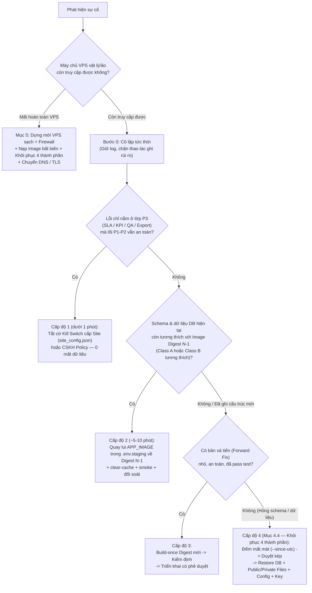

# Sổ Tay Quay Lui, Khôi Phục DB/Files/Config/Key & Dựng Lại Khi Mất Toàn Bộ VPS (`P4-10` — Cổng `G09`)

- **Mã tài liệu:** `P4-ROLLBACK-RUNBOOK` (`docs/p4/rollback-runbook.md` — `P4.md §7.6`, `§15`, `§20.2`)
- **Đầu vào hạ tầng thực tế (`https://crm.hrpartner.vn`):**
  - VPS: `103.77.208.186` · Project: `crm-cskh-vps-staging` · Site: `crm-staging.localhost`
  - Wrapper: `/opt/crm-cskh-staging/staging-compose` · Cấu hình: `/opt/crm-cskh-staging/.env.staging` (`0600`) · Overlay domain: `/opt/crm-cskh-staging/compose.domain.yaml`
  - Công cụ đi kèm: [`check_health_and_invariants.py`](../../deploy/ops/check_health_and_invariants.py) (`--since-utc`), [`create_encrypted_backup.py`](../../deploy/ops/create_encrypted_backup.py), [`verify_offsite_restore.py`](../../deploy/ops/verify_offsite_restore.py), [`staging_https_smoke_and_reconcile.py`](../../deploy/ops/staging_https_smoke_and_reconcile.py), [`manage_isolated_staging_dr.py`](../../deploy/ops/manage_isolated_staging_dr.py)
  - Tài liệu liên kết: [`backup-restore.md`](./backup-restore.md), [`isolated-staging-dr-https.md`](./isolated-staging-dr-https.md), [`release-runbook.md`](./release-runbook.md), [`operations-sop.md`](./operations-sop.md)

---

## 1. Điều Kiện Kích Hoạt Quay Lui / Cô Lập Sự Cố (`P4.md §15.1`)

Kích hoạt ngay quy trình này khi xuất hiện bất kỳ dấu hiệu nào sau phát hành hoặc trong vận hành:

1. **Rò rỉ PII hoặc vượt ranh giới quyền** có thể tái hiện giữa các nhân sự/đội/vai trò (`SEV-1`).
2. **Sai lệch chủ sở hữu (`lead_owner` / `Active Claim`)** hoặc phát sinh nhiều owner active cho cùng một hồ sơ (`INV-01 != 0`).
3. **Mất quyền truy cập hợp lệ diện rộng** hoặc **Người tuyển dụng** không thể ghi nhận liên hệ / đặt lịch hẹn lại.
4. **Sai lệch nghiêm trọng số liệu SLA / KPI / quy gán lịch sử `team-as-of`** sau khi nâng cấp.
5. **`migrator` thất bại**, lỗi hỏng bảng/chỉ mục MariaDB, mất khóa giải mã hoặc không mở được tệp đính kèm `private`.
6. **Tỷ lệ `5xx > 1%`**, `OOMKilled` lặp lại, hàng đợi RQ đình trệ kéo dài, hoặc **mất hoàn toàn máy chủ VPS**.

---

## 2. Cây Quyết Định 4 Cấp Độ + Kịch Bản Mất VPS — Tuyệt Đối Không Lùi Mù (`P4.md §15.2`)



---

## 3. Ma Trận Tương Thích Thay Đổi Trước Phát Hành (`Compatibility Matrix`, `P4.md §6.1`)

| Phân loại | Đặc điểm thay đổi | Cho phép Quay lui Image Cấp độ 2 (`N → N-1`)? | Lưu ý quan trọng khi quay lui |
| :--- | :--- | :---: | :--- |
| **`Class A` — Chỉ đổi mã / giao diện / dịch thuật tĩnh** | Không thêm/sửa DocType JSON, không thêm dòng mới trong `patches.txt`. | **CÓ (An toàn trực tiếp)** | Đổi `APP_IMAGE` về image/digest `N-1` + `clear-cache`. Lưu ý: các nhãn lưu trong cơ sở dữ liệu (`tabTranslation` hoặc `tabCSKH Outcome Code`) nếu đã cập nhật qua patch/UI sẽ vẫn giữ giá trị trong DB trừ khi khôi phục DB Cấp độ 4. |
| **`Class B` — Bổ sung Schema tương thích xuôi (`Additive`)** | Chỉ thêm cột nullable/có default hoặc thêm index mới; mã `N-1` không bị lỗi khi cột mới tồn tại. | **CÓ (Đã kiểm tra tương thích)** | Không chạy `migrator` lùi mù; kiểm tra kỹ `check_health_and_invariants.py` sau khi đổi image. |
| **`Class C` — Backfill dữ liệu có Checkpoint** | Chạy patch điền/chuyển đổi dữ liệu lịch sử trong [`patches.txt`](../../apps/crm_cskh/crm_cskh/patches.txt). | **HẠN CHẾ** | Bắt buộc có gói `Pre-Release Encrypted Backup` đã khớp SHA-256 offsite + phương án `Forward Fix` (Cấp độ 3) hoặc `Restore` (Cấp độ 4). |
| **`Class D` — Phá vỡ tương thích (`Breaking / Destructive`)** | Đổi tên/xóa cột, thay đổi ngữ nghĩa khóa chính hoặc xóa dữ liệu. | **KHÔNG ĐƯỢC PHÉP LÙI IMAGE** | Chỉ xử lý bằng `Forward Fix` (Cấp độ 3) hoặc Khôi phục toàn phần 4 thành phần (Cấp độ 4). |

---

## 4. Chi Tiết Thao Tác Cho Từng Cấp Độ Trên VPS Đang Chạy

### 4.1. Cấp độ 1 — Tắt Nhanh Tính Năng Qua Kill Switch (`< 1 phút`, `0` Downtime, `0` Mất Dữ Liệu)

Áp dụng khi sự cố chỉ thuộc báo cáo KPI, job xuất tệp, chấm QA hoặc đồng hồ SLA:

```bash
# Tắt toàn bộ cụm tính năng P3 (hoặc thay bằng khóa con: cskh_p3_reporting_enabled / cskh_p3_export_enabled / cskh_p3_sla_enabled / cskh_qa_enabled):
/opt/crm-cskh-staging/staging-compose exec -T backend \
  bench --site crm-staging.localhost set-config cskh_p3_enabled false
/opt/crm-cskh-staging/staging-compose exec -T backend \
  bench --site crm-staging.localhost clear-cache
```

- **Kiểm chứng:** Các màn P3 trả `403`, API P3 trả `503 POLICY_CONFLICT`, trong khi `/cskh/my-customers`, `/cskh/work-item` và `/cskh/callbacks` vẫn trả `HTTP 200`. Các bản ghi `CSKH Dirty Scope` tiếp tục được tích lũy an toàn để bù số liệu khi bật lại (`set-config cskh_p3_enabled true`).

### 4.2. Cấp độ 2 — Quay Lui Về Image Digest `N-1` (`~5–10 phút`, Bảo Toàn Dữ Liệu Phát Sinh)

> **Lưu ý tác động dữ liệu:** Cấp độ 2 **bảo toàn 100% hồ sơ liên hệ, lần liên hệ và lịch hẹn mới phát sinh**, nhưng nếu bản `N` có cập nhật nhãn danh mục lưu trong MariaDB (`tabCSKH Outcome Code` hoặc `tabTranslation`), các nhãn trong DB vẫn giữ nguyên theo trạng thái DB hiện hành.

```bash
# 1. Bật bảo trì, tạm dừng scheduler và chờ worker hoàn tất job đang chạy:
/opt/crm-cskh-staging/staging-compose exec -T backend \
  bench --site crm-staging.localhost set-maintenance-mode on
/opt/crm-cskh-staging/staging-compose exec -T backend \
  bench --site crm-staging.localhost scheduler pause

# 2. Khôi phục tệp cấu hình .env.staging về bản sao lưu trước phát hành (hoặc đặt lại APP_IMAGE về định danh N-1) và giữ nguyên quyền 0600:
cp -p /opt/crm-cskh-staging/.env.staging.bak.<TIMESTAMP> /opt/crm-cskh-staging/.env.staging
chmod 600 /opt/crm-cskh-staging/.env.staging

# 3. Đồng bộ lại configurator và dựng lại các service ứng dụng (KHÔNG chạy migrator lùi mù):
/opt/crm-cskh-staging/staging-compose run --rm configurator
/opt/crm-cskh-staging/staging-compose up -d backend websocket frontend queue-short queue-long scheduler proxy

# 4. Xóa cache, bật lại scheduler và mở chế độ bảo trì:
/opt/crm-cskh-staging/staging-compose exec -T backend \
  bench --site crm-staging.localhost clear-cache
/opt/crm-cskh-staging/staging-compose exec -T backend \
  bench --site crm-staging.localhost clear-website-cache
/opt/crm-cskh-staging/staging-compose exec -T backend \
  bench --site crm-staging.localhost scheduler resume
/opt/crm-cskh-staging/staging-compose exec -T backend \
  bench --site crm-staging.localhost set-maintenance-mode off

# 5. Hậu kiểm digest, bất biến nghiệp vụ và HTTPS smoke (sử dụng thư mục ops đã xác minh đúng SHA tại /opt/crm-cskh-ops — xem backup-restore.md Mục 3.0):
test -f /opt/crm-cskh-ops/deploy/ops/check_health_and_invariants.py
sudo python3 /opt/crm-cskh-ops/deploy/ops/check_health_and_invariants.py \
  --env-file /opt/crm-cskh-staging/.env.staging \
  --mode tls \
  --extra-compose-file /opt/crm-cskh-staging/compose.domain.yaml \
  --site crm-staging.localhost \
  --environment-label staging
```

### 4.3. Cấp độ 3 — Phát Hành Bản Vá Tiến (`Audited Forward Fix`)
1. Tạm cô lập vùng lỗi bằng Cấp độ 1 hoặc `set-maintenance-mode on`.
2. Đóng gói bản sửa lỗi thành commit sạch → build image gắn SHA bất biến → kiểm định trên môi trường cô lập → cập nhật theo [`release-runbook.md`](./release-runbook.md).

### 4.4. Cấp độ 4 — Khôi Phục Đồng Bộ 4 Thành Phần: `DB + Public/Private Files + Config + encryption_key`

> [!CAUTION]
> **Tác động tới dữ liệu phát sinh sau mốc sao lưu:** Khôi phục cơ sở dữ liệu và tệp đính kèm về thời điểm `T_backup` **sẽ ghi đè và làm mất toàn bộ hồ sơ liên hệ, lần ghi nhận liên hệ, lịch hẹn, lô nhập và bản chụp KPI phát sinh trong khoảng `(T_backup, T_now]`**. Bắt buộc thực hiện kiểm kê `--since-utc`, chụp một bản backup trạng thái hỏng hiện tại để lưu bằng chứng, và có **phê duyệt kép của `Technical Owner` + `Owner/BOD`** trước khi chạy lệnh `bench --force restore`.

#### Bước 1 — Cô lập ghi, kiểm kê dữ liệu phát sinh (`--since-utc`) và chụp lại hiện trạng trước khi ghi đè
```bash
/opt/crm-cskh-staging/staging-compose exec -T backend \
  bench --site crm-staging.localhost set-maintenance-mode on
/opt/crm-cskh-staging/staging-compose exec -T backend \
  bench --site crm-staging.localhost scheduler pause
/opt/crm-cskh-staging/staging-compose stop queue-short queue-long scheduler

# Đếm chính xác số lượng bản ghi nghiệp vụ sẽ bị quay lui sau mốc backup:
test -f /opt/crm-cskh-ops/deploy/ops/check_health_and_invariants.py
sudo python3 /opt/crm-cskh-ops/deploy/ops/check_health_and_invariants.py \
  --env-file /opt/crm-cskh-staging/.env.staging \
  --mode tls \
  --extra-compose-file /opt/crm-cskh-staging/compose.domain.yaml \
  --site crm-staging.localhost \
  --environment-label staging \
  --since-utc "<BACKUP_TIMESTAMP_UTC_VD_2026-11-09T04:00:00Z>" \
  --out /var/lib/crm-cskh/releases/pre-restore-data-loss-audit.json

# Tạo bản sao lưu cứu hộ của trạng thái hiện tại trước khi ghi đè (công cụ tự sinh backup-key 0600 riêng trong thư mục bundle):
sudo python3 /opt/crm-cskh-ops/deploy/ops/create_encrypted_backup.py \
  --compose-wrapper /opt/crm-cskh-staging/staging-compose \
  --site crm-staging.localhost \
  --out-dir /var/backups/crm-cskh/pre-overwrite-safety-$(date -u +%Y%m%dT%H%M%SZ)
```

#### Bước 2 — Xác thực SHA-256, giải mã gói sao lưu và kiểm tra 6 thành phần
```bash
RESTORE_WORK="/var/lib/crm-cskh/restore-work-$(date -u +%Y%m%dT%H%M%SZ)"
install -d -m 700 "${RESTORE_WORK}"

# 1. Đối chiếu SHA-256 của backup.tar.gz.enc với biên bản backup-report.json / offsite-verification.json:
echo "<EXPECTED_ARCHIVE_SHA256>  /duong-dan-goi-sao-luu/backup.tar.gz.enc" | sha256sum -c -

# 2. Giải mã bằng OpenSSL PBKDF2 200.000 iter dùng đúng tệp backup-key (0600) riêng của bundle đó (không in khóa ra terminal):
openssl enc -d -aes-256-cbc -pbkdf2 -iter 200000 -md sha256 \
  -pass file:/duong-dan-khoa-rieng-cua-bundle/backup-key \
  -in /duong-dan-goi-sao-luu/backup.tar.gz.enc \
  -out "${RESTORE_WORK}/backup.tar.gz"
chmod 600 "${RESTORE_WORK}/backup.tar.gz"

# 3. Trích xuất an toàn và đối chiếu SHA-256 của từng thành phần bằng hàm chuẩn của verify_offsite_restore.py:
python3 -c '
import pathlib, sys
sys.path.insert(0, "/opt/crm-cskh-ops/deploy/ops")
from verify_offsite_restore import extract_backup
members = extract_backup(pathlib.Path(sys.argv[1]), pathlib.Path(sys.argv[2]))
print("VERIFIED_MEMBERS=", sorted(members.keys()))
' "${RESTORE_WORK}/backup.tar.gz" "${RESTORE_WORK}"
```

#### Bước 3 — Khôi phục đồng bộ DB + Public Files + Private Files + `site_config.json` (`encryption_key`)
1. Đảm bảo `APP_IMAGE` trong `/opt/crm-cskh-staging/.env.staging` (`0600`) khớp phiên bản tương thích với gói sao lưu.
2. Dừng tạm thời `backend` và `websocket` để ngắt mọi kết nối DB đang mở, chỉ giữ `db`, `redis-cache`, `redis-queue` đang chạy.
3. Đưa 4 tệp (`*-database.sql.gz`, `*-files.tar`, `*-private-files.tar`, `*-site_config_backup.json`) vào thư mục tạm `/tmp/restore-in` của một container quản trị `backend` dùng một lần và thực thi:
   ```bash
   DB_ROOT_PW_FILE="$(grep '^DB_PASSWORD_SECRETS_FILE=' /opt/crm-cskh-staging/.env.staging | cut -d= -f2- | tr -d '\"'\'')"

   /opt/crm-cskh-staging/staging-compose stop backend websocket frontend

   # Khôi phục SQL + Public Files + Private Files:
   /opt/crm-cskh-staging/staging-compose run --rm -T \
     -v "${RESTORE_WORK}:/tmp/restore-in:ro" \
     backend bash -lc '
       set -euo pipefail
       SQL_FILE=$(ls /tmp/restore-in/*-database.sql.gz)
       PUB_TAR=$(ls /tmp/restore-in/*-files.tar | grep -v private-files.tar)
       PRIV_TAR=$(ls /tmp/restore-in/*-private-files.tar)
       bench --site crm-staging.localhost --force restore "${SQL_FILE}" \
         --with-public-files "${PUB_TAR}" \
         --with-private-files "${PRIV_TAR}" \
         --db-root-password "$(cat /run/secrets/db_root_password)"
     '
   ```
4. **Phục hồi cấu hình cấp site & `encryption_key` (`0600`) theo quy tắc fail-closed:**
   - Gộp các khóa cấu hình ứng dụng từ `*-site_config_backup.json` vào `sites/crm-staging.localhost/site_config.json` (giữ nguyên `db_name`/`db_password` hiện hành của site nếu cùng site, hoặc cập nhật theo `new-site` nếu dựng mới).
   - **Trường hợp `PRESENT_VERIFIED` (`*-site_config_backup.json` có `encryption_key`):** Ghi chính xác giá trị `encryption_key` từ bản backup vào `site_config.json`, đặt `chmod 600` và `chown 1000:1000`, sau đó chạy kiểm định `evaluate_encryption_key_state()` + giải mã thử toàn bộ `__Auth WHERE encrypted = 1`.
   - **Trường hợp `UNINITIALIZED_NO_ENCRYPTED_DATA` (`*-site_config_backup.json` chưa có `encryption_key`):** Xác nhận `before.json` không báo mất khóa và bảng `__Auth WHERE encrypted = 1` có đúng `0` dòng; xóa mọi khóa `encryption_key` rỗng/lạ nếu có và giữ `chmod 600` trên `site_config.json`.

#### Bước 4 — Đồng bộ `migrator`, kiểm tra `Translation`, mở lại dịch vụ & Smoke HTTPS
```bash
# 1. Đồng bộ configurator và chạy migrator chuẩn:
/opt/crm-cskh-staging/staging-compose run --rm configurator
MIGRATE_SITES=true /opt/crm-cskh-staging/staging-compose --profile migrate run --rm migrator

# 2. Khởi động lại toàn bộ dịch vụ, xóa cache, bật lại scheduler và tắt chế độ bảo trì:
/opt/crm-cskh-staging/staging-compose up -d backend websocket frontend queue-short queue-long scheduler proxy
/opt/crm-cskh-staging/staging-compose exec -T backend bench --site crm-staging.localhost clear-cache
/opt/crm-cskh-staging/staging-compose exec -T backend bench --site crm-staging.localhost clear-website-cache
/opt/crm-cskh-staging/staging-compose exec -T backend bench --site crm-staging.localhost scheduler resume
/opt/crm-cskh-staging/staging-compose exec -T backend bench --site crm-staging.localhost set-maintenance-mode off

# 3. Xóa thư mục giải mã tạm chứa dữ liệu nhạy cảm:
rm -rf "${RESTORE_WORK}"

# 4. Chạy kiểm tra bất biến nghiệp vụ và HTTPS smoke:
sudo python3 /opt/crm-cskh-ops/deploy/ops/check_health_and_invariants.py \
  --env-file /opt/crm-cskh-staging/.env.staging \
  --mode tls \
  --extra-compose-file /opt/crm-cskh-staging/compose.domain.yaml \
  --site crm-staging.localhost \
  --environment-label staging
```

---

## 5. Kịch Bản Mất Toàn Bộ VPS — Dựng Mới Máy Chủ & Khôi Phục Thảm Họa (`Bare-Metal / Total VPS Loss DR`)

> [!IMPORTANT]
> **Phạm vi đối chiếu thời gian khôi phục (`RTO`):** Trong diễn tập khôi phục cô lập ngày `09/11/2026` trên VPS `103.77.208.186` ([`restore-drill-report.json`](../../deploy/ops/evidence/p4-vps-live-20261109/restore-drill-report.json)), Pha A khôi phục hoàn chỉnh 9 chặng (giải mã → dựng stack → `new-site` → `restore` SQL + files → `migrate ×2` → đối soát `INV-01..06` + `5/5 Translation` → HTTP/CSRF smoke) đạt **`142.598 giây`** (`sql_and_files_restore_only = 22.585 giây`). **Con số `142.598 giây` này chỉ đo bản clone trên cùng máy chủ VPS khi gói sao lưu và Docker image đã sẵn có trên ổ đĩa cục bộ; kịch bản Mất toàn bộ VPS dưới đây sẽ cộng thêm thời gian: (1) cấp phát máy chủ mới & cài đặt OS/tường lửa/Docker, (2) tải gói sao lưu mã hóa và image qua mạng WAN, và (3) chuyển đổi DNS + cấp lại chứng chỉ TLS.**

Áp dụng khi máy chủ `103.77.208.186` hỏng phần cứng không thể khôi phục tại chỗ và phải dựng lại từ đầu trên một VPS Linux mới:

### Bước 1 — Cấp phát VPS mới & Khóa cứng Tường lửa trước khi mở mạng
1. Cấp phát máy chủ Ubuntu LTS (`>= 4 vCPU`, `>= 8 GB RAM`, ổ SSD NVMe đủ chứa tối thiểu `3×` dung lượng DB + files + images), cài đặt múi giờ hệ thống `UTC` (ứng dụng dùng `Asia/Ho_Chi_Minh`) và cài đặt Docker Engine + Docker Compose plugin chính thức.
2. Cấu hình UFW + chuỗi `DOCKER-USER` chỉ mở cổng `80/tcp`, `443/tcp` và cổng SSH quản trị theo danh sách IP cho phép; **xác nhận bằng `ss -tulpn` rằng các cổng `3306`, `6379`, `8000`, `9000` không bao giờ lộ ra giao diện mạng ngoài**.

### Bước 2 — Tái tạo cấu trúc thư mục, Secret LF `0600` & Wrapper Compose
1. Chuẩn bị và xác minh mã nguồn vận hành vào `/opt/crm-cskh-ops` tại đúng commit SHA đã phát hành theo [`backup-restore.md`](./backup-restore.md) Mục 3.0 (không giả định `/opt/crm-cskh-app` tồn tại sẵn).
2. Tạo thư mục `/opt/crm-cskh-staging` và `/etc/crm-cskh/secrets` (`chmod 700`):
   - Tạo tệp mật khẩu root MariaDB mới (`db_root_password.txt`, quyền **`0600`**, kết thúc bằng duy nhất ký tự `\n` `LF`, tuyệt đối không có `\r`).
   - Lấy đúng tệp `backup-key` (`0600`) của gói sao lưu sẽ khôi phục từ kho lưu ký bí mật độc lập của Owner vào thư mục tạm `0700` riêng để phục vụ giải mã ở Bước 4.
   - Tạo lại `/opt/crm-cskh-staging/.env.staging` (`0600`), `/opt/crm-cskh-staging/compose.domain.yaml` (cấu hình Traefik host `crm.hrpartner.vn` → header `X-Frappe-Site-Name: crm-staging.localhost`) và script wrapper `/opt/crm-cskh-staging/staging-compose` (`0750`).

### Bước 3 — Nạp Image Ứng Dụng Bất Biến (`Immutable Image`)
- Kéo đúng digest từ Registry (`docker pull <registry>/crm-cskh@sha256:...`) hoặc chuyển gói image `.tar` đã lưu trữ qua SCP → kiểm tra `sha256sum` hai đầu → `docker load` → đối chiếu `docker image inspect` khớp đúng định danh bất biến `sha256:acb950578479189ab2f11d8843d1182b83e78789bda99b4743ed24d8b0ede0d9` (hoặc digest phát hành hiện hành).

### Bước 4 — Khởi tạo Nền tảng Dữ liệu & Khôi phục Gói Sao Lưu Offsite Mới Nhất
1. Chuyển gói `backup.tar.gz.enc` và `backup-report.json` mới nhất từ kho offsite lên VPS mới, kiểm tra khớp `sha256sum`.
2. Khởi động `db`, `redis-cache`, `redis-queue` và chạy `configurator`:
   ```bash
   /opt/crm-cskh-staging/staging-compose up -d db redis-cache redis-queue
   /opt/crm-cskh-staging/staging-compose run --rm configurator
   ```
3. Tạo khung site rỗng `crm-staging.localhost` bằng `bench new-site crm-staging.localhost --no-mariadb-socket --db-host db ...`, sau đó thực hiện **Bước 2 → Bước 4 của Mục 4.4** để nạp lại toàn bộ `database.sql.gz`, `files.tar`, `private-files.tar`, `site_config_backup.json` (`encryption_key`), chạy `migrator` và kiểm tra 5 bản ghi `Translation` của Owner (xóa sạch bản sao tạm của `backup-key` trên VPS ngay sau khi giải mã xong).

### Bước 5 — Cắt chuyển DNS, Cấp lại TLS & Kích hoạt Vận hành Định kỳ
1. Cập nhật bản ghi DNS `A` của `crm.hrpartner.vn` trỏ sang địa chỉ IP của VPS mới.
2. Khởi động toàn bộ stack (`/opt/crm-cskh-staging/staging-compose up -d`), theo dõi Traefik tự động lấy chứng chỉ Let's Encrypt hợp lệ cho `crm.hrpartner.vn`.
3. Chạy `staging_https_smoke_and_reconcile.py https-smoke --public-domain crm.hrpartner.vn --extra-compose-file /opt/crm-cskh-staging/compose.domain.yaml` và `check_health_and_invariants.py` xác nhận toàn bộ `INV-01..06 == 0`.
4. Kiểm tra trước (dry-run) rồi cài đặt lại các bộ lập lịch định kỳ bằng `install_systemd_timers.py --repo-root /opt/crm-cskh-ops ... --install` ([`backup-restore.md`](./backup-restore.md) Mục 3.1).

---

## 6. Bằng Chứng Thực Thi Cây Quyết Định & Quay Lui Image Thật `N -> N-1` Trên Clone HTTPS Cô Lập (`G09`)

> [!IMPORTANT]
> **Nguyên tắc bắt buộc (`G09`):** Phép kiểm `verify-digest` từ chối một digest sai chỉ là rào chắn preflight, **không bao giờ thay thế cho diễn tập quay lui ứng dụng thật**. Diễn tập `G09` trong [`manage_isolated_staging_dr.py`](../../deploy/ops/manage_isolated_staging_dr.py) (`rehearse_rollback_tiers_over_https`) thực thi đầy đủ trên clone HTTPS cô lập và ghi nhận nhật ký quyết định từng bước của Operator (`operator_decision_tree_log` trong [`isolated-staging-dr-https-report.json`](../../deploy/ops/evidence/p4-https-delta-20261109/isolated-staging-dr-https-report.json)):

1. **`DT-01-TIER1-FEATURE-DISABLE` (Cấp 1 — Cờ tính năng P3):** Tắt `cskh_p3_enabled=false` + `clear-cache` → API P3 trả `503` an toàn trong khi luồng tác nghiệp cốt lõi `P1/P2` (`customers.my_list`) tiếp tục trả `200`, sau đó bật lại khôi phục `200`.
2. **`DT-02-SCHEMA-COMPATIBILITY-AND-TIER3-IMAGE-ROLLBACK` (Quay lui Ứng Dụng Thật `N -> N-1` Không Hạ DB):**
   - Khi thay đổi thuộc `Class A/B` tương thích ngược (như giữa baseline `main` `46783019` `v15.123.1` và ứng viên `N` `v15.126.0`), ghi bản ghi đánh dấu trên `N` → đổi `APP_IMAGE` về đúng image `N-1` thật → chạy `docker compose up -d --no-build --force-recreate backend frontend websocket queue-short queue-long scheduler` → `bench clear-cache` + `clear-website-cache`.
   - Kiểm chứng cả 6 container chạy đúng digest `N-1` (`verify-digest == PASS`), phiên bản Frappe thực chạy lùi về `N-1`, bản ghi tạo trên `N` được **bảo toàn 100% (`0` mất dữ liệu, không hạ cấp schema MariaDB)**, `Staff A` và `BOD` đăng nhập/đọc qua HTTPS đạt `200`, và `INV-01..06 == 0`.
3. **`DT-03-CLASS-D-OR-CORRUPTION-TIER4-RESTORE` (Cấp 4 — Khôi Phục Điểm Thời Gian Có Kiểm Kê Mất Dữ Liệu):**
   - Khi rơi vào nhánh `Class C/D` hoặc hỏng dữ liệu không thể `forward-fix` ngay: chạy `check_health_and_invariants.py --since-utc <backup_utc>` thống kê chính xác số bản ghi phát sinh sau mốc sao lưu → dừng `queue-short`, `queue-long`, `scheduler` → `bench --force restore` DB + public/private files → chạy `migrator` → đo lại ngay cửa sổ `--since-utc` xác nhận **`all_post_restore_deltas_zero = true` (`8/8` bộ đếm `= 0`)** và `INV-01..06 == 0`.

---

## 7. Các Thao Tác Bị Cấm Tuyệt Đối Khi Xử Lý Sự Cố (`P4.md §15.4`)

- **CẤM** chạy `bench reinstall`, `bench drop-site`, `docker compose down --volumes` hoặc câu lệnh SQL `DELETE` / `TRUNCATE` trên môi trường đang phục vụ của Owner.
- **CẤM** chạy `bench migrate --skip-failing` để bỏ qua patch lỗi và báo cáo phát hành thành công.
- **CẤM** bỏ kiểm tra `encryption_key` một cách mù quáng khi khôi phục bản sao lưu có dữ liệu mã hóa (`__Auth.encrypted = 1`).
- **CẤM** sửa tay bảng `tabCSKH Assignment History`, `tabCSKH Contact Attempt` hay `tabCSKH KPI Snapshot` bằng SQL.
