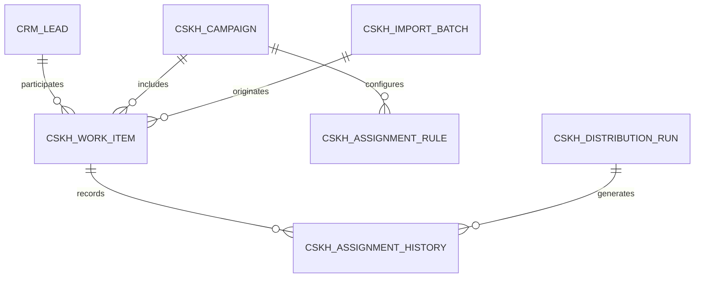

# P1 — KHO KHÁCH HÀNG, TEAM & WEIGHTED DISTRIBUTION

> **Dự án:** CRM-CSKH — Quản trị kho khách hàng, phân phối lead và chất lượng chăm sóc khách hàng  
> **Tài liệu:** `P1.md`  
> **Phiên bản:** 1.0 — 15/10/2026  
> **Tài liệu cha:** [`master-plan.md`](./master-plan.md)  
> **Phụ thuộc:** [`P0.md`](./P0.md), đặc biệt P0 Exit Report và các ADR đã chốt  
> **Trạng thái:** Đặc tả triển khai giao trực tiếp cho AI Coding Agent; chưa phải báo cáo đã code/test xong  
> **Nền tảng:** Frappe Framework + Frappe CRM + custom app `crm_cskh`; baseline tham chiếu CRM `v1.87.0`, phiên bản thực thi lấy từ `version-lock.md` đã nghiệm thu tại P0  
> **Kết quả P1:** BOD/Admin import kho số điện thoại, cấu hình người nhận và tỷ trọng, *xem trước → xác nhận → giao số*, theo dõi được số liệu phân phối trên web; nhân viên đăng nhập và chỉ thấy danh sách khách được giao.

---

## 0. ĐỌC TRƯỚC KHI CODE — NGUYÊN TẮC BẤT BIẾN

1. **P1 chỉ bắt đầu khi P0 đạt GO**, đặc biệt phân quyền cấp bản ghi, import Lead chỉ có số điện thoại, chiến lược UI extension và migration. Không âm thầm bỏ qua blocker P0.
2. **Một website CRM**, khác quyền sẽ thấy màn hình khác nhau. **Không xây ứng dụng desktop**; ứng dụng điện thoại chỉ là hướng mở rộng API sau này, không thuộc P1.
3. **Không dựng backend/DB thứ hai.** Dữ liệu nằm trong MariaDB của Frappe; `crm_cskh` chứa DocType, service, API và UI bổ sung. Sử dụng Redis/workers/scheduler vốn có của Frappe khi cần job.
4. **Không sửa core vì tiện tay.** Đọc file upstream, chọn `REUSE → CONFIGURE → EXTEND → BUILD NEW`; thay đổi upstream nếu bất khả kháng phải có ADR, diff tối thiểu và regression test.
5. **P1 không xây CSKH workflow hoàn chỉnh.** Chưa làm Contact Attempt, danh mục kết quả, lịch hẹn/callback, SLA CSKH, tính điểm chất lượng — các phần đó thuộc P2/P3.
6. **BOD phải có kết quả hữu hình cuối P1:** kho khách, nhập dữ liệu, nhóm nhân viên, phân phối, số đã giao/chưa giao, hàng đợi lỗi, lịch sử giao/thu hồi, bộ lọc theo team/campaign/người nhận.
7. **Mọi thao tác thay đổi quyền sở hữu đi qua một backend service** được kiểm soát quyền, transaction, locking, idempotency và audit. Không cho frontend tự cập nhật `lead_owner` rồi tự tạo history.
8. **Bảo vệ số điện thoại** ở API, tìm kiếm, xuất dữ liệu và dữ liệu nhập; cấm đọc chéo qua `CRM Lead`, Call Log, Note, Task, attachment hay endpoint thống kê.
9. **UI nghiệp vụ tiếng Việt** ngay trong P1, dùng cơ chế dịch của Frappe, không tạo hệ thống i18n song song.
10. **Kiểm thử trên local + CI + site kiểm thử riêng.** Không dùng dữ liệu thật hoặc production để debug; không triển khai VPS mỗi lần sửa code.

### 0.1. Những việc tuyệt đối không làm trong P1

- Không gọi/nhắn tin Zalo/Facebook tự động, không yêu cầu kết nối tài khoản nhắn tin.
- Không tạo `CSKH Contact Attempt`, `CSKH Outcome Code`, `CSKH Policy`, `CSKH KPI Snapshot` bản hoàn chỉnh.
- Không dùng `Contacted` để đo chất lượng chăm sóc khi chưa có bằng chứng hoạt động.
- Không làm dashboard điểm chất lượng nhân viên hay conversion trong P1; chỉ có **dashboard vận hành phân phối**.
- Không triển khai ứng dụng điện thoại, không tạo API riêng cho một client cụ thể.
- Không tự động thu hồi do quá hạn CSKH; có thể thu hồi/chuyển *thủ công* với quyền và lý do đầy đủ.
- Không thêm nền tảng workflow ngoài Frappe chỉ để chạy phân phối.

---

## 1. MỤC TIÊU, VAI TRÒ VÀ DEFINITION OF SUCCESS

### 1.1. Mục tiêu theo người dùng

| Vai trò | Kết quả cuối P1 |
|---|---|
| **BOD** | Truy cập web, xem tổng kho, chưa phân, đã phân, theo chiến dịch/team/nhân viên, các lần chuyển giao và sai lệch tỷ lệ; chỉ đọc theo quyền được cấp. |
| **Admin** | Import CSV/XLSX có preview, sửa/loại lỗi, tạo chiến dịch, thiết lập trọng số, chạy dry-run, xác nhận phân phối, tra cứu lịch sử và xử lý batch lỗi. |
| **Team Leader** | Xem danh sách và số liệu trong team, xem ai đang nhận bao nhiêu; nếu được ủy quyền, chuyển giao trong phạm vi team. |
| **Nhân viên tuyển dụng/CSKH** | Đăng nhập, xem danh sách khách **được giao cho mình** và thông tin cần thiết để liên hệ; chưa cần nhập kết quả CSKH ở P1. |

### 1.2. Đầu ra tối thiểu

1. `CRM Lead` tiếp tục là hồ sơ gốc; Lead chỉ có số điện thoại được tạo hợp lệ theo giải pháp P0.
2. Có quy trình nhập an toàn: upload → preview → chuẩn hóa → phân loại hợp lệ/trùng/lỗi → commit → history.
3. Có Campaign và Work Item liên kết Lead, hỗ trợ Lead thuộc nhiều chiến dịch *qua thời gian*.
4. Có danh sách nhân viên đủ điều kiện phân phối theo team và trọng số; xử lý giới hạn `capacity`.
5. Có phân phối 50/30/20 ra kết quả 500/300/200 khi có 1.000 khách đủ điều kiện và không có giới hạn khác.
6. Có thuật toán công bằng tích lũy qua các batch nhỏ, deterministic/idempotent.
7. Có chuyển giao/thu hồi thủ công và timeline giao nhận không bị ghi đè.
8. Có màn hình My Customers và Distribution Dashboard theo quyền.
9. Có bộ test dữ liệu, phân phối đồng thời, retry, permission và CI xanh.
10. Có `P1 Exit Report` và toàn bộ schema/API/ADR để P2 phát triển không phải thay lại nền.

### 1.3. Quyết định mặc định để AI Coding có thể làm ngay

- Một Lead canonical cho một số điện thoại chính đã chuẩn hóa; danh tính nhập chưa chắc chắn không được tự merge nếu xung đột.
- Mỗi Lead được tham gia nhiều campaign theo thời gian, **nhưng chỉ một Work Item active trên toàn CRM** trong P1; khi muốn mở chiến dịch khác phải đóng/giải quyết claim đang active. Đây là mặc định đơn giản, an toàn cho quyền sở hữu trong CRM gốc.
- Mỗi Work Item active có đúng một nhân viên owner, hoặc ở trạng thái chưa giao; không có đồng sở hữu.
- Work Item active được tính `queued`, `assigned`, `in_progress`, `on_hold` nếu dùng; trạng thái P1 thực sự sử dụng chỉ `queued`, `assigned`, `revoked`, `closed`. P2 mở rộng state machine mà không đổi định danh work item.
- Khi chia tỷ lệ, chỉ lấy các nhân viên `enabled`, thuộc phạm vi team/campaign và không quá `capacity`.
- `capacity` = số **Work Item active đang được giao** cho user trong phạm vi do rule quy định, không phải tổng số lead người đó từng nhận.
- Quyền đổi tỷ trọng thuộc Admin; Leader không tự sửa rule trừ khi có ủy quyền rõ ràng.
- Không xóa Lead và lịch sử assignment khi thu hồi; việc đóng campaign/work item phải có trạng thái riêng.
- Không đưa số khách thật vào log, thông báo lỗi, screenshot hoặc CI artifact.

> Nếu kết quả P0 hoặc chủ hệ thống quyết định khác một trong các mặc định trên, ghi ADR-P1, sửa cả đặc tả/test, không điều chỉnh ngầm giữa lúc code.

---

## 2. ENTRY GATE — BẮT BUỘC ĐỌC KẾT QUẢ P0

AI Coding phải đọc:

- `master-plan.md`, `P0.md`, **`P0 Exit Report`**, `version-lock.md`.
- `ADR-003` (UI extension), `ADR-004/005` (RBAC/BOD), `ADR-006` (phone-only), `ADR-007` (Lead/Work Item), `ADR-008` (mutation/idempotency), `ADR-009` (i18n), `ADR-010` (migration/restore).
- Các test P0: Sales Hierarchy, DocShare/ToDo/Lead, Call Log/Task/Note/attachments, API permissions.

**Trước PR nghiệp vụ:** chạy `bench list-apps`, `bench --site <dev-site> migrate` và test suite nền; lưu log, cam kết đúng version lock. Nếu P0 chưa có bằng chứng GO, dừng ở code khảo sát/test không chạm dữ liệu thật.

| Điều kiện | Bắt buộc |
|---|---|
| App `crm_cskh` cài được trên site DEV | PASS |
| UI integration đã có ADR và PoC | PASS |
| Lead phone-only và i18n tiếng Việt chạy được | PASS |
| P0 security gate 0 High/Critical cross-access | PASS |
| DB migration + automated tests reproducible | PASS |

---

## 3. REUSE MATRIX — CẦN ĐỌC SOURCE THẬT TRƯỚC KHI VIẾT

> Các đường dẫn bên dưới được kiểm tra theo Frappe CRM stable `v1.87.0` vào 15/10/2026. **Nếu `version-lock.md` khác tag này, phải đối chiếu lại source tại revision triển khai.**

| Nhu cầu P1 | Có sẵn ở upstream | Quyết định | Phạm vi phải thêm |
|---|---|---|---|
| CRM Lead / danh sách khách | `crm/fcrm/doctype/crm_lead/crm_lead.{py,json}`, `frontend/src/pages/Leads.vue` | **REUSE** | Chuẩn hóa SĐT, chỉ mục chống trùng, filter kho, placeholder name theo P0. |
| Import bảng tính | `frontend/src/pages/DataImport.vue`, Frappe Data Import | **REUSE/EXTEND** | Preview chuẩn hóa, reconciliation, batch history, resume/error rows; không viết lại engine CSV/XLSX nếu Frappe API đủ. |
| User, role và team | `crm/api/user.py`, `crm/fcrm/doctype/crm_sales_hierarchy/`, `crm/permissions/org_hierarchy.py` | **REUSE/CONFIGURE** | Chỉ tiêu đủ điều kiện nhận, màn hình gán weight/capacity, BOD viewer theo ADR P0. |
| Auto assignment mặc định | `frontend/src/components/Settings/AssignmentRules/AssigneeRules.vue`, Framework Assignment Rule | **REUSE** cho use case khác | `CSKH Weighted Assignment` riêng; tránh sửa Round Robin / Load Balancing gốc. |
| Đồng bộ assignment ↔ owner | `crm/fcrm/doctype/crm_lead/crm_lead.py`, `crm/api/todo.py` | **EXTEND bằng adapter** | Transactional ownership service; kiểm tra/hủy ToDo/DocShare cũ và quyền. |
| Xem chi tiết giao nhận | Frappe timeline / audit, `CRM Status Change Log` | **REUSE cách hiển thị** | Lịch sử giao nhận là DocType độc lập, không lấy `status_change_log` làm nguồn chính. |
| Danh sách và filter | `crm/api/doc.py`, `frontend/src/pages/Leads.vue`, Frappe UI lists | **REUSE** | My Customers, unassigned pool và campaign filters theo UI strategy P0. |
| Dashboard | `frontend/src/pages/Dashboard.vue`, `crm/api/dashboard.py` | **REUSE patterns** | P1 Distribution Dashboard riêng; không mặc định hook dashboard chỉ có ở nhánh `develop`. |
| Permission | `crm/hooks.py`, `crm/permissions/org_hierarchy.py` | **REUSE + HARDEN** | Permission-query + has_permission cho DocTypes mới; kiểm thử joins và aggregate. |
| Audit và dịch UI | Frappe Version/Comments, `crm/locale/vi.po`, `frontend/src/translation.js` | **REUSE** | Bản dịch tiếng Việt mới, audit bất biến bằng domain event. |

### 3.1. Hai cảnh báo đặc biệt từ source upstream

1. `crm/api/todo.py::after_insert` đồng bộ `ToDo.allocated_to` sang `CRM Lead.lead_owner` bằng `frappe.db.set_value`; `clear_owner_on_unassign` có thể xóa owner khi hủy assignment. Vì vậy **trình tự ToDo → owner → DocShare phải được kiểm chứng cùng transaction**, không được cập nhật rời rạc để tồn tại trạng thái nửa vời.
2. `crm/permissions/org_hierarchy.py` dùng `lead_owner`, ToDo và team tree để giới hạn Lead. Sales Manager **không nằm trong hierarchy** có thể có tầm nhìn rộng; `DocShare` hoặc đường đọc phụ trợ cũng cần kiểm thử. Không cấp role rộng chỉ để xem dashboard.

### 3.2. Chiến lược tích hợp UI

- **Ưu tiên:** trang mới trong cùng Frappe site và cùng đăng nhập, ví dụ `/cskh/distribution` và `/cskh/my-customers`, tái sử dụng Frappe UI/components và API; gắn navigation theo lựa chọn ADR-003.
- **Nếu ADR-003 chứng minh patch upstream nhỏ là bắt buộc:** giữ fork có file-diff tối thiểu, test route/sidebar và quản lý rõ patchset; không copy toàn bộ CRM Vue UI thành app riêng.
- Không dựng một SPA/backend khác chỉ để có trang P1. Cần chứng minh tại DEV rằng refresh deep-link, auth, route và quyền hoạt động.

---

## 4. LUỒNG NGHIỆP VỤ P1

### 4.1. Admin nhập kho

1. Mở **Kho khách hàng → Nhập danh sách**.
2. Upload CSV/XLSX; hiển thị tên file, sheet (nếu có), nguồn/campaign tùy chọn, mapping cột.
3. Preview 20–100 dòng đầu; phân loại hợp lệ, số trùng cùng file, trùng CRM, dữ liệu lỗi, hàng trống.
4. Admin xem thống kê **trước commit**, tải bảng lỗi nếu cần; chọn chính sách import hợp lệ.
5. Nhấn **Xác nhận nhập**. Backend kiểm tra lại checksum/revision, ghi job và thực thi theo lô.
6. Kết quả: số tạo mới / gắn Lead có sẵn / bỏ qua trùng / lỗi; mỗi dòng có lý do và link Lead nếu hợp lệ.
7. Khách được đưa vào kho; **không tự phân phối** chỉ vì đã import, trừ khi người dùng xác nhận một thao tác phân phối riêng.

### 4.2. Admin tạo Campaign và rule

1. Tạo chiến dịch: tên, nguồn, nhóm áp dụng, ngày, trạng thái.
2. Chọn tập khách đủ điều kiện: theo batch, nguồn, nhãn hoặc lọc Lead; hiển thị lý do bị loại.
3. Chọn nhân viên/team; cấu hình weight/capacity/enabled.
4. **Preview/dry-run:** N khách đủ điều kiện, số dự kiến mỗi user, chênh tỷ lệ, số loại trừ, người hết capacity.
5. Admin xác nhận; backend chốt snapshot input/policy version, tạo `Distribution Run` và chạy phân phối.
6. Hiển thị tiến độ và kết quả thực; sai lệch so với preview phải có giải thích rõ.

### 4.3. Nhân viên xem khách đã được giao

- Menu **Khách được giao**: số điện thoại/khách, nguồn, chiến dịch, ngày giao, người giao, trạng thái `Mới được giao`, tìm/lọc/sắp xếp.
- Mở Lead qua quyền sẵn có; chưa có form cập nhật kết quả CSKH trong P1 (P2 bổ sung).
- Không có nút tự đổi `lead_owner`, sửa campaign, export toàn bộ kho hoặc tự giao khách cho người khác.

### 4.4. Chuyển/thu hồi thủ công

- Admin chọn work item hoặc nhóm work item, nhập lý do và người nhận mới (hoặc trả lại kho).
- Preview các work item có thể/không thể chuyển; xác nhận bằng action riêng.
- Service khóa work item, xác minh owner hiện tại, đóng lịch sử cũ, cập nhật user/ToDo/DocShare, ghi sự kiện và lịch sử mới.
- Kết quả hiển thị ngay; nhân viên cũ phải bị từ chối đọc hồ sơ qua API sau khi thu hồi nếu không còn quyền hợp lệ nào khác.
- Không xóa lịch sử để tránh sai lệch báo cáo trong P2/P3.

---

## 5. THIẾT KẾ DỮ LIỆU — TÁI SỬ DỤNG TRƯỚC, THÊM KHI CÓ LÝ DO

### 5.1. DocType gốc được giữ

- `CRM Lead`: danh tính và số điện thoại chuẩn; một owner chính hiện tại; existing status **không bị lạm dụng làm trạng thái phân phối**.
- `User`, `Role`, `CRM Sales Hierarchy`: nhân sự/team/role; không tạo bảng nhân viên song song.
- `ToDo`, `DocShare`: assignment/sharing của Frappe; chỉ thao tác thông qua service đã kiểm thử.
- `CRM Lead Source`, Frappe File/Data Import, Frappe Version: nguồn/nhập/file/audit khi phù hợp.

### 5.2. DocType mới tối thiểu

| DocType / trường chính | Bắt buộc P1 | Ghi chú |
|---|---|---|
| **CSKH Import Batch** (`source_file`, `checksum`, `status`, `created_by`, `total/valid/new/duplicate/error`, `mapping_json`, `committed_at`) | Có | Một lệnh import gắn mã idempotency; không công khai file gốc. |
| **CSKH Campaign** (`name`, `code`, `title`, `description`, `status`, `owner`, `team_scope`, `started_at`, `ended_at`) | Có | Campaign code duy nhất; chưa cần SLA policy. |
| **CSKH Assignment Rule** (`campaign`, `team`, `user`, `weight`, `capacity_limit`, `enabled`, `effective_from/to`, `version`) | Có | Quy định duy nhất trên `(campaign, user, effective version)` hoặc cấu trúc có rule header/detail. |
| **CSKH Work Item** (`campaign`, `lead`, `status`, `assigned_to`, `assigned_at`, `import_batch`, `allocation_run`, `last_transfer_at`) | Có | Unique `(campaign, lead)`; 1 work item/lead/campaign; active owner là 0 hoặc 1. |
| **CSKH Assignment History** (`work_item`, `action`, `from_user`, `to_user`, `actor`, `event_at`, `reason`, `distribution_run`, `ownership_start/end`, `event_id`) | Có | Append-only domain events; không ghi đè lịch sử. |
| **CSKH Distribution Run** (`campaign`, `idempotency_key`, `rule_version`, `selection_fingerprint`, `status`, `preview/actual counts`, `started/finished_at`, `error`) | Có | Vận hành batch, resume/reconcile và preview vs actual. |
| **CSKH Identity Index** hoặc custom field trên Lead (`normalized_phone`, unique) | Có | **Chọn 1 phương án trong ADR-P1-01**, không xây cả hai. Ngăn 2 request tạo hai canonical lead cùng SĐT. |
| **CSKH Active Claim** hoặc ràng buộc đồng thời tương đương | Có nếu nhiều campaign active | Một Lead không bị giao đồng thời ở 2 campaign; gỡ claim khi work item không active. Phải có bằng chứng DB uniqueness/concurrency. |

**Yêu cầu không phình schema:** `Import Row`/`Distribution Line` là bảng mới **chỉ khi** audit, retry và xuất lỗi không thể thực hiện chắc chắn bằng child table hoặc structured error artifact trong `CSKH Import Batch`/`Distribution Run`. AI Coding phải ghi lý do và quy mô dữ liệu dự kiến trước khi tạo thêm DocType.

### 5.3. Quan hệ cốt lõi



- `CRM Lead` là entity gốc dùng chung; không tạo một bảng `customers` mới trong P1.
- `CSKH Work Item` là đơn vị giao việc và nền tảng cho Contact Attempt ở P2.
- `CSKH Assignment History` lưu chính xác khoảng thời gian sở hữu; ngay cả khi A → B → A, ba phiên ownership không được gộp.
- Mỗi `CSKH Distribution Run` đóng băng `rule_version` và `selection_fingerprint` để lịch sử có thể tái lập.
- Các field P2 như `first_touch_due`, `next_action_due`, `Contact Attempt` sẽ bổ sung sau; không tạo trường để trống hàng loạt nếu chưa phục vụ P1.

### 5.4. Chuẩn hóa điện thoại

Hàm pure `normalize_vn_phone(raw)`:

1. Đọc đầu vào **như chuỗi**, giữ `raw_phone` trong import audit; không cho bảng tính làm mất số 0 đầu.
2. Unicode normalize, trim; loại dấu cách, `-`, `.` hoặc ký tự phân cách hợp lệ; phát hiện dữ liệu có nhiều số trong một ô và yêu cầu tách, không đoán.
3. Hỗ trợ `0xxxxxxxxx`, `84xxxxxxxxx`, `+84xxxxxxxxx` theo quy tắc số di động Việt Nam có thể cấu hình/kiểm chứng. Đích lưu một kiểu canonical (mặc định E.164 `+84...`), mọi API so khớp trên canonical.
4. Không tự biến số bàn, số quốc tế, chuỗi ngắn, dữ liệu Excel scientific notation hỏng, ký tự lạ thành mobile hợp lệ; đưa vào queue lỗi hoặc chế độ review.
5. Không coi hai số trùng chỉ vì cùng 6–7 số cuối; không gộp theo tên khách.
6. Nếu dùng thư viện `phonenumbers`, pin version, xử lý Việt Nam theo test; nếu dùng parser gọn tự viết phải có test bao phủ tương đương cho phạm vi đã công bố.

**Ví dụ test (định dạng minh họa, không sử dụng số thật):** `0912345678`, `84912345678`, `+84 912 345 678` đều về `+84912345678`; `091234567`, `09abc`, rỗng, `9.12346E+08` phải bị cảnh báo/loại theo rules.

**Chiến lược canonical/unique:** nếu chọn custom `CRM Lead.cskh_normalized_phone` unique, phải bảo đảm mọi create/update Lead liên quan đều đi qua validation/hook kiểm tra; nếu dữ liệu legacy có trùng, cần report và giải quyết trước khi bật unique. Nếu chọn Identity DocType với DB unique `normalized_phone`, lưu link canonical Lead, transaction insert/lookup và kiểm tra tất cả đường tạo Lead. **Không dựa vào kiểm tra tồn tại trên app mà thiếu unique constraint tại DB.**

### 5.5. Tạo Lead chỉ có số điện thoại

- Tuân thủ `CRM Lead.first_name` mandatory và ràng buộc của `set_lead_name` trong upstream.
- Sử dụng placeholder hợp lệ **theo ADR-006 P0** (vd `Chưa rõ tên`), gắn `cskh_is_placeholder_name=1`, không ghi số điện thoại vào tên như thể đó là tên thật.
- Import trùng có Lead chính: **không tự sửa `lead_owner`, status, ghi chú hay trường thủ công hiện có**; chỉ cập nhật các trường thiếu nếu policy cho phép và có audit.
- Dùng Frappe save/insert + validation đúng cách, không bypass `ignore_mandatory` hoặc viết SQL insert thẳng vào Lead.

### 5.6. Constraint/index bắt buộc

| Phạm vi | Ràng buộc |
|---|---|
| Lead identity | Unique canonical phone (hoặc identity table unique); nullable khi Lead không có số và được phép tạo theo đường khác. |
| Work Item | Unique `(campaign, lead)`; index `(assigned_to, status, assigned_at)` và `(campaign, status)`; index `(lead, status)`. |
| Active Claim | Unique `lead` trong claim table hoặc thiết kế DB tương đương đã được chứng minh; claim/wkitem cập nhật atomically. |
| Import Batch | Unique `idempotency_key` trong phạm vi site/action và/or `(file_checksum, import_mode, user-approved key)` để retry đúng; import cùng file cho campaign khác không bị chặn tùy tiện. |
| Distribution Run | Unique `idempotency_key` (scoped), row chứa version+fingerprint; chỉ một executor sở hữu run ở một thời điểm. |
| Assignment History | Unique `event_id`, index `(work_item, event_at)`; mở rộng `(to_user, ownership_start/end)` cho KPI kỳ sau. |
| Rule | Có uniqueness và validation `weight > 0`, `capacity >= 0` theo semantics đã quyết. |

**Đặt các unique/index trong schema patch hoặc controller `on_doctype_update` được version-control, có test migrate hai lần**, không chỉ cấu hình tay qua Desk.

---

## 6. IMPORT ENGINE — TRIỂN KHAI CÓ KIỂM SOÁT VÀ CÓ THỂ THỬ LẠI

### 6.1. Tái sử dụng Data Import ở mức tối đa

AI Coding phải POC khả năng dùng Frappe Data Import để nhập CSV/XLSX, map cột, validate và log. Phân biệt:

- **Native Data Import:** phù hợp nhập Lead chuẩn theo schema.
- **CSKH Import Wizard:** cần preview chuẩn hóa số, xử lý trùng và gắn batch — phần có thể làm thêm *wrapper/service* quanh Data Import, không viết parser bảng tính mới nếu không cần.
- Nếu native Data Import không cho can thiệp dedupe/precheck như yêu cầu, có thể viết pipeline riêng cho `CSKH Import Batch` nhưng **tái sử dụng** Frappe File, Data Import helper/`openpyxl`/stdlib `csv`; không viết framework import generic.

### 6.2. Pipeline tiêu chuẩn

```text
Upload private file
  -> File checksum + size/type validation
  -> Parse streaming / chunked
  -> Header mapping + row classification
  -> Normalization + duplicates snapshot
  -> Preview + explicit confirm
  -> Background job with idempotency key
  -> Recheck each row under transaction / unique index
  -> Create/attach canonical Lead
  -> Persist totals + errors + batch status
  -> Show result / retry failed rows safely
```

- Định dạng: UTF-8 CSV có BOM hoặc XLSX; `.xls` cũ không hỗ trợ trừ khi có lý do rõ ràng.
- Hạn mức mặc định ban đầu: file **≤ 10 MB**, **≤ 50.000 dòng**, cấu hình được; phải benchmark trước khi nâng. Không phụ thuộc một request HTTP giữ kết nối xuyên suốt import.
- Parse CSV/XLSX ở worker, theo chunks; không tải toàn bộ workbook quá lớn vào RAM nếu thư viện hỗ trợ read-only.
- Preview và commit đều kiểm tra quyền Admin + checksum, không nhận raw client preview results làm nguồn sự thật.
- Giữ `row_number`, raw/canonical phone và lỗi; artifact lỗi được bảo vệ, có quyền truy cập hạn chế và thời hạn lưu.
- Hỗ trợ `DRY_RUN`, `CONFIRMED`, `QUEUED`, `RUNNING`, `COMPLETED`, `COMPLETED_WITH_ERRORS`, `FAILED`; status transition phải được validate.

### 6.3. Phân loại trùng và chính sách

| Loại | Hành vi P1 |
|---|---|
| Trùng trong cùng file | Đếm riêng; lấy dòng hợp lệ đầu tiên theo quy tắc xác định, không tạo bản ghi kép. |
| Trùng với CRM Lead | Dùng lại canonical Lead; không đè dữ liệu nhạy cảm và không tự chuyển owner. |
| Trùng Work Item trong cùng campaign | Không tạo Work Item mới; ghi lý do skip/already-attached. |
| Đang active trong campaign khác | Block/hold với lý do xung đột; không cấp hai owner. |
| Số không hợp lệ/không xác định | Quarantine/error, cho phép xuất danh sách lỗi và sửa file. |
| Facebook-only / không có số | Ngoài phạm vi nhập kho số P1; có thể dùng Lead gốc nếu đã tồn tại, không suy đoán để merge. |

### 6.4. Idempotency của import

- Cùng `idempotency_key` với cùng checksum/mapping trả về **cùng import run/result**, không chạy lại duplicate job.
- Cùng key nhưng checksum/mapping khác → từ chối với lỗi xung đột.
- Cùng file trong **đợt import mới có chủ đích** được phép tạo `Import Batch` mới; Lead canonical vẫn không trùng.
- Crash/retry giữa batch: recheck row trạng thái và unique identity, reconcile counts từ DB; không tính `count_success` bằng cộng dồn event không idempotent.
- Hai Admin import cùng một số đồng thời: DB unique thắng; tác vụ thua re-fetch Lead canonical hoặc báo conflict có thể giải quyết, không tạo 2 Lead.

### 6.5. Preview — các thống kê bắt buộc

- Tổng dòng đọc / hàng trống / có số / số hợp lệ / lỗi định dạng.
- Số trùng cùng file / đã tồn tại CRM / chưa có trong CRM.
- Số đang active ở campaign khác / số có thể phân phối.
- Tên trường mapping, checksum file, preview revision và timestamp; cảnh báo preview sẽ được kiểm tra lại khi commit.
- Xuất danh sách dòng lỗi theo quyền; bảo vệ trước spreadsheet formula injection khi tạo file CSV/XLSX để tải xuống.

---

## 7. WEIGHTED DISTRIBUTION — THUẬT TOÁN, QUYỀN, CẠNH TRANH

### 7.1. Quy tắc eligibility

**Lead đủ điều kiện** khi:

1. Là canonical Lead hợp lệ, chưa bị đánh dấu bị cấm liên hệ/không phân phối (nếu policy này đã được cấu hình; mặc định không tự suy diễn).
2. Thuộc bộ lọc campaign được Admin lựa chọn; không có Work Item `(campaign, lead)` trùng.
3. Không đang bị giữ bằng `Active Claim` của campaign khác theo chính sách P1.
4. Nếu bị gắn owner từ hoạt động ngoài CSKH, phải kiểm tra quyền/chính sách; không tự giành owner từ module khác.
5. Tại thời điểm **execute**, mọi điều kiện vẫn đúng, không chỉ đúng ở preview.

**User đủ điều kiện** khi: active/enabled; có role Sales User phù hợp; ở đúng team được cấu hình; có policy weight dương; không vượt capacity; không bị khóa/tạm ngưng.

### 7.2. Chính sách trọng số

- `weight` là **trọng số tương đối**, không bắt buộc tổng bằng 100; UI có thể hiển thị tỷ lệ chuẩn hóa.
- Ví dụ `5 : 3 : 2` tương ứng `50 : 30 : 20`.
- Nếu user đầy capacity hoặc bị disable, loại khỏi vòng phân bổ **cho phần tiếp theo**, phân phối lại theo tỷ lệ các user còn đủ điều kiện; UI phải hiển thị lý do thay đổi.
- Nếu tất cả đều không đủ điều kiện, batch kết thúc với danh sách chưa giao, **không ép vượt capacity**, không tự tăng quota.
- Đếm số được giao ở **Work Item**, không dùng số giao ở `CRM Lead` riêng lẻ hay `ToDo` làm tổng duy nhất.

### 7.3. Thuật toán khuyến nghị: cumulative deficit weighted fair

Giữ counter `assigned_count` tích lũy theo `(campaign, rule_version, user)` trong bản ghi/runs có transaction bảo vệ. Trong một phân phối tuần tự, tại bước phân bổ tiếp theo:

```python
# PSEUDOCODE: logic tham khảo, chưa phải mã Frappe chạy production
# totals đã được lock trong DB; chỉ xét users còn đủ điều kiện.
next_total = total_assignments_in_epoch + 1
winner = max(
    eligible_users,
    key=lambda user: (
        next_total * user.weight / sum_active_weights
        - user.cumulative_assignments,
        -user.stable_tiebreak_order,
    ),
)
assign_one_work_item(winner)
update_counters_transactionally(winner)
```

**Lưu ý về capacity/thay đổi rule:** công thức trên là nguyên lý công bằng tích lũy trong một epoch có cùng tập trọng số. Khi có người hết quota hoặc rule thay đổi, phải tạo **epoch/version mới** hoặc khởi tạo lại mục tiêu/counter thích hợp cho tập user mới; nếu không có thể có những cú lệch lớn do dùng mẫu số cũ. Viết rõ version/epoch vào history, test fairness qua những lần thay đổi.

**Alternative hợp lệ:** smooth weighted round robin với state persisted và cùng chứng minh các invariant; không cần tự code engine generic nhiều lớp nếu giải pháp đơn giản đạt test.

### 7.4. Ví dụ nghiệm thu và sai số

- 1.000 lead hợp lệ, A/B/C có trọng số 50/30/20, capacity đủ, mọi lead đều mới: **A=500, B=300, C=200**.
- 10 lead với 50/30/20: **5/3/2**.
- Sau 100 batch một khách, tổng kết phải **50/30/20** (trọng số ổn định, không có thay đổi eligibility); không được batch nào cũng giao khách đầu tiên cho A do quên counter.
- Với tổng N nhỏ và weights cố định, kiểm thử sai lệch `abs(actual_i - N*w_i/W) <= 1` cho các trường hợp benchmark nêu trong tests; nếu thuật toán được chọn không đáp ứng tổng quát, công bố/bảo vệ sai số chính xác trước khi release.
- Một user bị disable/capacity full giữa batch: các lead sau đó cho nhóm còn hợp lệ; tổng đã giao, chưa giao và bị loại phải đối soát.
- Preview có thể chênh actual do race; audit bắt buộc ghi `eligible_at_preview`, `eligible_at_execute`, `skipped_reason`.

### 7.5. Concurrency, transactions, idempotency

**Bắt buộc thiết kế khóa DB, không chỉ lock Python trong bộ nhớ.**

- Một `Distribution Run` được tạo với unique `idempotency_key` + fingerprint; chuyển trạng thái bằng thao tác điều kiện (`planned -> running`) hoặc khóa row `SELECT ... FOR UPDATE`.
- Chỉ một worker được quyền sở hữu run tại một thời điểm; crash recovery có lease/heartbeat hoặc reconcile state đã ghi.
- Lock đối tượng chính theo thứ tự ổn định (**campaign/rule-state → Lead/active claim → Work Item**) để giảm deadlock; với batches lớn chia transaction thành chunks có kiểm soát.
- Khi phân phối Lead, kiểm tra lại Active Claim/Work Item bằng row lock/DB uniqueness; tạo Work Item, active claim, owner/ToDo/DocShare và Assignment History **atomically** theo policy đã test.
- Các sự kiện ra ngoài transaction (notifications/realtime) thực hiện sau commit, không coi gửi thông báo thành công là điều kiện lưu assignment thành công.
- Retry một line đã commit phải trả về trạng thái có sẵn, không nhân đôi Work Item/History hay counter.
- Cần test deadlock, partial failure, rollback và phản hồi khi conflict; không che lỗi bằng `ignore_permissions=True` ở các endpoint dành cho user thường.

### 7.6. Quy trình gán Lead đúng với Frappe

`crm_cskh.services.ownership` là cổng mutation duy nhất cho các action P1:

- `assign(work_item_id, target_user, actor, reason, request_id)`
- `reassign(work_item_id, expected_owner, target_user, reason, request_id)`
- `revoke(work_item_id, expected_owner, reason, request_id)`

Trong service:

1. Xác minh quyền actor, phạm vi team/campaign và role mục tiêu.
2. Lock Work Item + kiểm soát Lead canonical/claim; kiểm tra `expected_owner` để chặn thao tác bằng phiên bản cũ.
3. Xác minh trạng thái và capacity của người nhận.
4. Áp dụng adapter **theo thứ tự đã được P0 chứng minh** cho `ToDo`/`lead_owner`/`DocShare`; sau thao tác assert chỉ owner mong muốn còn quyền hợp lệ theo policy.
5. Đóng ownership interval cũ, mở history event mới; update Work Item và trạng thái batch trong transaction.
6. Commit; sau đó thông báo/cache invalidation phù hợp. Lỗi phải rollback phần dữ liệu cùng transaction.

**Không được:** gọi `frappe.db.set_value('CRM Lead', id, 'lead_owner', user)` độc lập rồi cho rằng đã phân phối an toàn; tự hủy `ToDo` ngoài service; cho client truyền cờ `ignore_permissions`.

### 7.7. Chuyển giao, thu hồi, hủy campaign

- Manual reassign và revoke đều cần lý do và `request_id` để idempotent.
- Có thể chuyển batch nhiều Work Item, mỗi item có kết quả riêng (success/conflict/forbidden/failed); UI không trả “thành công toàn bộ” nếu chỉ một phần đạt.
- Khi revoke, Work Item trở lại `queued`/`revoked` theo state model đã chốt; current owner rỗng, history giữ nguyên.
- Khi đóng campaign, không xóa Work Item/History; release Active Claim theo transition được phê duyệt và có test. Nếu còn nhiệm vụ đang active, yêu cầu admin chọn hành động kết thúc rõ ràng, không âm thầm giải phóng.
- Quyền truy cập dữ liệu lịch sử: với user cũ phải được quyết định theo policy; mặc định chỉ Admin/BOD/Leader trong phạm vi phù hợp thấy history toàn diện, nhân viên cũ không tiếp tục xem PII của Lead sau thu hồi.

---

## 8. PHÂN QUYỀN & BẢO VỆ KHO DỮ LIỆU

### 8.1. Ma trận P1

| Tác vụ | BOD Viewer | Admin | Leader | Staff |
|---|---|---|---|---|
| Xem tổng quan phân phối | Toàn hệ thống | Toàn hệ thống | Đội mình | Cá nhân |
| Xem số khách chưa giao / pool | Tổng số (mặc định không PII) | Có chi tiết | Phạm vi ủy quyền | Không |
| Import file | Không | Có | Chỉ nếu ủy quyền riêng | Không |
| Xem file import thô / lỗi | Không mặc định | Có | Không mặc định | Không |
| Tạo/sửa campaign/rule | Không | Có | Không mặc định | Không |
| Preview & execute phân phối | Không | Có | Chỉ nếu ủy quyền rõ | Không |
| Reassign/revoke | Không | Có | Nội bộ team nếu được ủy quyền | Không |
| Xem danh sách khách có PII | Theo quyền BOD cụ thể | Có | Team mình | Chỉ đang sở hữu |
| Xem assignment history | Báo cáo / drill-down được duyệt | Có | Trong team | Giới hạn hiện tại |
| Export danh sách khách | Chỉ theo quyền export riêng | Theo quyền được cấp | Theo policy team | Mặc định tắt |

**BOD viewer không mặc định là `System Manager`.** Không thay việc kiểm soát dữ liệu bằng cách ẩn nút trong Vue.

### 8.2. Implementation security bắt buộc

- API mutations dùng `POST` và CSRF/session hay auth phù hợp; `GET` chỉ đọc, không có side effect.
- RBAC trên từng DocType mới: `has_permission`, `permission_query_conditions`, role permission đúng `read/write/create/export` theo Frappe version lock; API phải kiểm quyền mọi parent/child liên quan.
- **Không dùng `frappe.get_all` trả kết quả trực tiếp cho user** khi dữ liệu yêu cầu row-level permission; `get_all` có thể bypass filter quyền. Nếu nội bộ service phải dùng, tự giới hạn output theo actor và policy đã test.
- Aggregate count theo team phải tính qua scope được phép; không để Staff đưa `user=Administrator` vào API để xem số của người khác.
- Import raw files/private errors: kiểm tra direct file URL, download endpoint, file link leak qua API.
- `CRM Lead` đã tồn tại ngoài campaign: không để lọt vào My Customers hoặc pool nếu ngoài scope.
- Rate limit import/preview/export và giới hạn response pagination.
- Nhật ký bảo mật không ghi nguyên số điện thoại hoặc payload import; dùng batch ID, lead ID, event ID và action.
- Không cho Staff mutate `lead_owner`, `ToDo`, `DocShare`/Work Item bằng generic Frappe endpoints nếu khiến vượt quyền. P0 phải có guard, P1 cần test lại sau khi tạo UI/API mới.
- `CSKH Assignment History` phải append-only theo contract nghiệp vụ; update/delete bị chặn với user thường và Admin hành chính, ngoại lệ correction cần cơ chế event bù riêng.

### 8.3. Kịch bản xâm phạm giả lập cần test

1. Staff A đổi `lead_owner` thành B hoặc tự giao khách chưa thuộc mình qua API.
2. Staff A đoán ID Work Item của Staff B và gọi detail/list/count.
3. Staff A gọi `execute_distribution` hoặc `reassign` trực tiếp dù UI đã ẩn nút.
4. Staff A xem file import, bảng lỗi, số điện thoại chưa giao hoặc export qua URL biết trước.
5. Leader team X đọc/thu hồi khách team Y bằng ID cụ thể.
6. Staff A đã bị thu hồi Lead vẫn truy cập Lead, Call Log, Task, Note và file thông qua generic API/direct URLs.
7. BOD viewer sửa Campaign/Rule hoặc cấp role Admin.
8. Thử phân phối đồng thời qua hai tài khoản Admin cùng campaign, cùng Lead.
9. So sánh số lượng aggregate trên Dashboard với query không giới hạn quyền để phát hiện leak.
10. Attempt sửa/xóa Assignment History hoặc idempotency key đã dùng.

**P1 NO-GO nếu còn cross-access High/Critical**, dù demo UI nhìn đúng.

---

## 9. UI/UX CẦN LÀM — ƯU TIÊN GIÁ TRỊ CHO BOD

### 9.1. Trang 1 — Kho khách hàng

- Danh sách Lead theo nguồn, batch, trạng thái phân phối; tìm số theo quyền.
- Nhãn tiếng Việt `Chưa phân phối`, `Đã giao`, `Xung đột`, `Lỗi dữ liệu` được suy ra từ Work Item/Claim, không viết vào `CRM Lead.status` bừa bãi.
- Phân biệt **số khách duy nhất (Lead)** và **số công việc theo campaign (Work Item)**; không cộng lẫn gây số ảo.
- Link đến Frappe Lead detail có sẵn (theo quyền), không viết lại trang detail.

### 9.2. Trang 2 — Nhập danh sách

- Upload, mapping, preview, nhóm lỗi, xác nhận và theo dõi jobs.
- Nếu file có cột SĐT ở kiểu numeric, UI cảnh báo nguy cơ mất số 0 đầu; không tự tin hứa khôi phục số đã bị Excel thay đổi.
- Có trang lịch sử batch và tải lỗi; hiển thị số tạo mới, dùng lại, bị loại rõ ràng.

### 9.3. Trang 3 — Chiến dịch và quy tắc chia

- Campaign list/create/edit/close theo quyền.
- Chọn team/user, nhập weight và capacity; tỷ lệ normalized % được tính ngay.
- Preview phân phối với bảng `Nhân viên | % | Dự kiến | Đã giao từ trước | Capacity còn lại`.
- Hiển thị lý do khách/người nhận không hợp lệ; nút **Xác nhận phân phối** tách biệt Preview.
- Batch history, retry job thất bại, tra cứu bằng run ID.

### 9.4. Trang 4 — Khách được giao (My Customers)

- Mặc định chỉ filter current user ở **backend**, không chỉ client.
- Cột: Tên hiển thị/placeholder, SĐT, chiến dịch, nguồn, ngày giao, trạng thái công việc.
- Filter/tìm kiếm/sort/pagination; mở Lead detail hợp lệ. Không có form Contact Attempt trong P1.
- Empty state: `Anh/chị chưa được giao khách hàng nào`.

### 9.5. Trang 5 — Distribution Dashboard (BOD có ngay P1)

**Cards tối thiểu:**

- Tổng khách hàng duy nhất (Lead) trong scope.
- Số đủ điều kiện trong kho/chưa phân phối.
- Số Work Item đã giao active.
- Số Work Item chưa giao hoặc bị xung đột.
- Số chiến dịch active và số batch lỗi.

**Bảng tối thiểu:**

| Nhân viên | Tỷ trọng | Số giao hiện tại | Số giao trong đợt | Chưa sử dụng capacity | Team |
|---|---:|---:|---:|---:|---|
| A | 50% | 500 | 500 | Theo rule | X |
| B | 30% | 300 | 300 | Theo rule | X |
| C | 20% | 200 | 200 | Theo rule | X |

*Bảng trên là ví dụ minh họa, không phải dữ liệu thực.*

**Filters:** campaign, khoảng ngày phân phối, team, user, batch; drill-down theo lịch sử nếu có quyền.

**Nguồn sự thật:** query an toàn từ `CRM Lead` + `CSKH Work Item` + `CSKH Assignment History` + `CSKH Distribution Run`; phân biệt số giao **đã từng** và số giao **đang sở hữu**, vì reassign làm hai khái niệm khác nhau.

### 9.6. UI i18n

- Sử dụng tiếng Việt dễ hiểu: `Kho khách hàng`, `Nhập danh sách`, `Đợt phân phối`, `Tỷ lệ giao`, `Sức chứa còn lại`, `Khách được giao`, `Thu hồi`, `Chuyển người phụ trách`.
- Ánh xạ thuật ngữ Frappe như `Lead` → `Khách hàng tiềm năng`, `Assigned To` → `Người phụ trách`; không xuất hiện lỗi dịch `Lead → Chì` trên luồng chính.
- Format số/ngày `vi-VN`, múi giờ ứng dụng `Asia/Ho_Chi_Minh`; thời điểm DB lưu chuẩn và đổi timezone ở UI.
- Hiển thị rõ partial failures, progress, duplicate, quota; không chỉ toast `Success` vô căn cứ.

---

## 10. BACKEND API CONTRACT — THỐNG NHẤT TRƯỚC KHI LÀM FRONTEND

> Đường dẫn `crm_cskh.api.*` bên dưới là **API dự kiến**, không khẳng định có sẵn trong upstream. Tên cuối cùng có thể theo convention P0 nhưng phải ghi OpenAPI-like contract trong repo.

| Endpoint dự kiến | Method | Vai trò | Chức năng |
|---|---|---|---|
| `crm_cskh.api.imports.create_preview` | POST | Admin | Tạo preview từ file đã upload, mapping và policy. |
| `crm_cskh.api.imports.confirm` | POST | Admin | Xác nhận batch/idempotency, enqueue job. |
| `crm_cskh.api.imports.get_status` | GET | Authorized | Xem trạng thái/tổng hợp batch, không lộ file ngoài quyền. |
| `crm_cskh.api.campaigns.list` | GET | Theo scope | Danh sách campaign. |
| `crm_cskh.api.campaigns.save` | POST | Admin | Tạo/sửa campaign (server validate). |
| `crm_cskh.api.distribution.preview` | POST | Admin/ủy quyền | Tính dry-run của selection/rule. |
| `crm_cskh.api.distribution.execute` | POST | Admin/ủy quyền | Thực thi preview token/idempotency. |
| `crm_cskh.api.distribution.get_run` | GET | Theo scope | Progress/results/partial errors. |
| `crm_cskh.api.ownership.reassign` | POST | Admin/ủy quyền | Chuyển owner có expected-owner+reason. |
| `crm_cskh.api.ownership.revoke` | POST | Admin/ủy quyền | Thu hồi owner có expected-owner+reason. |
| `crm_cskh.api.customers.my_list` | GET | Staff/Leader/BOD/Admin | Danh sách current assignment, permission enforced. |
| `crm_cskh.api.dashboard.distribution` | GET | Theo scope | Aggregate không lộ data ngoài quyền. |

### 10.1. Yêu cầu chung cho mọi endpoint

- Authentication theo Frappe; permission check ở server; validate dữ liệu vào; query pagination.
- Response có code ổn định `INVALID_PHONE`, `DUPLICATE`, `ALREADY_ASSIGNED`, `RULE_CHANGED`, `CAPACITY_EXCEEDED`, `CONFLICT`, `FORBIDDEN`, `PARTIAL_SUCCESS`, `RETRYABLE_FAILURE`.
- Cần request/idempotency key cho mutation; không truyền secret/admin permission qua JS.
- `preview` trả `preview_id`, `selection_fingerprint`, `rule_version`, `expires_at`, `summary`; `execute` nhận `preview_id`, `expected_rule_version`, `idempotency_key`.
- Nếu preview đã hết hạn/rule hoặc selection thay đổi → HTTP conflict nghiệp vụ, yêu cầu preview lại; không tự giao khách theo số liệu cũ.
- API list/dashboard trả `scope` được áp dụng, tổng số records và thời điểm tính. Không chấp nhận tham số `user/team` rộng hơn quyền.
- Không cho API runtime nhận danh sách ID tuỳ ý rồi trả PII của ID không có quyền, kể cả batch operation.

### 10.2. Ví dụ hợp đồng phân phối (minh họa)

```json
{
  "preview_id": "PREVIEW-001",
  "campaign": "CAMP-2026-10",
  "selection_fingerprint": "sha256:example",
  "rule_version": 3,
  "eligible_count": 1000,
  "excluded_count": 25,
  "targets": [
    {"user": "staff-a@example.test", "weight": 50, "planned": 500},
    {"user": "staff-b@example.test", "weight": 30, "planned": 300},
    {"user": "staff-c@example.test", "weight": 20, "planned": 200}
  ]
}
```

**Ghi chú:** API mẫu dùng `example.test`, không chứa thông tin nhân sự/số điện thoại thật; `planned` chỉ là preview, không cam kết actual khi data/rule/eligibility thay đổi.

---

## 11. WORK PACKAGES — PHÂN RÕ VIỆC CHO AI CODING

| WP | Nhiệm vụ | Phụ thuộc | Deliverable/PR | Mức ưu tiên |
|---|---|---|---|---|
| **P1-WP01** | Đọc P0 Exit Report; kiểm tra version, extension/UI/permission, chốt ADR P1 | P0 GO | `P1-entry-report.md`, ADR-P1-01.. | Blocker |
| **P1-WP02** | DocType, migrations, constraints, indexes, seed/status | WP01 | `crm_cskh` schema, migration tests | Blocker |
| **P1-WP03** | Normalize phone + canonical identity + dedupe tests | WP02 | Pure service, DB uniqueness, tests | Blocker |
| **P1-WP04** | Import wizard/service, batch history và background job | WP03 | Import API + UI + tests | Cao |
| **P1-WP05** | Campaign, team eligibility, rules và capacity UI | WP02 | Campaign/rule API + UI + tests | Cao |
| **P1-WP06** | Weighted distribution preview/execution, reconciliation | WP04,WP05 | Allocation service, run job, deterministic tests | Blocker |
| **P1-WP07** | Transactional ownership, reassign/revoke, permission cleanup | WP02,WP06 | Ownership service + audit + RBAC tests | Blocker |
| **P1-WP08** | My Customers, kho và Distribution Dashboard | WP04,WP06,WP07 | Vue pages + role-sensitive navigation | Cao |
| **P1-WP09** | Việt hóa, UI polish, error states | WP04–08 | Screenshots/checklist `vi-VN` | Cao |
| **P1-WP10** | CI integration/e2e/concurrency, migration/restore smoke | Tất cả | Test reports, performance evidence | Blocker |
| **P1-WP11** | Bàn giao, demo BOD, chốt GO/NO-GO P2 | WP10 | `P1 Exit Report`, release candidate | Blocker |

### 11.1. Thứ tự PR được khuyến nghị

1. **PR-01 Schema + ADR:** Work Item, Campaign, History, Rule, Import Batch/Run, identity strategy, permission skeleton.
2. **PR-02 Phone & Import:** parse, normalize, dedupe, preview, commit/retry, import UI.
3. **PR-03 Campaign & Eligibility:** team/user/rule/capacity, campaign UI.
4. **PR-04 Distribution Engine:** weighted fair, dry-run, background commit, locking/idempotency/reconcile.
5. **PR-05 Ownership & RBAC:** transfer/revoke, history, DocShare/ToDo/owner sync, negative tests.
6. **PR-06 User-facing UI:** kho, My Customers, dashboard, quyền điều hướng, Việt hóa.
7. **PR-07 Stabilization:** migration on populated site, load/concurrency, regression/security, deployment candidate, documentation.

**Mỗi PR** phải ghi: file upstream đã đọc/tái sử dụng, file mới, quyết định không làm mới ở đâu, testcase, giới hạn, DB changes, rollback impact. Không merge PR khi migration/test không pass.

---

## 12. TEST PLAN — CHỨNG MINH TRƯỚC KHI NGHIỆM THU

### 12.1. Seed tối thiểu

- 1 BOD Viewer, 1 Admin, 2 Team Leaders ở hai nhánh độc lập, 5 nhân viên có user IDs ổn định, 1 Staff disabled.
- 1 campaign phân phối thường, 1 campaign song song, 1 campaign đã đóng.
- 1.200 lead giả, gồm 1.000 số unique hợp lệ để test 50/30/20, và các dòng lỗi/trùng/không có tên.
- Danh sách trọng số A/B/C `50/30/20`; capacity rộng, capacity chạm ngưỡng; các rule version 1/2.
- Mock hoặc fixture ToDo/DocShare, test Call Log/Task/Note/file từ P0 để kiểm quyền sau thu hồi.

### 12.2. Functional acceptance tests

| ID | Case | Kỳ vọng |
|---|---|---|
| T1-01 | CSV chỉ cột SĐT, có số `0/84/+84` tương đương | Một Lead canonical, placeholder name hợp lệ, tổng nhập đúng. |
| T1-02 | XLSX có cột numeric, text, ô trống, duplicated rows | Không tạo số từ dữ liệu scientific notation không đáng tin; thống kê lỗi và trùng đúng. |
| T1-03 | Upload lại cùng key + cùng file | Không tạo Lead/Batch/History trùng. |
| T1-04 | Upload cùng file ở đợt được duyệt khác | Batch mới hợp lệ, không nhân đôi canonical Lead. |
| T1-05 | Hai import đồng thời cùng canonical phone | Unique DB chặn trùng, kết quả reconcile đúng. |
| T1-06 | Imported Lead có owner và trường gốc | Import trùng không đổi owner/status/ghi chú. |
| T1-07 | Preview 1.000 lead 50/30/20 | Dự kiến 500/300/200 với capacity đủ. |
| T1-08 | Execute 1.000 lead 50/30/20 | Actual 500/300/200, history/ToDo/Lead owner nhất quán. |
| T1-09 | 100 batch, mỗi batch 1 lead | Tổng 50/30/20 với weights ổn định. |
| T1-10 | A hết quota sau một phần batch | Không vượt quota, phần còn lại giao lại hợp lệ, báo lý do. |
| T1-11 | Staff disabled / sang team khác | Không còn eligible cho allocation tiếp theo. |
| T1-12 | Hai run cùng chọn một Lead | Chỉ một active claim/owner, không có work item active trùng. |
| T1-13 | Retry job khi đã commit một phần | Không double assignment/history/counter. |
| T1-14 | Rule/selection đổi sau preview | Execute bị từ chối, bắt preview lại. |
| T1-15 | Chuyển A → B rồi B → C | History đủ 3 phiên ownership, current owner C. |
| T1-16 | Thu hồi từ A về kho | Owner trống, claim/work item state theo policy, A mất quyền nếu không có quyền khác. |
| T1-17 | Đóng campaign khi có work item active | Không xóa/mất lịch sử; hệ thống yêu cầu xử lý rõ ràng. |
| T1-18 | My Customers của A | Chỉ hiện công việc A đang sở hữu, không hiển thị số của B. |
| T1-19 | BOD Distribution Dashboard | Tử/mẫu số chính xác; filter/scope và drill-down đúng; không gọi nhầm là KPI CSKH. |
| T1-20 | Việt hóa UI P1 | Không có thuật ngữ sai/mixed English trên luồng chính. |

### 12.3. Security negative tests

- `SEC-01`: Staff A đọc Lead B bằng direct ID/generic API → bị từ chối.
- `SEC-02`: Staff A xem `CSKH Work Item` của B, import errors hoặc raw file → bị từ chối.
- `SEC-03`: Staff A gọi `distribution.execute`, `ownership.reassign`, `ownership.revoke` → bị từ chối.
- `SEC-04`: Leader X đọc aggregate và chuyển giao team Y → bị từ chối.
- `SEC-05`: BOD viewer ghi/sửa/xóa Campaign/Rule/History → bị từ chối.
- `SEC-06`: Owner A sau thu hồi không còn xem Lead và vật đính kèm nếu policy không cho; `DocShare`/`ToDo` cũ không tạo cửa hậu.
- `SEC-07`: Staff dùng export/list endpoint và query parameters tự gán `team`, `user` khác → không mở rộng scope.
- `SEC-08`: Imported file chứa nội dung CSV formula, HTML; preview, tải lỗi không thực thi script/formula ngoài ý muốn.
- `SEC-09`: User không có quyền đoán ID hoặc lấy direct link đến File raw → từ chối.
- `SEC-10`: Nếu Admin thao tác đồng thời với Staff/current owner bị đổi, optimistic conflict không cho overwrite dữ liệu mới.

### 12.4. Resilience/concurrency/performance

- 2 và 5 parallel import jobs chạm cùng normalized phone; đảm bảo idempotency/unique.
- 2 và 5 parallel distribution runs có lead giao nhau; không giao trùng, lịch sử nhất quán.
- Artificial failure sau tạo Work Item nhưng trước update owner: transaction rollback/reconcile, không orphan.
- Failure sau DB commit trước thông báo: retry notification không tạo event giao mới.
- Simulate worker restart giữa batch 10.000 dòng; resume hoặc báo batch thất bại có thể retry an toàn.
- `bench migrate` trên DB có Work Items/History, chạy hai lần; test install site mới/backup+restore test site.
- Benchmark demo tối thiểu: import 10.000 dòng giả; phân phối 10.000 work items (nếu tài nguyên DEV đáp ứng); report thời gian, peak RAM, DB queries, indexes, lock waiting. **Không đặt cam kết SLA tốc độ khi chưa đo.**
- Regression P0: UI/permissions/manual Call Log/Task vẫn hoạt động sau thêm `crm_cskh`.

### 12.5. Tính đúng của thống kê

Ví dụ sau phân phối 1.000 khách:

```text
Total valid canonical Leads in source = 1,000
Work Items created & assigned        = 1,000
Owner A + B + C                       = 500 + 300 + 200 = 1,000
Active Claims                        = 1,000
Assignment History initial events    = 1,000
Distribution Run committed lines     = 1,000
```

Khi chuyển 10 khách A → B, **số lần sự kiện assignment tăng thêm 10**, nhưng **tổng khách đang được giao vẫn 1.000**. Dashboard phải phân biệt sự kiện với số current owners; không cộng lịch sử để tính kho đang giao.

---

## 13. CI, MIGRATION VÀ RELEASE DISCIPLINE

1. PR: Python lint/unit, DocType schema validation, API permission tests, import phone fixtures, weighted allocator deterministic tests.
2. Integration trên site thử nghiệm độc lập có MariaDB/Redis; tạo DB sạch, install apps, migrate, seed, chạy tests.
3. E2E tối thiểu: upload preview/confirm, setup rule, preview/execute, mở My Customers với hai staff, reassign/revoke, BOD dashboard.
4. Test migrations dữ liệu có sẵn; có đường dự phòng cho migration thất bại/DB unique conflicts; không xóa hoặc overwrite Lead/PII lịch sử tự động.
5. Build frontend theo strategy P0, pin dependency versions, smoke after install và trên test site restore.
6. Worker jobs có job ID, log redacted, state machine, retry policy, alerts vận hành cơ bản trong site; không cần hệ thống phụ mới.
7. **Production chưa được tự động deploy từ mọi commit.** Release cần approval, backup, migration report, smoke verification và rollback plan.
8. Bằng chứng test không dùng số điện thoại thật; lưu artifact đã redacted.

### 13.1. Rollback nguyên tắc

- Migration thêm DocType/field/index phải forward-compatible; không drop dữ liệu để rollback.
- Khi deployment thất bại, ưu tiên rollback code nếu schema tương thích; trường hợp không tương thích phải restore đầy đủ DB + files từ backup cô lập đã test.
- Không rollback assignment bằng SQL xóa Work Item/History; nghiệp vụ cần *compensating event/revoke* có lý do.
- `preview`, `distribution run` và import jobs bị dừng cần đánh dấu/reconcile trước khi retry.

---

## 14. P1 GO / NO-GO — TIÊU CHÍ NGHIỆM THU CHÍNH THỨC

| Gate | Yêu cầu PASS | Bằng chứng bắt buộc |
|---|---|---|
| **G1-01 — P0 provenance** | P0 đã GO; code đúng version lock và ADR | P0 Exit Report + version-lock + CI log |
| **G1-02 — DB schema** | DocTypes, indexes/unique, install/migrate lặp lại được | Migration/test reports |
| **G1-03 — Phone-only import** | CSV/XLSX có số không tên; valid/trùng/lỗi xử lý đúng | Data fixtures + preview + commit screenshots |
| **G1-04 — Canonical identity** | Không tạo trùng normalized phone qua concurrent imports | DB unique test + race tests |
| **G1-05 — Campaign/rules** | Tạo/sửa/đọc scope campaign, weights, capacity | API + UI role tests |
| **G1-06 — Weighted fair** | 1.000 = 500/300/200 và batch nhỏ đúng policy | Deterministic allocation test |
| **G1-07 — Atomic assignment** | Không trùng current owner/work item khi 2+ jobs chạy; retry an toàn | Parallel/concurrency/rollback tests |
| **G1-08 — Reassign/revoke** | A → B/thu hồi có history đầy đủ và dọn quyền cũ đúng | Audit + cross-access test |
| **G1-09 — BOD dashboard** | BOD xem được kho/giao/chưa giao/theo team/người, totals chính xác | E2E + count reconciliation |
| **G1-10 — My Customers** | Staff chỉ thấy khách được giao, không sửa quyền/phân phối | E2E + negative API tests |
| **G1-11 — Security** | 0 High/Critical cross-access/unauthorized mutation trong toàn P1 scope | RBAC matrix + security CI |
| **G1-12 — Tiếng Việt** | Màn hình P1 đủ tiếng Việt theo glossary, không lỗi dịch nghiêm trọng | Screenshots + UI checklist |
| **G1-13 — Stability** | CI xanh; batch lỗi có thể retry; migration/restore smoke pass | Actions logs + restore report |
| **G1-14 — P1 handoff** | Đủ docs/schema/API/ADRs và P1 Exit Report; dữ liệu P2 có thể tham chiếu | Artifact checklist |

**GO P2:** mọi Gate bắt buộc PASS. **NO-GO:** có leak dữ liệu, phân phối trùng, sai owner/assignment history, import làm hỏng dữ liệu, job không idempotent hoặc không thể migrate. Các lỗi thẩm mỹ có thể ghi backlog nhưng không được làm sai quyền, số liệu hay thao tác chính.

---

## 15. DELIVERABLES — NHỮNG FILE AI CODING PHẢI BÀN GIAO

### 15.1. Code/artifacts

```text
crm_cskh/
├── crm_cskh/
│   ├── doctype/
│   │   ├── cskh_import_batch/
│   │   ├── cskh_campaign/
│   │   ├── cskh_assignment_rule/
│   │   ├── cskh_work_item/
│   │   ├── cskh_assignment_history/
│   │   └── cskh_distribution_run/
│   ├── services/
│   │   ├── phone_identity.py
│   │   ├── import_service.py
│   │   ├── eligibility.py
│   │   ├── weighted_allocator.py
│   │   ├── ownership.py
│   │   └── reporting.py
│   ├── api/
│   ├── permissions/
│   ├── jobs/
│   ├── patches/
│   ├── hooks.py
│   └── tests/
├── frontend/          # Theo ADR-P0 UI, có thể thay vị trí thực tế
└── docs/
    ├── P1-entry-report.md
    ├── P1-Exit-Report.md
    ├── schema-p1.md
    ├── api-contract-p1.md
    ├── assignment-invariants.md
    ├── security-matrix-p1.md
    ├── import-dedup-policy.md
    ├── distribution-algorithm.md
    ├── glossary-vi.md
    └── adr/
```

**Lưu ý:** sơ đồ folder là target logic; đường dẫn chính xác theo conventions app được P0 chốt, không ép AI Coding sao chép nhầm cấu trúc package của Frappe.

### 15.2. P1 Exit Report bắt buộc có

1. Baseline versions/commit/image, P0 Gate tham chiếu.
2. Danh mục file upstream **thực sự reuse**, file mới, file chỉnh sửa và lý do.
3. Screenshots luồng import → campaign → dry-run → execute → My Customers → Dashboard; mỗi vai trò có bằng chứng.
4. Mô tả normalization/dedupe, bảng kết quả import 1.200 dòng giả.
5. Phân phối 1.000 khách 50/30/20 và 100 batch nhỏ; actual numbers + delta.
6. Test race/retry/rollback/partial failures, indexes, measurements.
7. RBAC matrix có negative tests và xác nhận cleanup quyền sau reassign.
8. API contract, schema & migrations, dữ liệu seed, bản dịch Việt.
9. Known limitations, risks, các việc **không làm ở P1**.
10. Quyết định **GO / CONDITIONAL GO / NO-GO** và các blocking tickets.

---

## 16. ADR CẦN CHỐT NGAY ĐẦU P1

| ADR | Câu hỏi | Mặc định khuyến nghị |
|---|---|---|
| **ADR-P1-01** | Unique phone bằng custom Lead field hay Identity DocType? | Ưu tiên ít schema hơn **nếu** kiểm soát mọi đường tạo Lead; nếu không, Identity DocType với DB unique và guard. |
| **ADR-P1-02** | Chặn hai campaign active cùng Lead bằng cách nào? | Active Claim unique theo Lead, trong cùng transaction; kiểm thử race. |
| **ADR-P1-03** | Data Import native hay wrapper riêng? | Native-first, custom normalization/dedupe wizard khi cần; benchmark trước khi bổ sung parser. |
| **ADR-P1-04** | Weighted-fair persisted state và xử lý rule/capacity đổi? | Cumulative fair theo epoch/rule version, deterministic tests. |
| **ADR-P1-05** | Đồng bộ Lead owner/ToDo/DocShare khi reassign/revoke? | Adapter atomic dựa PoC P0, không cập nhật rời; quyền sau mutation phải được test. |
| **ADR-P1-06** | Trang Vue mới tích hợp trong website thế nào? | Sử dụng ADR-003 P0, không phụ thuộc hook `develop` chưa có bản stable. |
| **ADR-P1-07** | Chia quyền BOD/Leader/export ra sao? | Least privilege, BOD viewer riêng, team scope bằng backend. |
| **ADR-P1-08** | Giới hạn import và thời hạn lưu raw files? | 10MB/50k dòng mặc định, private file và retention cấu hình; xem lại sau benchmark. |

**ADR chỉ được chốt bằng source revision thực tế + PoC/tests, không phải nhận định trên README.**

---

## 17. RỦI RO ƯU TIÊN VÀ PHƯƠNG ÁN CHẶN

| Rủi ro | Hậu quả | Phòng ngừa/giải pháp |
|---|---|---|
| Native Assignment Rule chạy song song với custom distribution | Owner bị ghi đè / quota sai | Rule ownership rõ; loại Lead/campaign khỏi auto-rule xung đột, kiểm thử trigger. |
| ToDo cancellation làm mất `lead_owner` | Staff thấy sai/không thấy khách | Chỉ ownership service mutation; adapter kiểm chứng P0 và invariants. |
| DocShare/Call Log/Task còn quyền cũ | Lộ số, lịch sử CSKH | Cross-access regression tests, cleanup + permission filters. |
| Dedupe chỉ làm phía UI | Hai request cùng tạo 2 Lead | DB uniqueness + transaction + idempotency. |
| Import thay owner hiện có | Cướp khách của user khác | Import mặc định không đổi owner/status; reconciliation UI riêng. |
| Nhiều chiến dịch cùng Lead | Nhiều owner, KPI tương lai sai | Active Claim và clear conflict handling. |
| Preview stale | Giao sai tỷ lệ/khách trùng | Fingerprint/rule version/expiry + revalidation at execute. |
| Fairness counters reset từng batch | Tỷ lệ sai với batch nhỏ | Persist weights/epoch, test 100 x 1 khách. |
| Jobs chạy trùng sau timeout | Giao hai lần, đếm ảo | Unique run/event ids, row locks, retry reconciliation. |
| BOD Dashboard dùng lịch sử đếm current | Số báo cáo ảo | Current ownership query + reconciliation tests. |
| Sai chữ Việt/format điện thoại | Nhân viên nhập nhầm hoặc hiểu nhầm | Glossary và UI acceptance P1. |
| Viết lại UI import/list dù Frappe đã có | Tốn công, khó nâng cấp | Mandatory upstream reuse review trước PR. |

---

## 18. TÀI LIỆU THAM CHIẾU SOURCE — AI CODING PHẢI MỞ

**Frappe CRM stable `v1.87.0`:**

- [CRM Lead model](https://github.com/frappe/crm/blob/v1.87.0/crm/fcrm/doctype/crm_lead/crm_lead.py) và [schema](https://github.com/frappe/crm/blob/v1.87.0/crm/fcrm/doctype/crm_lead/crm_lead.json)
- [CRM User API](https://github.com/frappe/crm/blob/v1.87.0/crm/api/user.py)
- [CRM Sales Hierarchy](https://github.com/frappe/crm/blob/v1.87.0/crm/fcrm/doctype/crm_sales_hierarchy/crm_sales_hierarchy.py)
- [Record-level permission logic](https://github.com/frappe/crm/blob/v1.87.0/crm/permissions/org_hierarchy.py)
- [ToDo assignment hooks](https://github.com/frappe/crm/blob/v1.87.0/crm/api/todo.py)
- [Assignment Rule UI](https://github.com/frappe/crm/blob/v1.87.0/frontend/src/components/Settings/AssignmentRules/AssigneeRules.vue)
- [Data Import page](https://github.com/frappe/crm/blob/v1.87.0/frontend/src/pages/DataImport.vue)
- [Lead list](https://github.com/frappe/crm/blob/v1.87.0/frontend/src/pages/Leads.vue)
- [CRM generic document list API](https://github.com/frappe/crm/blob/v1.87.0/crm/api/doc.py)
- [Backend hooks](https://github.com/frappe/crm/blob/v1.87.0/crm/hooks.py)
- [CRM Dashboard API](https://github.com/frappe/crm/blob/v1.87.0/crm/api/dashboard.py)
- [UI routes](https://github.com/frappe/crm/blob/v1.87.0/frontend/src/router.js)
- [Vietnamese localization](https://github.com/frappe/crm/blob/v1.87.0/crm/locale/vi.po)

**Framework (chọn phiên bản chính xác theo P0):** Document/DocType development, Frappe REST API, permissions, `frappe.enqueue`, MariaDB migrations, Frappe tests, Docker production/development tại [Frappe Framework Documentation](https://docs.frappe.io/framework) và [frappe_docker](https://github.com/frappe/frappe_docker).

**Quan trọng:** Link source ở đây là baseline tham chiếu, không được suy ra rằng P1 đã được chạy thành công trên một Frappe site cụ thể. Mọi chức năng đều phải kiểm chứng bằng test trên revision đã khóa.

---

## 19. LỜI GIAO VIỆC CUỐI CÙNG CHO AI CODING AGENT

> Hãy triển khai P1 như một lớp nghiệp vụ **mỏng, kiểm soát được và kiểm thử được** trên Frappe CRM. Trước khi tạo file mới, đọc đúng mã nguồn Frappe stable đã được P0 chốt; ghi reuse matrix và ADR. Bắt đầu từ **canonical phone + DB constraints + ownership invariants**, sau đó làm import, campaign/rule, weighted distribution, My Customers và BOD Distribution Dashboard.
>
> **Không xây sớm P2/P3**, không sửa Frappe gốc chỉ để tiện code, không lấy UI là lớp bảo mật, không dùng môi trường production để thử. BOD phải thấy ngay số lượng khách và kết quả phân phối ở P1, nhưng tuyệt đối không gọi các chỉ số đó là “chất lượng CSKH” khi chưa triển khai Contact Attempt tại P2.
>
> Chỉ tuyên bố **P1 GO** nếu dữ liệu chính xác, phân phối công bằng/idempotent, chuyển giao an toàn và nhân viên không thể truy cập chéo kho số khách hàng.
