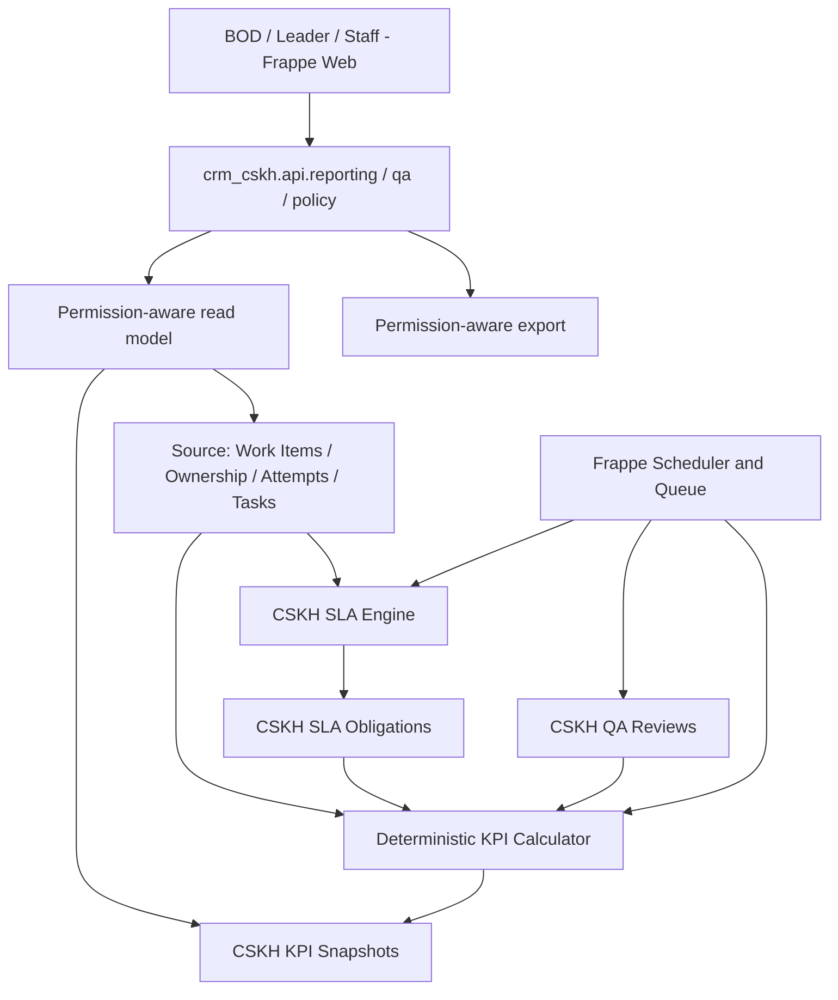

# P3 — SLA, KPI, QA & BOD QUALITY DASHBOARD

> **Dự án:** CRM-CSKH — Quản trị kho khách hàng, phân phối lead và chất lượng chăm sóc khách hàng  
> **Tài liệu:** `P3.md`  
> **Phiên bản:** 1.0 — 15/10/2026  
> **Tài liệu cha:** [`master-plan.md`](./master-plan.md)  
> **Phụ thuộc bắt buộc:** [`P0.md`](./P0.md), [`P1.md`](./P1.md), [`P2.md`](./P2.md), các Exit Report thực tế, ADR và `version-lock.md` của repository triển khai  
> **Trạng thái:** Đặc tả giao **AI Coding Agent**; **không mặc định P0–P2 đã hoàn thành**  
> **Công nghệ:** Frappe Framework + Frappe CRM + custom app `crm_cskh`; MariaDB, Redis, Frappe background jobs; Vue/Frappe UI; **một website duy nhất**  
> **Baseline tham khảo:** [`frappe/crm` tag `v1.87.0`](https://github.com/frappe/crm/tree/v1.87.0). Luôn dùng phiên bản khóa thực tế ở P0 khi code.  
> **Đầu ra P3:** BOD biết **ai được giao bao nhiêu, có chăm sóc đúng hạn không, kết nối ra sao, tồn đọng gì, điểm tuân thủ bao nhiêu, vì sao được điểm đó**, và truy ngược được từ mọi chỉ số tới dữ liệu có thẩm quyền.

---

## 0. ĐỌC TRƯỚC KHI CODE — BẤT BIẾN KHÔNG ĐƯỢC VI PHẠM

1. **Chỉ bắt đầu P3 khi P2 đạt GO.** Đọc source thực tế, đặc biệt `CSKH Work Item`, `CSKH Assignment History`, `CSKH Contact Attempt`, `CSKH Attempt Correction`, `CSKH Outcome Code`, `CSKH Policy`, liên kết `CRM Task` và mọi ADR đã duyệt. Nếu chưa có hoặc khác hợp đồng, lập discrepancy report; không tự bịa schema.
2. **Không xây lại CRM.** Sử dụng Frappe CRM cho Lead/Task/Call Log/User/Sales Hierarchy; tận dụng Frappe UI, chart components, jobs và quyền sẵn có. Xây engine CSKH đặc thù trong `crm_cskh`.
3. **Không có web thứ hai, backend thứ hai, database thứ hai.** Cùng Frappe site cho Admin/BOD/Leader/Staff, quyền do server kiểm tra. Không đề xuất triển khai desktop. Chỉ thiết kế API để ứng dụng điện thoại có thể dùng *sau này*, không làm ứng dụng ở P3.
4. **Tuyệt đối không đếm cuộc gọi hai lần.** `CSKH Contact Attempt` có hiệu lực (sau correction) là nguồn sự thật cho số lần thử/kết nối; `CRM Call Log` chỉ là sự kiện/chi tiết liên kết. `CRM Task` là nguồn sự thật lịch hẹn; SLA Obligation chỉ là sự thật về hạn và trạng thái chấp hành, không phải một Task thứ hai.
5. **Không nhầm “đã cố gắng liên hệ” với “đã kết nối”.** No Answer, Busy, SMS/Zalo gửi nhưng chưa có phản hồi được tính Attempt nếu hợp lệ, **không** tính Connected.
6. **Không nhầm “nhân viên khai đã gọi” với “đã xác minh”.** `self_reported`, `verified`, `disputed` được thống kê riêng. Không tự suy ra Verified từ việc điền form hoặc có ghi chú.
7. **Không dùng `CRM Lead.lead_owner` hiện tại để hồi tính KPI quá khứ.** Cần gắn mọi dữ liệu lịch sử với **ownership interval** bất biến từ P1, event time và team membership có hiệu lực trong kỳ.
8. **SLA tính theo bản policy đang có hiệu lực khi nghĩa vụ phát sinh, có snapshot/version.** Đổi chính sách hôm nay không âm thầm đổi hạn hôm qua.
9. **Không phạt sai do chuyển giao/đóng chiến dịch/nghỉ có phê duyệt.** Mỗi loại được định nghĩa rõ bằng *event*, điều kiện và bằng chứng. Không tự động miễn trừ theo cảm tính.
10. **Mọi KPI phải có tên, công thức, tử số, mẫu số, kỳ, time basis, exclusions, scope, provenance, test case.** Nếu mẫu số bằng 0, trả `N/A`, không trả 0% hoặc 100% tùy tiện.
11. **Không xếp hạng nhân viên bằng số cuộc gọi hoặc số tin nhắn đơn thuần.** Tách **tuân thủ quy trình**, **hiệu quả kết nối/chuyển đổi** và **độ tin cậy dữ liệu**.
12. **Điểm QA thiếu mẫu không được coi là điểm 0.** Tính `provisional`/`insufficient_data` với hiển thị minh bạch, không trộn ranking giữa provisional và finalized.
13. **BOD phải drill-down được.** Mỗi số liệu có thể mở danh sách Work Item / Attempt / Task / SLA Violation / QA Review tạo ra nó, trong đúng quyền truy cập.
14. **Report API / export cũng phải lọc quyền từ backend.** Không dựa vào filter UI, không cho nhân viên yêu cầu `user=someone_else` hoặc thay `team_id` để xem dữ liệu khác.
15. **Việt hóa UI nghiệp vụ**, công thức và tên chỉ số; định dạng thời gian Asia/Ho_Chi_Minh; lưu thời gian theo chuẩn được P0/P2 chốt, luôn tránh nhầm UTC với local.
16. **DEV local trước, CI/fixtures đầy đủ, staging độc lập khi cần.** Không test KPI trên dữ liệu người lao động/khách hàng thật chưa được ẩn danh. Không cập nhật source trực tiếp trên VPS production.
17. **P3 không tích hợp dịch vụ liên lạc mới**, không mở rộng import/weighted distribution, không xây predictive AI, không viết app điện thoại, không xây payroll/commission, không lập hệ thống BI ngoài Frappe.

### 0.1. Phân định phạm vi

| P2 đã cung cấp | P3 bổ sung | P4 mới hoàn thiện |
|---|---|---|
| Contact Attempt có cấu trúc | Định nghĩa và tính KPI | Hardening, load test, vận hành production |
| Task follow-up / filter overdue | SLA nhiều chính sách, working hours, vi phạm và escalation | Giám sát hệ thống, backup/restore rehearsal |
| State và outcome snapshot | QA tùy chọn, verified vs self-reported, score 100 | SOP và diễn tập sự cố hoàn chỉnh |
| Thống kê vận hành cơ bản | Snapshot kỳ, dashboard BOD, drill-down và export có quyền | Tối ưu hiệu năng theo tải thật |
| Ownership history P1 | Historical attribution / team-as-of | Audit bảo mật cuối cùng |

**Định nghĩa thành công đơn giản:** BOD chọn một nhân viên trong tháng bất kỳ, thấy rõ tỷ lệ liên hệ lần đầu đúng hạn, tỷ lệ xử lý lịch hẹn, tỷ lệ phủ khách, điểm quy trình, số khách quá hạn, tỷ lệ kết nối và tỷ lệ dữ liệu có bằng chứng; bấm vào bất kỳ con số nào để kiểm tra dữ liệu gốc.

---

## 1. ENTRY GATE — CHỈ BẮT ĐẦU KHI P2 ĐÃ ĐỦ DỮ LIỆU

AI Coding phải đọc các file `P0 Exit Report`, `P1 Exit Report`, `P2 Exit Report`, `version-lock.md` và source tương ứng, tạo `docs/p3/entry-audit.md` gồm:

- Frappe/CRM version, schema hiện tại, test chạy qua và các ADR chưa chốt.
- Unique ID của Work Item; quan hệ `(campaign, lead)`; status active/terminal; cơ chế không có hai Work Item active trên một Lead theo P1.
- Assignment History có `ownership_start` / `ownership_end`, `from_user`/`to_user`, `actor`, `event_at`, reason; khả năng xác định ownership interval khi A → B → A.
- Nguồn event-time chuẩn của Attempt (`occurred_at`, `recorded_at`, `performed_by`), `verification_status`, `outcome_snapshot` và correction effective view.
- Mapping Call Log–Attempt (không đếm trùng), Task callback–Attempt–Work Item, status done/canceled và reschedule audit.
- CSKH Policy precedence/version và `next_action_due`; các trường chỉ là cache/projection phải nhận diện rõ.
- Role matrix từ P0–P2, đặc biệt khả năng nhân viên đọc generic Frappe API, Calls/Tasks/Notes/exports ngoài scope.
- UI extension ADR từ P0 và đường đi `My Customers`/overview từ P1/P2.
- Chất lượng ẩn danh test seed, migration strategy và các phép đối soát ở P2.

**Entry failure:** thiếu thời điểm assignment, không phân biệt self-reported/verified, không truy được effective attempts sau correction, hoặc có lỗi xem chéo PII => **NO-GO P3**; sửa ở lớp P1/P2 và bổ sung regression test trước, không vá bằng SQL trong KPI.

### 1.1. Bộ dữ liệu tối thiểu để kiểm thử

- 2 campaign có priority, policy và lead source khác nhau; 2 team; >= 5 nhân viên, 1 BOD, 1 Admin.
- >= 60 Work Items với các trường hợp unassigned, active, completed, invalid, DNC, campaign paused, transferred, reassigned A→B→A.
- >= 120 Attempts có cả No Answer, Busy, Connected, Interested, Not Interested, SMS chưa phản hồi, callback requested; một số được sửa bằng correction; ít nhất 1 Call Log gắn Attempt.
- >= 25 callback Tasks, gồm đúng hạn, trễ, rescheduled, canceled vì chuyển giao, duplicate retry.
- >= 2 phiên policy khác nhau; ngày nghỉ và ca làm việc qua ngày; có sự kiện trước/sau thời điểm đổi policy.
- Các cases QA chưa đủ mẫu, bị tranh chấp, đã xác minh, reviewer tự duyệt việc của mình bị chặn.

---

## 2. SOURCE AUDIT / REUSE MATRIX — PHẢI MỞ ĐÚNG TAG

Các file Frappe CRM **đã được kiểm tra trên `v1.87.0`** như điểm xuất phát, nhưng AI Coding bắt buộc xác minh lại trên phiên bản thực tế của P0:

| Chức năng | Source upstream | Khả năng dùng lại | Quyết định P3 |
|---|---|---|---|
| SLA gốc với giờ làm, ngày nghỉ và response status | [`crm/fcrm/doctype/crm_service_level_agreement/crm_service_level_agreement.py`](https://github.com/frappe/crm/blob/v1.87.0/crm/fcrm/doctype/crm_service_level_agreement/crm_service_level_agreement.py), `.json` | **Reuse logic/reference**, không reuse trực tiếp semantics | Đo/kiểm tra utility lịch làm việc; CSKH deadline riêng, không gán sai vào `communication_status` |
| Task + hạn và người phụ trách | [`crm/fcrm/doctype/crm_task/crm_task.py`](https://github.com/frappe/crm/blob/v1.87.0/crm/fcrm/doctype/crm_task/crm_task.py) | **Reuse** | `CRM Task` giữ callback; liên kết SLA obligation |
| Lead và owner/status | [`crm/fcrm/doctype/crm_lead/crm_lead.py`](https://github.com/frappe/crm/blob/v1.87.0/crm/fcrm/doctype/crm_lead/crm_lead.py) | **Reuse** | Không tính KPI lịch sử từ owner hiện tại |
| Call Log | [`crm/fcrm/doctype/crm_call_log/crm_call_log.py`](https://github.com/frappe/crm/blob/v1.87.0/crm/fcrm/doctype/crm_call_log/crm_call_log.py) | **Reuse** | Chỉ liên kết, không coi Call Log thứ hai là Attempt |
| Timeline/activities | [`crm/api/activities.py`](https://github.com/frappe/crm/blob/v1.87.0/crm/api/activities.py), [`frontend/src/components/Activities/Activities.vue`](https://github.com/frappe/crm/blob/v1.87.0/frontend/src/components/Activities/Activities.vue) | **Reuse** | Drill-down tới timeline đã kiểm quyền, thêm tab CSKH khi cần |
| Dashboard, chart layout và data | [`crm/api/dashboard.py`](https://github.com/frappe/crm/blob/v1.87.0/crm/api/dashboard.py), [`crm/fcrm/doctype/crm_dashboard/crm_dashboard.py`](https://github.com/frappe/crm/blob/v1.87.0/crm/fcrm/doctype/crm_dashboard/crm_dashboard.py) | **Reuse UI/primitives** | P3 dashboard riêng, không ghi đè Manager Dashboard |
| User/team hierarchy | [`crm/permissions/org_hierarchy.py`](https://github.com/frappe/crm/blob/v1.87.0/crm/permissions/org_hierarchy.py), `CRM Sales Hierarchy` | **Reuse có kiểm thử** | Tạo scope dữ liệu server-side, phân quyền lịch sử theo team-as-of |
| Scheduler/workers | [`crm/hooks.py`](https://github.com/frappe/crm/blob/v1.87.0/crm/hooks.py), Frappe scheduler/queue | **Reuse** | Đăng ký job của `crm_cskh`, xử lý idempotent |
| Giao diện thống nhất và ngôn ngữ | Frappe UI, Frappe i18n, `crm/locale/vi.po` | **Reuse** | Việt hóa cả chỉ số/công thức/tooltip/export |
| Import, weighted assignment, My Customers | Code `crm_cskh` P1/P2 | **Reuse tuyệt đối** | Không xây thêm phiên bản khác |

**Chú ý theo version:** Dashboard API của tag `v1.87.0` chỉ gọi resolver có tên `get_<chart>` trong `crm.api.dashboard`; cơ chế hook `crm_dashboard_charts` thấy ở nhánh `develop` **chưa hiện diện ở tag này**. Không tạo kế hoạch dựa trên hook chưa có ở baseline. P3 dùng **route/chart endpoint thuộc `crm_cskh`** với quyền server-side, tái sử dụng component đồ họa. Khi có extension API ổn định về sau thì mới cân nhắc tích hợp.

**Một điểm kỹ thuật phải tránh:** Frappe SLA gốc dùng `sla_creation`, `first_responded_on`, `communication_status`; nó **không tự đo** thời gian từ `CSKH Assignment History.ownership_start` đến `CSKH Contact Attempt`. P3 phải dùng SLA obligation riêng cho yêu cầu này.

### 2.1. Quy tắc reuse thư viện

- Dùng `frappe.qb`/ORM, `frappe.get_list`, Frappe scheduler/`frappe.enqueue`, cơ chế caching và serialization đã có. Với truy vấn aggregation lớn, SQL tham số hóa có explain/index, không N+1.
- Dùng Vue/Frappe UI của cùng baseline, cùng design tokens và cơ chế i18n. Chart library mới chỉ thêm nếu component hiện có không đáp ứng và đã có ADR lý do.
- Không tạo Redis riêng, worker stack riêng, reporting PostgreSQL, Kafka, dashboard Metabase hoặc frontend app mới chỉ để có P3.
- Không import trực tiếp helper private của Frappe rồi phụ thuộc behavior chưa có compatibility test; ưu tiên dùng public API hoặc copy thuật toán tính giờ thành pure functions **có test và ghi rõ lý do** nếu cần.

---

## 3. KIẾN TRÚC P3 — MỘT BACKEND, MỘT NGUỒN SỰ THẬT



- **Write model:** giữ dữ liệu gốc ở P1/P2, không tạo bản sao customer mới.
- **SLA projection:** `CSKH SLA Obligation` ghi nghĩa vụ, deadline, policy snapshot, trạng thái, event refs và lý do miễn trừ; có nguồn kiểm tra lại.
- **KPI read model:** tập hợp kết quả đã chuẩn hóa, nguồn dữ liệu và phiên bản metric; snapshot tạo theo job, có thể tính lại có kiểm soát.
- **QA (tùy chọn, có feature flag):** reviewer kiểm định mẫu bằng checklist khi BOD phê duyệt quy trình. Khi chưa bật QA, dashboard và KPI cốt lõi vẫn vận hành; phần điểm thiếu mẫu QA được gắn `provisional`.
- **Frontend:** BOD/Leader/Staff dùng API cùng phiên đăng nhập; phạm vi user/team/campaign do backend quyết định.
- **Workers:** tính SLA, recalculation, alert và export; tất cả có khóa/idempotency, retry và job log.

Không dùng database thứ hai. Nếu cần realtime trên dashboard: dùng cơ chế sự kiện/sockets đã có, **không** cập nhật từng biểu đồ sau mỗi Attempt theo cách tốn tài nguyên; thống kê được cập nhật với SLA độ tươi rõ ràng.

---

## 4. ĐỊNH NGHĨA THỜI GIAN, KỲ BÁO CÁO VÀ OWNERSHIP

### 4.1. Ba mốc thời gian độc lập

1. **Event time:** `occurred_at` Attempt, `completed_at` Task, `event_at` Assignment. Đây là mốc nghiệp vụ.
2. **Recorded/processing time:** sự kiện được server ghi nhận hoặc được sửa qua correction. Dùng để biết vì sao báo cáo thay đổi sau này.
3. **Snapshot as-of:** thời điểm hệ thống chốt tính KPI trên tập events đã biết. Báo cáo phải nói được “dữ liệu cập nhật tới lúc nào”.

Lưu timestamp nhất quán theo quyết định P0/P2 (khuyến nghị UTC trong thuật toán, chuyển sang `Asia/Ho_Chi_Minh` ở biên UI/report); sử dụng khoảng thời gian **[from, to)**, không tự suy đoán ngày kết thúc 23:59:59.

### 4.2. Định nghĩa kỳ

- Dashboard cho phép ngày, tuần, tháng, quý, năm, khoảng tùy chọn. Chỉ số theo **cohort, deadline, hoặc event** phải gắn nhãn rõ để tránh nhầm.
- **Nhận mới trong kỳ:** đếm ownership intervals bắt đầu trong kỳ.
- **Đến hạn lần đầu trong kỳ:** đếm obligation có deadline lần đầu thuộc kỳ (dù khách được giao cuối kỳ trước).
- **Đến hạn follow-up trong kỳ:** đếm callback obligations có deadline thuộc kỳ.
- **Đã kết nối trong kỳ:** đếm Work Items có ít nhất một connected Attempt hiệu lực thuộc kỳ, trong scope báo cáo; không dùng “người đang sở hữu”.
- **Backlog cuối kỳ:** ảnh chụp trạng thái active và overdue tại `as_of`, không phải số cộng dồn của các sự kiện đã xảy ra.
- **Active at period end:** chỉ số tồn kho; không cộng tổng hàng ngày để thành tổng tháng.

### 4.3. Ownership interval và team-as-of

- Mỗi interval có `work_item_id`, `assignee_id`, `start_at`, `end_at`, `team_id_at_assignment` (được snapshot hoặc có membership history đáng tin), reason, event ID.
- Half-open interval: `[start_at, end_at)`; Attempt tại `end_at` thuộc owner kế tiếp nếu timestamp/bút toán chứng minh được. Nếu hai event đồng thời, phân xử bằng **server event sequence** hoặc event ID, không dựa hoàn toàn vào mili-giây.
- A → B → A tạo **3 intervals**, không gộp vì cùng user.
- KPI historical gắn employee tại thời điểm xảy ra sự kiện, Team Leader hiện tại chỉ xem dữ liệu phù hợp scope đã được phê duyệt. Việc nhân viên chuyển team không được thay đổi số liệu lịch sử của team trước.
- **Sau chuyển khách, Staff không được đọc PII gốc** chỉ vì còn có KPI cá nhân về giai đoạn đã phụ trách. Drill-down cho Staff chỉ hiển thị thống kê đã giới hạn/ẩn danh theo policy; Leader/BOD có scope rõ ràng.

### 4.4. Ngưỡng tin cậy dữ liệu

Các trạng thái báo cáo: `fresh`, `calculating`, `stale`, `provisional`, `finalized`, `insufficient_data`, `failed`. Hiển thị `calculated_at`, `source_watermark`, `formula_version`, `policy_version` và `scope`. Không gắn badge thành tích giả khi snapshot đang stale hoặc chưa đủ dữ liệu.

---

## 5. SLA ENGINE — KHÁI NIỆM VÀ NGUYÊN TẮC

### 5.1. Bốn loại nghĩa vụ trong P3

| Mã | Nghĩa vụ | Thời điểm bắt đầu | Hoàn thành khi | Mẫu số KPI |
|---|---|---|---|---|
| `FIRST_ATTEMPT` | Liên hệ lần đầu | Work Item được giao / interval bắt đầu theo policy | Attempt hợp lệ đầu tiên thuộc owner có trách nhiệm | Obligation đã đến hạn |
| `FIRST_CONNECTED` | Kết nối thành công lần đầu (**theo dõi riêng**, chưa phạt mặc định) | Work Item/đợt xử lý | Connected Attempt đầu tiên | Report riêng, không đánh đồng việc cố gắng liên hệ |
| `FOLLOWUP` | Chăm sóc đúng lịch hẹn | `CRM Task`/reschedule hợp lệ tạo hạn | Attempt có liên hệ với lịch hẹn hoặc Task completion đã xác minh theo quy tắc | Task obligation đã đến hạn |
| `MIN_ATTEMPTS` | Số lần thử tối thiểu trong chu kỳ | Event/policy kích hoạt | Đủ N attempt hợp lệ, cách quãng tối thiểu nếu policy yêu cầu | Obligation chu kỳ đã đến hạn |

**Mặc định P3:** triển khai `FIRST_ATTEMPT`, `FOLLOWUP` trước; `MIN_ATTEMPTS` chỉ kích hoạt khi policy thực sự yêu cầu; `FIRST_CONNECTED` theo dõi KPI kết quả **không** tự biến thành vi phạm nhân viên nếu khách không bắt máy.

### 5.2. Policy và hiệu lực

- Tái sử dụng `CSKH Policy` từ P2; **mở rộng có kiểm soát**, không tạo `SLA Policy` thứ hai nếu không bắt buộc.
- Precedence kế thừa: **Campaign > Team > Global**, priority xác định và không cho hai policy cùng hiệu lực mâu thuẫn ở một scope.
- Các trường mới đề xuất: `first_attempt_target_minutes`, `first_attempt_clock` (`business|wall`), `working_calendar`, `followup_grace_minutes`, `max_missed_followups_before_escalation`, `min_attempts`, `min_attempt_spacing_minutes`, `handoff_min_grace_minutes`, `warning_before_due_minutes`, `escalation_rules_json` (validated schema), `excluded_outcomes`, `scoring_enabled`, `effective_from/to`, immutable `version/hash`.
- **Đóng băng policy** khi sinh obligation: link `policy_version` + snapshot những tham số liên quan (target, calendar ID/version, holidays, grace, precedence, timezone). Một thay đổi policy chỉ áp dụng cho các obligation **mới**, trừ backfill đã được phê duyệt và có audit.
- Pause/suspension không được tự xảy ra vì Admin sửa status. Chỉ có event `pause(reason, authority, start/end)` hợp lệ mới có thể dừng SLA theo policy; phải lưu rõ có dừng đồng hồ hay không.

### 5.3. Lịch làm việc và thời hạn

- Hỗ trợ thời gian làm việc theo đội/campaign, ngày nghỉ, ngoại lệ và ca qua nửa đêm (nếu cần), timezone xác định.
- Sử dụng lịch Frappe (`CRM Service Day`, `CRM Holiday List`) nếu adapter đáp ứng đúng các trường hợp P3; **không sửa chính** cách SLA gốc áp dụng cho `CRM Lead`.
- Pure functions `business_minutes_between(start, end, calendar)` và `add_business_minutes(start, target, calendar)` phải có test độc lập: ngoài giờ, cuối tuần, nghỉ lễ, chuyển ngày, ca qua đêm, zero target, ngày không có ca.
- Deadline chỉ đổi khi event/policy cho phép. **Scheduler trễ không được đổi deadline**: worker đánh giá dựa trên event time/deadline và phát alert sau khi đọc DB.
- Timezone locale hiển thị Việt Nam. Không dùng giờ trình duyệt để kết luận vi phạm; backend mới có thẩm quyền.

### 5.4. Trạng thái một obligation

`pending`, `fulfilled_on_time`, `fulfilled_late`, `breached_open`, `waived`, `canceled_validly`, `superseded`; kèm các trường `due_at`, `fulfilled_at`, `breached_at`, `finalized_at`, `waiver_reason`, `waived_by`, `source_event`.

- `pending` đến hạn chưa qua: chưa tính vào mẫu số KPI *đến hạn*.
- `breached_open` quá hạn chưa hoàn tất: vào mẫu số và là trễ; hoàn tất sau đó chuyển `fulfilled_late`, không xóa vi phạm gốc.
- `waived/canceled_validly`: ngoài mẫu số có lý do và người phê duyệt; báo cáo phải có số lượng loại trừ, không âm thầm xóa.
- `superseded`: event được thay thế bởi reschedule hợp lệ, có link `replaced_by`, không xóa lịch sử.
- Mọi thao tác trực tiếp của Staff đối với trường `status`, `due_at`, `waived_by`, `policy_version` đều bị từ chối ở generic API.

### 5.5. SLA khi chuyển khách A → B

Vấn đề này phải có quy tắc **không thể game** bằng cách chuyển khách ngay trước deadline:

1. **Deadline cấp Work Item không bị reset âm thầm.** Nếu chưa first-touch thì nghĩa vụ gốc giữ `original_due_at` và lịch sử chuyển giao.
2. **Trách nhiệm cấp owner interval:** A chịu trách nhiệm khi deadline rơi vào khoảng A phụ trách (hoặc A đã vi phạm trước khi chuyển); B chịu phần còn lại theo handoff policy. Không phạt A cho deadline chưa đến ở thời điểm bàn giao hợp lệ.
3. **Grace khi bàn giao:** nếu policy cho B ít nhất X phút làm việc, ghi `handoff_grace_at` và effective due mới cho B, nhưng giữ original due để kiểm soát SLA toàn hệ thống. Hệ thống quản lý được cả `work_item_sla` và `employee_accountability_sla`.
4. **Chuyển sau khi đã quá hạn:** vi phạm đang có của A vẫn tồn tại; B không gánh vi phạm xảy ra trước khi mình nhận; B nhận obligation riêng nếu còn việc chưa hoàn thành.
5. **Chuyển nhiều lần liên tiếp:** không cho liên tục reset grace. Có giới hạn hoặc yêu cầu Admin phê duyệt và lưu nguyên nhân; BOD thấy số trường hợp reset/waive.
6. **Follow-up callback:** `CRM Task.due_date` không thay đổi do chuyển chủ trừ khi Admin đổi lịch có audit; task ownership chuyển cùng công việc; attribution vi phạm dựa trên owner ở thời điểm trách nhiệm đến hạn.

**ADR-P3-01** phải chốt semantics chi tiết. Không được tự bỏ qua trường hợp A→B→A.

### 5.6. Escalation / cảnh báo

- Cảnh báo sắp đến hạn: configurable threshold, recipients theo team ownership tại thời điểm phát.
- Quá hạn: tạo `CSKH SLA Violation/Alert` bằng một sự kiện idempotent theo `(obligation, threshold_level)` hoặc trường log tương đương.
- Escalation levels ví dụ: Staff → Team Leader → Admin/BOD, chỉ sau khi được phê duyệt trong `CSKH Policy`.
- Cảnh báo nội bộ trên web; không gửi SMS/Zalo cho khách hoặc các dịch vụ ngoài dự án.
- Deduplicate, cooldown, stop/escalation on fulfillment, route đúng người sau transfer, tránh gửi nội dung PII nếu không cần.
- Worker retry không tạo 2 cảnh báo; job failure có log và admin inspection view.

---

## 6. THIẾT KẾ DỮ LIỆU P3 — PHẦN MỚI TỐI THIỂU

### 6.1. Những nguồn được giữ nguyên

- `CRM Lead` — danh tính khách, không copy thành bảng customer thứ hai.
- `CSKH Work Item`, `CSKH Assignment History`, `CSKH Campaign`, `CSKH Contact Attempt`, `CSKH Attempt Correction`, `CSKH Outcome Code`, `CSKH Policy` — từ P1/P2.
- `CRM Task` — nguồn của callback due/completion; `CRM Call Log` — chi tiết cuộc gọi, không làm nguồn đếm độc lập.
- `User`, `CRM Sales Hierarchy` — nhân sự/team; bổ sung membership history/snapshot nếu P1 chưa lưu team-as-of chính xác.

### 6.2. DocType mới/điều chỉnh đề xuất

| DocType | Trường lõi | Cách dùng |
|---|---|---|
| **`CSKH SLA Obligation`** | `work_item`, `assignment_interval`, `task`, `type`, `policy_version`, `calendar_snapshot`, `start_at`, `original_due_at`, `effective_due_at`, `fulfilled_at`, `status`, `responsible_user/team`, `exemption_code`, `waiver_by`, `source_event_id`, `revision` | Lưu deadline và trách nhiệm; unique business key khi cần |
| **`CSKH SLA Event`** (tùy chọn) | `obligation`, `event_type`, `event_at`, `actor`, `reason`, `payload_hash`, `request_id` | Dùng khi Frappe Version/audit P1/P2 không đủ chứng minh quá trình update; ADR trước khi thêm |
| **`CSKH KPI Run`** | `metric_version`, `policy_versions_hash`, `scope`, `period`, `as_of`, `source_watermark`, `status`, `idempotency_key`, `started_at`, `finished_at`, `error`, `recompute_reason` | Một lệnh tính/chạy lại; có retry và audit |
| **`CSKH KPI Snapshot`** | `run`, `period_type/from/to`, `scope_type/id`, `user`, `team_at_period`, `campaign`, `policy_version`, `metric_version`, `numerators/denominators`, `score_components`, `final_score`, `confidence/status`, `calculated_at`, `source_watermark` | Bản báo cáo đóng băng, link đến run; history nhiều revision |
| **`CSKH QA Review`** | `attempt/work_item`, `reviewed_user`, `reviewer`, `checklist_version`, `criteria_results`, `passed`, `score`, `evidence_type`, `verification_decision`, `reviewed_at`, `appeal_status`, `sampling_batch` | Kiểm định mẫu, có audit/cấm tự duyệt |
| **`CSKH QA Checklist`** (nếu cần cấu hình) | `version`, `effective_date`, `criteria/weights`, `sampling_rules`, `thresholds`, `enabled` | Tạo khi có workflow QA thật; nếu không, dùng cấu hình versioned nhẹ trong policy |

**Nguyên tắc tối giản:** Không tạo đồng thời `CSKH Followup Task` mới vì đã có `CRM Task`. Không tạo bảng `CSKH Violation` riêng nếu `CSKH SLA Obligation` + event log + notification hiện tại đủ audit. Không nhân bản Work Item/Attempt chỉ để tổng hợp KPI.

### 6.3. Index/constraint quan trọng

- `CSKH SLA Obligation`: index `(work_item, type, status)`, `(responsible_user, effective_due_at)`, `(effective_due_at, status)`, `(task)`; business uniqueness trên `(type, source_event_id, responsibility_interval/version)` theo ADR.
- `CSKH KPI Run`: unique `(scope_hash, period_start, period_end, metric_version, as_of_or_revision, idempotency_key)` hoặc equivalent; không dùng khóa quá rộng khiến legitimate recompute bị chặn.
- `CSKH KPI Snapshot`: index `(scope_type, scope_id, period_end, metric_version, status)`, `(user, period_start, period_end)`, `(campaign, period_end)`; pointer latest accepted snapshot phải cập nhật atomically.
- `CSKH QA Review`: unique `(review_target, checklist_version, review_round)` theo policy; chặn duplicate active review hoặc cho nhiều người review có `review_round` rõ.
- Frappe DocType permissions + `has_permission`, `permission_query_conditions` hoặc custom read/write API phải chứng minh Staff không CRUD/report tùy ý trên các DocType P3.
- Dùng migration patch idempotent, index xây bằng `frappe.db.add_index`/SQL tương thích bản Frappe đã khóa; validate schema thực tế. Không assume PostgreSQL partial indexes vì DB chính là MariaDB.

### 6.4. Append-only và correction

- Mỗi attempt correction ở P2 làm phát sinh yêu cầu tính lại affected SLA/KPI; không sửa log quá khứ rồi xóa dấu vết.
- Khi QA thay trạng thái `verified/disputed`, lưu reviewer, bằng chứng và chính sách; không biến `self_reported` thành verified chỉ vì reviewer mở phiếu.
- Khi policy version mới có hiệu lực, các snapshots cũ vẫn truy được; tính lại quá khứ phải có `KPI Run` nêu lý do, approver, source watermark và kết quả cũ/mới.
- Hạn chế lưu PII trực tiếp trong KPI Snapshot; chủ yếu chứa identifiers, counts, rates, score và references.

---
## 7. KPI DICTIONARY — MỖI CHỈ SỐ PHẢI GIẢI THÍCH ĐƯỢC

### 7.1. Quy ước chung

Ký hiệu:

- `I`: ownership interval của một Work Item; mỗi interval có chính xác một nhân viên chịu trách nhiệm chính.
- `A(I)`: tập **effective** Contact Attempts của nhân viên `I.assignee`, có `occurred_at` nằm trong interval `I`, đã qua correction và chưa void.
- `connected(a)`: cờ **đã kết nối hai chiều thực tế** từ `outcome_snapshot`, không suy ra từ channel hay status Call Log.
- `due(O)`: deadline có hiệu lực của obligation `O`; `O` thuộc kỳ đến hạn nếu `period_start <= due(O) < period_end`.
- `eligible(x)`: bản ghi đạt điều kiện tính tại `as_of` và không thuộc tập loại trừ hợp lệ đã công bố.
- Tỷ lệ `(numerator / denominator) × 100`, nếu `denominator=0` trả `{value:null, status:'insufficient_data', reason:'no_eligible_records'}`.
- `policy_version`, `metric_version`, `period`, `attribution_scope`, `as_of` bắt buộc trong contract metric.

**Thống nhất hai đơn vị thống kê khác nhau:**

1. **Lead/Work Item-level:** dùng cho tổng khách duy nhất, khách đã kết nối, tồn backlog toàn công ty; dedup Work Item và không cộng số nhân viên nếu khách có nhiều ownership intervals.
2. **Ownership interval-level:** dùng cho đánh giá trách nhiệm nhân viên; một Work Item có thể xuất hiện trong trách nhiệm của A và B, nhưng có `interval_id` riêng. Tổng theo nhân viên **không đồng nghĩa** tổng khách duy nhất công ty.

### 7.2. Danh mục KPI chuẩn P3

| Key | Tên tiếng Việt | Tử số / công thức | Mẫu số, kỳ, và ghi chú |
|---|---|---|---|
| `assigned_intervals` | Lượt nhận khách | Số `I` bắt đầu trong kỳ | Count; có thể > số Work Item duy nhất |
| `unique_assigned_items` | Khách được giao duy nhất | Số Work Item distinct trong phạm vi và kỳ | Count; khác `assigned_intervals` |
| `eligible_coverage` | Tỷ lệ phủ liên hệ | Số eligible `I` có >= 1 effective Attempt trong interval trước cutoff | Số eligible `I` đã đủ thời gian xử lý tại cutoff; quy tắc cohort/exposure versioned |
| `attempts_count` | Số lần thử liên hệ | Count effective Attempts trong kỳ | Count, không phải chỉ số chất lượng chính |
| `connected_items` | Khách kết nối thành công | Số Work Item distinct có connected Attempt trong kỳ/scope | Count; có thể chọn first-ever vs connected-in-period rõ ràng |
| `connected_rate` | Tỷ lệ kết nối | Số eligible ownership intervals có >=1 connected Attempt trong interval và kỳ/cửa sổ cohort | Số eligible intervals có >=1 Attempt; ghi rõ không chia cho tổng lần gọi |
| `first_touch_on_time` | Liên hệ lần đầu đúng hạn | Số eligible `FIRST_ATTEMPT` obligations `fulfilled_on_time` | Số eligible `FIRST_ATTEMPT` obligations đến hạn trong kỳ; late/open breach tính không đạt |
| `followup_on_time` | Chăm sóc đúng lịch | Số eligible `FOLLOWUP` obligations `fulfilled_on_time` | Số eligible callback obligations đến hạn trong kỳ |
| `outcome_completeness` | Cập nhật kết quả đầy đủ | Attempts hợp lệ đáp ứng required fields theo `outcome_snapshot/policy_version` | Tổng effective Attempts trong kỳ; không tính note do AI tự sinh không được duyệt |
| `overdue_backlog` | Khách/công việc quá hạn | Số Work Items distinct active có >=1 open overdue obligation tại `as_of` | Count tồn kho, không cộng kỳ như event count |
| `open_followups_overdue` | Lịch hẹn quá hạn | Count open `FOLLOWUP` obligations có `effective_due_at < as_of` | Count hiện tại, không cộng các lần worker quét |
| `qa_pass_rate` | Tỷ lệ QA đạt | QA Reviews được duyệt và đạt chuẩn trong cohort theo `reviewed_at` | Tổng QA Reviews đã hoàn tất, đủ điều kiện; tránh review nhiều lần cùng target |
| `verification_rate` | Tỷ lệ kết quả đã xác minh | Effective Attempts trạng thái verified | Effective Attempts được tính trong kỳ; disputed được báo riêng |
| `conversion_rate` | Tỷ lệ đạt mục tiêu | Work Items đáp ứng conversion definition của campaign | Mẫu số campaign versioned; **không ép tất cả chiến dịch dùng một mẫu số** |
| `breach_count` | Số vi phạm SLA | Số obligation có breach event trong kỳ | Count; `breached_open`→`fulfilled_late` chỉ là **một vi phạm** |
| `sla_waiver_count` | Số miễn trừ hợp lệ | Obligation waived trong kỳ theo approver | Count và danh sách audit bắt buộc |

**Điểm cần ghi trong UI:** `first_touch_on_time` đo **liên hệ thử lần đầu**; `connected_rate` đo **kết nối được với khách**. Hai chỉ số phải đứng riêng, không đổi tên để tạo cảm giác tốt hơn.

### 7.3. Thời gian phản hồi và percentile

- `first_attempt_latency_business_minutes`: khoảng từ `I.start_at` đến first effective Attempt của owner, trừ ngoài giờ theo lịch áp dụng; chưa có attempt thì không đưa vào trung bình thời gian thành công, **hiển thị số pending/breached riêng**.
- `first_attempt_latency_wall_minutes`: thời gian thực tế, phục vụ QA/so sánh nhưng không thay SLA business minutes.
- Hiển thị median/p90 trước average khi có đủ mẫu. Nếu N nhỏ, chỉ count và N/A theo policy.
- Không gọi `CRM Lead.first_response_time` là thời gian phản hồi CSKH nếu nó xuất phát từ SLA giao tiếp gốc.

### 7.4. Exclusions và cohort fairness

Các trường hợp phải định nghĩa tường minh, *có bằng chứng*:

| Case | Quy tắc mặc định đề xuất |
|---|---|
| Invalid phone đã được duyệt | Có thể exclude khỏi connected/conversion denominator theo policy; vẫn phản ánh lỗi chất lượng nguồn; không tự xóa khỏi nhận khách |
| Do not contact (DNC) | Chặn các lần liên hệ mới và đánh dấu excluded đối với nghĩa vụ tương lai từ thời điểm DNC hợp lệ; không xóa breach xảy ra trước đó |
| Campaign paused | Chỉ dừng/hoãn SLA nếu pause event và policy quy định; freeze thời gian có lưu lịch sử |
| Nhân viên nghỉ đã được Admin phê duyệt | Xử lý theo nghỉ/handover event và policy; không suy đoán từ không hoạt động |
| Transferred trước deadline | Không phạt A nếu A chưa đến hạn và handover hợp lệ; trách nhiệm B theo handoff policy; log mọi grace |
| Transferred sau breach | Vi phạm cũ của A giữ lại; B không thừa kế lỗi cũ |
| Ownership quá ngắn và chưa mature | Coverage được loại khỏi cohort chỉ theo min exposure/config, nhưng vẫn thấy số nhận và số chuyển; không loại tùy tiện |
| Corrected/voided Attempt | Metric dùng effective view; lưu run cũ và lý do recompute |
| Self-reported contact | Được tính attempt nếu nghiệp vụ cho phép; phân loại mức độ tin cậy, **không** thành verified |
| Không có đủ QA sample | `QA=N/A`; tổng điểm `provisional` theo phép tính công bố; **không** mặc định QA=0 |
| Callback Task tạo/dời lịch nhiều lần | Dùng lịch sử deadline và reschedule event; không hủy chỉ số trễ đã xảy ra nếu không có duyệt hợp lệ |

**Mỗi report** hiển thị hoặc có thể mở: `excluded_count`, `exclusion_reasons`, `waiver_count`, `data_quality_warnings`. Nếu exclusions > ngưỡng cấu hình, cảnh báo BOD để tránh thao túng KPI bằng cách chuyển khách sang "số sai"/"đã hủy".

### 7.5. Định nghĩa điểm chất lượng `PROCESS_SCORE` (0–100)

Mục tiêu là đo **mức tuân thủ**, không thay thế Conversion Rate, Connected Rate hoặc năng lực giao tiếp thực tế.

**Trọng số mặc định để demo, PHẢI cấu hình và được BOD phê duyệt trước production:**

| Thành phần | Trọng số mặc định | Nguồn dữ liệu |
|---|---:|---|
| First touch đúng hạn | 25 | `FIRST_ATTEMPT` SLA obligations |
| Phủ khách được giao | 20 | Ownership intervals + effective attempts |
| Cập nhật kết quả đầy đủ | 20 | Effective attempts + outcome snapshot |
| Follow-up đúng hạn | 20 | `FOLLOWUP` SLA obligations + Tasks |
| QA đạt chuẩn | 15 | `CSKH QA Review` có hiệu lực |
| **Tổng** | **100** | |

Công thức khi **mọi thành phần có dữ liệu**:

`score = ROUND(0.25 × first_touch_rate + 0.20 × coverage_rate + 0.20 × completeness_rate + 0.20 × followup_rate + 0.15 × qa_rate, 2)`

Trong đó mọi `_rate` có đơn vị **0–100**, nên kết quả cũng **0–100**.

**Khi thiếu một số thành phần** (ví dụ QA chưa triển khai), tính điểm **tạm thời** từ các thành phần có mẫu số >0:

`provisional_score = ROUND(Σ(weight_i × rate_i) / Σ(weight_i for valid_i), 2)`

Ví dụ 4 thành phần còn lại có tỷ lệ `90`, `80`, `100`, `75`, QA chưa có mẫu:

- Tổng điểm có trọng số: `25×90 + 20×80 + 20×100 + 20×75 = 7.350` (đơn vị weight-point).
- Tổng trọng số đủ dữ liệu = `85`.
- Điểm provisional = `7350/85 = 86,47`.
- UI bắt buộc ghi **“86,47 — Tạm tính; thiếu mẫu QA”**, không xếp ngang với điểm đã finalized.

**Một chỉ số rate có denominator=0 thì chính chỉ số đó N/A, không phải 0%.** Nếu tổng trọng số có dữ liệu < ngưỡng được BOD phê duyệt hoặc lượng sample quá ít, status=`insufficient_data`, không công bố điểm tổng hoặc ranking.

**Trọng số/versioning:** chốt trên `CSKH Policy` / cấu hình scoring versioned, snapshot ở kỳ; trọng số có thể khác campaign/team nhưng so sánh nhiều campaign phải giải thích rằng điểm dùng policy khác nhau. Không dùng conversion rate trực tiếp làm thành phần điểm quy trình mặc định để tránh bất công vì nguồn khách.

### 7.6. Những chống gian lận tối thiểu

- Event `recorded_at` so với `occurred_at` để phát hiện nhập lùi giờ; backdate vượt policy chỉ được correction/approval, không tính là first touch đúng hạn khi không có bằng chứng phù hợp.
- Cảnh báo outcome `Connected` được báo nhiều bất thường, cuộc gọi thời lượng 0, liên hệ số không hợp lệ, kết quả nhập dồn dập; **cảnh báo kiểm tra, không tự kết luận gian lận**.
- Không cho Staff đánh dấu `verified` hoặc tự duyệt QA; không cho người tạo policy tự xóa SLA Violation.
- Tách QA score và outcome performance khỏi total score; BOD xem được số mẫu và nguồn kiểm chứng.
- Dashboard có danh sách nhóm có tỷ lệ void/correction/waiver cao và source quality để người quản lý xem xét.

---

## 8. QA — KIỂM ĐỊNH MẪU CHĂM SÓC KHÁCH HÀNG (TÙY CHỌN BẬT TRONG P3)

**Scope control:** QA Review là module *tùy chọn theo master-plan*. P3 ưu tiên SLA + KPI + Dashboard. Nếu chưa có quy trình QA được BOD duyệt, để feature flag `qa_enabled=false`; không giả lập review, vẫn chạy báo cáo và gắn `provisional` hoặc `insufficient_data` rõ ràng. Nếu chọn triển khai QA trong P3 thì tất cả quy tắc và test dưới đây trở thành bắt buộc trước khi bật cho người dùng.

### 8.1. Không ép đội CSKH vào bài kiểm tra bán hàng chung

QA đánh giá **độ đúng quy trình, sự đầy đủ và hợp lý của ghi nhận**. Chỉ kết luận nội dung cuộc trao đổi có thật nếu có bằng chứng hợp lệ (ghi âm được phép, dữ liệu hệ thống liên lạc, phản hồi xác minh của khách hoặc quy trình kiểm định được duyệt). Ghi chú đẹp **không đồng nghĩa** đã liên hệ thật.

Checklist ban đầu:

1. Người phụ trách tại thời điểm liên hệ có đúng quyền không?
2. Kênh, thời điểm, outcome, note đúng schema và không mâu thuẫn?
3. Có lịch hẹn lại khi outcome yêu cầu?
4. Có thể đối chiếu nguồn bằng chứng không? Nếu không thì ghi rõ `unverified`.
5. Có dấu hiệu bỏ qua quy tắc DNC hoặc liên hệ ngoài policy không?
6. Reviewer có ghi nhận xét và quyết định đủ rõ để nhân viên cải thiện không?

BOD có thể cấu hình checklist versioned, trọng số và tỷ lệ mẫu theo campaign/team mà không hard-code trong frontend.

### 8.2. Sampling

- Cho phép sampling ngẫu nhiên có seed cố định và stratified theo nhân viên/campaign/outcome/verification_status.
- Đặt **minimum sample threshold** có thể cấu hình; không đưa điểm QA của một mẫu duy nhất thành kết luận chất lượng của cả tháng nếu chưa được phê duyệt.
- Kết quả sampling lưu `sampling_batch`, rule version, seed và danh sách ID; không sinh lại một mẫu khác mỗi lần refresh.
- BOD có thể yêu cầu review thủ công các trường hợp quá hạn, disputed, correction bất thường, nhưng báo cáo cần phân biệt `random_sample` và `risk_targeted` để không tạo thiên lệch.
- **Tránh sampling bias:** QA pass rate KPI so sánh nhân viên ưu tiên từ mẫu đại diện; mẫu được chọn theo rủi ro được hiển thị riêng hoặc áp dụng điều chỉnh trọng số có tài liệu.

### 8.3. Workflow QA

`queued → in_review → approved | rejected | needs_evidence → appealed → resolved`

- Reviewer hợp lệ trong phạm vi được quản trị phê duyệt; không tự duyệt attempt của chính mình.
- Review bất biến sau `approved`; sửa bằng revision/appeal có audit, không update tùy tiện.
- Có thời hạn phản hồi khi nhân viên khiếu nại điểm, người xử lý phải khác reviewer nếu chính sách yêu cầu.
- QA có thể xác minh evidence riêng hoặc đánh giá tuân thủ; cần **hai trường riêng**: `process_review_result` và `verification_decision`.
- Lưu tham chiếu file an toàn; không nhúng file ghi âm/thông tin nhạy cảm thẳng vào KPI snapshot hoặc thông báo.
- Khi appeal được duyệt: phát recompute job cho kỳ bị ảnh hưởng; bảng điểm mới có liên kết tới phiên cũ.

### 8.4. Quyền QA

| Vai trò | Xem | Duyệt/đánh giá | Export |
|---|---|---|---|
| Staff | Review thuộc mình theo mức được phép, không vượt quyền PII sau handover | Gửi giải trình/appeal, **không tự duyệt** | Chỉ tổng hợp cá nhân nếu chính sách cho phép |
| Team Leader | Review trong team được cấp | Review cấp team nếu không conflict of interest | Team-only, theo quyền |
| Admin / QA Officer được chỉ định | Mẫu được phân công | Duyệt, giải quyết theo quyền | Có kiểm toán |
| BOD | Tổng hợp toàn hệ thống và drill-down theo chính sách | Có thể phê duyệt ngoại lệ đặc biệt | Scope toàn công ty, có export audit |

Role `QA Officer` chỉ tạo nếu P0/P1 role architecture cho phép đúng; không cấp `System Manager` hàng loạt để có quyền QA.

---

## 9. KPI CALCULATION, SNAPSHOT, RECOMPUTE

### 9.1. Pipeline đề xuất

1. Nhận `scope, [from,to), as_of, metric_version`, xác thực scope.
2. Đọc assignment/ownership intervals đúng thời gian; dựng team-as-of từ history.
3. Đọc effective Contact Attempts P2 **một lần**; gắn `interval_id`, loại duplicates/voided.
4. Đọc Task lifecycle và SLA obligations; áp exclusions versioned.
5. Đọc QA Reviews có hiệu lực, phân biệt sampled/targeted và trạng thái verified.
6. Aggregate counts, numerator/denominator từng metric và policy version.
7. Tính score nếu đạt data sufficiency; sinh drill-down filters/source references.
8. Đối soát invariants, ghi snapshot + KPI Run trong transaction phù hợp; atomic switch active/latest pointer.
9. Trả dashboard data với `as_of`, `calculated_at`, `freshness`, `status`, `exclusion_counts`, `metric_version`.

### 9.2. Scheduler + event-driven invalidation

- P1/P2 mutations phát event nhẹ `work_item_changed`, `assignment_changed`, `attempt_recorded`, `attempt_corrected`, `task_changed`, `qa_decided` với ID.
- **Không** tính lại toàn bộ báo cáo trong transaction ghi Attempt/Task. Ghi dirty scope/window sau commit, enqueue job tổng hợp.
- Recompute theo affected employees/campaigns/periods; định kỳ reconciliation để sửa miss event/job failures.
- Phân tách `fast current counters` cho dashboard ngày hiện tại và `published snapshots` cho lịch sử đã chốt. Cả hai cùng định nghĩa metric.
- Retry đồng nhất `run_id`/idempotency key; một kỳ/scope không được có hai job thay nhau publish sai thứ tự.
- Job đêm hoặc lịch phù hợp được cấu hình; **không khẳng định mọi biểu đồ realtime**. Nên hiển thị "Dữ liệu cập nhật lúc ...".

### 9.3. Daily / weekly / monthly / quarterly / yearly

- **Daily:** metric theo event/deadline có tính đến các sự kiện đến muộn; snapshot ngày có thể provisional đến khi qua watermark window.
- **Week/Month/Quarter/Year:** ưu tiên aggregate từ **các tử/mẫu số đã chuẩn hóa** chứ không cộng trung bình phần trăm từng ngày.
- Tỷ lệ tháng = `SUM(numerator_eligible)/SUM(denominator_eligible)` nếu các cohort không trùng và định nghĩa cho phép cộng; với `distinct work_item` phải tính distinct trên kỳ thay vì cộng daily distinct.
- Snapshot lịch sử phải giữ `metric_version`, `policy_version`, `timezone`, `exclusions` và `as_of`; không ghi đè khi công thức đổi.
- Khi changed correction xảy ra ở kỳ đã chốt: tạo revision và hiển thị nhãn `restated`, giải thích chênh lệch.

### 9.4. KPI Run contract ví dụ

```json
{
  "scope": {"type": "employee", "id": "recruiter.a"},
  "period": {"from": "2026-10-01", "to_exclusive": "2026-11-01", "timezone": "Asia/Ho_Chi_Minh"},
  "as_of": "2026-11-02T02:00:00Z",
  "metric_version": "cskh-metrics-v1",
  "source_watermark": "2026-11-02T01:50:00Z",
  "status": "provisional",
  "metrics": {
    "first_touch_on_time": {"numerator": 80, "denominator": 100, "value_percent": 80.0},
    "followup_on_time": {"numerator": 45, "denominator": 50, "value_percent": 90.0},
    "verification_rate": {"numerator": 20, "denominator": 120, "value_percent": 16.67}
  },
  "exclusions": {"approved_dnc": 2, "invalid_phone": 3},
  "score": {"value": null, "status": "insufficient_data", "reason": "qa_minimum_sample_not_met"}
}
```

Ví dụ minh họa contract, **không phải báo cáo thực**. JSON response tuyệt đối không trả dữ liệu customer PII trong aggregate API.

### 9.5. Reconciliation bất biến

- `eligible_count = on_time + late_or_breached` đối với cohort đến hạn, sau khi tách `waived/canceled_validly/pending`; mọi trường hợp có `status` lạ phải báo lỗi tính toán.
- `unique_work_items <= assigned_intervals` trong cùng cohort phù hợp; không áp dụng so sánh ở scope/cohort khác nhau.
- `connected_intervals <= attempted_intervals` với cùng tập eligibility/period.
- `verified_attempts <= effective_attempts`.
- `qa_approved_count <= qa_reviewed_eligible_count`.
- `snapshot(scope all)` phải khớp distinct/reconciled source, nhưng **không** bắt bằng tổng nhân viên cho metric distinct khi có transfer.
- `breach_count` không tăng khi worker quét đi quét lại một `breached_open` obligation.
- Daily/weekly/monthly rollup khớp nguyên tắc dedup và cohort.

Không được cố ép invariant bằng `LEAST()`/`GREATEST()` làm đẹp báo cáo; fail job với lỗi có thể truy vết nếu dữ liệu gốc không nhất quán.

---

## 10. DASHBOARD — BOD NHÌN THẤY CHẤT LƯỢNG THỰC SỰ

### 10.1. Màn hình 1 — Executive Quality Overview (BOD)

Top KPI cards:

- Tổng khách đang phụ trách, được giao mới trong kỳ (chú thích đơn vị).
- Khách đã thử liên hệ, khách kết nối được, tỷ lệ kết nối.
- First-touch đúng hạn; follow-up đúng hạn.
- Tồn đọng quá hạn; số vi phạm mới; số cần escalations.
- Điểm quy trình trung bình có phương pháp đúng (*không* trung bình đơn thuần score người, trừ khi policy cho phép).
- % dữ liệu verified, % self-reported, disputed.

Chart/list: xu hướng theo ngày/tuần; team comparison; top overdue backlog; distribution giữa chiến dịch/nguồn; danh sách alert cần xử lý.

### 10.2. Màn hình 2 — Team Comparison

- Team, số người có nghĩa vụ đến hạn, assigned intervals, coverage, first touch SLA, follow-up SLA, connected rate, correction/dispute/verification rates, overdue count.
- Filter campaign/source/time; hover định nghĩa chỉ số; click mở nhân viên trong team.
- Team-as-of theo kỳ, không di chuyển mọi thành tích về team mới chỉ vì nhân viên chuyển team.
- Khi team có ít mẫu, `N/A` và status — không xếp hạng ảo.

### 10.3. Màn hình 3 — Employee Quality

- Bảng nhân viên với **mẫu số** cạnh tỷ lệ (`80/100`, không chỉ `80%`).
- Tách cột `PROCESS_SCORE`, `CONNECTED_RATE`, `CONVERSION_RATE`, `VERIFICATION_RATE`, `OVERDUE_BACKLOG`.
- Filter team/campaign/source, active/inactive, kỳ và policy. Cho phép sort nhưng **không** trộn provisional với finalized để “xếp hạng”.
- Cột `Data confidence` chỉ số lượng mẫu, nguồn xác minh và tranh chấp; cảnh báo phân công workload/lead quality quá khác nhau.
- Click nhân viên → detail gồm timeline, cohort, violations, QA, correction; quyền mỗi loại thông tin được xác thực lại.

### 10.4. Màn hình 4 — Campaign / Source Performance

- So sánh chiến dịch/nguồn theo lead quality và outcome, tránh đánh đồng conversion thấp do data bẩn với nhân viên yếu.
- Tỷ lệ khách sai số/trùng/DNC, tỷ lệ kết nối, số lần thử bình quân *tham khảo*, thời gian first touch, vi phạm theo policy.
- Campaign đang dùng policy version nào; không so sánh raw score 2 policy khác nhau nếu không chú giải.

### 10.5. Màn hình 5 — SLA & QA Operations

- Danh sách `overdue`, `breached`, `waived`, `escalated`, `needs_review`.
- Hàng đợi QA, tình trạng lấy mẫu, số đã duyệt, disputed, appeal.
- Tìm theo `work_item_id`/masked customer identifier tùy quyền; không lộ hàng loạt SĐT ở BOD aggregate cards.
- Admin/Leader có thao tác phê duyệt reason/waiver/correction phù hợp quyền, với confirm và audit.

### 10.6. Màn hình 6 — Personal Scorecard (Staff)

- Điểm cá nhân và biểu đồ tiến bộ; giải thích rõ cách tính/còn thiếu mẫu nào.
- Số khách cần xử lý, lịch sắp đến hạn, đã quá hạn; link sang My Customers P1/P2.
- Nhân viên không được tra cứu dữ liệu của đồng nghiệp; không được mở PII khách từng phụ trách sau handover, chỉ xem metric lịch sử theo policy.

### 10.7. Drill-down contract

Mọi card/chart phân tích phải gọi backend bằng `metric_key`, `scope`, `period`, `as_of`/`run_id`, `filters` đã allowlist. Backend trả danh sách **source IDs được phép** (Work Item, Attempt, Task, SLA Obligation, QA Review), pagination và field masking.

BOD bấm “First-touch đúng hạn 80/100” → mở **100 obligations đủ điều kiện**, lọc `80 on_time` và `20 late`. Không được dùng danh sách Lead có `status=Contacted` làm thay thế vì semantics khác.

### 10.8. Export

- CSV/XLSX tùy công nghệ export Frappe có sẵn; **chỉ bật các định dạng đã chứng minh kiểm quyền**.
- Server-side filter, async export nếu lớn, per-role column allowlist; BOD có thể xuất aggregate, chi tiết PII khi được phép; Staff chỉ xuất phần cho phép và không vượt quyền cũ.
- Log `who`, `scope`, `filter`, `columns`, `row_count`, `timestamp`, `purpose/approval` nếu policy yêu cầu; có expiry cho link download.
- Prevent CSV formula injection: escape leading `=`, `+`, `-`, `@`, tab/newline theo export policy; filename vô hại; kiểm tra không lộ số trong dashboard logs.
- Không để frontend fetch toàn bộ bản ghi rồi lọc và export cục bộ.

---
## 11. BACKEND API CONTRACT — FRONTEND KHÔNG TỰ TÍNH KPI

### 11.1. Đề xuất endpoint trong custom app

Tên dưới đây là **contract đề xuất**, AI Coding đối chiếu source và conventions đã có; mọi public method phải có decorator/cơ chế quyền rõ và trả schema nhất quán:

| Method logic | Ví dụ tên Python / API | Quyền |
|---|---|---|
| Lấy tổng quan BOD | `crm_cskh.api.reporting.get_executive_overview` | BOD/Admin |
| Lấy bảng đội | `crm_cskh.api.reporting.get_team_comparison` | BOD/Admin; Leader chỉ team mình |
| Lấy nhân viên | `crm_cskh.api.reporting.get_employee_quality` | BOD/Admin; Leader team; Staff chính mình |
| Báo cáo chiến dịch | `crm_cskh.api.reporting.get_campaign_quality` | Theo campaign scope |
| Lấy metrics cá nhân | `crm_cskh.api.reporting.get_my_scorecard` | Logged-in Staff, scope lấy từ session |
| Drill-down KPI | `crm_cskh.api.reporting.get_metric_drilldown` | Server validates row-level scope |
| Xem SLA obligations | `crm_cskh.api.sla.list_obligations` | Theo scope và quyền dữ liệu |
| Lấy review queue | `crm_cskh.api.qa.list_reviews` | Authorized reviewer |
| Duyệt QA | `crm_cskh.api.qa.submit_review` | Reviewer được giao, cấm self-review |
| Gửi giải trình | `crm_cskh.api.qa.appeal_review` | Owner của sự kiện, không lộ data đã thu hồi |
| Cấu hình policy | `crm_cskh.api.policy.publish_revision` | Admin với quyền policy |
| Export report | `crm_cskh.api.reporting.request_export` | Per-role allowlist, audit + quota |
| Kích hoạt recompute | `crm_cskh.api.reporting.request_recompute` | System/Admin được ủy quyền, có reason |
| Xem trạng thái job | `crm_cskh.api.reporting.get_run_status` | Admin hoặc requester đúng quyền |

**Cấm generic `frappe.client.set_value` trên SLA/KPI/QA DocTypes** nếu nó vượt qua validation/approval. Đặt role permission chặt, validate trong controller/server service và kiểm thử trực tiếp qua REST generic CRUD/list/export. Không dùng `ignore_permissions=True` trên request user mà thiếu gate riêng.

### 11.2. Định dạng request báo cáo

```json
{
  "scope": {"type": "team", "id": "TEAM-A"},
  "period": {"from": "2026-10-01", "to_exclusive": "2026-11-01"},
  "filters": {"campaign": "CAMP-2026-10", "source": null},
  "basis": "deadline_cohort",
  "snapshot": "latest_published",
  "page_size": 30,
  "cursor": null
}
```

- API không tin client-supplied `user`, `team`, `campaign`; resolve scope từ session rồi intersect với requested scope.
- Field `basis` chỉ nhận allowlist và mặc định hợp lệ theo metric; không cho arbitrary SQL/group_by.
- Page-size max, sort allowlist, rate limit và thời gian query có giới hạn; `export` đi qua queue.
- Time ranges giới hạn (ví dụ P3 dashboard 1 năm, lịch sử dài qua job báo cáo), có ADR và performance evidence.
- Error codes ổn định: `FORBIDDEN_SCOPE`, `INVALID_PERIOD`, `INVALID_METRIC`, `SNAPSHOT_STALE`, `POLICY_CONFLICT`, `DATA_RECONCILIATION_FAILED`, `INSUFFICIENT_DATA`, `QA_CONFLICT`, `RECOMPUTE_IN_PROGRESS`.

### 11.3. Response metric cơ bản

```json
{
  "metric_key": "first_touch_on_time",
  "label": "Liên hệ lần đầu đúng hạn",
  "definition_version": "cskh-metrics-v1",
  "period": {"from": "2026-10-01", "to_exclusive": "2026-11-01"},
  "scope": {"type": "team", "id": "TEAM-A"},
  "numerator": 80,
  "denominator": 100,
  "value_percent": 80.0,
  "excluded_count": 3,
  "status": "provisional",
  "as_of": "2026-11-02T02:00:00Z",
  "drilldown_token": "opaque-signed-token-with-expiry"
}
```

`drilldown_token` là opaque/expiring, **không** là capability vượt quyền; backend luôn revalidate session, scope, row-level permission trước khi trả dữ liệu. Có thể dùng `run_id + filters` thay token nếu tiện và an toàn hơn.

### 11.4. Future-proof API, không làm ứng dụng điện thoại ở P3

- Stable metric keys và error codes, ISO 8601, pagination, request IDs, idempotency, versioned response.
- Không gắn report API với DOM/Vue state; API độc lập với UI.
- Không cấp quyền quá rộng cho token API bên ngoài; session auth hiện tại là baseline cho web.

---

## 12. PHÂN QUYỀN BÁO CÁO, QA VÀ BẢO VỆ DỮ LIỆU

### 12.1. Ma trận scope

| Chức năng | Staff | Team Leader | Admin | BOD |
|---|---|---|---|---|
| Tổng KPI công ty | Không | Không | Có nếu được cấp | Có |
| KPI team | Không, trừ summary được duyệt | Team/subtree được phân quyền | Có | Có |
| KPI cá nhân | Của mình | Của người thuộc team tại scope hợp lệ | Theo quyền | Có |
| Drill-down lịch sử | Aggregate của mình; không PII sau reassign | Team theo policy, kiểm row-level | Theo quyền | Theo chính sách dữ liệu |
| QA Review | Xem/gửi giải trình của mình | Trong team, tránh conflict | Được cấp | Được cấp |
| Waive SLA | Không | Chỉ theo delegation, lý do bắt buộc | Có theo chính sách | Phê duyệt trường hợp đặc biệt |
| Sửa policy/scoring weights | Không | Không mặc định | Quản trị policy | Phê duyệt cấu hình kinh doanh |
| Recompute / restatement | Không | Không | Có audit + approval rule | Yêu cầu/xem giải thích |
| Export dữ liệu chi tiết | Rất giới hạn | Team-only | Theo quyền | Theo quyền |

### 12.2. Bài kiểm tra quyền cần chú ý

- **Role-based + record-based:** có quyền truy cập API `reporting` không đồng nghĩa được chọn `scope=all`.
- `CSKH KPI Snapshot` thường không chứa PII, nhưng nhân viên có thể suy ra thông tin riêng tư nếu drill-down quá chi tiết và scope quá nhỏ; do đó vẫn cần authorization.
- `CSKH QA Review` có thể chứa evidence cực nhạy cảm; file URLs phải kiểm Frappe file permission và cả owner/work item scope. Không trả public R2/media URL nếu policy không cho.
- Khi Lead đã chuyển từ A sang B, A chỉ đọc KPI aggregate lịch sử của A; không tải raw Attempt/phone từ link snapshot cũ.
- Cross-team queries và export không được trả dữ liệu của nhân viên ngoài subtree. Đổi role/team trong khi report job chờ phải revalidate trước khi hoàn thành/download.
- Đối với BOD, dùng role nghiệp vụ riêng đã duyệt; **không** cấp `System Manager` chỉ để xem KPI.

### 12.3. Chống thao túng số liệu

- Không cho Staff sửa `verification_status`, `occurred_at`, `policy_version`, SLA due/waiver, snapshot scores trực tiếp.
- Tất cả `waive`, `backfill`, `recompute`, `QA approve`, `Policy Publish`, `Export` ghi audit actor/reason/time/affected scope.
- Chống backdated correction âm thầm đổi kỳ: báo cáo đổi `revision/as_of` và hiển thị “đã tính lại”.
- Một quyền QA/waiver phải được xác thực ngay tại thời điểm thao tác, không chỉ tại thời điểm mở trang.

---

## 13. WORK PACKAGES — THỨ TỰ GIAO AI CODING AGENT

| WP | Công việc | Deliverable chính | Phụ thuộc |
|---|---|---|---|
| **P3-00** | Entry audit, khóa source/schema và metric definitions | `docs/p3/entry-audit.md`, `docs/p3/kpi-dictionary.md` | P2 GO |
| **P3-01** | Policy/calendar effective version, test clock | Pure SLA calendar functions + policy snapshot | 00 |
| **P3-02** | SLA Obligation engine, handoff/waiver | New DocType/service/jobs, migration, tests | 01 |
| **P3-03** | SLA warnings/violations, reconcilers | Notifications trong web, idempotent jobs | 02 |
| **P3-04** | Metric engine, cohort/ownership attribution | Pure metrics/SQL queries + golden tests | 00,02 |
| **P3-05** | QA sampling/review, evidence & appeal **(tùy chọn theo feature flag)** | Nếu bật: QA DocType, review UI/API, audit; nếu chưa bật: contract + `qa_enabled=false` + score provisional | 00, P2 correction |
| **P3-06** | KPI runs/snapshots, backfill/recompute | DocTypes/jobs/watermarks/rollback | 04, và 05 nếu QA được bật |
| **P3-07** | BOD/Leader/Staff quality dashboard | Vue/Frappe UI + role-aware report APIs | 03,06 |
| **P3-08** | Drill-down/export/quyền dữ liệu | Paginated queries, signed export, audit | 07 |
| **P3-09** | CI/E2E, regression, Vietnamese UI, Exit Report | Test pack, ADRs, `P3 Exit Report` | All |

### 13.1. Thứ tự PR khuyến nghị

1. **PR-01 — Metric contracts & data audit:** `kpi-dictionary.md`, P1/P2 reconciliation queries, timezone/ownership fixtures; **không UI**.
2. **PR-02 — Calendar & SLA policy:** pure time functions, versioned policies, schema tests.
3. **PR-03 — SLA engine:** obligations, handoff/transfer, waiver, idempotent breach jobs, UI basic overdue.
4. **PR-04 — KPI engine:** metric grain/cohort, numerator/denominator queries, property tests; no dashboard yet.
5. **PR-05 — QA (tùy chọn):** nếu BOD bật, sample reproducibility, checklist, review/appeal, permissions; nếu chưa bật, xác minh fallback `provisional` và để QA contract cho giai đoạn sau.
6. **PR-06 — Snapshots/recompute:** scheduler, atomic latest pointer, run history, reconciliation.
7. **PR-07 — BOD/Team/Personal dashboard:** role-aware API, Vietnamese UI, source tooltip.
8. **PR-08 — Drilldown/export:** row-level permissions, masking, file access and negative tests.
9. **PR-09 — QA/UAT/Exit:** golden dataset signed off, CI green, documented tradeoffs, GO/NO-GO.

Có thể thực hiện song song các phần độc lập nhưng **không** chạy dashboard trước khi metric dictionary và API schema được duyệt. Tránh PR khổng lồ khó review; mỗi PR phải chỉ ra bằng chứng reuse/module mới/test.

### 13.2. Cấu trúc code tham khảo

```text
apps/crm_cskh/crm_cskh/
├── doctype/
│   ├── cskh_sla_obligation/
│   ├── cskh_kpi_run/
│   ├── cskh_kpi_snapshot/
│   └── cskh_qa_review/
├── services/
│   ├── calendar.py
│   ├── sla_engine.py
│   ├── kpi_calculator.py
│   ├── qa_service.py
│   └── report_query.py
├── api/
│   ├── reporting.py
│   ├── sla.py
│   └── qa.py
├── jobs/
│   ├── evaluate_sla.py
│   ├── recompute_kpi.py
│   └── reconcile_metrics.py
├── permissions/
├── tests/
│   ├── test_sla_calendar.py
│   ├── test_sla_transfer.py
│   ├── test_metric_attribution.py
│   ├── test_qa_sampling.py
│   ├── test_report_permissions.py
│   └── test_snapshot_restatement.py
└── frontend/
    └── [thực tế theo ADR UI extension P0]
```

Cấu trúc **gợi ý**, không phải yêu cầu tạo folder khác conventions của P0/P1/P2. Dùng đúng naming strategy hiện hữu.

---

## 14. TEST PLAN — DÙNG GOLDEN DATASET ĐỂ CHỨNG MINH ĐÚNG

### 14.1. Cách tổ chức test

1. **Pure unit tests**: calendar calculation, policy precedence, rate/scoring, reason/exception classification.
2. **Frappe integration tests**: thật sự tạo Work Item/Assignment History/Attempt/Task và tính SLA/metric qua DB.
3. **Negative security tests**: gọi trực tiếp API gốc và API mới dưới session các vai trò.
4. **Property / metamorphic tests**: chạy lại job không đổi kết quả, xáo trộn thứ tự events khi không làm đổi semantics, corrections cho ra restatement.
5. **E2E/UI tests**: Staff/Leader/BOD sử dụng website, kiểm dashboard/drill-down/export và các nhãn tiếng Việt.
6. **Reconciliation tests**: so kết quả calculator với bảng tính thủ công đã chốt (golden dataset + expected results fixture checked into repo).

### 14.2. Functional & SLA cases tối thiểu

| ID | Kịch bản | Expected |
|---|---|---|
| F01 | Giao Work Item, first attempt trước hạn | `fulfilled_on_time`, first touch numerator +1 |
| F02 | Attempt đúng chính xác deadline | **On-time** (quy tắc biên `<= due_at`) |
| F03 | Attempt sau deadline | `fulfilled_late`, breach đã từng xảy ra +1 |
| F04 | Không có attempt khi quá hạn | `breached_open`, không duplicate qua nhiều worker runs |
| F05 | Gửi tin Zalo không có phản hồi | Attempt +1, connected +0 |
| F06 | Call Log + Attempt liên kết cùng cuộc gọi | Attempts +1, không +2 |
| F07 | `No Answer` rồi sau đó `Connected` | 2 attempts, 1 connected interval/work item |
| F08 | Correction void attempt đầu tiên | First-touch recompute dùng attempt hiệu lực tiếp theo; report restated |
| F09 | Attempt bị backdate trái policy | Không được làm SLA on-time, có error/approval flow |
| F10 | Reassign A→B trước hạn | A không bị phạt deadline chưa đến; B xử lý theo handoff grace |
| F11 | Reassign sau A đã breach | A breach giữ lại, B không gánh lỗi A |
| F12 | Reassign A→B→A | Ba intervals; không gộp/trùng quyền sở hữu |
| F13 | Staff chuyển team giữa tháng | KPI đã xảy ra vẫn thuộc đúng team-as-of |
| F14 | Callback đúng hạn | Follow-up numerator +1 |
| F15 | Callback hoàn thành trễ | Denominator +1, numerator +0, violation +1 |
| F16 | Reschedule hợp lệ trước deadline | Supersede obligation cũ có history, đúng policy |
| F17 | Reschedule sau khi đã breach | Không xóa breach cũ nếu không có waiver được duyệt |
| F18 | Campaign pause hợp lệ | Đồng hồ dừng/chạy theo policy snapshot, không đổi lịch sử |
| F19 | Invalid phone/DNC được duyệt | Exclusion rõ, lý do hiển thị, không xóa vi phạm cũ |
| F20 | Đổi policy sau ngày X | Obligation cũ dùng policy cũ, mới dùng policy mới |
| F21 | Người chưa có nghĩa vụ đến hạn | Rate N/A, không bị ghi 0% |
| F22 | Không có QA sample | `provisional/insufficient`, không QA=0 |
| F23 | QA review được duyệt, sau đó appeal thành công | KPI recompute có revision/source change |
| F24 | Một reviewer cố tự duyệt Attempt của mình | Bị chặn server-side |
| F25 | Replay cùng một event/queue retry | Không tạo trùng obligation/alert/snapshot |
| F26 | Import/đóng Campaign ảnh hưởng Work Items | Dashboard exposure/exclusion đúng scope và thời điểm |
| F27 | `connected_rate` mẫu số là tried intervals, không phải total calls | Tỷ lệ bằng golden expected |
| F28 | Tổng công ty khác tổng unique theo nhân viên sau transfer | Đúng distinct company, không double count |
| F29 | Daily/Monthly/Quarterly cross-aggregation | Khớp tử/mẫu số, distinct recomputed đúng kỳ |
| F30 | Có event correction của tháng cũ | Kỳ cũ hiện `restated`; delta giải thích được |
| F31 | Worker chạy trễ 1 giờ | Deadline và historical classification không thay đổi |
| F32 | Scheduler bị lỗi và chạy bù | Không mất obligation, không double count |
| F33 | Dashboard load lại 20 lần | Không sinh KPI Run mới / không đổi score |
| F34 | Task tạo khác Work Item nhưng có cùng SĐT | Không tự ghép sai callback |
| F35 | `verification_status=self_reported` | Verification numerator +0, Attempt metric tùy policy |
| F36 | File/export CSV có ô bắt đầu bằng `=` | Export được escape; không inject formula |

### 14.3. Golden time calendar (ví dụ chính xác)

Dùng lịch: thứ Hai–thứ Sáu, 08:00–12:00 và 13:00–17:00; timezone `Asia/Ho_Chi_Minh`, không có ngày nghỉ trong ví dụ đầu tiên.

- Bắt đầu **thứ Hai 16:00**, target **180 business minutes** → due **thứ Ba 10:00** (60 phút thứ Hai + 120 phút thứ Ba).
- Bắt đầu **thứ Sáu 16:00**, target **120 business minutes** → due **thứ Hai tuần kế tiếp 09:00** (60 phút thứ Sáu + 60 phút thứ Hai).
- Bắt đầu **thứ Hai 12:15**, target **45 business minutes** → due **thứ Hai 13:45**.
- Bắt đầu thứ Sáu 17:30, target 60 business minutes, thứ Hai là ngày nghỉ cấu hình → due **thứ Ba 09:00**.
- `target=0` hoặc lịch trống: phải có behavior được ADR quy định, không vòng lặp vô hạn hoặc deadline ngẫu nhiên.

### 14.4. Security regression tối thiểu

| ID | Negative case | Expected |
|---|---|---|
| S01 | Staff A gọi report `user=B` | Bị từ chối hoặc server ép về A; không lộ B |
| S02 | Staff A chọn `scope=company` | 403; không trả aggregate ngoài quyền |
| S03 | Leader A chọn `team=B` | 403 |
| S04 | Staff A request raw PII của khách đã chuyển B | 403 hoặc masked aggregate theo policy |
| S05 | Staff gọi `frappe.client.get_list` với `CSKH KPI Snapshot` của người khác | Không lộ data |
| S06 | Staff gọi `frappe.client.set_value` sửa điểm của mình | 403 |
| S07 | Staff chỉnh SLA due/waiver/policy_version qua generic API | 403 |
| S08 | Staff tự nâng verification state lên Verified | 403 |
| S09 | Staff sửa/duyệt QA của chính mình | 403 |
| S10 | Reviewer thuộc team A mở evidence team B | 403, kể cả file URL trực tiếp |
| S11 | Leader cũ mở report staff vừa chuyển team theo phạm vi không cho phép | Quyền theo policy as-of/current được áp dụng đúng |
| S12 | Export trước khi bị thu hồi quyền, download sau khi bị thu hồi | Từ chối/revoke/expire theo policy |
| S13 | Sửa URL `run_id`/`snapshot_id` của người khác | 403 |
| S14 | Đổi query parameter/cursor để vượt giới hạn row scope | 403 hoặc kết quả đã lọc |
| S15 | Mở `recording_url` từ SLA/QA drilldown không có quyền | Không được phát file/URL |
| S16 | CSRF/GET cố gọi write method (waive/approve/recompute) | Write chỉ qua method đúng và CSRF/session validation |
| S17 | Cố bỏ masking bằng `columns=*`, `fields=*`, `export_all=true` | Allowlist vẫn áp dụng |
| S18 | BOD role không có `System Manager` sử dụng dashboard | Hoạt động đúng chức năng báo cáo, không tự có quyền cấu hình hệ thống |

### 14.5. Performance / độ ổn định

- Tạo dataset tổng hợp benchmark trên DEV/staging; có ít nhất các mức 10.000, 100.000 Work Items với Attempts/Tasks nhiều lần; đây là **mốc thử nghiệm**, không khẳng định VPS đủ tải thật.
- Đo p50/p95 cho overview, team comparison, employee list, drilldown page; đo thời gian full recompute/incremental recompute, memory workers, DB slow queries, query counts, index usage.
- Ngưỡng nghiệm thu P3 do team chốt dựa trên baseline VPS ở P0 và concurrency dự kiến; ví dụ **mục tiêu đề xuất** p95 overview <=3 giây với dữ liệu đã cache/snapshot và quyền đúng. Đây không phải cam kết thực tế; P4 load test sản xuất sẽ tái xác nhận.
- Không full-scan Attempts mỗi lần mở dashboard; pagination, aggregation/index và snapshot. Với correction, recompute phần affected, không chặn thao tác nhân viên.
- Với retry/restart worker, all jobs phải idempotent; không deadlock kéo dài do lock scope rộng; có timeout và admin retry.

---

## 15. CI, MIGRATION, BACKFILL, ROLLBACK

### 15.1. PR checks

- Python static checks/lint phù hợp repo, unit tests/calendar/metrics.
- Frappe integration tests migrations và fixtures; compatibility test với CRM tag đã khóa.
- Security negative tests bắt buộc trong CI hoặc test suite riêng **gated** trước merge.
- Frontend lint/type/build, UI tests cho KPI labels, `N/A`, stale/provisional, drill-down và role menus.
- Golden dataset kết quả versioned, tránh sửa expected result mà không có reviewer approval.

### 15.2. Schema migrations

- Migration chỉ **add** DocType/field/index cần thiết, không phá P1/P2 schema; `bench migrate` chạy idempotent trên bản backup/test copy.
- Mọi new policy chỉ publish khi valid; không tạo toàn bộ obligations lịch sử một cách tự động khi người dùng vào web.
- Backfill P1/P2 dữ liệu cũ cần job có `dry_run`, checkpoint, batch size, reconciliation, không tự tạo Verified hoặc chính sách quá khứ không có chứng cứ.
- Nếu dữ liệu cũ thiếu exact owner timeline, đánh dấu `historical_attribution_unknown`, không tự đoán từ `lead_owner` hôm nay.

### 15.3. Rollback

- `code rollback` trước khi `data rollback`, vì snapshot vẫn có thể đọc/đối soát; không xóa lịch sử SLA/KPI chỉ vì thay công thức.
- Khi schema đã thêm/có dữ liệu, triển khai tương thích ngược qua feature flags, dual-reader hoặc migration an toàn; không chạy lệnh drop table/index chưa được phê duyệt.
- Tài liệu `docs/p3/rollback.md` chỉ rõ làm thế nào vô hiệu hóa job/cảnh báo và UI P3 mà giữ nguyên P1/P2.
- Snapshot revision là append-only; restore từ backup là phương án cuối khi dữ liệu vật lý hỏng, không thay cho recompute đúng chuẩn.

---

## 16. P3 GO / NO-GO — ĐIỀU KIỆN NGHIỆM THU

Đánh dấu **PASS/FAIL/BLOCKED, bằng chứng**, link CI/test-run, người nghiệm thu cho từng gate:

| # | Điều kiện | Bằng chứng tối thiểu |
|---|---|---|
| **G01** | Entry audit P0/P1/P2 đã được duyệt | `entry-audit.md`, source/version locked |
| **G02** | Tất cả KPI có dictionary, grain, denominator, exclusions và version | `kpi-dictionary.md`, reviewed ADR |
| **G03** | SLA business-hour/holiday tính đúng | Pure tests, golden timestamps |
| **G04** | First-touch đúng hạn/trễ đúng trên dữ liệu mẫu | Integration tests + manual expected results |
| **G05** | Follow-up SLA xử lý reschedule/late/breach đúng | Task/obligation tests |
| **G06** | Chuyển khách A→B→A không đánh lại lỗi và không reset deadline để “lách” | Handoff tests, obligation/event history |
| **G07** | Không double count Call Log+Attempt, Task+Obligation | Golden metrics reconciliation |
| **G08** | Team-as-of và employee attribution lịch sử không méo khi transfer | Ownership/role tests |
| **G09** | Điểm 0–100 đúng công thức; N/A/provisional/insufficient chính xác kể cả chưa bật QA | Golden score tests, QA missing sample case |
| **G10** | QA: nếu bật phải có sampling/review/appeal và cấm tự duyệt; nếu chưa bật, không tạo review/verified giả và chấm điểm thiếu QA minh bạch | QA tests khi bật hoặc disabled-mode + provisional tests |
| **G11** | Scheduler/retry và recompute có idempotency; có revision cũ/mới | Repeated-run/restate evidence |
| **G12** | Dashboard BOD/Leader/Staff hiển thị đúng scope và giải thích KPI | Screenshots + functional UAT |
| **G13** | Drill-down từ ít nhất 5 chỉ số trọng yếu tới source records đúng | IDs list + reconciliation logs |
| **G14** | Không lộ chéo data qua report, generic API, export, file URL | Security suite >=18 cases |
| **G15** | BOD phân biệt self-reported, verified, disputed; data stale được gắn nhãn | UAT evidence |
| **G16** | Report date/week/month/quarter/year không sai khi distinct/multi-interval | Rollup tests |
| **G17** | UI tiếng Việt tự nhiên, glossary chuẩn ở các luồng P3 | UI/UAT checklist |
| **G18** | Migration/rollback được thử trên dữ liệu giả lập và CI sạch | Migration dry-run, runbook |
| **G19** | Hiệu năng được đo và không có N+1/full scan nghiêm trọng | Benchmark + EXPLAIN / profile |
| **G20** | P3 Exit Report đủ điểm tồn tại, ADR, limitation và sign-off | Signed exit report |

**NO-GO tuyệt đối:** lỗi xem chéo PII; metric sai người chịu trách nhiệm; reset SLA để xóa breach; duplicate count; score được trình bày như dữ liệu đã xác minh trong khi chỉ self-reported; QA 0 vì thiếu mẫu; tính KPI production trực tiếp từ current owner không có ownership history.

**Đầu ra nhìn thấy ngay cho BOD:** BOD vào trang tổng quan, chọn tháng và chiến dịch, xem leaderboard *có điều kiện đủ mẫu*, chọn nhân viên A → xem số `80/100` first-touch → mở 100 obligations → kiểm chứng deadline, owner interval, Attempts và policy_version. Nếu không thể giải thích được từng mẫu nguồn, coi như P3 **chưa đạt**.

---

## 17. DELIVERABLES — FILE, CODE VÀ BÁO CÁO BẮT BUỘC

### 17.1. Code

- Schema/Doctype migrations cho SLA obligations, KPI runs/snapshots, QA; custom policy fields theo ADR.
- SLA calendar + engine + notifications/escalations + reconciliation jobs.
- KPI deterministic calculators + versioned dictionary + snapshot/recompute jobs.
- QA sampling/review/appeal logic và permission guards.
- Role-aware reporting endpoints, dashboard frontend, staff scorecard, drilldown/export.
- Vietnamese translations và labels/tooltips chung với Frappe.
- Tests/fixtures/CI jobs và các script benchmark/diagnostic có thể chạy lại.

### 17.2. Tài liệu AI Coding phải nộp

```text
docs/p3/
├── entry-audit.md
├── reuse-matrix.md
├── kpi-dictionary.md
├── sla-policy-spec.md
├── calendars-and-holidays.md
├── ownership-attribution.md
├── scoring-and-data-sufficiency.md
├── qa-checklist-and-sampling.md
├── report-api-contract.md
├── authorization-matrix.md
├── metric-reconciliation.md
├── migration-and-backfill.md
├── rollback.md
├── benchmark-report.md
├── security-test-report.md
├── uat-bod-checklist.md
├── uat-staff-checklist.md
├── version-and-upstream-diff.md
├── adrs/
└── P3-EXIT-REPORT.md
```

Nếu P0/P1/P2 có quy chuẩn docs khác, tuân theo quy chuẩn đã duyệt, nhưng **không bỏ các nội dung bắt buộc**.

### 17.3. P3 Exit Report phải trả lời

```markdown
# P3 EXIT REPORT

## 1. Thông tin build và phiên bản nguồn
- Frappe / CRM / crm_cskh commit, migrations, feature flags, release image digest.

## 2. Reuse và code mới
- Từng thành phần upstream dùng lại và phần mở rộng; upstream patches + lý do.

## 3. Metric dictionary và precision
- Công thức, sample denominators, exclusions, score, data sufficiency.

## 4. SLA và attribution
- Calendar, holiday, transfer A→B→A, waiver, idempotency, bằng chứng test.

## 5. Dashboard và quyền
- BOD, Leader, Staff; drilldown; export; role/data-scope regression.

## 6. QA và nguồn xác minh
- Reviewer roles, sample policy, appeal, self-reported/verified split.

## 7. Recompute, migrations, hiệu năng
- Snapshot/restate behavior, DB indexes, performance results, rollbacks.

## 8. Còn thiếu / rủi ro
- Ghi rõ hạn chế, policy chưa bật, dữ liệu chưa xác minh, những thay đổi đưa P4.

## 9. GO / NO-GO
- 20 gates, bằng chứng, người nghiệm thu, ngày nghiệm thu.
```

---

## 18. ADR — NHỮNG QUYẾT ĐỊNH PHẢI GHI LẠI

| ID | Quyết định | Mặc định đề xuất |
|---|---|---|
| ADR-P3-01 | Ownership transfer ảnh hưởng deadline và trách nhiệm thế nào? | Work Item original due bất biến; trách nhiệm theo interval; grace có giới hạn, audit |
| ADR-P3-02 | Dùng Frappe native SLA engine hay CSKH obligations? | Sử dụng utilities/calendar có test; CSKH obligation riêng do semantics khác |
| ADR-P3-03 | Time source và business-hour semantics? | Server event time + Asia/Ho_Chi_Minh presentation; policy calendar snapshot |
| ADR-P3-04 | Recompute incremental vs full? | Incremental affected scope; nightly reconciliation; full backfill admin-only |
| ADR-P3-05 | Chính sách effective date, conflict và waivers? | Campaign > Team > Global, versioned; waive với quyền và reason |
| ADR-P3-06 | KPI grain và denominator? | Company unique Work Item khác employee ownership interval; due cohort rõ |
| ADR-P3-07 | Score policy và QA thiếu mẫu? | Điểm tạm tính reweight, gắn provisional; không xếp hạng với finalized |
| ADR-P3-08 | QA representative sample và targeted cases? | Separate cohorts; không đánh đồng kết quả |
| ADR-P3-09 | Dashboard extension strategy trên CRM version khóa? | Trang P3 độc lập cùng Frappe site, reuse Frappe UI, ít patch upstream |
| ADR-P3-10 | Data freshness và kỳ chốt? | Source watermark + as_of + explicit provisional/finalized |
| ADR-P3-11 | Snapshot schema, revisions và restatement? | Runs/snapshots append-only revisions, latest pointer atomic |
| ADR-P3-12 | Export scope/PII, masking và retention? | Server-side allowlist/expiry/audit |
| ADR-P3-13 | Tối thiểu review sample và score confidence? | Policy configurable, BOD sign-off |
| ADR-P3-14 | Lịch quản lý lịch nghỉ/ca qua đêm? | Reuse lịch Frappe sau adapter tests, pure fallback nếu cần |
| ADR-P3-15 | Có tạo SLA Event/QA Checklist Doctype không? | Chỉ khi native audit/config không đủ, chứng minh trước khi mở rộng schema |

Mỗi ADR phải chứa alternatives, source links, trade-offs, migration/upgrade impacts, security effects, test proof và người duyệt. Không tự “chốt” bằng suy đoán nếu chưa khảo sát mã triển khai P0/P2.

---

## 19. RỦI RO ƯU TIÊN VÀ PHƯƠNG ÁN XỬ LÝ

| Rủi ro | Tác hại | Biện pháp |
|---|---|---|
| Chấm SLA bằng trường `CRM Lead.sla_status` gốc | Sai nghĩa và deadline | Obligation riêng, adapter cho calendar/time only |
| Thống kê theo owner hiện tại | KPI quá khứ đổi theo transfer | Ownership interval + team-as-of |
| Tính “đã kết nối” từ SMS gửi đi | Thổi phồng connected rate | Outcome snapshot với `is_connected` rõ |
| Call Log và Attempt cùng được count | KPI cao giả | Dedupe source + unique link + tests |
| Nhân viên reset hạn bằng reschedule/transfer | Lách SLA | Deadline snapshot, event/approval, no reset after breach |
| Chính sách đổi mà số tháng trước đổi âm thầm | Mất niềm tin BOD | Versioned snapshots/restatement |
| QA thiếu mẫu mà hiển thị 0 | Chấm điểm bất công | Provisional/N/A/insufficient; transparent weights |
| Mẫu QA chỉ chọn ca rủi ro | QA pass rate có bias | Random sample + targeted separated |
| Staff sửa giờ/verified/score | Gian lận KPI | Server permission, append-only corrections |
| KPI API quá rộng | Lộ SĐT/PII | Scope backend, masking, security tests |
| Worker chạy trễ/lặp | Trễ cảnh báo, double breach | Idempotency, event time, reconciliation |
| Snapshot stale vẫn hiển thị như realtime | BOD quyết định sai | Source watermark/freshness labels |
| Aggregation dùng N+1/full scan | Dashboard chậm, nghẽn DB | SQL indexes, snapshots, benchmark, pagination |
| Dashboard phụ thuộc hook chỉ có trên `develop` | Lỗi khi deploy ổn định | Build extension theo baseline P0, không dùng hook chưa phát hành |
| Staff xem raw attempts sau reassign qua KPI link | Lộ dữ liệu khách | Aggregate personal KPI; row-level auth lại khi drilldown |
| Export CSV tạo formula injection | Rủi ro khi mở Excel | Escape cells + tests |

---

## 20. NGUỒN THAM KHẢO MÃ NGUỒN — AI CODING PHẢI ĐỌC

### Frappe CRM tag `v1.87.0` (chỉ để tham chiếu, dùng version P0 đã lock)

- [CRM core repository](https://github.com/frappe/crm/tree/v1.87.0)
- [Lead definition / lifecycle](https://github.com/frappe/crm/blob/v1.87.0/crm/fcrm/doctype/crm_lead/crm_lead.py)
- [Lead fields and permissions](https://github.com/frappe/crm/blob/v1.87.0/crm/fcrm/doctype/crm_lead/crm_lead.json)
- [CRM Task](https://github.com/frappe/crm/blob/v1.87.0/crm/fcrm/doctype/crm_task/crm_task.py)
- [CRM Call Log](https://github.com/frappe/crm/blob/v1.87.0/crm/fcrm/doctype/crm_call_log/crm_call_log.py)
- [CRM SLA calculation](https://github.com/frappe/crm/blob/v1.87.0/crm/fcrm/doctype/crm_service_level_agreement/crm_service_level_agreement.py)
- [CRM SLA schema](https://github.com/frappe/crm/blob/v1.87.0/crm/fcrm/doctype/crm_service_level_agreement/crm_service_level_agreement.json)
- [CRM dashboard API](https://github.com/frappe/crm/blob/v1.87.0/crm/api/dashboard.py)
- [CRM dashboard layout](https://github.com/frappe/crm/blob/v1.87.0/crm/fcrm/doctype/crm_dashboard/crm_dashboard.py)
- [CRM activities API](https://github.com/frappe/crm/blob/v1.87.0/crm/api/activities.py)
- [Permissions and organizational hierarchy](https://github.com/frappe/crm/blob/v1.87.0/crm/permissions/org_hierarchy.py)
- [CRM hooks / scheduler](https://github.com/frappe/crm/blob/v1.87.0/crm/hooks.py)
- [Frappe CRM frontend](https://github.com/frappe/crm/tree/v1.87.0/frontend/src)
- [Translations vi.po](https://github.com/frappe/crm/blob/v1.87.0/crm/locale/vi.po)

### Tài liệu dự án cần đọc trước khi code

- [`master-plan.md`](./master-plan.md) — định nghĩa KPI/phase và kiến trúc chung.
- [`P0.md`](./P0.md) — phiên bản/môi trường DEV, UI extension, phân quyền và bảo mật.
- [`P1.md`](./P1.md) — Work Item, owner, Assignment History, team scope và dashboard phân phối.
- [`P2.md`](./P2.md) — Contact Attempt, outcome snapshot, correction, Task callback, policy versions và dữ liệu tiến độ.

---

## 21. LỜI GIAO VIỆC CUỐI CÙNG CHO AI CODING AGENT

> **Thực hiện P3 theo đúng thứ tự: đọc và xác minh code P0–P2 → chốt Metric Dictionary/ADR → xây SLA Engine → QA → KPI Engine/Snapshots → Dashboard → drill-down/export → kiểm thử và nghiệm thu.**  
> Không code lại Frappe CRM, không lấy UI Dashboard gốc làm bằng chứng “đã có KPI CSKH”, không cập nhật điểm khách hàng dựa trên giả định AI, không sử dụng dữ liệu sản xuất chưa ẩn danh để thử nghiệm.  
> Kết quả không được coi là GO khi còn lỗi phân quyền, đếm trùng, attribution sai hoặc không truy được từ điểm số về dữ liệu gốc.  
> Sau P3: **BOD nhìn thấy chất lượng CSKH có công thức, bằng chứng và khả năng truy vết**; P4 tập trung hardening, vận hành, production readiness và tài liệu API tương lai, không mở thêm hệ thống mới.
