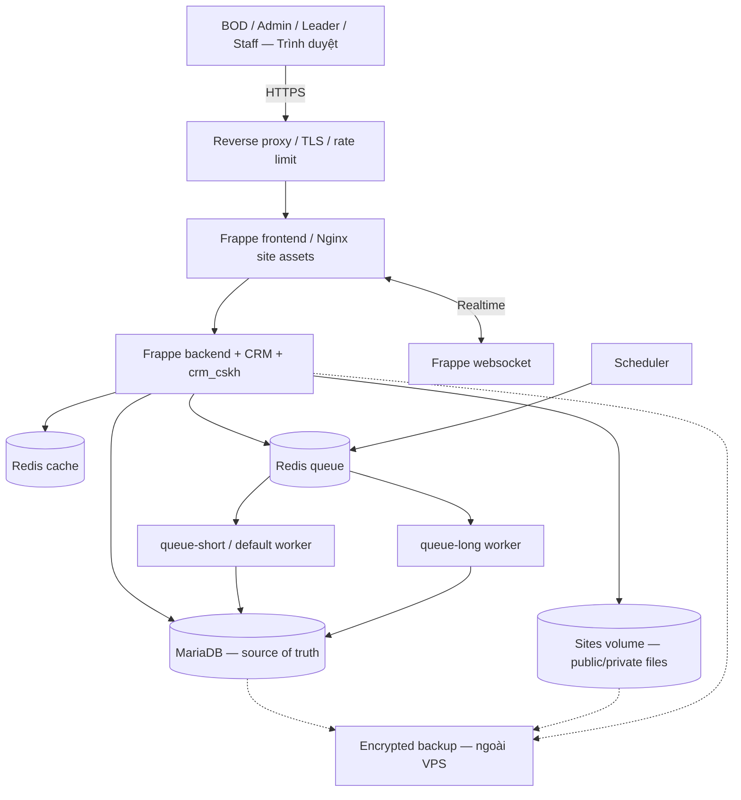
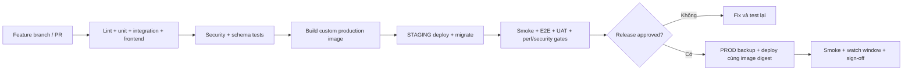
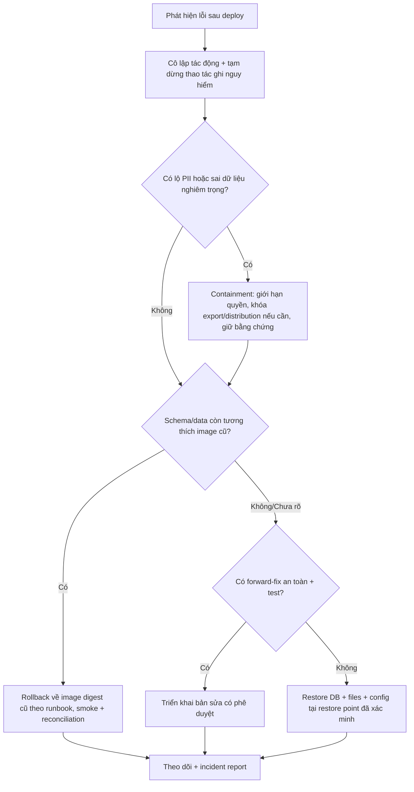

# P4 — PRODUCTION HARDENING, RELEASE READINESS & OPERATIONS

> **Dự án:** CRM-CSKH — Quản trị kho khách hàng, phân phối lead và chất lượng chăm sóc khách hàng  
> **Tài liệu:** `P4.md`  
> **Phiên bản:** 1.0 — 15/10/2026  
> **Tài liệu cha:** [`master-plan.md`](./master-plan.md)  
> **Phụ thuộc:** [`P0.md`](./P0.md), [`P1.md`](./P1.md), [`P2.md`](./P2.md), [`P3.md`](./P3.md), Exit Reports đã nghiệm thu, ADR và `version-lock.md` thực tế  
> **Trạng thái:** Đặc tả triển khai giao cho AI Coding Agent; **KHÔNG mặc định P0–P3 đã hoàn thành, đã kiểm thử hay đã được triển khai Production**.  
> **Nền tảng:** Frappe CRM + custom app `crm_cskh`; một hệ thống Web; MariaDB, Redis, Docker Compose trên VPS Ubuntu.  
> **Baseline tra cứu:** Frappe CRM [`v1.87.0`](https://github.com/frappe/crm/tree/v1.87.0) (tham khảo); **phiên bản thực thi phải lấy từ khóa phiên bản đã được P0 chốt**.  
> **Đầu ra P4:** CRM có thể phát hành và vận hành trên VPS bằng artifact bất biến, có UAT, kiểm thử quyền/hiệu năng, backup/restore được chứng minh, phương án rollback thực dụng và hướng dẫn vận hành cho công ty.

---

## 0. CHỈ THỊ CHO AI CODING — ĐỌC TRƯỚC KHI TRIỂN KHAI

1. **P4 là phase đưa sản phẩm vào sử dụng thật, không phải phase viết lại nghiệp vụ P1–P3.** Mọi thay đổi để sửa lỗi bắt buộc có regression test; chức năng mới không liên quan không được chen vào release.
2. **Chỉ có một CRM Web.** BOD, Admin, Team Leader và nhân viên truy cập cùng Frappe site, khác nhau bởi scope/role. Không có desktop client; không phát triển ứng dụng điện thoại ở phase này. Chỉ giữ API contract để dùng về sau.
3. **Một nguồn sự thật:** MariaDB/Frappe; `crm_cskh` là custom app trong cùng site. Không chuyển dữ liệu nghiệp vụ sang database thứ hai, không tạo thêm backend API tổng quát thay Frappe.
4. **Không triển khai bất cứ thứ gì lên Production để thử code.** DEV/CI → STAGING cách ly → release có phê duyệt → Production. Không sửa code trực tiếp trong container Production.
5. **Dùng phương án production chính thức của `frappe/frappe_docker`:** `compose.yaml` + override phù hợp hoặc giải pháp tương đương đã xác minh. **Không dùng** `frappe/crm/docker/docker-compose.yml` hoặc `frappe_docker/pwd.yml` demo cho production.
6. **Production image phải chứa sẵn** đúng bộ Frappe Framework + Frappe CRM + `crm_cskh` và frontend assets. Tag phải truy ra commit/lockfile/image digest; tuyệt đối tránh `latest` ở Production.
7. **Mọi thay đổi schema phải thử trên dữ liệu STAGING trước**, có backup kiểm chứng, compatibility assessment và kế hoạch khôi phục. Không coi “chạy lại image cũ” là rollback DB.
8. **Cấm truy cập chéo thông tin số điện thoại hoặc lịch sử chăm sóc**, kể cả khi gọi trực tiếp API gốc của Frappe, xem link file, export, truy vấn báo cáo, chuyển owner, hủy assignment hoặc thay đổi team.
9. **Báo cáo BOD phải đúng và có khả năng truy vết.** Không được hiển thị dữ liệu `self_reported` thành `verified`, KPI `provisional` thành dữ liệu đã chốt, hoặc điểm QA thiếu mẫu thành 0.
10. **Backup có giá trị khi đã restore thành công.** Bao gồm DB, public/private files, site config và encryption key; bản sao nằm ngoài VPS, được mã hóa và kiểm soát quyền.
11. **Việt hóa và đào tạo là điều kiện Go-Live.** Những luồng vận hành hằng ngày phải được nghiệm thu bằng tiếng Việt, đúng glossary của master plan.
12. **Không tự sửa điều kiện GO/NO-GO hoặc hạ mục tiêu benchmark để báo cáo PASS.** Nếu thiếu dữ liệu/không đủ tài nguyên, báo `BLOCKED`, đề xuất hướng xử lý và xin quyết định.

### 0.1. Tiêu chí thành công ở góc độ BOD

BOD vào URL Production và có thể: xem tổng khách/khách đã phân phối → kiểm tra một chiến dịch → xem tình hình CSKH từng team/người → mở một KPI, đối chiếu các lần liên hệ, lịch hẹn, thời hạn và ownership history. Nhân viên chỉ có thể thấy/ghi dữ liệu khách được giao. Nếu các bước này hoạt động trên STAGING nhưng chưa được chứng minh quyền và an toàn dữ liệu ở Production thì **chưa GO**.

### 0.2. Ngoài phạm vi P4

- Xây thêm chức năng nghiệp vụ chưa có trong kế hoạch P1–P3.
- Tích hợp một nền tảng liên lạc bắt buộc hoặc áp dụng chính sách chỉ được dùng một kênh.
- Xây ứng dụng điện thoại, app desktop, CRM Core khác, BI stack riêng hoặc data warehouse mới.
- Đưa CRM vào kiến trúc nhiều VPS/HA nếu chưa có yêu cầu và chỉ tiêu đã được duyệt; tuy nhiên phải chỉ ra giới hạn một VPS.
- Mua công cụ monitoring/CI/backup thương mại khi có thể tái sử dụng công cụ open-source hoặc các dịch vụ hiện hữu phù hợp.

---

## 1. ENTRY GATE — ĐIỀU KIỆN BẮT ĐẦU P4

AI Coding phải tạo `docs/p4/entry-audit.md` ghi bằng chứng kiểm tra, không chỉ đánh dấu checkbox:

| Hạng mục | Bắt buộc kiểm chứng | Nếu chưa đạt |
|---|---|---|
| P0 | `P0 Exit Report`, source/version locked, UI extension ADR, baseline security suite | Quay lại P0 xử lý blocker |
| P1 | Kho số, import, weighted assignment, `CSKH Work Item`, ownership history, chuyển giao, phân quyền Lead đạt gate | Quay P1 fix, không vận hành dữ liệu thật |
| P2 | Contact Attempt, Call Log/Task adapters, lifecycle, callback handover, chống duplicate, quyền nhật ký và file | Quay P2 fix |
| P3 | SLA obligation, metric dictionary, KPI run/snapshot, BOD drill-down, role-aware reporting, golden datasets | Quay P3 fix |
| Toàn hệ thống | Unit/integration/E2E cơ bản đang pass trên đúng version lock | Chặn build release |
| Dữ liệu | Có seed dataset không chứa dữ liệu thật; có danh mục dữ liệu PII và nơi lưu | Chặn Staging/UAT |
| Hạ tầng | Có quyền quản trị VPS/DNS/domain, backup destination ngoài VPS và secret storage | Không dựng Production |
| Nhân sự | Chỉ định người phụ trách triển khai, nghiệm thu UAT, quyết định rollback và vận hành | Không Go-Live |

**Không có bằng chứng = chưa đạt.** Không lấp chỗ trống bằng suy đoán từ tài liệu P0–P3.

### 1.1. Kiểm tra lại khớp schema thực tế

- Đọc `bench --site <DEV_SITE> list-apps`, DocType JSON/migration patches thực tế và các báo cáo P0–P3.
- Xuất schema inventory và mapping canonical fields, constraints, indexes, jobs, role scopes.
- Đối chiếu tất cả DocType `CSKH*` đang tồn tại với tài liệu; nếu một entity được thay tên/gộp trong ADR, dùng tên thực tế; **không tự tạo bản trùng**.
- Xác nhận KPI phiên bản công thức, `policy_version`, assignment interval, attempt provenance, correction/recompute semantics đã có cơ chế không mất lịch sử.
- Kiểm tra extension UI đã được P0 quyết định có cần fork hay không; nếu có fork, pin SHA và liệt kê patch.

---

## 2. SOURCE AUDIT & REUSE MATRIX — KHÔNG VIẾT LẠI HẠ TẦNG

| Thành phần cần cho P4 | Reuse trước tiên | Phần cần bổ sung tối thiểu |
|---|---|---|
| Production services | [`frappe/frappe_docker`](https://github.com/frappe/frappe_docker) `compose.yaml` + overrides | Production overrides/env theo VPS thực tế, network và secrets |
| Build custom apps | Official custom/layered Docker image workflow | Build CRM + `crm_cskh`, frontend bundle, tag/digest, provenance |
| Backup/restore | `bench backup --with-files`, `bench restore` của Frappe | Đưa backup ra ngoài VPS, encryption, manifest, checksum, restore drills |
| DB migrations | `bench --site ... migrate`, Frappe patches/fixtures | Rehearsal, execution log, canary checks, rollback decision tree |
| Cache, queue, scheduler | Redis + Frappe workers/scheduler có sẵn | Alert queue lag, dead jobs, failed jobs, duplicate/replay guard |
| Authentication | Frappe User/Role/session, MFA nếu hỗ trợ/cấu hình được | Account policy, session rules, credential rotation, permission regression |
| Record permissions | `crm/permissions/org_hierarchy.py`, `crm/api/todo.py` + P0–P3 custom guards | Hardening API/file/export/Call Log/Task/Notes/KPI theo actual scope |
| Data/UI | Frappe ListViews/Lead/Call Log/Task/Activities, Vue/Frappe UI | UX fixes, i18n, accessibility ở luồng bắt buộc |
| Metrics/dashboard | P3 calculator, snapshots, drill-down/reconciliation | Indexing, caching có TTL/version, monitoring correctness/delay |
| Automated tests | Frappe `bench run-tests`, Python test runner, frontend scripts đã có | E2E/UAT security/load suite và release gates |
| Operations logs | Docker logs, Frappe error log, scheduler/worker logs | Dashboards và notification thresholds, log redaction, incident SOP |

**Đọc và ghi rõ source revision thực tế** trước khi copy bất cứ lệnh Docker, Compose path hoặc API nào. `frappe_docker` thay đổi cấu trúc theo phiên bản, không dùng mặc định kiến thức từ nhánh `main` làm bằng chứng Production image hiện có là giống nhau.

### 2.1. Phát hiện cần giữ trong P4

- `frappe/crm` bản ổn định đã có `CRM Lead`, `CRM Call Log`, `CRM Task`, `CRM Sales Hierarchy`; các API/role mặc định chưa tự bảo đảm cách ly mọi loại dữ liệu theo `CSKH Work Item` của chúng ta.
- Logic `ToDo` có đồng bộ owner và thao tác hủy có thể tác động owner; kiểm thử transfer/rollback/permission sau deploy là bắt buộc.
- Dashboard Frappe gốc thiên về Sales; báo cáo chất lượng CSKH riêng từ P3 có thể chứa phép tính nhạy cảm về mẫu số, lịch sử team, KPI revisions.
- `frappe_docker/pwd.yml` là môi trường demo, không đủ để cài custom apps và lưu trữ production đáng tin cậy; dùng `compose.yaml` + overrides đã kiểm tra.
- Frappe hỗ trợ `bench restore` kèm public/private files; restore hoặc downgrade sau migration cần đánh giá tương thích, **không tự động ép downgrade**.

---

## 3. KIẾN TRÚC HẠ TẦNG PRODUCTION — MỘT VPS

### 3.1. Sơ đồ logic



> Sơ đồ logic, không phải `docker-compose.yml` có thể chạy trực tiếp. Tên service và cách tách reverse proxy/Redis phụ thuộc vào bản `frappe_docker` đã lock.

### 3.2. Các service và trách nhiệm

| Nhóm | Service tham chiếu | Yêu cầu production |
|---|---|---|
| Entry | TLS reverse proxy (Traefik/Nginx/Caddy theo ADR) | HTTPS, redirect HTTP→HTTPS, HSTS sau khi xác minh, không lộ cổng nội bộ |
| Frontend | `frontend` | Chỉ chuyển request tới backend/websocket đúng site, phục vụ static assets |
| Backend | `backend` | Gunicorn/Frappe; chỉ có image đã ký/đánh digest, secrets runtime |
| Realtime | `websocket` | Realtime qua proxy HTTPS, session/authorization kiểm thử |
| Jobs | `queue-short`, `queue-long` | Backpressure, idempotent, retry safe, health/logging |
| Scheduler | `scheduler` | Một active scheduler trong mô hình một site/bench; clock đúng |
| Database | MariaDB service từ production override | Persistent volume, credentials riêng, kiểm soát kết nối, backup |
| Cache/Queue | Redis cache + Redis queue | Không public internet, cấu hình persistence/eviction hợp lý cho queue |
| Config | One-shot `configurator`/create-site/migrator | Chỉ chạy khi setup/release; không nhầm container init với worker thường trực |
| Storage | `sites` + DB volume | Quyền file đúng, bảo vệ `site_config.json`, kiểm tra dung lượng |

**Không chốt cứng 9 hay 10 container** trước khi có Compose thực tế: số lượng thay đổi tùy overrides, proxy và cách cấu hình Redis. P4 phải ghi danh sách service bằng `docker compose config --services`.

### 3.3. Kế hoạch tài nguyên và giới hạn

- Baseline lập dự toán từ master plan: **8 vCPU, 16 GB RAM, 120–160 GB NVMe** trên VPS, nhưng **chỉ lựa chọn chính thức sau benchmark P4**.
- Đo thực tế CPU/RAM/DB connections, Redis memory, queue backlog, container restarts, file growth với dữ liệu gần quy mô thực.
- Tách giới hạn worker concurrency khỏi số phiên web; không tăng workers đến mức MariaDB nghẽn.
- Dự phòng chỗ lưu DB, logs, uploads và backup tạm; không để backup trong cùng filesystem là bản sao duy nhất.
- Một VPS = single point of failure. Tài liệu phải ghi rõ giới hạn chịu lỗi; không khẳng định HA hoặc zero-downtime khi chưa có kiến trúc thực sự hỗ trợ.

### 3.4. Network và secret boundaries

- Chỉ công khai cổng 443; cổng 80 chỉ cần cho redirect/challenge. SSH giới hạn IP/VPN/key, không dùng password login nếu có thể.
- MariaDB và Redis chỉ nằm trên Docker internal network, **không publish host ports**.
- Prod, Staging và DEV không chia sẻ DB, Redis, Docker volumes, backup keys hay credentials.
- Không đặt secrets trong `.env.example`, Git repository, Docker image layer, frontend bundle, CI output, log hoặc tài liệu screenshots.
- Site config và encryption key được sao lưu có mã hóa, quản lý riêng quyền giải mã; quyền đọc production secrets chỉ cấp cho tài khoản vận hành được ủy quyền.
- Đảm bảo container process chạy non-root khi image hỗ trợ, chỉ mount volumes cần thiết, giới hạn Linux capabilities nếu không làm hỏng upstream.

---

## 4. STRATEGY BUILD/RELEASE — ARTIFACT BẤT BIẾN

### 4.1. Ghim phiên bản tối thiểu

`docs/p4/release-manifest.json` (mẫu schema, **không chứa secrets**):

```json
{
  "release_id": "crm-cskh-YYYYMMDD-NNN",
  "git_sha": "FULL_COMMIT_SHA",
  "frappe_framework_ref": "PINNED_TAG_OR_SHA_FROM_P0",
  "frappe_crm_ref": "PINNED_TAG_OR_SHA_FROM_P0",
  "crm_cskh_ref": "FULL_COMMIT_SHA",
  "image": "registry.example/crm-cskh@sha256:ACTUAL_DIGEST",
  "migration_revision": "ACTUAL_PATCHSET_ID",
  "kpi_formula_version": "ACTUAL_VERSION_FROM_P3",
  "previous_release_id": "PREVIOUS_ID",
  "build_url": "CI_RUN_URL",
  "test_report_url": "CI_REPORT_URL",
  "approved_by": ["RELEASE_APPROVER"]
}
```

Không copy giá trị giả trên vào manifests deploy. `image digest` chỉ được ghi sau khi build/push thành công; không ghi trước. Frappe app/frontend nguồn của image phải truy ngược được đến commit.

### 4.2. Quy trình CI/CD



**Quy tắc tuyệt đối:** Không build riêng một image khác từ source mới hơn khi lên Production. Production kéo **chính digest đã chạy trên Staging**. Không có thao tác `git pull` rồi `bench update` trực tiếp trên VPS như bước phát hành mặc định.

### 4.3. Pipeline stages cần implement

1. `source-check`: branch protection, pinned dependencies, secrets scan, dependency/SBOM/license scan, changelog, migration manifest.
2. `static-check`: Python lint/type checks phù hợp repo, Vue lint/build, i18n linter, test schema fixtures.
3. `test`: Frappe unit/integration, P1–P3 golden tests, API negative tests.
4. `build`: tạo production custom image chứa tất cả apps, version metadata/assets.
5. `image-check`: vulnerability scan, chạy lệnh `bench version`/`list-apps` trong môi trường thử và xác nhận digest.
6. `deploy-staging`: deploy bằng image digest, chạy migrator đúng một lần, seed tài khoản/dữ liệu không thật, chụp logs.
7. `e2e/security/perf`: thực hiện các gate bắt buộc; báo cáo machine-readable.
8. `release-approval`: người chịu trách nhiệm duyệt, đánh dấu migration class, backup/recovery state và thời điểm bảo trì.
9. `deploy-prod`: deploy đúng manifest, có checkpoint từng bước, có quyền dừng thủ công.
10. `post-release`: health + e2e smoke + metrics watch, phát hành `P4 Release Report`.

**Không đưa Production SSH private key vào PR workflow từ fork/người không tin cậy**; dùng environment protection và quyền tối thiểu. Tài khoản CI build và CI deploy phải tách quyền.

### 4.4. Repository/tài liệu dự kiến

```text
crm-cskh-project/
├── master-plan.md
├── P0.md ... P4.md
├── apps/crm_cskh/             # Frappe custom app (chính)
├── frontend/                  # chỉ khi ADR P0 có extension riêng
├── deploy/
│   ├── compose/               # overrides và cấu hình được pin
│   ├── images/                # build recipe / apps.json hoặc lock tương đương
│   ├── env.example            # chỉ placeholders, không secrets
│   ├── scripts/
│   │   ├── validate-env.sh
│   │   ├── preflight.sh
│   │   ├── deploy-release.sh
│   │   ├── healthcheck.sh
│   │   ├── backup.sh
│   │   └── restore-test.sh
│   └── manifests/
├── .github/workflows/
│   ├── ci.yml
│   ├── image.yml
│   ├── staging.yml
│   └── production.yml
├── tests/
│   ├── e2e/
│   ├── security/
│   ├── performance/
│   ├── fixtures/
│   └── golden/
└── docs/p4/
    ├── entry-audit.md
    ├── infra-inventory.md
    ├── release-manifest.json
    ├── security-review.md
    ├── backup-restore.md
    ├── release-runbook.md
    ├── rollback-runbook.md
    ├── monitoring-alerts.md
    ├── performance-report.md
    ├── uat-report.md
    ├── api-contract.md
    ├── glossary-vi.md
    ├── operations-sop.md
    └── P4-exit-report.md
```

**Cấu trúc tham khảo**: phải phù hợp repo/ADR thực tế đã được chốt tại P0; không tạo workspace thứ hai nếu repo đang có đủ folders.

---

## 5. STAGING — BẮT BUỘC TRƯỚC KHI GO-LIVE

1. Dựng Staging chạy gần Production nhất có thể: cùng image/Compose layout/schema, khác secrets/domain/DB/volumes.
2. Nếu Staging và Production tạm thời trên cùng VPS, buộc cách ly Compose project, Docker networks, volumes, credentials, domain, ports, scheduler, file buckets; đặt giới hạn tài nguyên để Staging không làm Production nghẽn. **Ưu tiên host khác nếu điều kiện cho phép**.
3. Không dùng production dump chứa PII trên Staging. Nếu kiểm thử restore từ dump thật là không tránh được thì phải masking/tokenization đúng chuẩn, kiểm soát quyền và xóa sau test; ưu tiên synthetic data.
4. Không gửi email/thông báo ra địa chỉ người lao động/khách thật từ Staging; khóa integrations gây side effect ở Staging.
5. Có tài khoản test cho Administrator, BOD, Admin nghiệp vụ, hai Team Leader khác nhau, tối thiểu ba nhân viên thuộc hai team, nhân viên nghỉ/ngừng nhận khách và tài khoản bị khóa.
6. Seed đủ tập dữ liệu: số trùng, phone-only, một khách nhiều campaigns, A→B→A, lead không liên hệ, nhiều attempts, callback quá hạn, SLA ngày nghỉ/cuối tuần, QA N/A, snapshot restatement.
7. **Không tự động mở public staging**: bảo vệ bằng network restriction/SSO/test-access tùy môi trường.

### 5.1. Staging acceptance smoke

- [ ] Login/logout/refresh, session expiry và role routing chính xác.
- [ ] Import batch demo và xem duplicate summary.
- [ ] Weighted assignment preview → execute → user A/B thấy đúng danh sách.
- [ ] Chuyển owner A→B và A mất quyền chi tiết/call/files/export.
- [ ] Ghi cuộc gọi thủ công, Contact Attempt và lịch hẹn; không double count.
- [ ] Scheduler xử lý follow-up, SLA, snapshot; không tự tạo Verified.
- [ ] BOD xem dashboard P1/P3; Staff xem KPI cá nhân; team boundaries chính xác.
- [ ] Drill-down và export đúng người/đúng mẫu số.
- [ ] Ngôn ngữ tiếng Việt, thời gian Asia/Ho_Chi_Minh, báo cáo kỳ đúng.
- [ ] Frappe API và custom API trả lỗi đúng khi hết quyền.

---

## 6. MIGRATION, BACKFILL & COMPATIBILITY

### 6.1. Phân loại thay đổi trước release

| Class | Ví dụ | Điều kiện phát hành |
|---|---|---|
| **A — Code-only** | UI, logic không đổi schema | Image rollback được nếu không sinh side effect không tương thích |
| **B — Additive schema** | Thêm DocType/trường/index tương thích | Test migration từ snapshot cũ; rollback code bằng compatibility guard |
| **C — Data backfill** | Bổ sung phone canonical, ownership timeline, KPI snapshots | Có `dry_run`, batch/checkpoint, idempotent, đối soát trước/sau |
| **D — Breaking/destructive** | Rename/drop cột, thay khóa/ý nghĩa dữ liệu, xóa dữ liệu | **Không mặc định cho P4**; cần ADR, kế hoạch expand/contract, backup và phê duyệt riêng |

### 6.2. Bất biến dữ liệu phải giữ nguyên

- Tổng số khách `CRM Lead` canonical không thay đổi bất ngờ khi migration không có import được phê duyệt.
- `CSKH Work Item` active uniqueness không bị phá; không tạo hai owner active cho cùng một work item.
- Lịch sử `CSKH Assignment History` append-only và không đổi người thực hiện quá khứ.
- `CSKH Contact Attempt`/Call Log/Task không tạo bản ghi trùng do retry.
- SLA violations không bị “xóa” sau handoff hay recompute; KPI revisions có lịch sử và dấu nguồn.
- QA thiếu mẫu không tự chuyển thành điểm 0; `self_reported` không thành `verified` chỉ vì backfill.
- Dữ liệu chỉ được correction bằng nghiệp vụ có audit, không update tay trên DB để sửa điểm.

### 6.3. Migration rehearsal

1. Chụp bản sao STAGING đang chạy release N-1 và tạo manifest counts/checksums từ **bản sao**.
2. Tạo backup theo đúng định dạng production, sao ra vị trí cô lập.
3. Deploy image N theo plan với maintenance/ghi dữ liệu được chặn khi cần; đảm bảo queue không phát sinh tác vụ ghi ngoài transaction đang migrate.
4. Chạy `bench --site <STAGING_SITE> migrate` từ container đã build, qua Compose service đúng thực tế.
5. Chạy schema/patch verification, constraint/index check, data reconciliation, API/UI smoke.
6. Chạy lại migration trong điều kiện không thay đổi để xác nhận idempotency của patches; không chạy backfill mù nếu job không an toàn.
7. Thử rollback thích hợp: code rollback nếu tương thích, hoặc restore DB+files tại một site DR nếu schema không tương thích.
8. Đo `migration_duration`, job drain time, lock time, expected downtime và ghi rõ trong release note.

### 6.4. Những lệnh tham khảo (chỉ chạy sau khi xác nhận Compose/service/site)

```bash
# Đọc danh sách service của chính bộ compose đã được lock
# Có thể cần nhiều -f hoặc COMPOSE_FILE theo deploy ADR

docker compose -f compose.yaml config --services

docker compose -f compose.yaml ps

# Xác minh app đã cài tại đúng site
# Không copy nguyên xi nếu service của dự án đặt tên khác

docker compose -f compose.yaml exec backend bench --site <SITE_NAME> list-apps

# Migration chỉ được chạy sau bước preflight + backup + rehearsal
# Không coi lệnh dưới đây là toàn bộ release procedure

docker compose -f compose.yaml exec backend bench --site <SITE_NAME> migrate
```

**Lưu ý:** Nếu backend container được triển khai lại trong cùng lúc chạy migrate, cần dùng one-shot migrator hoặc quy trình bảo trì được phê duyệt. Không để nhiều replica/worker tự chạy `migrate` đồng thời. Tránh lệnh `--skip-failing` trong Production như cách bỏ qua lỗi; chỉ dùng trong sự cố có quyết định kỹ thuật được ghi lại.

---
## 7. BACKUP & DISASTER RECOVERY — PHẢI KHÔI PHỤC ĐƯỢC

### 7.1. Định nghĩa backup đầy đủ

Một điểm khôi phục hợp lệ phải bao gồm **cùng một thời điểm nhất quán**:

1. Database của Frappe Site (`.sql.gz` hoặc định dạng hợp lệ của tool đã khóa).
2. Public files của site.
3. Private files của site, kể cả file nhập, đính kèm CSKH và bằng chứng nếu đang lưu tại local site.
4. `site_config.json`/cấu hình cần thiết để khôi phục, đặc biệt **encryption key**, nhưng lưu/kiểm soát như secret.
5. Manifest: site ID, timestamp UTC + timezone, image digest, `frappe/crm/crm_cskh` refs, DB engine version, checksum, kích thước file, kết quả verify và vị trí bản sao.
6. Các tài liệu dựng hạ tầng bằng code, Compose/env templates và secret inventory **không gồm secret values**.

> Backup DB không chứa toàn bộ file; copy volume file mà không backup DB cũng không thể bảo đảm trạng thái nghiệp vụ. `site_config.json` có thể chứa secrets: không push lên Git, không đính kèm báo cáo công khai.

### 7.2. Phương án backup mặc định đề xuất

| Loại | Tần suất **đề xuất để duyệt** | Retention **đề xuất** | Đích |
|---|---|---|---|
| DB + public/private files | Hằng ngày, ngoài giờ tải cao | Daily 14 bản, weekly 8 bản, monthly 3 bản | Storage tách VPS, mã hóa |
| DB bổ sung | Mỗi 4 giờ **nếu đáp ứng được thời gian/tải** | 48 giờ rolling | Storage ngoài VPS |
| Pre-release | Ngay trước mỗi migration lớn, sau khi dừng/kiểm soát writes | Ít nhất đến khi release được chấp nhận | Ngoài VPS |
| Site config + manifest | Khi secret/config đổi; kèm mỗi full backup | Theo backup tương ứng | Secret-aware encrypted storage |
| Restore test | Trước Go-Live, sau thay đổi lớn và định kỳ ít nhất hàng tháng | Giữ logs bằng chứng | Site DR cách ly |

**Các con số là đề xuất**, không phải SLA đã cam kết. P4 phải đo dữ liệu thực tế, chi phí và thời gian để trình người vận hành/BOD phê duyệt trước khi đưa vào policy chính thức. Nếu volume file lớn, cần cơ chế incremental/snapshot tương thích và lịch backup file khác, nhưng phải chứng minh khả năng khôi phục nhất quán.

### 7.3. Mục tiêu phục hồi đề xuất (cần approval)

- **RPO mục tiêu ban đầu: ≤ 4 giờ** nếu lịch backup bổ sung và hạ tầng đáp ứng; nếu chỉ có full backup mỗi ngày thì RPO thực tế có thể xấp xỉ 24 giờ. Không báo RPO 4 giờ khi chưa chứng minh.
- **RTO mục tiêu ban đầu: ≤ 4 giờ** cho site trên VPS thay thế nếu tài nguyên và quy trình đủ; phải đo thời gian phục hồi thực tế trước khi cam kết.
- Khi không thể đạt RPO/RTO đề xuất, ghi số đã đo được, mức rủi ro, chi phí nâng cấp và xin xác nhận chấp nhận rủi ro; không âm thầm coi là PASS.

### 7.4. Backup tham khảo

```bash
# Chỉ là ví dụ CLI bên trong một container/bench đã cấu hình đúng.
# Không thay cho script đồng bộ + mã hóa + checksum + upload offsite.

bench --site <SITE_NAME> backup --with-files
```

`backup.sh` của dự án phải chạy theo `frappe_docker` đã khóa, kiểm tra exit code, ghi backup manifest, checksum và xác nhận upload offsite trước khi báo thành công. Không để job backup thành công giả nếu file không đọc được, thiếu một archive hoặc upload lỗi.

### 7.5. Diễn tập khôi phục bắt buộc

1. Dựng site **DR TEST** sạch, cách ly production, không gửi thông báo ra bên ngoài.
2. Tải bản full backup và manifest từ storage ngoài VPS xuống site test qua quyền tối thiểu.
3. Kiểm tra checksum, giải mã, xác nhận các tệp tồn tại và image/app versions tương thích.
4. Restore database + public/private files và **encryption key phù hợp** theo hướng dẫn Frappe; không lộ khóa vào terminal logs.
5. Bật site trên image/patch revision tương ứng; nếu là recovery sau upgrade, xác nhận trạng thái migration cụ thể trước khi mở.
6. Đăng nhập tài khoản test, đọc Lead/Work Item/Attempt/Task, mở private file, đối chiếu dữ liệu phân phối, KPI runs và lịch sử bàn giao.
7. Đo thời gian **phát hiện → bắt đầu restore → site healthy → nghiệp vụ hoạt động**, tính RTO thực tế; từ timestamp cuối cùng tính data-loss window (RPO).
8. Xóa hoặc khóa DR TEST sau khi hoàn tất, lưu report đã redact PII.

Kết quả cần có: `docs/p4/backup-restore.md`, `restore-test-report.md`, hash manifests, log pass/fail, người thực hiện, thời lượng, danh sách lỗi chưa xử lý.

### 7.6. Phân biệt rollback và restore

- **Rollback image/code:** sử dụng khi release mới lỗi nhưng schema/data còn tương thích với code cũ.
- **Feature disable:** tắt KPI/recompute/job không an toàn qua feature flag nếu core vẫn hoạt động.
- **Restore DB/files:** chỉ dùng khi schema bị hỏng, migration không tương thích hoặc dữ liệu không thể sửa an toàn; phải ghi rõ **phần dữ liệu mới kể từ backup có nguy cơ mất**.
- **Forward fix:** nếu patch đã thêm dữ liệu mới và không thể rollback tương thích, ưu tiên phát hành bản vá mới có test, không restore bừa bản cũ.

---

## 8. SECURITY HARDENING — PII, AUTH, API & ROLE

### 8.1. Threat model cụ thể

Tài sản cần bảo vệ: kho số điện thoại, định danh Facebook, ghi chú khách, kết quả CSKH, lịch sử giao khách, dữ liệu hiệu quả nhân viên, file import, bằng chứng, exports, session cookies, API credentials, backup và key mã hóa.

Đối tượng có thể gây rủi ro: người ngoài internet, nhân viên lạm quyền, Team Leader vượt team, Admin nghiệp vụ cấu hình sai, automation chạy quyền cao, file URL bị chia sẻ, token/session bị lộ, code lỗi sau upgrade.

**Ràng buộc:** “Ẩn nút trên UI” không phải phân quyền. Backend phải kiểm tra mọi request theo user, ownership interval, role/team scope và trạng thái hoạt động của account.

### 8.2. Quyền và truy cập bắt buộc

| Actor | Lead/Work Item | Attempts/Task/Files | Dashboard | Admin tools |
|---|---|---|---|---|
| Staff A | Chỉ phần được giao và trong scope hiện tại | Chỉ dữ liệu thuộc scope; lịch sử cũ qua chính sách handoff đã duyệt | KPI bản thân, không lộ team khác | Không |
| Team Leader A | Cây nhân viên thuộc team A | Cùng giới hạn team | Team A + drill-down được phép | Các thao tác ủy quyền trong team |
| BOD | Phạm vi toàn công ty đã duyệt | Theo quyền view/export, masking nếu cần | Toàn công ty | Không mặc định quyền System Manager |
| Admin nghiệp vụ | Kho/quy trình trong giới hạn | Xem/sửa theo nghiệp vụ được cấp | Báo cáo được cấp | Import, distribution, transfer được kiểm toán |
| System Manager | Bảo trì hệ thống, phạm vi kỹ thuật | Chỉ khi thật sự cần hỗ trợ | Không dùng làm tài khoản sinh hoạt của BOD | Cấp quyền, vận hành |

P4 phải kiểm tra role mapping thực tế từ P0–P3; không coi bảng này là quyền mặc định đã được Frappe cấp đúng.

### 8.3. Security checklist thực thi

- **TLS:** HTTPS mọi truy cập, cookie `Secure`/`HttpOnly`/SameSite thích hợp, bảo vệ CSRF của Frappe, kiểm tra redirect/open redirect.
- **Session/account:** disable user nghỉ việc, revoke phiên khi cần, yêu cầu mật khẩu mạnh; ưu tiên MFA cho tài khoản BOD/Admin nếu stack và policy hỗ trợ; kiểm tra brute-force/lockout/throttling.
- **Role/Doctype:** hạn chế `Sales Manager` ngoài Sales Hierarchy; loại quyền không cần thiết trên `CRM Call Log`, `CRM Task`, `FCRM Note` và DocTypes `CSKH*`; test generic `/api/resource`, `/api/method`, list/report/export.
- **Assignment:** staff không tự đổi `lead_owner`, tạo `ToDo`/DocShare để chiếm khách, gọi bulk assignment hoặc bỏ qua service giao khách chuẩn.
- **PII:** số điện thoại được mask ở UI theo role; server-side filter trước phân trang/count; không log số đầy đủ, token, file content, ghi chú nhạy cảm hoặc secrets.
- **Export:** tách quyền đọc UI và quyền export; server-side authorization, audit ai xuất/đã xuất bao nhiêu, hạn chế bulk download, file tạm hết hạn; không phát link public dài hạn cho dữ liệu cá nhân.
- **File:** file riêng tư chỉ truy cập qua cơ chế xác thực/ủy quyền tương ứng; kiểm tra path traversal, MIME/extension/size, filename injection, CSV formula injection khi xuất file; cân nhắc malware scan nếu cho upload tùy ý.
- **API:** allowlist các method cần thiết, input validation, giới hạn query/page size, rate limiting, payload size, IDOR negative tests, idempotency keys ở lệnh ghi.
- **Reports:** BOD/team/staff view/export/filter khác scope, không dùng `frappe.db.get_all` thiếu kiểm soát để xây endpoint đọc dữ liệu nhạy cảm.
- **Backup/secrets:** chỉ role vận hành có quyền; encrypted offsite; restore artifact không ở public storage; không đưa site secret vào log.
- **Network:** không public MariaDB/Redis/worker admin ports; chỉ expose reverse proxy; firewall host.
- **Dependencies:** lock và quét CVE trên image packages, Python/JS dependencies và bản Frappe; phân loại findings theo thực tế exploit/exposure.
- **Audit:** lưu log thay đổi quyền, import/export, bulk distribution, owner transfer, correction SLA/KPI, impersonation/support access và deploy actions.
- **Headers:** CSP, frame protections, content-type nosniff, HSTS/cross-origin policy được kiểm thử thực tế (không bật cứng gây hỏng Frappe scripts/socket).

### 8.4. Bài kiểm thử phá ranh giới quyền — không được bỏ

Mỗi bài cần kiểm tra **UI + API trực tiếp**; trước/sau transfer; khi login bằng tài khoản và khi token/session hết hạn. Đặc biệt:

1. Staff A thử `get_list`, `get`, search, export Lead của B.
2. Staff A thử đọc `CRM Call Log` của B bằng ID trực tiếp; liên kết file/recording URL.
3. Staff A thử đọc/sửa `CRM Task`, `FCRM Note`, `CSKH Contact Attempt` của B.
4. Staff A thử gọi API phân phối/chuyển owner/hủy `ToDo` của B.
5. Staff A gửi `lead_owner`, `assigned_to`, `actor`, `team` giả trong payload ghi.
6. Staff A thử mở link tải CSV/PDF/export được BOD tạo.
7. Leader A thử đổi filter `user=LeaderB`, `team=TeamB`, `campaign_id` của team khác.
8. User bị disabled/revoked dùng lại session cũ.
9. Client thay `page_length`, sorting, report aggregation, `reference_doctype` để lộ dữ liệu ngoài scope.
10. Thay URL private file, path encode/traversal để đọc file gắn khách khác.
11. Chuyển A→B→A và hủy ToDo: xác nhận current owner/DocShare/ToDo không lệch, người cũ không còn quyền vượt chính sách.
12. BOD business-view không có System Manager admin permissions trừ khi được cấp rõ.
13. QA reviewer không tự chấm tự duyệt; không sửa evidence người khác nếu QA bật.
14. Export quá lớn/nhanh, concurrent download/rate-limit; không gây memory blowout.
15. Brute force/CSRF/session fixation/XSS phổ biến ở form ghi chú và label custom.
16. Read-only report endpoint không làm thay đổi trạng thái hoặc kích hoạt heavy recompute không giới hạn.

**Security GO/NO-GO:** bất kỳ truy cập chéo PII có thể tái hiện là **NO-GO**, kể cả đã ẩn UI. High severity có đường khai thác rõ ràng phải được vá hoặc có biện pháp cô lập được người phê duyệt chấp thuận; không chỉ ghi “sẽ sửa sau”.

---

## 9. PERFORMANCE, LOAD, STABILITY & CAPACITY

### 9.1. Benchmark phải phản ánh nghiệp vụ thật

Gợi ý lập hai quy mô dữ liệu tổng hợp (có thể điều chỉnh theo quy mô thực và ngân sách VPS):

| Dataset | Khách | Work Items | Contact Attempts | Staff active |
|---|---:|---:|---:|---:|
| **S1 — MVP** | 50.000 | 75.000 | 250.000 | 40 |
| **S2 — Stress** | 250.000 | 400.000 | 1.250.000 | 100 |

**Đây là workload gợi ý để kiểm thử, không phải năng lực đã được xác nhận.** Nếu dữ liệu thực tế nhỏ/lớn hơn, điều chỉnh có ADR và giải thích. Không dùng số điện thoại thật.

### 9.2. Workload cần đo

| Kịch bản | Mục tiêu ban đầu để nghiệm thu **nếu đạt trên VPS** | Bằng chứng |
|---|---|---|
| Staff mở My Customers | p95 API ≤ 1,5 giây, không tính mạng người dùng | latency histograms + DB query plan |
| Mở Lead + lịch sử tương tác | p95 API ≤ 2 giây với phân trang lịch sử | traces/logs và raw samples |
| Ghi Contact Attempt + Task callback | p95 ≤ 2 giây, không có duplicate | response times + reconciliation |
| BOD overview đã có snapshot | p95 API ≤ 3 giây | P3 snapshot latency + result correctness |
| Drill-down KPI phân trang | p95 API ≤ 3 giây | scope checks + EXPLAIN/indexes |
| Preview weighted distribution 10.000 Work Items | Hoàn thành trong thời gian hợp lý, đo thực tế; mục tiêu tham khảo ≤ 60 giây | job/report; không nghẽn toàn site |
| Execute distribution 10.000 Work Items | Chạy nền có progress/cancel, không duplicate và giữ toàn vẹn | throughput, queue/backpressure, invariants |
| Import 50.000 dòng CSV | Upload→validate→commit theo batch, có log lỗi; mục tiêu thời gian dựa benchmark | duration, RAM, counts |
| Recompute KPI một kỳ | Không block UI; snapshot mới chỉ publish khi complete | job/revision logs |
| Đồng thời | Test 20, 40, 80 user sessions theo mix kịch bản | p95, error rate, CPU/RAM/queue |

**Các ngưỡng latency là đề xuất SLO nội bộ**, phải được người chịu trách nhiệm phê duyệt và chứng minh, không được trình bày là benchmark của Frappe CRM.

### 9.3. Cách chạy benchmark

1. Tạo synthetic dataset seed deterministic; có tỷ lệ trùng điện thoại, chuyển giao, nhiều attempts, callbacks, overdue và KPI snapshots.
2. Giữ cấu hình Compose/worker/resources gần production; lưu commit, image digest, DB size, indexes, VM spec.
3. Warm-up, đo baseline idle, đo tải trung bình, peak và soak (đề xuất tối thiểu 60 phút).
4. Tách GET readonly và POST ghi dữ liệu; không replay POST thiếu idempotency trên cùng DB.
5. Đo latency p50/p95/p99, requests/sec, error %, timeout, DB connections/locks, slow queries, worker lag/retries và RSS/CPU.
6. Run `EXPLAIN`/query profiling trên các endpoint chậm; sửa indexes, pagination, N+1 và query scoping bằng tests, không tối ưu mù.
7. Chạy lại cùng dataset sau tối ưu; báo kết quả trước/sau và tác động correctness.
8. Kết luận: với VPS hiện tại, dữ liệu/đồng thời nào ổn định; giới hạn an toàn khuyến nghị và upgrade path.

### 9.4. Những điểm dễ nghẽn trong dự án

- Tìm số điện thoại chưa có index cho canonical field, `LIKE '%...'` trên bảng lớn.
- Query `CRM Call Log`/Attempts/Tasks không phân trang hoặc join nhiều bảng không filter scope.
- KPI tính live từ hàng triệu Attempts thay vì đọc snapshot đã publish.
- Cron recompute full history trong giờ cao điểm.
- Import/assignment các batch lớn giữ transaction quá dài, locks nhiều bảng hoặc enqueue một lúc hàng chục nghìn jobs.
- Export đồng bộ hàng trăm nghìn dòng làm web worker timeout.
- Redis queue backlog hoặc scheduler chạy trùng job, tạo nhiều lần retry.
- Tải bản ghi có quá nhiều linked files/activities ngay ở trang đầu.

### 9.5. Kết quả bắt buộc

`docs/p4/performance-report.md` phải có: dataset generator, môi trường, command/test config (không secrets), raw metrics, p95/p99, RPS, error%, DB explain samples, bottleneck, fix PR links, kết luận **PASS/FAIL theo ngưỡng đã duyệt**, sizing recommendation. Không được báo “tốt/nhanh” nếu không có phép đo.

---

## 10. OBSERVABILITY & ALERTING

### 10.1. Theo dõi kỹ thuật

| Nhóm | Metric/signal | Ngưỡng khởi điểm **đề xuất**, phải hiệu chỉnh |
|---|---|---|
| Website | 5xx rate, p95 latency, login success, TLS expiry | 5xx > 1% trong 5 phút; TLS < 14 ngày |
| Container | Restarts, OOMKilled, unhealthy | Restart bất thường hoặc bất kỳ OOM nào |
| CPU/RAM | Sustained usage / swap | CPU > 85% trong 15 phút, RAM > 90% |
| Disk | Usage %, inode, DB growth, backup space | Disk > 80% cảnh báo, > 90% critical |
| MariaDB | Connections, slow queries, lock waits, replication N/A | Connection gần limit, lock wait tăng |
| Redis | Queue depth, memory, failed jobs | Queue backlog tăng liên tục; job critical failed |
| Scheduler | Last successful run, heartbeat | Trễ quá 2 lần cadence dự kiến |
| Backup | Last success time, checksum, upload confirmation | Trễ quá kỳ backup hoặc thiếu archive |
| Business | Import failures, distribution mismatch, orphan Task, KPI reconciliation | Bất kỳ mismatch integrity nghiêm trọng |
| Security | Auth abuse, forbidden API spikes, export bulk, privilege change | Cảnh báo theo baseline và quyền |

### 10.2. Giám sát nghiệp vụ là bắt buộc

- **Ownership invariant:** không có Work Item có hai owner active trái chính sách; `lead_owner`/ToDo/DocShare phản ánh đúng service canonical.
- **Attempt integrity:** không có duplicate theo idempotency key; linked Call Log có mapping chuẩn; nguồn bằng chứng không tăng cấp sai.
- **Callback integrity:** Task follow-up tồn tại đúng người/đúng hạn sau transfer, không orphan.
- **SLA engine health:** overdue job không bỏ sót, deadline timezone/holiday đúng policy version, replay không duplicate breach.
- **KPI reconciliation:** published snapshot khớp golden/live source trong tolerance bằng 0 cho count-based invariants; revision mới không thay lịch sử âm thầm.
- **Data quality:** đếm import rejected/duplicate, phone canonical invalid, file virus/validation failures nếu có.

### 10.3. Logging, retention, redaction

- Structured logs có `request_id`, `actor_id`, `action`, `doctype`, `document_id` (nếu không nhạy cảm), `job_id`, `release_id`, `duration_ms`, `outcome`, **không chứa phone đầy đủ, tokens, raw notes hoặc secret**.
- Audit log theo role và hoạt động nhạy cảm; quyền đọc audit thuộc Admin vận hành/BOD được ủy quyền, không mở rộng cho toàn bộ Sales Manager.
- Thời gian lưu logs/audit/backups phải được công ty phê duyệt và cân nhắc yêu cầu pháp luật/khả năng lưu trữ; tài liệu không tự coi tất cả logs phải giữ vô hạn.
- Tích hợp công cụ giám sát lightweight phù hợp VPS; **không bắt buộc mua nền tảng mới** nếu Docker/Frappe/system metrics và logging hiện có đáp ứng.

### 10.4. Alert hygiene

Mỗi alert phải có owner, severity, hành động đầu tiên, link runbook, cách acknowledge, quiet hours nếu thích hợp và chống gửi lặp vô hạn. Test alert bằng điều kiện giả lập trong Staging để chắc chắn kênh cảnh báo được nhận; không chỉ tạo rule mà chưa thử.

---

## 11. API STABILITY & FORWARD COMPATIBILITY

P4 không phát triển ứng dụng điện thoại. Tuy nhiên phải chốt **contract API có phân quyền server-side**, đủ cho client tương lai không cần viết lại core.

### 11.1. Những nhóm API cần tài liệu hóa

| Nhóm | Dữ liệu/động tác | Quy tắc |
|---|---|---|
| Auth | Login/session/logout/account scope | Không gửi API admin key vào client |
| My Customers | List/detail/search theo scope, phân trang | Không nhận `owner_id` bất kỳ từ staff |
| Contact Attempt | Create/list/correction theo Work Item | Idempotent POST, actor lấy từ session |
| Callback | Create/update/complete Task liên kết Work Item | Không cho ghi lịch hẹn khách người khác |
| Distribution (admin) | Preview/execute/history/transfer | Admin-only, audit, optimistic/DB locking |
| Reporting | Overview, staff/team, drill-down, period | Scope server-side, KPI version, null/provisional states |
| Files/Exports | Download signed/authorized | Session/role/ownership check, expiry, audit |

### 11.2. Hợp đồng tối thiểu cho API

Mỗi endpoint phải có: HTTP method, route thực tế, Auth/Role matrix, request validation, pagination limit, response schema, canonical error codes, idempotency semantics, audit fields, rate-limit, PII classification, cache strategy, version/compatibility policy và security negative tests.

Nếu chưa có versioned namespace như `/api/method/crm_cskh.api.v1...`, phải ghi ADR về cách versioning method names/fields; **không tự đổi toàn bộ routes P1–P3 trong P4 chỉ để đẹp hơn**.

### 11.3. Compatibility tests

- Backward-compatible optional fields không khiến client cũ lỗi.
- Pagination cursor/page limit không rò dữ liệu ở boundary.
- 401/403/404 không để lộ số điện thoại, notes hay existence qua thông báo lỗi.
- Retry cùng idempotency key không tạo bản ghi thứ hai.
- Report trả rõ `as_of`, `formula_version`, `sample_size`, `freshness`, `source_quality`, `provisional/verified`, `scope` theo P3 đã chốt.

---

## 12. VIỆT HÓA, UX VÀ ACCESSIBILITY — TRƯỚC KHI NGƯỜI THẬT DÙNG

### 12.1. Reuse đúng cơ chế sẵn có

- Frappe CRM có bản dịch `crm/locale/vi.po`, Preferences Language và frontend sử dụng i18n `__()`; **không xây i18n framework mới**.
- Các từ ngữ CSKH do chúng ta tạo phải theo glossary từ master plan, ví dụ `Lead → Khách hàng`, `Assignee → Người phụ trách`, `Contact Attempt → Lần liên hệ`, `Follow-up → Chăm sóc lại`, `SLA → Hạn xử lý`, `Provisional → Tạm tính`.
- Không sửa chữ gốc có phạm vi chung nếu nó làm hỏng ngữ cảnh module khác; dùng bản dịch chuyên biệt/translation context theo cơ chế của Frappe hoặc chú thích riêng.

### 12.2. UAT luồng tiếng Việt bắt buộc

| Màn hình | Cần kiểm tra |
|---|---|
| Đăng nhập/đổi mật khẩu | Nhãn, lỗi, thông báo tài khoản |
| Import | CSV errors, duplicate reasons, preview, xác nhận |
| Chia số | Weight %, quota, preview, assignment results, thu hồi/transfer |
| My Customers | Tìm, lọc, empty/loading/error states |
| Contact Attempt | Các kênh liên hệ, kết quả, ghi chú, lỗi validation |
| Callback | Đặt lịch, lịch sử dời hẹn, quá hạn |
| Dashboard | KPI numerator/denominator, ghi chú mẫu, tooltip, N/A/provisional |
| QA nếu bật | Review/appeal, quyền xem, audit |
| Tải file/export | Cảnh báo số lượng, lỗi thiếu quyền, trạng thái xử lý |
| Settings/roles | Vai trò BOD/Leader/Staff không gây hiểu nhầm |

- Ngày/giờ hiển thị theo `Asia/Ho_Chi_Minh`, lưu timestamp UTC hoặc theo quy tắc khóa từ P3; kỳ báo cáo rõ từ ngày/đến ngày.
- Numeric formats dùng separators nhất quán; tỉ lệ % có mẫu số, empty/zero/N/A tách bạch.
- Trên màn hình laptop thông thường không mất nút quan trọng, layout không vỡ khi tiếng Việt dài hơn tiếng Anh; kiểm tra keyboard focus, contrast và nhãn accessibility cơ bản.
- Nếu còn tiếng Anh ở một số trang cấu hình Frappe nội bộ ít dùng, ghi limitation; **luồng nhân viên/BOD dùng thường xuyên không được lẫn lỗi dịch nghiêm trọng**.

---

## 13. E2E TEST PLAN — FULL CUSTOMER JOURNEY

Chạy end-to-end bằng browser automation phù hợp stack hiện hữu (ưu tiên Playwright nếu chưa có framework tương đương) + Frappe integration tests. Test phải dùng tài khoản khác vai trò, không chỉ chạy với Administrator.

### 13.1. Functional/E2E test cases (F01–F30)

| ID | Trường hợp | Expected |
|---|---|---|
| F01 | Staff đăng nhập, xem trang chủ | Chỉ menu và dữ liệu trong scope |
| F02 | BOD đăng nhập | Thấy toàn công ty theo quyền BOD, không tự có System Manager |
| F03 | Import CSV phone-only | Chuẩn hóa, tạo/ghép lead đúng, không đòi tên thật |
| F04 | Import file có 0-prefix/+84 và số có whitespace | Canonical hóa thành một danh tính |
| F05 | Import trùng nội batch và với DB | Không nhân đôi Lead, có bản ghi lỗi/duplicate reason |
| F06 | Import file lỗi, file quá lớn | Báo lỗi dễ hiểu, không commit nửa vời nếu contract quy định atomic |
| F07 | Preview phân phối 50/30/20 trên batch 1.000 | 500/300/200 nếu không có quota/eligibility exceptions |
| F08 | Chia thành nhiều batch nhỏ | Weighted fairness/history giữ gần mục tiêu đã định |
| F09 | Cấu hình nhân viên inactive và cap | Không giao mới cho người không đủ điều kiện |
| F10 | Execute bị timeout, client retry | Không duplicate allocation |
| F11 | Hai admin execute cạnh tranh | DB uniqueness/locking giữ single active owner |
| F12 | Staff A nhận Lead từ Admin | Thấy Work Item, thông tin cần thiết và lịch sử phù hợp |
| F13 | Staff A ghi một cuộc gọi không nghe máy | Có Attempt, không tăng connected count |
| F14 | Staff A ghi một cuộc gọi đã trao đổi | Outcome được lưu, đúng actor và timestamp |
| F15 | Staff A chọn kênh liên hệ không phải call | Contact Attempt lưu đúng channel, không giả Call Log |
| F16 | Cùng call xuất hiện trong Call Log/Attempt | Không double count KPI |
| F17 | Staff A hẹn chăm sóc lại | CRM Task đúng user, thời hạn, link Work Item |
| F18 | Dời hẹn với lý do hợp lệ | Có audit/correction, không mất deadline cũ |
| F19 | Task quá hạn và scheduler chạy lại | Không duplicate notification/violation |
| F20 | Handoff A→B khi đang có callback | Ownership và Task của B đúng, A không sửa tiếp |
| F21 | Handoff A→B→A | Attribution lịch sử đúng từng interval |
| F22 | Kết thúc Work Item | Workflow cho phép/không cho phép theo policy; không mất lịch sử |
| F23 | First-touch SLA qua giờ làm việc/ngày nghỉ | Deadline/breach đúng golden calendar |
| F24 | Recompute KPI cùng input hai lần | Same result, snapshots/revisions đúng contract |
| F25 | KPI theo ngày/tuần/tháng/quý/năm | Reconciliation count/unique work items chính xác |
| F26 | KPI N/A/insufficient/provisional | Đúng label, không tính 0 hay 100 giả |
| F27 | Drill-down từ dashboard tới Attempt/SLA | Reconcile numerator/denominator và quyền người xem |
| F28 | Leader A xem nhân viên A, thử sang team B | Chỉ team A; truy cập team B bị từ chối |
| F29 | Export dữ liệu được phép | Có audit, file tải được, không lộ dữ liệu ngoài scope |
| F30 | Đồng thời mở nhiều phiên ở browser | Không mất session, race conditions hoặc lỗi thời gian |

### 13.2. Security cases (S01–S20)

| ID | Kịch bản | Expected |
|---|---|---|
| S01 | Staff A đọc Lead B qua REST resource | Deny, không trả PII |
| S02 | Staff A sửa Lead B bằng REST | Deny, DB không đổi |
| S03 | Staff A đọc Contact Attempt B | Deny |
| S04 | Staff A đọc CRM Call Log B | Deny hoặc trả tối thiểu theo policy, không PII |
| S05 | Staff A đọc Task/Note B | Deny |
| S06 | Staff A mở private file liên kết B | Deny |
| S07 | Staff A dùng link export BOD | Deny/expire |
| S08 | Staff A tạo ToDo để chiếm Lead B | Deny, no mutation |
| S09 | Staff A đổi payload `lead_owner`/`actor` | Server rejects/ignores theo contract |
| S10 | Staff A trigger phân phối/thu hồi | Deny |
| S11 | Leader A filter sang Team B | Deny và không leak aggregates |
| S12 | BOD chỉ xem reporting nhưng thử System Manager API | Deny |
| S13 | Handoff A→B xong A đọc bằng record ID cũ | Deny sau transfer |
| S14 | A→B→A, DocShare/ToDo không tồn tại quyền thừa | PASS reconciliation |
| S15 | User bị khóa dùng session cũ | Rejected theo revocation rule |
| S16 | API không có CSRF/session protection phù hợp | Deny |
| S17 | XSS từ note tên khách, HTML/file | Sanitized, không execute |
| S18 | Huge pagination/export payload | Bị giới hạn hợp lý |
| S19 | Generic API truy cập KPI snapshot cá nhân khác | Deny |
| S20 | Raw logs/backup/download URL không lộ PII/secret | Redacted/authorized |

### 13.3. Data integrity & DR cases (D01–D15)

| ID | Kịch bản | Expected |
|---|---|---|
| D01 | Migration trên clone N-1 | PASS, có log/checksum |
| D02 | Migration chạy lại | Không tạo duplicate schema/records |
| D03 | Failed migration | Dừng, giữ site an toàn, có recovery decision |
| D04 | Retry import job | Không đếm đôi/nhân đôi Lead |
| D05 | Retry distribution job | Không dual owner |
| D06 | Retry KPI recompute | Không publish incomplete snapshot |
| D07 | Đổi team sau khi KPI đã chốt | Historical team-as-of giữ nguyên |
| D08 | QA mẫu thiếu | Không biến điểm QA thành 0 |
| D09 | Backfill lịch sử thiếu owner | Mark unknown, không đoán current owner |
| D10 | DB backup | File và checksum đầy đủ |
| D11 | Public files restore | Mở được đúng attachment public |
| D12 | Private files + encryption key restore | Mở được file/secret đúng quyền |
| D13 | Code rollback trên additive schema | App cũ chạy an toàn nếu contract cho phép |
| D14 | Full restore trên DR site | Login, đọc/ghi synthetic records, metric check |
| D15 | Worker/scheduler restart giữa job | Không double effects và có resume/retry |

### 13.4. Cách lưu bằng chứng

- Mỗi test có ID, precondition, expected, actual, version/image digest, timestamp, actor scope, API request/response đã redact, screenshot/log khi cần và CI link.
- Không đưa ảnh chụp số điện thoại thật vào report gửi rộng rãi.
- Người nghiệm thu BOD không nhất thiết đọc code nhưng phải có thể đối chiếu một hành trình mẫu từ import đến dashboard.

---
## 14. PRODUCTION DEPLOYMENT RUNBOOK — CÓ CHECKPOINT VÀ STOP RULE

> Mục này là **quy trình**; AI Coding phải điền **command đúng Compose đã pin** vào `docs/p4/release-runbook.md` sau khi đã chạy diễn tập Staging. Không coi lệnh ví dụ dưới đây là script có thể chạy trực tiếp trên Production khi chưa kiểm chứng.

### 14.1. Trước ngày phát hành (T-7 đến T-1, mốc tương đối)

1. Đóng danh sách thay đổi/release branch; chỉ nhận bug fix có review.
2. Xác nhận P0–P3 Exit Reports và P4 Entry Gate, tất cả critical tests xanh.
3. Chốt version lock, image digest, Compose version, migrations, configuration diff, data backfill plan.
4. Staging chạy **đúng release image** và thực hiện E2E/role/security/performance/restore rehearsal.
5. Chốt Backup RPO/RTO thực tế và capacity đã đo; người vận hành xác nhận disk/CPU/memory headroom.
6. Chuẩn bị DNS, TLS, firewall, account bootstrap, SMTP nếu dùng email hệ thống, site admin credentials và secrets riêng (không commit).
7. Đào tạo tối thiểu một Admin nghiệp vụ, một Team Leader và nhóm nhân viên pilot; BOD nghiệm thu dashboard.
8. Chuẩn bị cửa sổ bảo trì theo giờ Việt Nam và thông báo người dùng trước khi ngừng ghi; chỉ mở production traffic khi đã kiểm tra xong.
9. Điền các vai trò: release owner, DB/backup owner, QA/UAT owner, decision maker, on-call hỗ trợ.
10. Chốt `GO`, `NO-GO` hoặc `GO WITH EXCEPTIONS` chỉ cho lỗi không chặn; mọi exception có owner, deadline, giới hạn tác động, sự đồng ý rõ ràng.

### 14.2. Preflight trước deploy (T-0)

- [ ] Production host đúng IP, DNS, site, user context, `docker compose` project.
- [ ] `git_sha`, image digest và CI attestation đúng manifest duyệt.
- [ ] Site/proxy/DB/Redis/worker hiện tại healthy; không có job critical đang chạy không thể gián đoạn.
- [ ] Backup gần nhất đã upload ngoài VPS; verify checksum và có bản test restore mới nhất PASS.
- [ ] Chỗ trống disk đủ cho pull image, backup, temporary migration và rollback artifacts.
- [ ] Mọi accounts test/sample đã tách khỏi production business data.
- [ ] Latest DB schema revision, active workers/jobs và config snapshot đã lưu.
- [ ] Recovery team sẵn sàng; điểm dừng và ngưỡng kích hoạt rollback đã thỏa thuận.
- [ ] Firewall/TLS/secret controls đúng; không lộ MariaDB/Redis ports.

**STOP RULE:** Nếu một preflight critical FAIL thì không chạy migration/deploy tiếp. Phải lưu log fail và xin quyết định thay đổi cửa sổ phát hành.

### 14.3. Thứ tự thực hiện trên Production

1. Đặt site vào trạng thái maintenance/read-only phù hợp với phiên bản và topology đang dùng; ngừng nhận tác vụ ghi mới nếu migration có nguy cơ tranh chấp.
2. Chờ hoặc dừng an toàn các import/distribution/recompute jobs; chụp queue state/watermarks để tiếp tục sau deploy.
3. Tạo **pre-release backup** toàn bộ DB/files/config, kiểm tra checksum, gửi offsite trước khi sửa schema.
4. Pull image **bằng digest đã nghiệm thu**, không build/reinstall packages ngay trên VPS.
5. Chạy one-shot migrator hoặc workflow migration đã diễn tập, ghi thời lượng và trạng thái patches.
6. Nếu migration hoàn tất: start/restart đúng backend/frontend/websocket/workers/scheduler theo thứ tự đã kiểm thử.
7. Chạy smoke tests nội bộ trước khi mở site: health, login, role, simple query, list/detail, create synthetic attempt, dashboard snapshot, queue processing.
8. Xác minh data integrity counts, ownership invariants, active job state; kiểm tra không có migration/worker loop.
9. Mở traffic; thực hiện smoke test từ public URL bằng tài khoản kiểm thử production không có PII thật.
10. Theo dõi tăng cường theo thời gian đủ đánh giá peak thông thường; thời lượng cụ thể do release owner quyết định trên cơ sở vận hành thực tế, không tự mặc định deploy thành công ngay sau HTTP 200.
11. Ghi lại `release_id`, approved manifest, timeline, logs, kết quả; BOD/operational owner xác nhận đủ điều kiện sử dụng.

### 14.4. Smoke test sau deploy (tối thiểu 15 phút thao tác thật)

| Check | PASS khi |
|---|---|
| URL / TLS | Đúng domain, không certificate error, redirect đúng |
| Login | BOD, Admin, Staff log in/out theo policy, không lộ account test |
| CRM core | Lead list/detail chính xác, create/read permissions không lỗi |
| P1 | Import demo/dry-run, distribution preview & audit read, current owner đúng |
| P2 | Attempt + callback trên khách synthetic, Staff chỉ thấy scope |
| P3 | SLA/snapshot/báo cáo/drill-down, phiên bản KPI và freshness chính xác |
| Workers | Queue critical job thực thi, scheduler heartbeat cập nhật |
| Integrity | Không duplicate active owners, không migration mismatch hoặc snapshot thất bại |
| Logs | Không có error spike, DB locks/OOM, auth failure bất thường |
| Data | PII masking, private files, audit logs đúng quyền |

BOD không cần thử mọi công thức trên Production nhưng phải xác nhận được 3 hành trình quan trọng: nhìn dashboard, drill-down một chỉ số, đối chiếu một khách từ giao số đến CSKH.

### 14.5. Feature flags và progressive rollout

Nếu `crm_cskh` có feature flags, ưu tiên bật theo lớp:

1. Site hoạt động và user permissions ổn.
2. Bật import/read-only reporting cho Admin/BOD nội bộ.
3. Bật phân phối mới theo nhóm pilot, hạn chế batch/quota.
4. Bật Contact Attempt/follow-up cho pilot.
5. Bật P3 snapshot/dashboard sau khi chạy reconciliation.
6. Mở rộng nhân viên/tải theo kế hoạch; không “big bang” nếu chưa có đủ dữ liệu test.

**Không tự reset data hoặc chấm lại KPI cũ** để phù hợp báo cáo mới khi rollout.

---

## 15. ROLLBACK/RECOVERY DECISION TREE — KHÔNG LÙI MÙ

### 15.1. Điều kiện kích hoạt

- Cross-team/PII leak có thể tái hiện.
- Sai owner do giao/thu hồi khách; có duplicate assignment hoặc DB inconsistencies.
- Người dùng bị mất quyền hợp lệ hàng loạt; business journey chính không thể hoàn tất.
- KPI tính sai/historical attribution sai sau migration với phạm vi nghiêm trọng.
- Database corrupt, schema migration thất bại, file private không còn đọc được.
- 5xx/timeout hoặc queue delay kéo dài vượt ngưỡng sự cố đã phê duyệt.
- Restore/backup phát hiện thiếu artifact cốt lõi.

### 15.2. Cây quyết định



### 15.3. Tính chi phí mất dữ liệu khi restore

Trước khi restore từ backup cũ, phải thống kê:

- Số Lead/Work Items/Attempts/Tasks/imports phát sinh sau restore timestamp.
- Số assignment transfers mới, callback due, SLA breach và KPI runs đã publish.
- Các yêu cầu xử lý dữ liệu được người dùng gửi trong khoảng mất dữ liệu tiềm năng.
- Khả năng xuất/salvage các events hợp lệ từ hệ thống lỗi mà không tạo replay sai quyền hay double count; nếu không chắc chắn, không tự động replay.

**RTO/RPO không chỉ là thời gian máy hoạt động lại, mà còn là dữ liệu nghiệp vụ mất/được đối soát.** Quyết định restore phải có phê duyệt từ technical owner và data/business owner.

### 15.4. Không thực hiện các thao tác nguy hiểm sau

- Không `bench reinstall`, `drop-site`, xóa volume hoặc chạy SQL `DELETE/TRUNCATE` chỉ để “sửa nhanh”.
- Không `bench migrate --skip-failing` để tuyên bố deploy PASS nếu patch lỗi chưa được phân tích.
- Không downgrade Frappe Framework/CRM tùy tiện khi DB đã chạy migration mới.
- Không reset ownership history, KPI snapshots, Attempt logs để hợp thức hóa report.
- Không restore Production từ một bản backup Staging không rõ nguồn gốc.

### 15.5. Tài liệu đầu ra

`docs/p4/rollback-runbook.md` phải có: image trước/sau, migrations, compatibility matrix, bước thao tác, thời gian ước lượng dựa rehearsal, stop/resume services, làm sạch cache an toàn, DB/files restore test và quyền phê duyệt. Thử trên Staging và lưu video/log/screenshot được redact.

---

## 16. UAT & CHANGE MANAGEMENT — NGƯỜI DÙNG THẬT PHẢI CHẤP NHẬN

### 16.1. Đợt pilot đề xuất

- **Pilot:** 1 Admin nghiệp vụ, 1 BOD, 2 Team Leader thuộc hai team, 5–10 nhân viên đại diện; dữ liệu pilot có kiểm soát và được cấp phép.
- Giai đoạn pilot ưu tiên vận hành trong giờ làm việc có người hỗ trợ; theo dõi số lần tạo ticket, phát hiện vấn đề dịch thuật, deadline confusion, phân quyền.
- Nếu có lead thật, áp dụng chính sách dữ liệu cá nhân và consent/notice phù hợp công ty; không lấy data thật đưa vào hệ thống chưa đạt security gate.
- Kiểm soát chiến dịch pilot tránh ảnh hưởng toàn bộ công ty; có phương án tạm dừng phân phối tự động trong khi vẫn đọc lịch sử.

### 16.2. UAT theo vai trò

| Vai trò | Kịch bản ký nghiệm thu |
|---|---|
| **BOD** | Kho khách, phân phối, hiệu quả CSKH, so sánh người/team, truy vết KPI, quyền xem dữ liệu |
| **Admin nghiệp vụ** | Import, làm sạch, rule 50/30/20, preview/execute, transfer/revoke, lịch sử/audit, export được phép |
| **Team Leader** | Xem team mình, theo dõi quá hạn, xem được lý do KPI, không nhìn team khác |
| **Staff** | My Customers, ghi một lần liên hệ mọi kênh, kết quả, callback, hoàn tất, điểm cá nhân |
| **Admin kỹ thuật** | Config, job recovery, backup, restore drill, monitoring, user provisioning, rollback |

### 16.3. Form nghiệm thu tối thiểu

Mỗi UAT case phải có người test, role/team, dataset, steps, expected, actual, screenshots/log redacted, bug severity, fix commit, retest date, ký duyệt hoặc tình trạng BLOCKED.

Ưu tiên dứt điểm lỗi P0: bảo mật/phân quyền; P1: phân phối và quyền sở hữu; P2: nhật ký hoạt động và callback; P3: công thức điểm và dashboard; P4: vận hành/khôi phục.

### 16.4. Tài liệu sử dụng và đào tạo

Phải có tài liệu tiếng Việt ngắn gọn theo vai trò (ảnh minh họa synthetic):

- Admin: nhập dữ liệu, kiểm tra số trùng, xem trước/giao số, thu hồi, chuyển khách, xem lịch sử.
- Staff: xác định khách cần liên hệ, chọn kênh và kết quả, đặt hẹn, khi nào được hoàn tất; tránh ghi kết quả không trung thực.
- Leader: xử lý khách quá hạn, theo dõi khối lượng, phê duyệt thao tác trong phạm vi được cấp.
- BOD: đọc KPI, phân biệt attempted/connected/converted, dữ liệu tự khai/xác minh, hiểu `N/A` và `provisional`.
- Operator: chạy health checks, xem queue, backup/restore, thu hồi account, áp dụng release/rollback.

Đào tạo xong phải có **sign-off người dùng**, không chỉ gửi file hướng dẫn.

---

## 17. VẬN HÀNH SAU GO-LIVE — OPERATIONS SOP

### 17.1. Lịch kiểm tra vận hành đề xuất

| Chu kỳ | Việc kiểm tra | Owner mặc định |
|---|---|---|
| Mỗi ngày | Site health, 5xx, queue backlog, scheduler heartbeat, disk, backup job và business invariant alerts | Operator |
| Mỗi ngày | Import errors, số khách chưa giao, callback quá hạn, KPI snapshot freshness | Admin nghiệp vụ/Leader |
| Mỗi tuần | Security/error logs, top slow queries, role/permission anomalies, data reconciliation sampling | Tech owner |
| Mỗi tháng | Restore drill, rotation/access review, storage trends, patch/vulnerability review | Operator + Tech owner |
| Trước mỗi release | STAGING full regression, backup status, schema assessment, UAT and GO sign-off | Release owner |
| Sau sự cố | Incident timeline, root cause, impact, data correction process, preventive test | Incident owner |

### 17.2. Phân loại sự cố

| Severity | Ví dụ | Hành động đầu tiên |
|---|---|---|
| **SEV-1** | Lộ dữ liệu cá nhân, sai owner hàng loạt, mất DB, bị chiếm admin | Contain ngay, chặn chức năng gây hại, đánh giá phạm vi và nghĩa vụ thông báo |
| **SEV-2** | Dashboard sai diện rộng, scheduler/queue đứng, import không dùng được | Disable/recover chức năng lỗi, ưu tiên bảo toàn dữ liệu |
| **SEV-3** | UI lỗi không ảnh hưởng dữ liệu, dịch sai nội dung phụ | Ticket, fix qua PR và release bình thường |

Mỗi severity cần policy thời gian phản hồi, escalation và người chịu trách nhiệm được công ty phê duyệt. Không tuyên bố có trực 24/7 khi chưa phân công con người và phương tiện.

### 17.3. Quy trình xử lý sự cố dữ liệu

1. Cô lập tính năng gây lỗi và lưu bằng chứng/time range.
2. Xác định affected lead/work-item IDs, users, assignment intervals, Attempts, Tasks, snapshot runs.
3. Xuất bảng sai lệch từ nguồn sự thật, không sửa trực tiếp lịch sử bằng tay.
4. Chọn correction/recompute có audit; QA/BOD phê duyệt nếu làm thay đổi score đã công bố.
5. Chạy reconciliation, báo cáo các khách/user/KPI bị ảnh hưởng trước/sau.
6. Nếu dữ liệu cá nhân đã bị truy cập trái phép, kích hoạt quy trình ứng phó vi phạm dữ liệu và tư vấn nghĩa vụ theo quy định áp dụng.

### 17.4. Quy trình thay đổi quyền nhân sự

- Nhân viên nghỉ việc: khóa user và revoke session, vô hiệu hóa nhận số mới, chuyển/thu hồi Work Items bằng canonical service, kiểm tra quyền cũ.
- Team Leader chuyển team: ghi team-as-of; kiểm tra ảnh hưởng dashboard và hồ sơ đã giao, không thay lịch sử KPI quá khứ.
- BOD/Admin thay đổi: duyệt role rõ, dùng tài khoản cá nhân, audit, không dùng Administrator chung để làm việc hằng ngày.

---

## 18. WORK PACKAGES — KẾ HOẠCH GIAO AI CODING

| WP | Công việc | Deliverable | Phụ thuộc |
|---|---|---|---|
| **P4-00** | Entry audit, freeze/version, baseline inventory, risk register | `entry-audit.md`, `infra-inventory.md`, release source map | P3 GO |
| **P4-01** | Production Docker architecture, build custom image, env/secrets/network | Compose overrides, Docker build, version lock, image digest | 00 |
| **P4-02** | CI/release workflow, manifests, Staging pipeline | CI workflows, auto tests, signed release manifest | 01 |
| **P4-03** | Staging dựng/seed và migration rehearsal | Staging test site, migration log, compatibility matrix | 01,02 |
| **P4-04** | Security hardening & permissions regression | Threat model, permission patches/tests, findings report | 03 |
| **P4-05** | Backup encryption/offsite/restore rehearsal | Backup scripts, manifests, DR site restore report | 01,03 |
| **P4-06** | Performance & capacity | Load suite, indexes/optimizations, perf report | 03 |
| **P4-07** | Monitoring/alerting/business integrity | Health checks, alarms/runbooks, test alerts | 01,03 |
| **P4-08** | E2E/UAT/Việt hóa/accessibility, user manuals | E2E matrix, UAT report, manuals, glossary | 04,05,06 |
| **P4-09** | API contract + security review cho future client | `api-contract.md` + compatibility tests | 04,08 |
| **P4-10** | Release/rollback runbooks, pilot & production go-live | Scripts/runbooks, deployment evidence, pilot sign-off | 02–09 |
| **P4-11** | P4 Exit Report, handover & post-launch SOP | `P4-exit-report.md`, operations handover | All |

### 18.1. PR sequence đề xuất

1. **PR-01 — Freeze & audit:** không code nghiệp vụ; đọc P0–P3 artifacts, chốt manifest/risks.
2. **PR-02 — Production image/Compose:** Docker custom apps, network/volumes/env templates, no hardcoded secrets.
3. **PR-03 — CI & Staging:** build once/test/push image, release digest, isolated Staging.
4. **PR-04 — Backup/restore:** encrypted offsite + restore script + DR rehearsal.
5. **PR-05 — Permissions hardening:** native Frappe + `crm_cskh` cross-scope tests/patches.
6. **PR-06 — Performance:** seed generator, realistic load suite, indexes/batching/caching changes.
7. **PR-07 — Observability:** health, critical jobs, audit, alerts, runbooks.
8. **PR-08 — Full E2E/UAT/i18n:** journeys + bug fixes + glossary + user docs.
9. **PR-09 — Deployment & rollback:** dry-run Staging, production preflight, rollback test, restore decision tree.
10. **PR-10 — Go-Live/handover:** release sign-off, monitoring watch, P4 Exit Report.

Một PR có thể chia nhỏ nếu tác động nhiều dịch vụ; các PR có thể làm song song nếu không bỏ qua dependency. **Không gộp toàn bộ P4 thành một PR** khó review.

### 18.2. Quy định về diff và kỹ thuật

- Không copy/Fork lại toàn bộ frontend CRM để sửa nút nhỏ; tận dụng ADR UI extension P0.
- Không viết lại queue scheduler, auth, backup engine khi Frappe đã cung cấp cơ chế phù hợp.
- Không viết lệnh SQL migration thủ công không idempotent khi Frappe patch có thể thực hiện.
- Không thêm monitoring agent làm tăng tải VPS đáng kể nếu không có mục tiêu đo được.
- Code/test/cấu hình thay đổi có README/người sở hữu và gắn P4 WP, acceptance ID.
- Mọi fix có regression test cùng một PR; test thất bại phải làm rõ lỗi thật hay flaky trước khi merge.

---

## 19. P4 GO / NO-GO — 24 CỬA NGHIỆM THU

Từng gate phải có: **PASS / FAIL / BLOCKED**, bằng chứng kiểm thử, CI/release digest, người xác nhận và ngày. Không được dùng trạng thái “N/A” cho gate bắt buộc trừ khi ADR được người duyệt chấp thuận rõ.

| Gate | Điều kiện nghiệm thu | Bằng chứng bắt buộc |
|---|---|---|
| **G01** | P0–P3 Exit Reports có thật và tất cả blocker đã xử lý | Entry audit, sign-offs |
| **G02** | Build custom image chứa đủ Frappe/CRM/`crm_cskh`, đúng version locked | Digest, `list-apps`, build log |
| **G03** | DEV/CI/STAGING/PROD tách rõ dữ liệu/secrets/volumes, không code trực tiếp trên VPS | Infra inventory + config review |
| **G04** | Pipeline CI pass test/lint/build/security và artifacts reproducible | CI run, artifact digest |
| **G05** | Staging chạy được **cùng digest** sẽ lên Production | Staging manifest + smoke |
| **G06** | Schema migration/re-run an toàn trên clone N-1 | Migration/reconciliation report |
| **G07** | Backup DB + public/private files + config/key đầy đủ và offsite | Manifest, hashes, destination proof |
| **G08** | Restore drill PASS trên site cách ly | Recovery test + RPO/RTO đo thực tế |
| **G09** | Rollback/forward fix/restore decision tree đã diễn tập | Rollback runbook, rehearsal logs |
| **G10** | Không có lỗ hổng truy cập chéo PII theo P0–P3 và P4 negative tests | Security report, S01–S20 |
| **G11** | User disabled/transfer/role changes không để lại quyền ngoài phạm vi | Auth/ownership tests |
| **G12** | API/files/export có authorization, rate limiting, audit và leak controls | Test traces, endpoint matrix |
| **G13** | Import và weighted distribution không nhân đôi, không dual ownership | F03–F11, integrity queries |
| **G14** | Contact Attempt, Call Log, Task/callback đúng nguồn và không double count | F13–F20, golden dataset |
| **G15** | SLA, QA, KPI revision, attribution đúng công thức và lịch sử | F21–F27 + P3 golden suite |
| **G16** | BOD, Leader, Staff dashboards/drill-down theo đúng scope | UAT + S11–S12/S19 |
| **G17** | Scheduler, queue, background jobs restart/retry idempotent | D04–D06/D15 + queue logs |
| **G18** | Benchmark đạt SLO đã phê duyệt và VPS có headroom thực tế | Performance report, system metrics |
| **G19** | Monitoring/alerting hoạt động và cảnh báo đã test | Alerts/rules/test receipts |
| **G20** | Các màn hình trọng yếu tiếng Việt, không dịch sai ngữ cảnh, accessibility cơ bản | UI checklist, glossary, UAT |
| **G21** | API contracts và schema migration policy được tài liệu hóa | `api-contract.md`, compatibility suite |
| **G22** | Admin/Leader/Staff/BOD hoàn thành UAT theo vai trò | Signed UAT report |
| **G23** | Production deploy bằng release artifact và smoke/post-watch đạt | Runbook execution + release report |
| **G24** | Operator nhận bàn giao SOP, quyền, restore/incident/release handbook và P4 Exit Report | Handover signed, runbooks |

### 19.1. NO-GO tuyệt đối

- Không khôi phục được DB+files+key trên môi trường test, hoặc backup chỉ lưu trên VPS duy nhất.
- Thấy leak số điện thoại, lịch sử chăm sóc, file hoặc dữ liệu nhân viên khác qua API/export/reports.
- Sai ownership/assignment integrity nghiêm trọng hoặc xuất hiện nhiều active owner trái policy.
- Sai điểm KPI/SLA trên golden dataset, hoặc dữ liệu tự báo cáo bị ngụy trang thành đã xác minh.
- Không xác minh được source/version/image digest đã deploy; người vận hành phải sửa code thủ công trực tiếp trên VPS mới chạy được.
- Migration không có rehearsal, không có recovery procedure, hoặc chưa biết hậu quả khi quay lại phiên bản cũ.
- Site chỉ pass khi dùng Administrator nhưng staff/team role chưa được kiểm thử.
- Không có người phụ trách vận hành hoặc không có người phê duyệt Go-Live.

### 19.2. Có thể hoãn nếu ghi rõ limitation và được duyệt

- Biểu đồ nâng cao ngoài bộ KPI cốt lõi.
- Các trang cấu hình Frappe nội bộ ít dùng chưa dịch hoàn hảo (không được sai nghiệp vụ nhân viên/BOD).
- QA sampling nếu P3 đã quyết định feature flag off và score provisional được trình bày minh bạch.
- Tối ưu peak/stress vượt xa capacity mục tiêu đã phê duyệt, **không ảnh hưởng SLA nội bộ đã chấp nhận**.
- Các tích hợp bên ngoài không nằm trong phạm vi vận hành CRM cốt lõi.

---

## 20. DELIVERABLES BẮT BUỘC

### 20.1. Mã nguồn/config/test

- Custom production image build recipe, version lock/SBOM, deployment overlays không chứa secrets.
- CI/CD pipelines với manual approval + artifact promotion; deployment không cần code edit tại VPS.
- Shell/scripts idempotent có sanity checks/preflight/stop rules, không chứa password inline.
- Permission/PII/export/file hardening patches và automated regression tests.
- Migration/rollback/restore rehearsal fixtures, migration inventory, compatibility tests.
- Synthetic data generator, test suites E2E/security/performance và results lưu versioned.
- Monitoring/healthchecks, log/audit redaction và critical business invariant alerts.
- Bản dịch/glossary cho flow cốt lõi; UI tests.

### 20.2. Tài liệu bắt buộc trong `docs/p4/`

| File | Nội dung tối thiểu |
|---|---|
| `entry-audit.md` | P0–P3 gate và code/version đang chạy |
| `infra-inventory.md` | VPS specs, Compose services, ports, firewall, DNS, volumes, ownership |
| `release-manifest.json` | Image digest, Git SHA, schema revision, test run, approval |
| `security-review.md` | Threat model, exposure, remediation, S01–S20, exception logs |
| `backup-restore.md` | Scripts, schedule/retention, destination, encryption, restore drill RPO/RTO |
| `release-runbook.md` | Preflight, deploy, migrate, smoke, post-watch, stop rules |
| `rollback-runbook.md` | Code compatibility, feature disable, forward fix, full restore decision tree |
| `monitoring-alerts.md` | Signals, alert thresholds, owners, test alert results |
| `performance-report.md` | Sizing, dataset, RPS/latency, bottlenecks, fixes |
| `uat-report.md` | BOD/Admin/Leader/Staff cases, feedback, sign-off |
| `api-contract.md` | Auth/scope/DTO/schema errors/idempotency/versioning |
| `glossary-vi.md` | Thuật ngữ tiếng Việt đã chuẩn hóa |
| `operations-sop.md` | Daily/weekly/monthly checks, incident, release, user offboarding |
| `P4-exit-report.md` | Gate results, release result, known limitations, owner sign-offs |

### 20.3. Mẫu P4 Exit Report

```markdown
# P4 EXIT REPORT — CRM-CSKH

## 1. Thông tin release
- Release ID:
- Git SHA / Image digest:
- Frappe Framework / Frappe CRM / crm_cskh refs:
- Migration/schema revision:
- Staging/Production domains (không secrets):
- Ngày deploy và người phê duyệt:

## 2. Bằng chứng reuse và code mới
- Upstream components reused:
- Custom app/patches added:
- Deviations/ADRs:

## 3. Kết quả CI/Staging/UAT
- CI run URL:
- Test totals PASS/FAIL/BLOCKED:
- Role/PII negative tests:
- UAT sign-off BOD/Admin/Leader/Staff:

## 4. Hiệu năng và dữ liệu
- Dataset/mix/VM resources:
- API p95/p99/error%:
- Import/distribution throughput:
- KPI/reconciliation evidence:

## 5. Backup, restore và rollback
- Offsite backup latest timestamp + checksum:
- Restore test PASS evidence:
- Measured RPO/RTO:
- Migration/rollback rehearsal:

## 6. Production release
- Preflight result:
- Maintenance window and downtime measured:
- Smoke tests:
- Monitoring watch:

## 7. Những tồn tại/rủi ro
- Critical/High findings:
- Accepted non-critical exceptions:
- Assigned owners/deadlines:

## 8. GO / NO-GO
| Gate | PASS/FAIL/BLOCKED | Evidence | Sign-off |
|---|---|---|---|

## 9. Handover
- Operator account/process transferred:
- Runbooks and monitoring URLs:
- Training completion:
- Business sign-off:
- Technical sign-off:
```

Không ghi các chuỗi token, DB passwords, encryption keys, số điện thoại thật hoặc dữ liệu CSKH thật vào report.

---

## 21. ADR BẮT BUỘC PHẢI GHI LẠI

| ADR | Nội dung quyết định và những phương án phải so sánh |
|---|---|
| **P4-ADR-01** | Production layout: bản `frappe_docker`, proxy strategy, Compose overrides, exact service inventory |
| **P4-ADR-02** | Custom image build strategy, image pin/digest, frontend assets and optional fork compatibility |
| **P4-ADR-03** | CI/CD runner, artifact registry, separate build/deploy credentials, approval workflow |
| **P4-ADR-04** | Staging isolation, resource placement, synthetic data vs masked recovery testing |
| **P4-ADR-05** | Backup scheme/retention/location/encryption/RPO/RTO và recovery approval |
| **P4-ADR-06** | Migration policy (expand/contract), backfill, queue draining, rollback compatibility |
| **P4-ADR-07** | Permission hardening of native CRM Call Log/Task/Note and `crm_cskh` DocTypes |
| **P4-ADR-08** | Production observability stack, business integrity invariants, thresholds/owners |
| **P4-ADR-09** | Accepted capacity/SLO based on measured benchmark; scaling decision |
| **P4-ADR-10** | Pilot scope/Go-Live decision/exception policy and release ownership |

ADR phải nêu bối cảnh, phương án, trade-offs, quyết định, tác động lên nâng cấp upstream, người phê duyệt và cách đảo quyết định khi có sự cố.

---

## 22. RỦI RO CHÍNH VÀ PHƯƠNG ÁN XỬ LÝ

| Rủi ro | Tác động | Biện pháp |
|---|---|---|
| Container demo lên Production | Mật khẩu mẫu, không bền vững, custom app không deploy đúng | Official production Compose + custom image + staging smoke |
| Drift giữa Staging và Production | Chạy tốt ở test nhưng hỏng khi release | Cùng image digest, manifest, config diff review |
| Backup thiếu site encryption key | Không giải mã dữ liệu sau restore | Secret-aware encrypted backup + DR drill |
| Backup nằm cùng VPS | Mất cả dữ liệu và bản sao khi disk/hardware lỗi | Encrypted offsite, checksum, retention |
| MariaDB/Redis public | Rủi ro xâm nhập, mất dữ liệu | Internal network, firewall, secret rotation |
| Chỉ dùng quyền UI | Staff xem chéo số/Call Logs/files bằng API | Server-side permission negative tests |
| ToDo/DocShare không sạch sau transfer | Bị lộ lead và sai ownership | P1 canonical service + reconciliation jobs |
| KPI stale hoặc tính lại lịch sử sai | BOD kết luận sai hiệu quả nhân viên | Formula version, snapshots, as-of/team history, golden reconciliation |
| Batch import/distribution khóa DB lâu | Site timeout, queue nghẽn | Batch size, indexes, background workers, load tests |
| Migration phá tương thích | Downtime/mất dữ liệu hoặc không rollback được | Rehearsal, additive migrations, maintenance, restore plan |
| CI credentials quá quyền | Pipeline có thể truy cập production ngoài kiểm soát | Environment approval, least privilege, separate tokens |
| Thiếu giám sát job nền | SLA/KPI không cập nhật mà không ai biết | Scheduler/queue/metric freshness alerts |
| Việt hóa sai nghiệp vụ | Nhân viên nhập sai trạng thái, dashboard bị hiểu nhầm | Glossary + role-based UAT |
| Một VPS hỏng hoàn toàn | Mất dịch vụ, không có HA | Offsite backups, documented RTO, host replacement drill |
| Thiếu người vận hành được đào tạo | Sự cố nhỏ kéo dài | SOP, handover, support ownership, restore rehearsal |

---

## 23. TÀI LIỆU THAM KHẢO CHÍNH THỨC / SOURCE CẦN ĐỌC

### 23.1. Frappe CRM (theo tag baseline; trong code dùng revision đã lock)

- [Frappe CRM `v1.87.0`](https://github.com/frappe/crm/tree/v1.87.0)
- [CRM Lead controller](https://github.com/frappe/crm/blob/v1.87.0/crm/fcrm/doctype/crm_lead/crm_lead.py)
- [CRM Call Log](https://github.com/frappe/crm/blob/v1.87.0/crm/fcrm/doctype/crm_call_log/crm_call_log.py)
- [CRM Task](https://github.com/frappe/crm/blob/v1.87.0/crm/fcrm/doctype/crm_task/crm_task.py)
- [Permission hierarchy](https://github.com/frappe/crm/blob/v1.87.0/crm/permissions/org_hierarchy.py)
- [ToDo owner/assignment hooks](https://github.com/frappe/crm/blob/v1.87.0/crm/api/todo.py)
- [Dashboard](https://github.com/frappe/crm/blob/v1.87.0/crm/api/dashboard.py)
- [SLA engine](https://github.com/frappe/crm/blob/v1.87.0/crm/fcrm/doctype/crm_service_level_agreement/crm_service_level_agreement.py)
- [VI translation](https://github.com/frappe/crm/blob/v1.87.0/crm/locale/vi.po)

### 23.2. Frappe deployment và CLI

- [Official Frappe Docker repository](https://github.com/frappe/frappe_docker)
- [Production Compose](https://github.com/frappe/frappe_docker/blob/main/compose.yaml) và [overrides](https://github.com/frappe/frappe_docker/tree/main/overrides) — **chỉ tham khảo, phải lock tag/SHA thực thi**.
- [Choosing deployment methods — official Docker docs](https://github.com/frappe/frappe_docker/blob/main/docs/01-getting-started/01-choosing-a-deployment-method.md)
- [Official Frappe commands](https://docs.frappe.io/framework/user/en/bench/frappe-commands)
- [Bench restore](https://docs.frappe.io/framework/user/en/bench/reference/restore)
- [Frappe Docker docs](https://frappe.github.io/frappe_docker/)
- [Frappe Framework tests](https://docs.frappe.io/framework/user/en/testing)

### 23.3. Các tài liệu nội bộ bắt buộc

- [`master-plan.md`](./master-plan.md) — kiến trúc, vai trò, scope, nguyên tắc reuse.
- [`P0.md`](./P0.md) — dev environment, permission baseline, UI extension, source lock.
- [`P1.md`](./P1.md) — kho số, canonical identity, distribution/ownership.
- [`P2.md`](./P2.md) — Contact Attempt, Task/Call adapters, follow-up, audit.
- [`P3.md`](./P3.md) — SLA, KPI dictionary, QA flags, snapshot/drill-down.
- P0–P3 Exit Reports, ADR, actual source tree, schema migration history và CI runs hiện có.

---

## 24. LỜI GIAO VIỆC CUỐI CÙNG CHO AI CODING AGENT

> Hãy bắt đầu P4 bằng `P4-00 Entry Audit`, **không tự giả định** P0–P3 đã code hoặc nghiệm thu xong. Đọc đúng các repos đang checkout và đối chiếu toàn bộ DocType, APIs, quyền, jobs và version locks. Trước khi viết thêm code hạ tầng, lập **reuse matrix** dựa trên Frappe/Frappe Docker để tận dụng cơ chế production image, scheduler, workers, backup, restore và permissions gốc.
>
> Sau đó triển khai từng WP/PR theo thứ tự, yêu cầu release image bất biến, Staging cách ly, security regression, backup/restore thử thành công, perf/UAT có dữ liệu đo và runbook deploy/rollback. **Chỉ thay đổi Production sau khi các gate đã có bằng chứng và được duyệt.** Không sửa trực tiếp container/code trên VPS để vá lỗi ngoài quy trình, không bỏ qua kiểm tra PII, không báo KPI đúng chỉ vì dashboard hiện số.
>
> **P4 chỉ hoàn thành khi hệ thống có thể được một operator khác tiếp nhận và vận hành, khôi phục, cập nhật an toàn theo tài liệu mà không phụ thuộc vào tác giả AI Coding.** Bàn giao `P4 Exit Report`, quyết định **GO/NO-GO** có thể kiểm toán và các giới hạn chưa xử lý.

**Hoàn thành P4 ⇒ đủ điều kiện Go-Live CRM-CSKH Web với quản trị kho khách, phân phối, CSKH và dashboard chất lượng cho BOD.**
