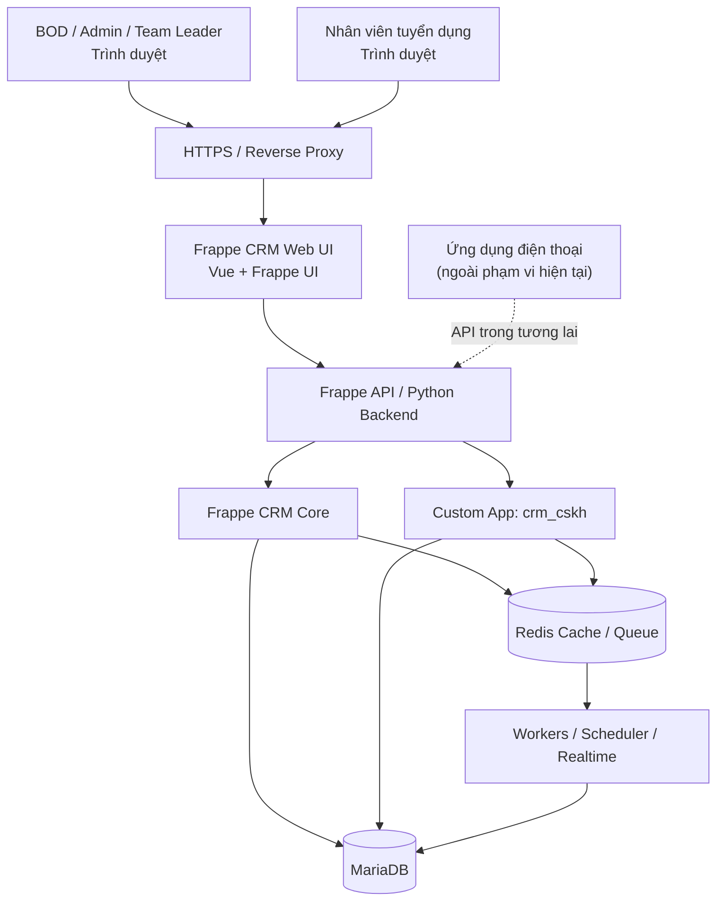
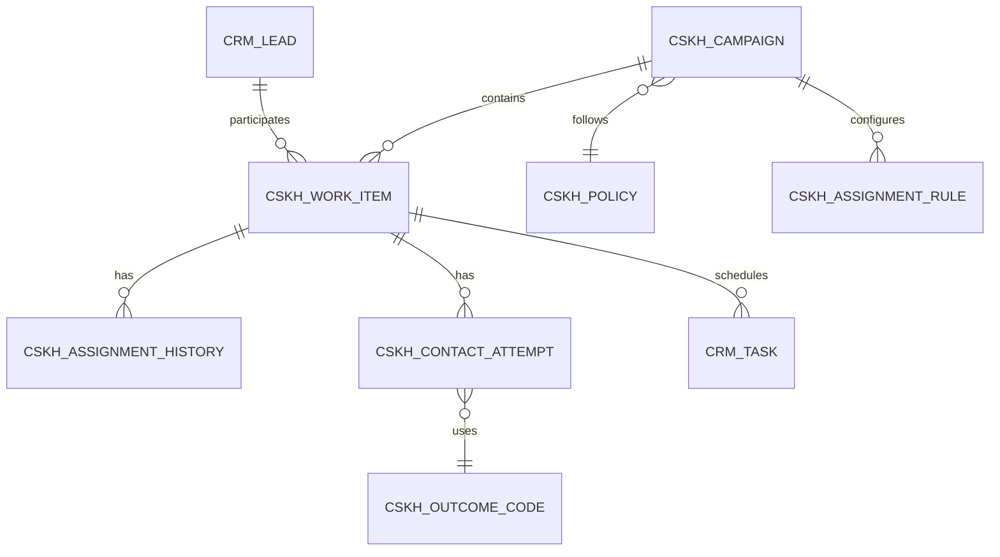
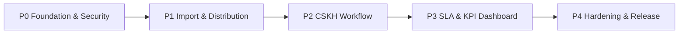

# MASTER PLAN — HỆ THỐNG CRM & QUẢN TRỊ CHẤT LƯỢNG CSKH

> **Mã dự án:** CRM-CSKH  
> **Phiên bản tài liệu:** 1.0 — 14/10/2026  
> **Trạng thái:** Master plan định hướng triển khai; chưa phải đặc tả chi tiết từng phase  
> **Nền tảng:** [Frappe CRM](https://github.com/frappe/crm) + custom Frappe app `crm_cskh`  
> **Baseline để khảo sát/POC:** Frappe CRM `v1.87.0` (phát hành 09/10/2026); phải khóa bộ phiên bản Frappe Framework tương thích sau P0  
> **Nguyên tắc:** Tái sử dụng tối đa chức năng và mã nguồn có sẵn; hạn chế sửa core.

---

## 0. Quyết định kiến trúc đã chốt

Đây là các **ràng buộc** cho mọi tài liệu và phase về sau:

1. **Chỉ xây ứng dụng web trong phạm vi dự án hiện tại.** BOD/Admin, Team Leader và nhân viên truy cập bằng trình duyệt, cùng một backend và một cơ sở dữ liệu chính.
2. **Không làm ứng dụng desktop.** Không dùng Electron/Tauri; không đưa đầu việc desktop vào backlog.
3. **Ứng dụng điện thoại là hướng phát triển sau này**, không thuộc phạm vi P0–P4. API và quy tắc bảo mật phải đủ rõ để ứng dụng tương lai có thể dùng lại mà không viết lại backend.
4. **Frappe CRM là CRM Core**, không xây một backend CRM mới bằng NestJS/Next.js, không xây lại chức năng CRM phổ thông đã có.
5. **Mở rộng bằng app riêng `crm_cskh`** cài vào cùng Frappe site. Chỉ fork/sửa frontend Frappe khi cơ chế extension không đáp ứng được nhu cầu; mọi thay đổi core phải có lý do và regression test.
6. **MariaDB là source of truth duy nhất của CRM**, Redis chỉ hỗ trợ cache/queue/realtime; không sử dụng Supabase/Neon làm database chính cho CRM.
7. **Nhân viên không bắt buộc nhắn qua Zalo** hay một kênh cố định: có thể gọi điện, SMS, Zalo, Facebook, phương thức khác. Hệ thống ghi nhận **hành động liên hệ và kết quả**, không giả định việc gửi tin nhắn đồng nghĩa với đã kết nối khách.
8. **BOD phải xem được chất lượng CSKH theo từng người và team**, không chỉ số lượng tin nhắn, số lần gọi hoặc thời gian online.
9. **Việt hóa là tiêu chí nghiệm thu**, tái sử dụng `crm/locale/vi.po` và cơ chế i18n có sẵn; chỉnh các chuỗi thiếu/sai, không xây một bộ dịch mới.
10. **Không cần deploy lên VPS mỗi lần sửa code.** DEV chạy cục bộ với dữ liệu mẫu; có CI và kiểm thử trước khi phát hành bản lên VPS chính thức.
11. **Không đưa thành phần hạ tầng bên ngoài CRM vào phạm vi triển khai máy chủ của dự án này.** CRM cần hoạt động đầy đủ mà không phụ thuộc vào một workflow ngoài dự án.

**Ưu tiên sản phẩm:** BOD nhìn thấy kho khách và số lượng phân phối ngay từ P1; nhân viên ghi nhận được toàn bộ quy trình CSKH ở P2; điểm chất lượng và báo cáo hoàn thiện ở P3.

---

## 1. Bối cảnh, mục tiêu và thành công kỳ vọng

### 1.1. Bối cảnh

Công ty hoạt động trong lĩnh vực tuyển dụng và cho thuê lại lao động. Nhân viên tuyển dụng/CSKH thường tiếp nhận danh sách người cần liên hệ, chủ yếu bằng số điện thoại hoặc danh tính liên hệ khác. Công ty cần kiểm soát quá trình giao khách, kết quả chăm sóc, lịch hẹn, trách nhiệm cá nhân và chất lượng làm việc thực tế.

Các vấn đề chính:

- Kho số điện thoại phân tán, dễ trùng lặp, khó kiểm soát người phụ trách.
- Chia khách theo tỷ lệ/nhóm nhưng khó kiểm toán việc chia và điều chuyển.
- Không có chuẩn kết quả liên hệ; ghi chú tự do khó thống kê và kiểm chứng.
- Nhân viên nhận số nhưng chậm liên hệ, bỏ sót lịch hẹn hoặc báo cáo không đủ.
- BOD cần phân biệt *mức độ chăm chỉ*, *tuân thủ quy trình* và *hiệu quả kết nối/chuyển đổi*.

### 1.2. Mục tiêu chính

- Xây **kho Lead/Contact tập trung** và quản trị được nguồn dữ liệu.
- **Import hàng loạt**, chuẩn hóa số Việt Nam, phát hiện trùng và ghi rõ nguồn/đợt import.
- **Phân phối theo tỷ lệ cấu hình** cho team/nhân viên; có thể dừng, điều chỉnh, thu hồi, phân phối lại và kiểm toán.
- Cung cấp **web làm việc hằng ngày** cho nhân viên với danh sách khách được giao, kết quả liên hệ có cấu trúc và lịch hẹn.
- Quản lý **SLA theo chính sách cấu hình** (liên hệ lần đầu, chăm sóc lại, quá hạn), không hard-code theo một quy định hành chính cố định.
- Dashboard để BOD/Leader đánh giá hiệu quả và chất lượng từng người theo ngày/tuần/tháng/quý/năm; xem chi tiết đến hồ sơ và nhật ký gốc.
- Có cơ sở mở rộng API cho ứng dụng điện thoại trong tương lai.

### 1.3. Thước đo thành công

- 100% khách được phân phối đều có hồ sơ nguồn, người nhận, thời điểm và lịch sử giao nhận.
- 100% sự kiện liên hệ ghi qua form chuẩn có nhân viên, thời điểm, kênh, kết quả và trạng thái xác minh.
- Nhân viên chỉ truy cập được dữ liệu đúng phạm vi được cấp; kiểm thử API và các tài liệu liên quan, không chỉ kiểm thử giao diện.
- BOD có thể xem khối lượng, tiến độ, tỷ lệ kết nối, lịch hẹn đúng hạn, quá hạn, tỷ lệ kết quả được cập nhật đầy đủ và điểm tuân thủ theo cá nhân/team.
- Các thao tác phân phối/import có thể chạy lại an toàn khi lỗi mà không tạo bản ghi công việc trùng.

> Các chỉ số ở đây là **tiêu chí tính đúng dữ liệu và khả năng truy vết**, không áp đặt rằng tỷ lệ liên hệ hay chuyển đổi của nhân viên phải đạt 100%.

---

## 2. Phạm vi và các đối tượng sử dụng

### 2.1. Trong phạm vi P0–P4

| Nhóm chức năng | Nội dung |
|---|---|
| Quản trị | User, role, team hierarchy, chính sách CSKH, cấu hình phân phối |
| Kho khách | Import, chuẩn hóa, chống trùng, nguồn, chiến dịch, tìm kiếm, phân loại |
| Phân phối | Theo trọng số/tỷ lệ, công suất, điều chuyển, thu hồi, lịch sử, kiểm toán |
| Nhân viên | My Customers, xem hồ sơ, ghi nhận liên hệ, kết quả, ghi chú, hẹn lại |
| Giám sát | Tiến độ, SLA, danh sách quá hạn, can thiệp/điều chỉnh |
| Báo cáo | BOD/Team Leader/nhân viên, KPI chất lượng, báo cáo theo kỳ và drill-down |
| Nền tảng | DEV, CI, kiểm thử, bảo mật, backup, deploy, monitoring, Việt hóa |

### 2.2. Ngoài phạm vi hiện tại

- Ứng dụng điện thoại (chỉ chuẩn bị API và mô hình dữ liệu hỗ trợ về sau).
- Tổng đài gọi điện hoặc ghi âm cuộc gọi bắt buộc; có thể tích hợp sau, nhưng **manual contact reporting** phải hoạt động độc lập.
- Tự động nhắn tin/gửi tin qua tài khoản cá nhân Zalo/Facebook.
- Hệ thống lương, hoa hồng, KPI lương thưởng hoặc chấm công.
- Đưa toàn bộ HRP/ERP khác vào cùng database CRM.
- Dashboard BI độc lập hoặc backend CRM thứ hai.

### 2.3. Vai trò

| Vai trò | Phạm vi dữ liệu/chức năng |
|---|---|
| **BOD** | Xem số liệu và chất lượng toàn công ty; quyền cấu hình/tác động chỉ cấp khi thực sự cần |
| **Admin CRM** | Quản lý nguồn khách, chiến dịch, phân phối, thu hồi, user, chính sách |
| **Team Leader** | Xem, giám sát và thao tác có kiểm soát với nhân viên/khách thuộc team |
| **Nhân viên tuyển dụng/CSKH** | Chỉ xem công việc/khách được giao, ghi hoạt động liên hệ, lịch hẹn, KPI cá nhân |
| **QA/Supervisor (tùy chọn)** | Kiểm tra mẫu nhật ký CSKH, gắn kết quả kiểm định; không tự động có quyền quản trị |

BOD **không cần** được cấp role `System Manager` mặc định để xem báo cáo. Xây role báo cáo riêng, giới hạn quyền theo nguyên tắc least privilege.

---

## 3. Repo nền tảng và chiến lược tái sử dụng

### 3.1. Các thành phần Frappe CRM đã khảo sát

| Thành phần / file trong `frappe/crm` | Đã có | Cách khai thác |
|---|---|---|
| `crm/fcrm/doctype/crm_lead/crm_lead.{json,py}` | `CRM Lead`, phone, owner, source, status, SLA, status history | Làm hồ sơ lead chính; thêm custom fields tối thiểu |
| `frontend/src/pages/Leads.vue`, `Lead.vue` | Danh sách/chi tiết Lead | Tái sử dụng list, filter, Kanban và trang chi tiết |
| `frontend/src/pages/DataImport.vue` | UI import dữ liệu | Tận dụng core import; thêm quy trình import số và kiểm trùng riêng |
| `frontend/src/components/Settings/AssignmentRules/AssigneeRules.vue` | `Round Robin`, `Load Balancing` | Giữ nguyên; thêm engine phân phối **theo trọng số** ở app riêng |
| `crm/api/assignment_rule.py`, `crm/install.py` | API/config rule hiện có | Tham khảo và tích hợp qua API/service Frappe; tránh sửa logic gốc |
| `crm/fcrm/doctype/crm_call_log/{crm_call_log.json,crm_call_log.py}` | Manual/Twilio/Exotel Call Log, trạng thái, thời gian | Dùng Call Log cho cuộc gọi; mở rộng mapping kết quả CSKH |
| `frontend/src/pages/CallLogs.vue` | Tạo và xem Call Log thủ công | Tái sử dụng khi cần; ưu tiên form liên hệ hợp nhất cho nhân viên |
| `crm/fcrm/doctype/fcrm_note/fcrm_note.json` | Ghi chú | Ghi chú bổ trợ, **không** thay thế kết quả liên hệ có cấu trúc |
| `crm/fcrm/doctype/crm_task/crm_task.{json,py}` | Task, due date, assignee, status | Tận dụng cho callback / công việc hẹn lại |
| `crm/fcrm/doctype/crm_service_level_agreement/` | SLA phản hồi, giờ làm việc, ngày nghỉ | Tận dụng tư duy/lịch làm việc, bổ sung SLA theo thời điểm giao khách |
| `crm/fcrm/doctype/crm_status_change_log/` | Nhật ký thay đổi trạng thái | Dùng bổ trợ; bổ sung lịch sử giao nhận và contact attempt riêng |
| `crm/fcrm/doctype/crm_sales_hierarchy/` | Cây cấp quản lý | Ánh xạ Team Leader và thành viên theo team |
| `crm/permissions/org_hierarchy.py`, `crm/hooks.py` | Permission hooks cho Lead/Deal | Tái sử dụng và **kiểm thử bảo mật**; bổ sung policy cho custom DocType |
| `crm/api/dashboard.py`, `crm/fcrm/doctype/crm_dashboard/` | Dashboard sales và bộ chart gốc | Tạo màn hình **CSKH Quality Dashboard** riêng ở phiên bản ổn định |
| `crm/api/activities.py`, `frontend/src/components/Activities/` | Timeline, calls, notes, tasks | Hiển thị thêm CSKH Contact Attempt theo cách mở rộng ít xâm lấn nhất |
| `crm/locale/vi.po`, `frontend/src/components/Settings/PreferencesSettings.vue` | Tiếng Việt và chọn ngôn ngữ theo user | Dùng i18n có sẵn; bổ sung/sửa bản dịch |
| `crm/api/__init__.py` | API lấy bản dịch theo ngôn ngữ user | Tái sử dụng, không phát triển bộ dịch riêng |

### 3.2. Những phát hiện cần lưu ý trước khi code

1. `CRM Lead.first_name` là trường bắt buộc: import số điện thoại **không có tên** cần chiến lược tên tạm rõ ràng, có đánh dấu placeholder; không bỏ qua validation bằng các cờ nguy hiểm.
2. `CRM Lead.lead_owner` chỉ biểu diễn **chủ hiện tại**; không đủ cho lịch sử phân phối và nhiều vòng chăm sóc.
3. `CRM Call Log.status` mô tả **trạng thái cuộc gọi** (`Completed`, `No Answer`, `Busy`...), không đồng nghĩa với **kết quả nghiệp vụ CSKH** (`Quan tâm`, `Hẹn lại`, `Không phù hợp`...).
4. `CRM Task` dùng được cho callback; không nên tự chế scheduler nhắc việc khác nếu Task/worker hiện có đáp ứng.
5. Quyền theo hierarchy cho Lead/Deal **không mặc nhiên đảm bảo** Call Log/Note/Task/attachments cũng được lọc đúng theo từng khách. Phải kiểm thử API thực tế.
6. Mã nguồn có đường đi qua `lead_owner`, `ToDo` assignments và `DocShare`; quy trình thu hồi/chuyển chủ phải đồng bộ ba cơ chế và thu hồi quyền còn sót.
7. **Bản `v1.87.0` không có hook `crm_dashboard_charts`** như trên nhánh `develop`. P3 phải có phương án dashboard extension riêng, không phụ thuộc tính năng chưa phát hành ổn định.
8. `crm/locale/vi.po` đã có tiếng Việt nhưng còn chuỗi thiếu và một số lỗi dịch nghĩa, ví dụ `Lead → Chì`; cần rà soát UI thực tế.
9. Kiểm tra bản quyền **AGPL-3.0** và nghĩa vụ đối với bản triển khai sửa đổi/khả năng cung cấp mã nguồn; không mặc định rằng mã fork kín không phát sinh nghĩa vụ.

### 3.3. Quy tắc tái sử dụng và nâng cấp

- **Ưu tiên #1:** Frappe metadata/custom fields, DocType, hooks, roles, List/Kanban, tasks, REST/API, scheduler.
- **Ưu tiên #2:** Tạo app `crm_cskh` để bổ sung server services, API, permission, pages và dashboard.
- **Ưu tiên #3:** Chỉ fork/sửa trực tiếp mã `crm` nếu extension không đáp ứng; ghi rõ diff, lý do và test chống regression.
- **Không làm:** sao chép toàn bộ `CRM Lead`, dựng `customers` DB thứ hai song song, tự viết framework authentication/UI khi Frappe đã cung cấp.

---

## 4. Kiến trúc triển khai



### 4.1. Trên VPS production

Một VPS Ubuntu, Docker Compose, với các nhóm service:

| Nhóm | Thành phần | Chức năng |
|---|---|---|
| Entry | HTTPS reverse proxy / Nginx | TLS, routing, giới hạn upload/rate-limit thích hợp |
| App | Frappe frontend/backend + `crm` + `crm_cskh` | Web, API, nghiệp vụ |
| DB | MariaDB | Dữ liệu chính của hệ thống |
| Cache/Queue | Redis cache, Redis queue | Cache, job queue, realtime hỗ trợ |
| Background | Short worker, long worker, scheduler | Import, phân phối, tác vụ định kỳ, tổng hợp KPI |
| Realtime | WebSocket/socket service | Sự kiện thông báo và cập nhật UI |
| Storage | Docker volumes + nơi backup độc lập | Dữ liệu site, file đính kèm, backup |

**Tài nguyên khởi điểm để lập dự toán:** khoảng 8 vCPU, 16 GB RAM, 120–160 GB NVMe cho production khoảng vài chục nhân viên, sau P0 phải benchmark theo số phiên đồng thời và tập dữ liệu thực tế. Đây **không phải yêu cầu cấu hình bắt buộc** của Frappe.

**Không lấy** `docker/docker-compose.yml` demo trong repo CRM làm production nguyên trạng: file đó có cấu hình phát triển và thông tin đăng nhập mẫu. Dùng phương án triển khai production theo Frappe Docker/custom image, pin image và secret riêng.

### 4.2. Cơ sở dữ liệu và lưu trữ

- **Một MariaDB chính** chứa các DocType Frappe và `crm_cskh`.
- File import và file đính kèm lưu trong storage của site; backup đồng bộ DB + file.
- R2 có thể dùng làm **đích backup ngoài VPS** hoặc nơi lưu file lớn nếu có adapter phù hợp; không phải điều kiện để ra MVP.
- Redis **không** là nguồn sự thật cho khách, kết quả CSKH hay phân phối.
- Không có dịch vụ Next.js, NestJS, PostgreSQL hay Electron riêng cho CRM giai đoạn này.

### 4.3. Môi trường phát triển và phát hành

| Môi trường | Vị trí | Cách dùng |
|---|---|---|
| **DEV** | Máy phát triển/agent, chạy local containers | Sửa Vue/Python, test tự động và test thủ công trên data seed |
| **CI** | GitHub Actions | Lint, Python/unit tests, frontend tests, kiểm tra build, migration smoke test |
| **STAGING** | Môi trường cô lập, bật trước khi có người dùng thật | UAT, phân quyền đa user, kiểm thử hồi quy, kiểm thử nâng cấp và dữ liệu giả |
| **PRODUCTION** | VPS chính | Chỉ chạy artifact/version đã nghiệm thu |

Không cần push VPS để thử mỗi thay đổi UI. Frontend chạy Vite dev/hot reload; backend chạy Frappe dev, reload/restart/migrate khi loại thay đổi yêu cầu. Staging không được dùng chung DB hoặc volume dữ liệu với production.

### 4.4. Nguyên tắc API cho tương lai

- Toàn bộ nghiệp vụ quan trọng được kiểm tra quyền và chạy tại **Frappe backend**, không khóa cứng logic ở giao diện Vue.
- Mọi mutation quan trọng có validation, transaction, authorization, audit log và idempotency khi cần.
- Dùng API version có hợp đồng dữ liệu rõ; không đưa thông tin đăng nhập quản trị hoặc khóa dịch vụ vào client.
- Tài liệu OpenAPI/collection test cho API mới; sẵn sàng cho ứng dụng điện thoại nhưng **không phát triển client điện thoại trong các phase này**.

---

## 5. Mô hình dữ liệu nghiệp vụ

### 5.1. Tái sử dụng DocType gốc

- `CRM Lead`: hồ sơ lead và thông tin liên hệ, current owner.
- `CRM Lead Status`: trạng thái lead chính.
- `CRM Call Log`: sự kiện cuộc gọi, trạng thái kỹ thuật và thời điểm.
- `CRM Task`: công việc và lịch hẹn CSKH.
- `FCRM Note`: ghi chú bổ sung.
- `CRM Sales Hierarchy`: cấu trúc quản lý.
- `User`, `Role`, `ToDo`, `DocShare`: người dùng, phân quyền, giao việc.

### 5.2. Đề xuất DocType mới trong `crm_cskh`

| DocType | Trường cốt lõi / vai trò | Giai đoạn |
|---|---|---|
| **CSKH Import Batch** | nguồn, checksum, file, người import, thống kê hợp lệ/trùng/lỗi, trạng thái | P1 |
| **CSKH Campaign** | tên đợt, mô tả, chính sách, trạng thái, ngày áp dụng, người sở hữu | P1 |
| **CSKH Assignment Rule** | campaign/team, user, weight, capacity, enabled, priority/effective date | P1 |
| **CSKH Work Item** | link Lead + Campaign, owner hiện tại, lifecycle, assigned_at, first_touch_due, next_action_due | P1/P2 |
| **CSKH Assignment History** | work item, from_user, to_user, action, actor, timestamp, reason, allocation_batch | P1 |
| **CSKH Contact Attempt** | work item, lead, staff, channel, occurred_at, outcome, note, self_reported/verified, evidence, next_followup | P2 |
| **CSKH Outcome Code** | code, nhãn Việt, nhóm kết quả, is_connected, is_terminal, requires_note, requires_followup | P2 |
| **CSKH Policy** | giờ làm, hạn first touch, nhắc lại, retry, lịch nghỉ, cấu hình theo team/đợt | P2/P3 |
| **CSKH KPI Snapshot** | ngày/kỳ, user/team/campaign, mẫu số, tử số, điểm, policy_version, calculated_at | P3 |
| **CSKH QA Review** (tùy chọn) | attempt/work item, reviewer, đánh giá, nhận xét, bằng chứng | P3 |

**Bắt buộc thiết kế khóa và index:** `(campaign, lead)` để chặn work item trùng không hợp lệ; `(assigned_to, lifecycle_status, next_action_due)` cho list nhân viên; `(work_item, occurred_at)` cho timeline; `(user, period, campaign)` cho snapshot. Kiểm tra trường unique theo chính sách tái sử dụng lead giữa các campaign, không unique toàn cục cứng nhắc.

### 5.3. Danh tính khách và chống trùng

- Chuẩn hóa số Việt Nam `0...`, `+84...`, `84...` về một kiểu canonical; kiểm tra chiều dài/đầu số theo bộ quy tắc có thể cập nhật; lưu nguyên bản đầu vào để audit.
- **Lead chỉ có điện thoại**: tạo tên tạm với cờ `is_placeholder_name`, không biến số điện thoại thành tên thật; cho phép bổ sung tên về sau.
- Lead có Facebook nhưng không có điện thoại: không ép gộp vào một khách chỉ dựa trên tên hiển thị. Khóa danh tính Facebook theo namespace/source cụ thể.
- Chỉ tự gộp khi có khóa định danh đáng tin cậy; trường hợp mơ hồ đi vào hàng chờ xem xét; giữ source/batch history.
- Khách có thể tham gia nhiều campaign theo thời gian, nhưng không được có **hai người đồng thời sở hữu cùng một công việc active**. Quy tắc xung đột giữa các campaign phải cấu hình rõ từ P1.

### 5.4. Mô hình quan hệ tối thiểu



**Lưu ý:** `CRM Lead.status` là trạng thái CRM tổng quát; `CSKH Work Item.lifecycle_status` là trạng thái công việc trong từng chiến dịch. Hai trường có thể đồng bộ theo mapping được định nghĩa, nhưng không nhất thiết giống hệt nhau.

---

## 6. Quy trình nghiệp vụ bắt buộc

### 6.1. Vòng đời của một khách trong chiến dịch

```text
Chưa phân phối (trong kho)
    ↓ Admin phân phối
Mới được giao / Chưa liên hệ
    ↓ tạo Contact Attempt
Đang liên hệ
    ├─ Không kết nối → Chờ liên hệ lại / Hẹn lại → Đến hạn → Đang liên hệ
    ├─ Đã kết nối → Đang chăm sóc / Hẹn lại
    ├─ Đạt mục tiêu → Hoàn tất / Thành công
    ├─ Không phù hợp / Từ chối → Hoàn tất / Thất bại theo lý do
    └─ Số sai / Không liên hệ → Ngừng liên hệ theo chính sách
```

**Không dùng** một trường `Contacted` duy nhất để suy ra khách đã bắt máy hoặc đồng ý. `attempted`, `connected`, `interested`, `converted` phải có định nghĩa riêng.

### 6.2. Contact Attempt: nguồn sự thật của hoạt động CSKH

Một bản ghi tối thiểu gồm:

- Ai liên hệ (user) và ai là current assigned owner khi liên hệ.
- Khách/work item liên quan.
- Kênh: `phone_call`, `sms`, `zalo`, `facebook`, `other`.
- Ngày giờ thực hiện; ngày giờ tạo bản ghi; có phân biệt nếu nhập bù.
- Kết quả mã hóa: `no_answer`, `busy`, `wrong_number`, `connected_interested`, `connected_not_interested`, `callback_requested`, `converted`, `other`... (cấu hình được bằng Outcome Code).
- Ghi chú và yêu cầu nhập ghi chú theo từng mã kết quả.
- `next_followup_at` nếu cần hẹn lại, liên kết `CRM Task`.
- `verification_status`: `self_reported`, `verified`, `disputed` (giai đoạn đầu chủ yếu là tự báo cáo).
- Thông tin tạo/sửa và lịch sử chỉnh sửa; quy định giới hạn thay đổi kết quả đã gửi.

**Nguyên tắc:** mỗi lần liên hệ là **một record mới**, không ghi đè lịch sử trước đó. Khi có Call Log tương ứng, lưu link tránh double-count. Một cuộc gọi thất bại chỉ tính là *attempt*, không tính là *connected*.

### 6.3. Luồng làm việc nhân viên

1. Đăng nhập web → **My Customers**.
2. Lọc: `Mới giao`, `Chưa liên hệ`, `Cần gọi lại`, `Đã kết nối`, `Quá hạn`, `Hoàn tất`.
3. Mở khách → xem số/danh tính, nguồn, lịch sử được phép truy cập.
4. Liên hệ bằng kênh phù hợp ngoài hoặc trong hệ thống.
5. Bấm **Ghi nhận kết quả** → chọn kênh, kết quả, nhập ghi chú, hẹn ngày nếu cần.
6. Backend tạo Contact Attempt; cập nhật lifecycle; tạo/cập nhật Task; tính SLA.
7. Nhân viên xem lại tiến độ và KPI cá nhân.

### 6.4. Luồng Admin/BOD

1. Import/tiếp nhận Lead vào kho.
2. Xem số hợp lệ, số trùng, số đang active, số đủ điều kiện phân phối.
3. Tạo Campaign, policy, chọn team/người nhận và trọng số.
4. Preview số lượng sẽ giao, xác nhận và lưu phân phối.
5. Xem tức thời danh sách giao, tiến độ, quá hạn; khi cần thu hồi/chuyển người phụ trách.
6. Xem BOD Dashboard theo kỳ, team, chiến dịch, nhân viên và drill-down tới timeline.

---

## 7. Phân phối khách theo tỷ lệ

### 7.1. Yêu cầu engine

- Trọng số theo nhân viên/team: ví dụ A 50%, B 30%, C 20%.
- Tham số cấu hình: `enabled`, `weight`, `capacity_limit`, team/campaign, priority, effective dates.
- Có preview/dry-run trước khi phân phối; batch có mã định danh và idempotency key.
- Khi một người tạm ngưng hoặc đủ quota, các khách tiếp theo phân cho những người còn hợp lệ theo trọng số đã điều chỉnh.
- Giảm lệch trọng số giữa nhiều batch nhỏ bằng weighted-fair strategy, có bộ đếm phân phối tích lũy theo policy version.
- Tách **quyền sở hữu công việc** và **lịch sử được giao**; khách chuyển người phụ trách không xóa contact attempts của người trước.
- Mọi thay đổi diễn ra tại backend trong transaction có locking/unique constraints; worker retry không giao trùng.

### 7.2. Điều phối với Assignment Rule có sẵn

Giữ Frappe Assignment Rule gốc cho use case mặc định. Module CSKH gọi các service Frappe liên quan `ToDo`/`lead_owner`/`DocShare`, **không** cập nhật mỗi `lead_owner` rồi bỏ qua quyền truy cập.

P0/P1 phải thử một trường hợp cụ thể: chuyển khách A → B; sau đó kiểm tra API với account A, B, Team Leader, BOD cho Lead, Contact Attempt, Call Log, Task, Note và attachment.

### 7.3. Chính sách phân phối lại

- Chuyển tay bởi Admin hoặc Leader được ủy quyền; bắt buộc lý do.
- Tùy chọn phân lại khi `quá hạn`, `nghỉ việc`, `không còn capacity`; **chưa tự động phân lại ở MVP** nếu chưa có chính sách được duyệt.
- Lưu `ownership_start_at`, `ownership_end_at`; KPI cá nhân gắn với phần thời gian họ thực sự sở hữu công việc.

---

## 8. SLA, điểm chất lượng và dashboard

### 8.1. SLA cần cấu hình

- Hạn liên hệ đầu tiên: `assigned_at` → `first_attempt_at` hoặc `first_connected_at` (định nghĩa KPI tách biệt).
- Hạn callback: `next_followup_at` → attempt được thực hiện.
- Tùy chọn giờ làm việc, ngày nghỉ, khung thời gian theo team/campaign.
- Số lần thử tối thiểu và chu kỳ nhắc lại có thể thay đổi theo chính sách.
- Quy tắc cảnh báo quá hạn, escalations và lịch sử vi phạm.

Không hard-code “gọi trong 2 giờ” hay “mỗi ngày 4 lần”; thay đổi chính sách chỉ cần cập nhật cấu hình có version/effective date.

### 8.2. KPI chuẩn, tách kết quả khỏi tuân thủ

| KPI | Định nghĩa gợi ý |
|---|---|
| Assigned | Số work item được giao trong kỳ, đếm theo ownership interval |
| Attempt Coverage | Số khách có ít nhất 1 lần thử / số khách cần được xử lý đủ điều kiện |
| Connected Rate | Số khách kết nối thực tế / số khách đã được thử liên hệ |
| First-touch On-time | Số work item có first attempt đúng hạn / số work item đã đến hạn |
| Follow-up On-time | Số lịch hẹn được xử lý đúng hạn / số lịch hẹn đến hạn |
| Outcome Completeness | Số attempts đủ thông tin bắt buộc / tổng attempts |
| Conversion Rate | Số khách đạt mục tiêu / mẫu số chiến dịch được quy định |
| Overdue Backlog | Số việc active đã quá hạn tại thời điểm đo |
| QA Pass Rate | Số mẫu CSKH đạt chuẩn / số mẫu được kiểm định |

**Điểm tuân thủ quy trình** là cấu hình theo phiên bản. Công thức ví dụ (chưa chốt chính sách): 25% first-touch đúng hạn + 20% coverage + 20% cập nhật đầy đủ + 20% follow-up đúng hạn + 15% QA. Khi QA chưa triển khai hoặc không có mẫu đủ điều kiện, phải có quy tắc chuẩn hóa trọng số; không mặc định cho 0 điểm.

**Không** dùng số tin nhắn, tổng số cuộc gọi hay giờ online làm đại diện duy nhất cho chất lượng CSKH.

### 8.3. Chống báo cáo sai và bảo đảm công bằng

- Tách **self-reported** khỏi **verified**; báo cáo phải thể hiện tỷ lệ xác minh, không trình bày mọi cuộc gọi nhập tay là “đã kiểm chứng”.
- Chỉ tính kết quả của nhân viên trong giai đoạn sở hữu công việc tương ứng.
- Mẫu số có quy tắc rõ với khách trùng, số sai, không còn đồng ý liên hệ, campaign dừng, nhân viên nghỉ phép.
- KPI snapshot lưu `policy_version` và phạm vi tính toán để có thể giải thích số liệu lịch sử.
- Cho phép QA kiểm tra mẫu có ghi lý do và audit; không xóa lịch sử khi nhân viên sửa một kết quả cũ.

### 8.4. Dashboard BOD

Ưu tiên các màn hình:

1. **Executive Overview:** tổng lead, đang được giao, đã thử liên hệ, đã kết nối, hẹn lại, quá hạn, hoàn tất.
2. **Team Comparison:** coverage, on-time, connected rate, backlog theo team.
3. **Employee Quality:** từng nhân viên, lượng được giao, liên hệ, đúng hạn, kết quả và điểm quy trình.
4. **Campaign Performance:** theo nguồn/đợt/phân phối và chất lượng dữ liệu.
5. **Drill-down/Audit:** nhấp vào số liệu xem danh sách khách và từng sự kiện gốc; có export theo phân quyền.

P1 có **dashboard số lượng và phân phối**; P3 mới có **dashboard kết quả/chất lượng đầy đủ**.

---

## 9. Bảo mật, phân quyền và audit

### 9.1. Bắt buộc ngay từ P0

- TLS, secrets trong secret/env manager, không commit khóa hoặc mật khẩu vào repo.
- Áp dụng phân quyền ở **backend/API** cho mọi list, detail, mutation, export, import, attachment, search và dashboard.
- Frappe `Sales Hierarchy` chỉ cấp quyền theo cây đã cấu hình đúng; kiểm tra manager nằm ngoài cây quản lý.
- Không cấp quyền rộng thông qua role `System Manager` cho người chỉ cần dashboard.
- Các DocType mới có permission query conditions, object-level checks và field-level controls khi cần.
- Audit thay đổi owner, assignment, kết quả, lịch hẹn, xóa/sửa và export dữ liệu.
- Có quy định xuất danh sách số hàng loạt; hạn chế tải xuống dữ liệu không thuộc phạm vi.
- Không dùng dữ liệu cá nhân thực trong test hoặc demo; nếu tạo staging từ production phải ẩn/mask dữ liệu nhạy cảm.

### 9.2. Các ca kiểm thử an ninh tối thiểu

- Nhân viên A không thể truy cập Lead/Call Log/Notes/Task/Contact Attempt/attachments của B qua API trực tiếp.
- Team Leader chỉ thấy dữ liệu thuộc team; BOD thấy dashboard theo role được ủy quyền.
- Sau chuyển giao, nhân viên cũ không còn quyền truy cập không mong muốn.
- User không thể giả mạo `employee_id`, `lead_owner`, `verified` hoặc `contacted_at` của người khác bằng cách sửa request.
- Endpoint bulk/export/search không bỏ qua quyền người dùng.
- Các API từ code gốc dùng `ignore_permissions` hoặc nhận tham số `ignore_permissions` phải được audit kỹ trước khi mở quyền cho user thường.
- Retention và xóa dữ liệu thực hiện theo chính sách nội bộ/pháp luật phù hợp; không xóa nhật ký cần kiểm toán một cách tùy tiện.

### 9.3. Backup, khôi phục và vận hành

- Backup MariaDB + site files + cấu hình; backup lưu **ngoài VPS**, có mã hóa và thời hạn lưu.
- Kiểm thử restore định kỳ; backup thành công nhưng không restore được không được coi là an toàn.
- Monitoring CPU, RAM, disk, database, worker queue, scheduled jobs, lỗi ứng dụng và chứng chỉ TLS.
- Deploy thay đổi schema theo migration có kiểm thử; backup trước migration; có kế hoạch rollback ứng dụng và restore DB khi migration không tương thích.

---

## 10. Chiến lược Việt hóa

### 10.1. Tài nguyên có sẵn

- `crm/locale/vi.po`: đã có tiếng Việt nhưng thiếu/sai một phần; không xây lại cơ chế i18n.
- Người dùng có thể chọn ngôn ngữ tại **Settings → Preferences → Language**; ứng dụng dùng tài nguyên dịch theo ngôn ngữ user.
- Các màn hình mới viết theo chuẩn translation functions của Frappe/Vue, không hard-code text một cách cản trở localization.

### 10.2. Từ điển thuật ngữ chuẩn ban đầu

| English | Thuật ngữ ưu tiên |
|---|---|
| Lead | Khách hàng tiềm năng / Khách được giao (theo ngữ cảnh) |
| Lead Owner | Nhân viên phụ trách |
| Sales User | Nhân viên tuyển dụng/CSKH |
| Sales Manager | Trưởng nhóm |
| Call Log | Nhật ký cuộc gọi |
| Contact Attempt | Lần liên hệ |
| Follow-up | Chăm sóc lại / Hẹn liên hệ lại |
| Assignment | Phân phối / Giao khách |
| SLA | Thời hạn xử lý |
| Overdue | Quá hạn |
| Outcome | Kết quả liên hệ |
| Dashboard | Báo cáo tổng quan |

### 10.3. Nghiệm thu bản dịch

- P0: bật tiếng Việt, lập danh sách lỗi thực tế và thiết lập từ điển.
- P1: UI kho khách, import, phân phối và user/team phải có tiếng Việt đúng ngữ cảnh.
- P2: luồng CSKH nhân viên, kết quả, lịch hẹn và lỗi validation phải rõ ràng.
- P3: dashboard, chỉ số, cảnh báo, tiêu đề xuất file và biểu đồ có nhãn tiếng Việt.
- **Tiêu chí:** các luồng nghiệp vụ chính không còn chuỗi chưa dịch hoặc dịch sai ngữ cảnh (ví dụ không để `Lead → Chì`).

---

## 11. Kế hoạch triển khai theo phase

### P0 — Foundation, Local Development & Security Gate

**Mục tiêu:** Chứng minh Frappe CRM chạy được, mở rộng được và đáp ứng yêu cầu bảo mật **trước khi xây hàng loạt**.

**Phạm vi**

- Khóa baseline Frappe CRM `v1.87.0`, framework và dependencies tương thích; xác nhận license/upgrade path.
- Dựng DEV bằng Docker/local, data seed, account mẫu: BOD, Admin, Team Leader, A, B.
- Dựng production-like smoke environment (STAGING hoặc môi trường tạm cô lập).
- Tạo repository custom app `crm_cskh`, skeleton hooks/DocType/API, migrations, test framework.
- Kiểm tra lead nhập **chỉ số điện thoại**, tạo/cập nhật Lead, gọi Call Log thủ công, tạo Task, lịch sử status.
- PoC quyền theo hierarchy, `DocShare`/`ToDo`/`lead_owner` khi reassignment; kiểm tra quyền trên Call Log/Notes/Task/attachments.
- Kích hoạt tiếng Việt; lập glossary và các lỗi i18n cần sửa.
- Tạo CI cơ bản, Docker custom image thử nghiệm và hướng dẫn chạy local.

**Tái sử dụng:** Frappe Framework, CRM app gốc, roles, metadata, data import, test framework, translation pipeline.

**Đầu ra:** `P0.md`, repository skeleton, `docker` dev setup, test seed, security matrix, architecture decision records, danh mục risk/blocker.

**Điều kiện qua P0 / GO-NO-GO:**

1. Có thể chạy và sửa UI/API **hoàn toàn trên DEV**, không phụ thuộc production.
2. Frappe + `crm_cskh` cùng site, migrations ổn định.
3. Một Lead chỉ có SĐT được tạo theo cách hợp lệ.
4. Các ca truy cập chéo và thu hồi quyền phải có giải pháp thử nghiệm đạt yêu cầu.
5. Chốt cách extension UI và Dashboard thực sự khả thi trên **tag ổn định**, không lấy tính năng từ `develop` làm giả định.

> **Không được bỏ qua P0 security gate** để chạy thẳng import dữ liệu khách thật.

### P1 — Kho khách, Team & Weighted Distribution

**Mục tiêu:** Admin đưa dữ liệu vào CRM và phân phối cho nhân viên; BOD nhìn thấy lượng khách được giao ngay.

**Phạm vi**

- Import CSV/XLSX, preview, đối chiếu cột, số hợp lệ/trùng/lỗi, placeholder name, import history.
- Quản lý Campaign và eligibility của Lead.
- Ánh xạ user/team qua `CRM Sales Hierarchy` và role/policy bổ sung.
- Cấu hình trọng số tỷ lệ và capacity theo nhân viên/team.
- Weighted assignment, dry-run, idempotent batch, transaction, history.
- Thu hồi/chuyển người phụ trách thủ công và dọn quyền truy cập cũ.
- Web **My Customers** tối thiểu: danh sách khách được giao, nguồn, số, trạng thái, chi tiết.
- **BOD Distribution Dashboard**: tổng kho, chưa giao, đã giao, mỗi team/người nhận bao nhiêu, history, các batch lỗi.
- Hoàn thiện tiếng Việt cho màn hình P1.

**Đầu ra:** `P1.md`, DocType/Services/UI/API mới, tests import/dedup/distribution/permissions.

**Nghiệm thu:**

- Nhập danh sách chỉ có số điện thoại với xử lý trùng minh bạch.
- Chia 1.000 lead theo tỷ lệ 50/30/20 trên tình huống đủ điều kiện tạo 500/300/200 work items; với batch nhỏ kiểm tra weighted fair và sai số đã định nghĩa.
- Hai job chạy đồng thời hoặc retry không sinh work item/assignment trùng.
- Admin/Leader/BOD thấy số liệu theo đúng quyền; nhân viên chỉ thấy khách được giao.
- Chuyển khách A → B có lịch sử, A không còn quyền ngoài chính sách.

### P2 — CSKH Workflow & Follow-up

**Mục tiêu:** Nhân viên báo cáo được toàn bộ quá trình CSKH mà không bị phụ thuộc một kênh giao tiếp.

**Phạm vi**

- Status/lifecycle của Work Item, danh mục `CSKH Outcome Code` cấu hình.
- Form **Ghi nhận lần liên hệ** nhanh với kênh, kết quả, note, hẹn lại.
- Tái sử dụng `CRM Call Log` cho call, mapping sang `Contact Attempt`; không đếm trùng.
- Tận dụng `CRM Task` cho callback và nhắc việc.
- Timeline đầy đủ của lead/work item theo quyền.
- Bộ lọc My Customers: chưa liên hệ, đã thử, kết nối, hẹn lại, quá hạn, hoàn tất.
- Quy tắc sửa/bổ sung nhật ký có audit; phân biệt self-reported và verified.
- Cấu hình chính sách CSKH theo team/campaign, không hard-code một cadence.
- Việt hóa hoàn chỉnh các luồng nhân viên.

**Đầu ra:** `P2.md`, Contact Attempt service, UI workflow, callback, tests.

**Nghiệm thu:**

- Một khách từ “mới giao” có thể được thử gọi → không nghe → đặt lịch → liên hệ lại → kết nối → hoàn tất.
- Mỗi lần liên hệ còn nguyên dấu thời gian, kênh, nhân viên, kết quả, không ghi đè.
- Call Log kỹ thuật và Outcome nghiệp vụ không bị đánh đồng.
- Nhân viên không thể tạo sự kiện cho khách ngoài phạm vi hoặc sửa trạng thái xác minh trái quyền.

### P3 — SLA, QA & BOD Quality Dashboard

**Mục tiêu:** BOD đánh giá đúng chất lượng CSKH của từng nhân viên, team và chiến dịch.

**Phạm vi**

- SLA first attempt, follow-up, quá hạn theo policy/effective date, khung giờ làm việc.
- Worker kiểm tra quá hạn, hàng chờ xử lý/escalation và cảnh báo trong hệ thống.
- KPI Engine chuẩn hóa mẫu số, attribution theo thời gian sở hữu, policy version.
- KPI snapshots theo ngày/tuần/tháng/quý/năm, cơ chế backfill/recompute có kiểm toán.
- BOD dashboard + team dashboard + personal dashboard.
- Drill-down từ số liệu đến Work Item/Contact Attempt và giải thích điểm số.
- Tùy chọn QA Review theo mẫu, so sánh self-reported/verified.
- Export báo cáo theo quyền, Việt hóa nhãn chỉ số và nội dung xuất.

**Đầu ra:** `P3.md`, SLA engine, KPI definitions, QA policy, dashboard, reconciliation tests.

**Nghiệm thu:**

- Các KPI có tài liệu công thức, mẫu số và edge cases, khớp với dữ liệu test tay.
- Nhân viên chuyển team/chuyển khách không làm méo KPI lịch sử.
- Có thể giải thích tại sao một người được điểm X và mở được dữ liệu gốc tạo ra điểm.
- Báo cáo BOD thể hiện rõ dữ liệu tự báo cáo và dữ liệu đã xác minh.

### P4 — Hardening, Operation & Release Readiness

**Mục tiêu:** Đưa hệ thống vào sử dụng ổn định, dễ nâng cấp và đủ nền tảng mở rộng tiếp.

**Phạm vi**

- E2E tests toàn bộ journey; hiệu năng import, phân phối, dashboard, đồng thời nhiều phiên.
- Hardening bảo mật API, export, file, search, permissions, rate limiting, audit.
- Production image, migrations, deploy/rollback runbooks, backup/restore rehearsal.
- Monitoring workers, queue, DB, disk, errors, job failures và số liệu bất thường.
- Versioning API, tài liệu endpoint/permission, kiểm tra khả năng phục vụ client điện thoại tương lai (**không xây app**).
- Đào tạo Admin/Leader/nhân viên, SOP quản trị dữ liệu và xử lý sự cố.
- Cải tiến UX, hoàn thiện Việt hóa và accessibility ở màn hình quan trọng.

**Đầu ra:** `P4.md`, production runbook, QA/UAT checklist, release checklist, performance/security test report, API contract.

**Nghiệm thu:**

- Triển khai được bản đã test từ CI lên production mà không sửa code trực tiếp trên VPS.
- Backup và restore đã được kiểm tra bằng dữ liệu thử nghiệm.
- Không còn lỗi quyền truy cập chéo nghiêm trọng trong test suite.
- Hệ thống chạy ổn định với bộ dữ liệu và mức concurrency mục tiêu được đo ở P0/P4.
- Có tài liệu vận hành, rollback, migrations và glossary tiếng Việt.

---

## 12. Dependency và chiến lược ra sản phẩm sớm



**Giá trị có ngay sau P1:** BOD nhìn thấy kho khách, nguồn, số đã phân, chưa phân, phân phối theo team/nhân viên và lịch sử chuyển giao. **Không được gắn nhãn báo cáo P1 là KPI chất lượng CSKH**, vì dữ liệu contact attempts chỉ hoàn chỉnh ở P2.

**MVP nghiệp vụ hữu dụng:** P0 + P1 + P2, với phân quyền đạt chuẩn. **Bộ quản trị chất lượng CSKH đầy đủ:** cộng thêm P3. **Đưa vào vận hành quy mô rộng:** P4.

---

## 13. Phân công cho AI Coding Agent

### 13.1. Nguyên tắc giao việc

AI Coding Agent chịu trách nhiệm cả custom app Frappe (Python/DocTypes/API), frontend Vue/Frappe UI, tests, CI và cấu hình Docker **trong repository của dự án CRM**.

**Bắt buộc với mỗi nhiệm vụ:**

1. Tìm file/chức năng upstream tương ứng trước khi code.
2. Ghi rõ 1 trong 4 lựa chọn: `REUSE`, `CONFIGURE`, `EXTEND`, `BUILD NEW`.
3. Nếu đề xuất sửa core, giải thích vì sao custom app/hook không giải quyết được.
4. Có migration/fixtures và unit/integration tests khi thay đổi dữ liệu/nghiệp vụ.
5. Có kiểm thử ACL trên API cho mỗi DocType/endpoint mới.
6. Có bản dịch tiếng Việt cho mọi UI mới.
7. Code chạy được local, CI pass, nêu rõ migration và rollback impact trước merge.
8. Không đưa code chưa nghiệm thu trực tiếp lên production.

### 13.2. Đầu ra của từng PR

- Tóm tắt nghiệp vụ, file upstream tái sử dụng, file mới/sửa, ảnh/chứng cứ test UI khi phù hợp.
- API/schema changes, kiểm thử phân quyền, migration commands và dữ liệu seed.
- Kết quả test tự động/thủ công, rủi ro còn tồn tại và các điểm cần review.

---

## 14. Ma trận kiểm thử xuyên suốt

| Nhóm | Tình huống bắt buộc |
|---|---|
| Import | Chỉ có SĐT; số khác định dạng; trùng cùng file/khác batch; số sai; import retry |
| Phân phối | Trọng số 50/30/20; batch nhỏ; nhân viên disable; full capacity; retry; race conditions |
| Chuyển giao | A → B → C; giữ lịch sử; KPI theo ownership; quyền cũ bị thu hồi |
| Workflow | No Answer ≠ Connected; nhiều lần thử; hẹn lại; đạt mục tiêu; đóng case |
| SLA | Qua ngày/giờ làm; ngày nghỉ; đổi policy; lịch quá hạn; hẹn lại nhiều lần |
| KPI | Đếm một khách đúng một lần theo mẫu số; không double count Call Log/Attempt; kỳ tháng/quý |
| RBAC | Staff A/B, Leader team khác, BOD, Admin, exporter, attachments/API detail |
| Localization | Không còn chuỗi khó hiểu ở luồng chính; ngày/giờ Việt Nam; nhãn/form lỗi |
| Release | Migration, backup/restore, worker restart, downgrade/rollback có kế hoạch |
| Future API | Endpoint mới không phụ thuộc Vue/session trick; xác thực và kiểm quyền backend |

---

## 15. Các quyết định mặc định và điểm cần chốt tại P0/P1

Để AI Coding không tự tạo giả định mâu thuẫn, master plan áp dụng các **mặc định** sau cho đến khi có quyết định khác:

| Chủ đề | Mặc định hiện tại | Chốt chi tiết ở |
|---|---|---|
| Kho khách | `CRM Lead` là entity chính; `CSKH Work Item` thể hiện nhiệm vụ trong campaign | P0/P1 |
| Khách trùng | Giữ một lead canonical khi khóa đáng tin cậy trùng; không tự merge mơ hồ | P1 |
| Chủ hiện tại | Một nhân viên chính trên một work item active | P1 |
| Phân phối | Weighted fair, có dry-run và batch idempotency; không auto thu hồi theo SLA ở MVP | P1 |
| Liên hệ | Staff tự chọn kênh, nhập kết quả thủ công | P2 |
| Kiểm chứng | `self_reported` mặc định; không đánh dấu `verified` nếu không có bằng chứng/quyền QA | P2/P3 |
| SLA | Chính sách cấu hình theo team/campaign, tính theo giờ làm việc đã khai báo | P2/P3 |
| KPI | Tuân thủ và kết quả tách thành các bộ chỉ số; điểm trọng số có version | P3 |
| UI | Cùng website, theo role; Việt hóa nghiệp vụ chủ đạo | P0–P3 |
| Staging | Môi trường riêng cô lập trước dữ liệu thật; có thể khởi động sau DEV | P0/P4 |
| Production | Một VPS Docker Compose; backup ngoài VPS; cấu hình sizing dựa benchmark | P0/P4 |
| Upstream | Pin release stable, không dựa vào `develop` trong acceptance tests | P0 |

**Các câu hỏi chi tiết** như tỷ lệ mặc định theo từng team, thời gian first-touch, mã kết quả CSKH cụ thể, quyền sửa lịch sử, chính sách loại trừ KPI sẽ được quyết định trong P1/P2/P3. Không khóa sớm vào con số chưa được công ty duyệt.

---

## 16. Rủi ro chủ chốt và phương án xử lý

| Rủi ro | Ảnh hưởng | Cách giảm thiểu |
|---|---|---|
| Sai quyền Call Log/Note/Task/attachment | Rò rỉ số điện thoại và lịch sử khách | Security gate P0; object-level tests cho mọi API |
| Lệch `lead_owner` / `ToDo` / `DocShare` | Khách bị mất chủ hoặc người cũ vẫn xem được | Assignment service tập trung, transaction, reconciliation job |
| Re-import trùng khách | Tốn công, giao lặp, KPI sai | Normalization, dedup, import batch audit, unique/idempotency |
| Trạng thái kỹ thuật và CSKH bị trộn | Tỷ lệ kết nối ảo | Contact Attempt tách biệt Call Log; mapping có test |
| Staff tự báo cáo không đúng | KPI đánh giá sai | Flag self-reported; review mẫu; verified tách biệt |
| Chỉ đếm người cuối cùng giữ Lead | KPI nhân viên cũ biến mất | Ownership history/time attribution |
| Frappe upgrade thay đổi hooks/UI | Gãy custom app | Pin versions, custom app, regression + staging migration |
| Bản tiếng Việt thiếu hoặc sai | Nhân viên thao tác nhầm | P0 glossary, nghiệm thu từng phase, không sửa tạm bằng hardcode |
| VPS là single point of failure | Downtime / mất dữ liệu | Backup offsite, restore drill, monitoring, kế hoạch DR |
| Dashboard chạy truy vấn quá nặng | Chậm toàn hệ thống | KPI snapshots/materialized aggregation ở app, index và benchmark |

---

## 17. Cấu trúc tài liệu và repository dự kiến

```text
crm-cskh-project/
├── docs/
│   ├── master-plan.md
│   ├── P0.md
│   ├── P1.md
│   ├── P2.md
│   ├── P3.md
│   ├── P4.md
│   ├── architecture/
│   │   ├── system-architecture.md
│   │   ├── data-model.md
│   │   ├── permission-matrix.md
│   │   ├── api-contract.md
│   │   └── glossary-vi.md
│   └── operations/
│       ├── dev-setup.md
│       ├── release-runbook.md
│       └── backup-restore.md
├── apps/
│   └── crm_cskh/               # Custom Frappe app
├── deploy/
│   ├── dev/
│   ├── staging/
│   └── production/
├── tests/
│   ├── security/
│   ├── import-distribution/
│   ├── workflow-sla/
│   └── kpi/
└── .github/workflows/
```

> Đây là **cấu trúc mục tiêu của repo dự án**, không phải khẳng định mọi thư mục đã tồn tại. Khi code thực tế, tùy Frappe Bench/custom app packaging mà có thể đặt `apps/crm_cskh` ở thư mục Frappe app chuẩn; không cần sao chép source `frappe` và `crm` vào repo này.

---

## 18. Definition of Done toàn dự án

Dự án được xem là hoàn thành phạm vi hiện tại khi:

- [ ] BOD/Admin dùng web để nhập kho khách, kiểm trùng và phân phối theo tỷ lệ cấu hình.
- [ ] Nhân viên dùng web xem khách được giao, ghi nhận phương thức/kết quả liên hệ, đặt lịch hẹn, hoàn tất công việc.
- [ ] Có dữ liệu gốc đầy đủ để audit mọi lần giao, chuyển, liên hệ, sửa, hẹn lại.
- [ ] Quyền theo staff/team/BOD/Admin được kiểm chứng ở backend trên toàn bộ dữ liệu liên quan.
- [ ] BOD xem dashboard đúng công thức về tiến độ, quá hạn, tỷ lệ kết nối, chất lượng CSKH theo người/team/campaign.
- [ ] Dashboard có thể truy ngược đến số liệu nền; không suy diễn self-reported thành verified.
- [ ] Luồng dùng hằng ngày được Việt hóa đúng nghiệp vụ.
- [ ] AI Coding có thể sửa/test local, CI pass và chỉ phát hành bản đã nghiệm thu lên VPS.
- [ ] Có production runbook, backup/restore, migration/rollback, monitoring và dữ liệu seed/test.
- [ ] API nghiệp vụ có hợp đồng đủ rõ để phát triển ứng dụng điện thoại trong dự án tương lai; **không phát triển ứng dụng đó ở đây**.

---

## 19. Nguồn mã đã khảo sát / tài liệu tham chiếu

**Baseline `v1.87.0`:** [GitHub Release](https://github.com/frappe/crm/releases/tag/v1.87.0) · [Repository](https://github.com/frappe/crm/tree/v1.87.0) · [README triển khai](https://github.com/frappe/crm/blob/v1.87.0/README.md)

**Các file cần AI Coding khảo sát đầu tiên:**

- [CRM Lead model](https://github.com/frappe/crm/blob/v1.87.0/crm/fcrm/doctype/crm_lead/crm_lead.py)
- [CRM Lead DocType](https://github.com/frappe/crm/blob/v1.87.0/crm/fcrm/doctype/crm_lead/crm_lead.json)
- [Assignment UI](https://github.com/frappe/crm/blob/v1.87.0/frontend/src/components/Settings/AssignmentRules/AssigneeRules.vue)
- [Assignment API](https://github.com/frappe/crm/blob/v1.87.0/crm/api/assignment_rule.py)
- [Ownership/ToDo hooks](https://github.com/frappe/crm/blob/v1.87.0/crm/api/todo.py)
- [Permission by hierarchy](https://github.com/frappe/crm/blob/v1.87.0/crm/permissions/org_hierarchy.py)
- [CRM Call Log](https://github.com/frappe/crm/blob/v1.87.0/crm/fcrm/doctype/crm_call_log/crm_call_log.py)
- [CRM Task](https://github.com/frappe/crm/blob/v1.87.0/crm/fcrm/doctype/crm_task/crm_task.py)
- [SLA](https://github.com/frappe/crm/blob/v1.87.0/crm/fcrm/doctype/crm_service_level_agreement/crm_service_level_agreement.py)
- [Dashboard API](https://github.com/frappe/crm/blob/v1.87.0/crm/api/dashboard.py)
- [CRM activities](https://github.com/frappe/crm/blob/v1.87.0/crm/api/activities.py)
- [Vietnamese translation](https://github.com/frappe/crm/blob/v1.87.0/crm/locale/vi.po)
- [Language preferences UI](https://github.com/frappe/crm/blob/v1.87.0/frontend/src/components/Settings/PreferencesSettings.vue)

**Nguyên tắc khi chuyển sang tài liệu chi tiết:** `master-plan.md` là nguồn định hướng chung. Các tài liệu `P0.md`–`P4.md` được viết và triển khai theo thứ tự; mọi thay đổi kiến trúc lớn, định nghĩa KPI hoặc mô hình dữ liệu phải cập nhật master plan trước khi code lệch thiết kế.
