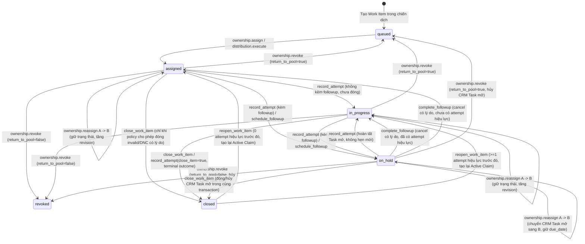
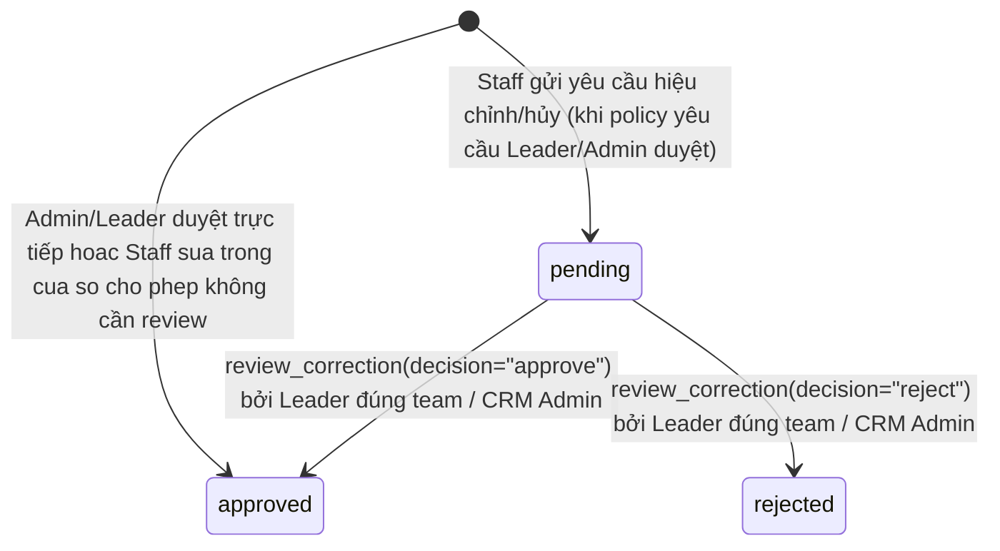

# P2 — State Machine & Lifecycle Specification

> **Dự án:** CRM-CSKH — Quản trị kho khách hàng, phân phối lead và chất lượng chăm sóc khách hàng
> **Tài liệu:** `docs/state-machine.md`
> **Phụ thuộc:** [`docs/root-plan/P2.md`](./root-plan/P2.md) (§5, §7, §8), [`docs/architecture/schema-p1.md`](./architecture/schema-p1.md), [`docs/adr/ADR-P2-01.md`](./adr/ADR-P2-01.md), [`docs/adr/ADR-P2-04.md`](./adr/ADR-P2-04.md)
> **Phạm vi:** Chu trình trạng thái chính thức của `CSKH Work Item`, `CRM Task` (callback CSKH), `CSKH Attempt Correction`, và quy tắc tách biệt với `CRM Lead.status`.

---

## 1. Tập trạng thái của `CSKH Work Item`

Trong P2, trường `CSKH Work Item.status` mở rộng từ 4 trạng thái P1 (`queued`, `assigned`, `closed`, `revoked`) lên **6 trạng thái** có ngữ nghĩa bất biến rõ ràng:

```python
OWNED_ACTIVE_WORK_ITEM_STATES = ("assigned", "in_progress", "on_hold")
ACTIVE_WORK_ITEM_STATES = ("queued", "assigned", "in_progress", "on_hold")
TERMINAL_WORK_ITEM_STATES = ("closed", "revoked")
ALL_WORK_ITEM_STATES = ("queued", "assigned", "in_progress", "on_hold", "closed", "revoked")
```

| Trạng thái | Nhãn tiếng Việt | `assigned_to` | Giữ `CSKH Active Claim` | Tính vào `capacity_limit` | `open_callback_task` | Ý nghĩa nghiệp vụ |
|---|---|---|---:|---:|---|---|
| `queued` | Chờ phân phối | `NULL` | Có | Không | `NULL` | Đã đưa vào hàng đợi chiến dịch, chưa giao cho nhân viên. |
| `assigned` | Đã giao — Chưa tác nghiệp | Bắt buộc (`Sales User`) | Có | **Có** | `NULL` | Đã giao cho nhân viên, chưa có `CSKH Contact Attempt` hiệu lực trong khoảng sở hữu hiện tại và chưa có lịch hẹn lại đang mở. |
| `in_progress` | Đang chăm sóc | Bắt buộc (`Sales User`) | Có | **Có** | `NULL` | Đã có ít nhất 1 `CSKH Contact Attempt` hiệu lực (chưa bị `void`), không có lịch hẹn lại đang mở, chưa kết thúc mục tiêu chiến dịch. |
| `on_hold` | Chờ hẹn liên hệ lại | Bắt buộc (`Sales User`) | Có | **Có** | Bắt buộc (`CRM Task` mở) | Đang có đúng **01** tác vụ hẹn chăm sóc lại (`CRM Task`) ở trạng thái mở (`Todo`/`In Progress`/`Backlog`), có `next_action_due`. |
| `closed` | Đã hoàn tất | `NULL` | Không (đã giải phóng) | Không | `NULL` (0 task mở) | Hoàn tất mục tiêu chăm sóc trong chiến dịch (`closed_at`, `closed_by`, `completion_reason` được ghi; lịch sử sở hữu đóng bằng event `close`). |
| `revoked` | Đã thu hồi | `NULL` | Không (đã giải phóng) | Không | `NULL` (0 task mở) | Bị thu hồi với `return_to_pool=False` (lịch sử sở hữu đóng bằng event `revoke`). *(Khi `return_to_pool=True`, Work Item quay về `queued` theo hợp đồng P1).* |

---

## 2. Sơ đồ chuyển trạng thái `CSKH Work Item`



---

## 3. Bảng quy tắc chuyển trạng thái chi tiết

| Từ trạng thái | Sang trạng thái | Hành động / API | Actor hợp lệ | Điều kiện tiên quyết (Preconditions) | Tác dụng phụ trong cùng Transaction |
|---|---|---|---|---|---|
| `queued` | `assigned` | `ownership.assign` / `distribution.execute` | `CSKH CRM Admin` | `campaign.status == "Active"`, `target_user` hợp lệ và còn `capacity_limit`, Lead chưa bị claim ở chiến dịch khác, Lead không bị `DNC` chặn. | Gán `assigned_to`, `assigned_at`, tạo/giữ `CSKH Active Claim`, mở `CSKH Assignment History(action="assign")`, đồng bộ `CRM Lead.lead_owner` + `DocShare` + `ToDo`, tăng `revision`. |
| `assigned` / `in_progress` | `in_progress` | `workflow.record_attempt` (không có `followup`, `close_work_item=False`) | Owner hiện tại, Leader đúng team, `CSKH CRM Admin` | `expected_revision` khớp, `channel` & `outcome_code` bật trong `CSKH Policy`, `occurred_at` hợp lệ (không tương lai, trong `allowed_backdate_minutes`, `>= active ownership_start`). | Tạo `CSKH Contact Attempt` (snapshot outcome + policy + `ownership_event`), link/tạo `CRM Call Log` nếu có dữ liệu hợp lệ, cập nhật bộ đếm hiệu lực của `Work Item`, tăng `revision`. |
| `assigned` / `in_progress` | `on_hold` | `workflow.record_attempt` (có `followup`) hoặc `workflow.schedule_followup` | Owner hiện tại, Leader đúng team, `CSKH CRM Admin` | `expected_revision` khớp, `due_at > now`, Outcome cho phép hẹn lại (`allows_followup=1`), Lead chưa bị `DNC` chặn hẹn lại. | Tạo 01 `CRM Task` (`cskh_is_followup=1`, `status="Todo"`), gán `open_callback_task`, `next_action_due = due_at`, tạo `ToDo` (`status="Open"`) cho assignee, tăng `revision`. |
| `on_hold` | `on_hold` | `workflow.schedule_followup` (reschedule) hoặc `workflow.record_attempt` (kèm `followup` mới) | Owner hiện tại, Leader đúng team, `CSKH CRM Admin` | Đang có `open_callback_task`; `due_at > now`; có `reason` khi dời lịch. | Nếu chỉ dời lịch: cập nhật `due_date` trên chính `CRM Task` đang mở, `cskh_reschedule_count += 1`, nối lịch sử vào `cskh_task_history_json`, **không tạo Task mở thứ hai**. Nếu từ `record_attempt` kèm `followup` mới: đánh dấu Task cũ `Done` gắn `cskh_completed_attempt` rồi tạo đúng 01 Task mở mới. Tăng `revision`. |
| `on_hold` | `in_progress` / `assigned` | `workflow.complete_followup` hoặc `workflow.record_attempt` (không hẹn mới) | Owner hiện tại, Leader đúng team, `CSKH CRM Admin` | **Không cho phép đóng Task suông để tính là liên hệ thành công.** Phải gắn `attempt_id` hợp lệ (`action="complete"`) hoặc hủy có `completion_reason` (`action="cancel"`). | Đóng `CRM Task` (`Done` hoặc `Canceled`), đóng `ToDo` của Task, xóa `open_callback_task = NULL`, `next_action_due = NULL`, chuyển `Work Item` về `in_progress` (nếu `attempt_count > 0`) hoặc `assigned` (nếu `attempt_count == 0`), tăng `revision`. |
| `assigned` / `in_progress` / `on_hold` | Giữ nguyên sub-state | `ownership.reassign` (`A -> B`) | `CSKH CRM Admin` | `expected_owner == A`, `target_user == B` đủ điều kiện campaign & capacity. | Đóng interval sở hữu của `A` (`ownership_end=now`), mở interval sở hữu của `B` (`action="reassign"`). Giữ nguyên `performed_by = A` trên mọi `Attempt` lịch sử. Nếu `on_hold`: chuyển `CRM Task.assigned_to` + `ToDo` từ `A` sang `B`, **giữ nguyên `due_date`** và `next_action_due`. Thu hồi mọi quyền đọc PII của `A` trên Lead/Attempt/Task/CallLog/Note/File. Tăng `revision`. |
| `assigned` / `in_progress` / `on_hold` | `queued` / `revoked` | `ownership.revoke` | `CSKH CRM Admin` | `expected_owner` khớp, có `reason`. | Nếu có `open_callback_task`: chuyển `CRM Task` sang `Canceled` kèm lý do, đóng `ToDo` của Task, xóa `open_callback_task` & `next_action_due`. Đóng interval sở hữu (`action="revoke"`, `to_user=NULL`). Xóa `assigned_to`, `CRM Lead.lead_owner`, `DocShare`, `ToDo` Lead; nếu `return_to_pool=False` xóa `CSKH Active Claim`. Tăng `revision`. |
| `assigned` / `in_progress` / `on_hold` | `closed` | `workflow.close_work_item` hoặc `workflow.record_attempt(..., close_work_item=True)` | Owner hiện tại, Leader đúng team, `CSKH CRM Admin` | Thỏa `CSKH Policy`: có ít nhất 1 attempt hiệu lực (trừ ngoại lệ invalid/duplicate/DNC khi `allow_close_without_contact_for_invalid=1`), có `completion_reason` khi outcome/policy yêu cầu, không còn `requires_followup` chưa thỏa. | Hủy/đóng mọi `CRM Task` callback mở trong **cùng transaction** (0 orphan open task); ghi `closed_at`, `closed_by`, `completion_reason`; đóng interval sở hữu (`action="close"`, `from_user=owner`, `to_user=NULL`, `ownership_end=now`); xóa `assigned_to`, `CSKH Active Claim`, `CRM Lead.lead_owner`, `DocShare`, `ToDo` Lead; tăng `revision`. |
| `closed` | `assigned` / `in_progress` | `workflow.reopen_work_item` | `CSKH CRM Admin`, hoặc Leader đúng team khi `policy.allow_leader_reopen == 1` | `campaign.status == "Active"`, có `reason`, `target_user` đủ điều kiện & còn capacity, Lead chưa có `CSKH Active Claim` khác và không bị `DNC` chặn. | Tạo lại `CSKH Active Claim`, mở interval sở hữu mới (`action="reopen"`, `to_user=target_user`, `ownership_start=now`), xóa `closed_at`/`closed_by`, ghi `reopened_at`/`reopened_by`/`reopen_reason`, đặt `status="in_progress"` nếu đã có attempt hiệu lực (ngược lại `"assigned"`), đồng bộ `lead_owner`/`DocShare`/`ToDo`, tăng `revision`. |

---

## 4. Các chuyển trạng thái bị cấm tuyệt đối (Forbidden Transitions)

1. `queued -> in_progress | on_hold | closed`: không thể ghi nhật ký liên hệ, hẹn lại hay hoàn tất khi chưa có người phụ trách (`WORK_ITEM_NOT_ACTIVE`).
2. `closed -> in_progress | on_hold | assigned` qua `record_attempt` hoặc `schedule_followup`: phải đi qua `reopen_work_item` có kiểm toán (`WORK_ITEM_NOT_ACTIVE`).
3. `revoked -> *` qua workflow: Work Item đã thu hồi dứt điểm là trạng thái kết thúc; muốn chăm sóc lại Lead phải phân phối Work Item mới qua campaign (`WORK_ITEM_NOT_ACTIVE`).
4. Đổi `CSKH Work Item.status` hoặc `CRM Task.status` trực tiếp qua `/api/resource`, `frappe.client.set_value`, hoặc Desk bởi tài khoản nghiệp vụ: bị chặn ở cả `has_permission` và controller `validate` (`FORBIDDEN`).
5. Hai callback `CRM Task` cùng mở trên 1 `CSKH Work Item`: bị chặn bởi khóa dòng `SELECT ... FOR UPDATE` trên `CSKH Work Item` và kiểm tra bất biến `max_open_followup_tasks_per_item = 1`.

---

## 5. Vòng đời của `CRM Task` làm Callback CSKH

- **Phân biệt với Task CRM thông thường:** `CRM Task` do CSKH tạo có `cskh_is_followup = 1` và `cskh_work_item = <work_item>` (lưu ý `CRM Task.name` dùng `autoincrement` trong `frappe/crm@v1.87.0`, luôn ép chuỗi `str(task.name)` khi ghi vào trường Link).
- **Trạng thái native sử dụng (`apps/crm/crm/fcrm/doctype/crm_task/crm_task.json`):**
  - `Todo` (mặc định khi tạo mới), `In Progress`, `Backlog`: đang mở (tối đa **01** bản ghi mở trên mỗi `CSKH Work Item`).
  - `Done`: đã được giải quyết bởi một `CSKH Contact Attempt` thực sự (`cskh_completed_attempt` bắt buộc khác rỗng).
  - `Canceled`: bị hủy có lý do kiểm toán (`cskh_completion_reason` bắt buộc khác rỗng) do user hủy hợp lệ, `ownership.revoke`, hoặc `close_work_item`.
- **Quy tắc chống gian lận số liệu (`P2.md` §7.2):** Đổi `CRM Task` sang `Done` **không bao giờ** tự sinh `CSKH Contact Attempt` và **không bao giờ** cộng `attempt_count` hay `connected_attempt_count`.

---

## 6. Vòng đời của `CSKH Attempt Correction`



- `CSKH Contact Attempt` gốc **không bao giờ bị `UPDATE` hoặc `DELETE`** các trường nghiệp vụ đã ghi.
- Khi một `CSKH Attempt Correction` chuyển sang `approved`:
  - `action = "correct"`: áp lớp phủ hiệu lực (`effective view`) cho các trường nằm trong allowlist (`outcome_code`, `channel`, `occurred_at` trong khoảng sở hữu của attempt gốc, `note`, `call_log`); chụp lại snapshot của `CSKH Outcome Code` tại thời điểm hiệu chỉnh.
  - `action = "void"`: đánh dấu attempt gốc không còn hiệu lực trong mẫu số `attempt_count` / `connected_attempt_count` / `last_attempt_at` / `last_outcome_code`, nhưng vẫn hiển thị trên timeline kiểm toán với nhãn đã hủy hiệu lực.
  - `action = "restore"`: chỉ dành cho `CSKH CRM Admin` để khôi phục một attempt đã bị `void` nhầm, kèm lý do kiểm toán.
  - Mọi `approved` correction tính toán lại read-model trên `CSKH Work Item` trong cùng transaction và tăng `Work Item.revision`.

---

## 7. Tách biệt với `CRM Lead.status` (ADR-P2-07)

- `CSKH Work Item.status` biểu diễn **tiến độ chăm sóc trong một chiến dịch cụ thể**.
- `CRM Lead.status` là trường phân loại phễu bán hàng chung của Frappe CRM (`New`, `Contacted`, `Nurture`, `Qualified`, `Unqualified`, `Junk`).
- **Quy tắc mặc định ở P2:** Các thao tác trên `CSKH Work Item` **không tự ý ghi đè** `CRM Lead.status` của Frappe CRM, tránh làm hỏng phễu bán hàng khi một Lead tham gia nhiều chiến dịch qua thời gian. Trạng thái từ chối liên hệ toàn cục được lưu tường minh tại `CRM Lead.cskh_do_not_contact` (kèm `cskh_dnc_reason`, `cskh_dnc_at`, `cskh_dnc_work_item`) và được bảo vệ xuyên suốt qua cả import lại lẫn phân phối chiến dịch mới.
